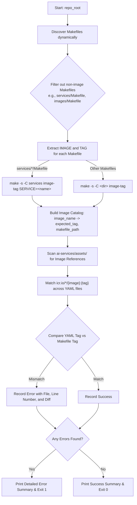

# Image Name and Version Consistency Checker Plan

## Problem Statement
We want to verify that container image tags referenced in `ai-services/assets/` application and service templates (`values.yaml`) match the current `TAG` defined in their respective `Makefile`s across the repository. If any mismatch is detected, the script should report actionable errors and exit with a non-zero status code.

Currently, [`.github/scripts/check_image_names.py`](check_image_names.py) maintains a hardcoded `COMPONENTS` mapping dictionary. This is error-prone and difficult to maintain as new images and services are onboarded.

## Solution: Dynamic Image & Tag Discovery
Eliminate the static `COMPONENTS` mapping entirely by dynamically discovering Makefiles, extracting their image names and tags, and scanning all asset templates for references.

---

## Architecture & Workflow



---

## Detailed Implementation Steps

### 1. Dynamic Makefile Discovery
* Scan the repository for all `Makefile`s using `find` or Python `pathlib.Path.rglob("Makefile")`, excluding the following directories:
  * `vendor/`, `venv/`, `.venv/`, `node_modules/`, `.git/`
* Exclude aggregator / parent Makefiles that do not define an image:
  * `services/Makefile` (parent dispatcher for individual services)
  * `images/Makefile` (parent dispatcher)
* Command equivalent:
  ```bash
  find . -type d \( -name "vendor" -o -name "venv" -o -name ".venv" -o -name "node_modules" \) -prune -o -type f -name "Makefile" -print
  ```

### 2. Extract `IMAGE` and `TAG` Values
For each discovered Makefile:
1. **Extract Image Name (`IMAGE`)**:
   * Read the file and parse variable assignment: `IMAGE\s*\??=\s*(\S+)`.
   * If `IMAGE` is not defined, skip the Makefile.
2. **Extract Resolved Tag (`TAG`)**:
   * For Makefiles in `services/<service_name>/Makefile`:
     * Execute: `make -s -C services image-tag SERVICE=<service_name>`
   * For all other Makefiles (`<dir>/Makefile`):
     * Execute: `make -s -C <dir> image-tag`
   * Fallback to in-file variable resolution if `make` execution fails.
3. **Build Image Catalog**:
   * Map `image_name` -> `{ "tag": expected_tag, "makefile": relative_makefile_path }`

### 3. Scan `ai-services/assets/` for Image References
* Scan all `.yaml` / `.yml` files in `ai-services/assets/`.
* For each image in the catalog, search for references matching:
  ```regex
  icr\.io/[^\s"']*/<image_name>:([^\s"']+)
  ```
* Command equivalent:
  ```bash
  grep -roE 'icr\.io/[^"'"'"'[:space:]]*/<image_name>:[^"'"'"'[:space:]]*' ./ai-services/assets | sort -u | awk -F: '{print $1, $2":"$3}'
  ```

### 4. Validate Tags and Report Mismatches
* Compare the tag found in each `values.yaml` reference against the expected `TAG` from the Makefile.
* **On Tag Mismatch**:
  * Log error detailing:
    * Asset file path and line number
    * Expected Makefile tag vs Actual `values.yaml` tag
    * Exact recommended fix (e.g. `icr.io/ai-services-cicd/<image>:<expected_tag>`)
* **On Match**:
  * Log validation check as successful.

### 5. CI / GitHub Workflow Integration
* The Python script [`.github/scripts/check_image_names.py`](check_image_names.py) will be executed in GitHub Actions workflows (e.g. [`.github/workflows/bump-image-version.yml`](../workflows/bump-image-version.yml)).
* **Exit Codes**:
  * `0`: All referenced image tags match their respective Makefiles.
  * `1`: One or more image tags are mismatched or missing.
