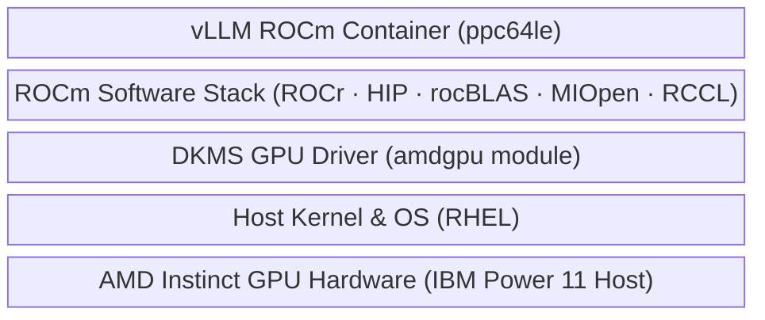

# AMD GPU (ROCm) Support in Podman Runtime

> **⚠️ Tech Preview**
> AMD GPU (ROCm) support is **tech preview only** for this release and production use is **not recommended** at this time.

## Overview

This proposal outlines the design and architectural changes required to introduce AMD GPU support (via the ROCm stack) for the Podman runtime on IBM Power (ppc64le) architecture. The goal is to enable deployment of vLLM-based LLM inference workloads on AMD Instinct GPUs.

---

## Stack Components & Sources

The following table details the distribution sources, artifact types, and hosting locations for each layer in the stack:

| Component / Layer | Artifact Type | Hosting / Distribution Source | Description |
|---|---|---|---|
| **Host Firmware** | Firmware | IBM Power Firmware ($\ge$ 1120) | Host platform firmware support |
| **Host Kernel** | Kernel Module | RHEL 10.2.z / 10.3 (`ppc64le`) | Base OS kernel supporting AMD GPU kernel modules |
| **AMD GPU Driver** | RPM Packages | [IBM DHE amdgpu Repository](https://public.dhe.ibm.com/software/server/POWER/Linux/AMD/amdgpu/RHEL/10/ppc64le/) | DKMS driver packages providing the `amdgpu` module |
| **ROCm Stack** | RPM Packages | [IBM DHE ROCm Repository](https://public.dhe.ibm.com/software/server/POWER/Linux/AMD/ROCm/RHEL/10/ppc64le/) | ROCm runtime libraries (ROCr, HIP, rocBLAS, MIOpen, RCCL) and `rocm-smi` CLI tools |
| **Python Wheels** | Python Wheels | [IBM DevPi ROCm Index](https://wheels.developerfirst.ibm.com/ppc64le/rocm/+simple/) | Pre-built `ppc64le` Python wheels (PyTorch with ROCm backend, vLLM dependencies) |
| **vLLM Container Image** | OCI Container Image | `icr.io/ai-services/vllm-rocm-ppc64le:<tag>` | IBM Container Registry (ICR) hosting the pre-built vLLM ROCm inference image for this project |

---

## Proposed Solution

### 1. Bootstrap

#### Prerequisites

The host-level stack components (firmware, kernel, AMD GPU driver, and ROCm stack) listed in the [Stack Components & Sources](#stack-components--sources) table above must be installed before bootstrap runs.

> **Note:** Automated installation of the AMD GPU DKMS driver and ROCm stack is **out of scope** for this release (Phase 2). Users must complete host-level setup before running bootstrap.

#### What Bootstrap Does

Bootstrap does **not** install host drivers or ROCm packages. It validates the host using a dedicated `ROCmRegistry` — no new user-facing flags; AMD capability is auto-detected:

- `amd-gpu`: Verifies `/dev/kfd` and `/dev/dri` exist and that `lspci -d 1002:` detects at least one compute/display class GPU (excluding AMD audio endpoints).
- `rocm-version`: Confirms `rocm-smi --version` succeeds and `rocm-smi --showid` detects available GPU devices.
- Reuses existing checks for platform architecture, RHN subscriptions, ulimits, and systemd slice limits.

---

### 2. Catalog & Worker

#### Dynamic Accelerator Configuration
- A new `acceleratorType` template parameter (`backend.acceleratorType`) is introduced to identify the accelerator in use on the host. During `ai-services catalog configure` and worker deployment, it is automatically set to `"amdgpu"` when `/dev/kfd` is detected, and defaults to `"spyre"` otherwise.
- **Template Gating:**
  - In `catalog.yaml.tmpl` and `worker.yaml.tmpl`, conditionally gate `/dev/vfio` resource requests and `/sys/kernel/iommu_groups` mounts on `acceleratorType == "spyre"`.
  - In `worker.yaml.tmpl`, mount `/sys/class/drm` read-only when `acceleratorType == "amdgpu"` to allow the worker to inspect GPU device status directly from sysfs.

#### System Info Reporting
- Extend Podman runtime system info to report AMD GPU resources under `amd.com/gpu`, enumerating display and compute class devices via PCI bus inspection (`1002:`).

#### vLLM ROCm Catalog Component
- Add a new `vllm-rocm` component under `assets/components/llm/vllm-rocm/` for the Podman provider.
- **Image Lifecycle:** The Dockerfile for the vLLM ROCm image will be hosted and maintained directly within this project repository, built for `ppc64le`, and published to IBM Container Registry (ICR).
- Key template specifications:
  - Run privileged with `hostIPC: true` and `seccompProfile: Unconfined` for ROCm memory mapping and RCCL communication.
  - Mount `/dev/kfd`, `/dev/dri`, `emptyDir` memory mount for `/dev/shm`, and host model storage (`:z`).
  - Declare pod annotation `ai-services.io/llm--amd-gpus: "{{ .Values.tensorParallelSize }}"` to drive dynamic device allocation.
  - Expose parameters for `tensorParallelSize`, `maxModelLen`, `apiKey` (rendered as a Secret), and custom environment variables.

---

### 3. Deployment Planning & Device Allocation

#### Free GPU Discovery via Worker
- The API server will not probe host hardware directly. Instead, the deployment planner will send a gRPC command (`COMMAND_TYPE_FIND_FREE_AMD_GPU_DEVICES`) to the worker pod (local or remote).
- The worker discovers free GPUs via sysfs:
  1. Inspects `/sys/class/drm/card<N>/device/vendor` and `/sys/class/drm/card<N>/device/mem_info_vram_used` for each card.
  2. Filters out non-AMD devices and sorts cards by PCI address to match KFD device enumeration order.
  3. Considers a GPU free if `mem_info_vram_used` is at or below an idle threshold (e.g., `<= 256 MiB`).
  4. Returns the corresponding ROCm device ordinals (`"0"`, `"1"`, etc.).
- > **Alternative Considered:** An alternative approach is using `rocm-smi` / `amdsmi` CLI or library calls inside the worker container requiring `/dev/kfd` and `/dev/dri` device node mounts in the worker pod.

#### Allocation & Pod Injection
- **Capacity Planning:** The planner reads `tensorParallelSize` from each `vllm-rocm` component in the deployment request and sums them to get the total number of GPUs needed (e.g. two components with `tensorParallelSize: 2` and `tensorParallelSize: 1` require 3 GPUs in total). If fewer free GPU devices are available than required, the deployment will fail.
- **Device Assignment:** Free ordinals are placed into an `AMDGPUPool`.
- **Environment Injection:** When rendering pod specifications, the deployer checks `ai-services.io/<container>--amd-gpus`, allocates ordinals from the pool, and injects them as a comma-separated `ROCR_VISIBLE_DEVICES` environment variable (e.g., `ROCR_VISIBLE_DEVICES="0,1"`).
  > **Note:** `ROCR_VISIBLE_DEVICES` also accepts `GPU-<hex_id>` UUIDs as an alternative to numeric ordinals. The hex ID can be read from `/sys/class/drm/card<N>/device/unique_id` (e.g. `GPU-c74caca7fb6f1a63`). This can be useful for explicit device pinning when ordinal ordering is uncertain.

---

## Scenarios Covered

The proposed design supports the following deployment scenarios:

### 1. Single-GPU Inference
- **Configuration:** `tensorParallelSize: 1`
- **Behavior:** Planner allocates one free GPU ordinal from the host (e.g., `ROCR_VISIBLE_DEVICES="0"`). The vLLM container runs inference on that isolated device.

### 2. Multi-GPU Tensor Parallelism (Single Host)
- **Configuration:** `tensorParallelSize: N` (e.g., 2, 4, or 8)
- **Behavior:** Planner verifies $N$ free GPUs exist and allocates $N$ ordinals (e.g., `ROCR_VISIBLE_DEVICES="0,1"`). vLLM distributes model layers across the specified GPUs using RCCL over shared memory (`/dev/shm`).

### 3. Co-located Multi-Model Deployments
- **Configuration:** Deploying multiple distinct models or application instances on a multi-GPU host.
- **Behavior:** The device pool assigns distinct, non-overlapping GPU ordinals to each container (e.g., Pod A receives `ROCR_VISIBLE_DEVICES="0"`, Pod B receives `ROCR_VISIBLE_DEVICES="1"`).

### 4. Resource Capacity Enforcement
- **Configuration:** Deployment request exceeding available idle GPUs.
- **Behavior:** The planner queries the worker over gRPC during pre-flight checks and returns an immediate planning error (e.g., `insufficient AMD GPU devices: required 4, available 2`), preventing failed partial container rollouts.

### 5. Authenticated Model Access
- **Configuration:** Deployments requiring Hugging Face / gated model credentials (`apiKey`).
- **Behavior:** An optional Secret (`vllm-secret-*.yaml.tmpl`) is rendered, injecting `VLLM_API_KEY` securely into the container environment.

---

## Out of Scope

- **OpenShift Runtime:** AMD GPU support is scoped specifically to the Podman runtime for now.
- **Multi-Node Distributed Inference:** Only single-host multi-GPU inference is covered; multi-node tensor parallelism is out of scope.
- **Automated ROCm Driver Installation:** Host-level installation of DKMS drivers and ROCm packages remains a prerequisite (will be taken up as Phase 2).
- **Alternative Inference Backends:** Workloads outside of vLLM (e.g., SGLang, llama.cpp, training/fine-tuning) are excluded.

---

## TODO

- **SMT Configuration:** Benchmark and establish optimal Power SMT tuning guidelines (comparing performance across SMT 2, 4, and 8) for AMD GPU workloads on IBM Power hosts.
- **Device Node Scoping:** Evaluate mounting only the specific allocated render nodes (e.g. `/dev/dri/renderD128`) per container instead of the full `/dev/dri` directory.
  - `ROCR_VISIBLE_DEVICES` must be re-indexed to container-local ordinals (`0`, `1`, …) since the container only sees its assigned nodes.
