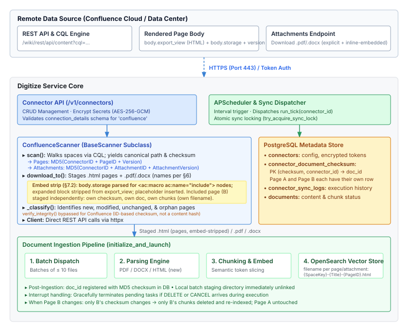
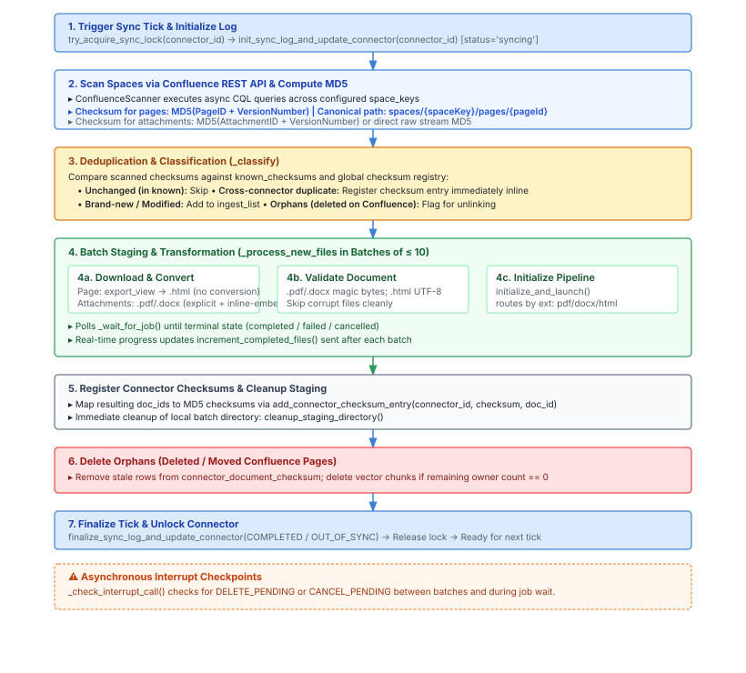
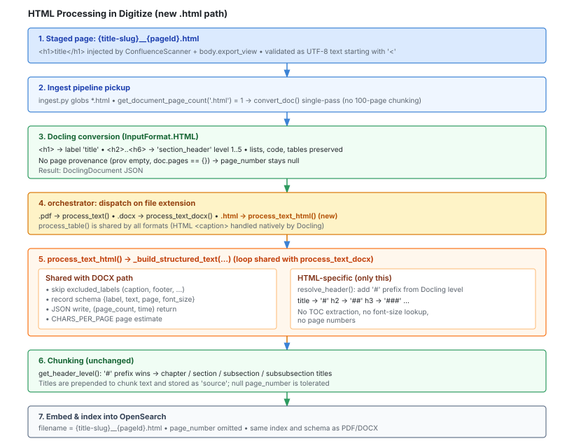

# Confluence Data Source Connector Proposal

## 1. Overview
This proposal defines the integration of **Confluence** (Cloud and Data Center / Server) as a first-class data source connector in Digitize alongside S3 (`object_storage`) and SSH/SFTP (`file_system`).

Confluence page bodies are not files: the REST API returns them as XHTML/HTML. Digitize today only ingests `.pdf` and `.docx`. This proposal therefore also introduces **HTML (`.html`) as a supported Digitize input format** (Section 8), so that pages are ingested as structured HTML rather than being rendered to PDF/DOCX first.

---

## 2. Architecture Diagram



---

## 3. Admin & Infrastructure Prerequisites

To onboard a Confluence instance, the following must be requested from the Admin/IT team:

| Category | Requirements |
| :--- | :--- |
| **Instance Info** | Base URL (`https://<domain>.atlassian.com/wiki` or self-hosted URL) and deployment type (Cloud vs. Data Center / Server). |
| **Authentication** | Dedicated service account credentials:<br>• **Cloud:** Service account email + API token.<br>• **Data Center / Server:** Personal Access Token (PAT) or Bearer token. |
| **Permissions** | Read/View permissions for target Space Keys (`space_keys`), page contents (rendered body), and attachments (`.pdf`, `.docx`). |
| **Network & TLS** | Firewall/egress allowlist from cluster pods to Confluence (port 443). Corporate CA bundle (`.pem`) if using internal self-signed TLS. |

---

## 4. Connector Schema & Configuration Fields

Stored in `connectors.connection_details` and validated at API boundaries:

| Field | S3 (`object_storage`) | SSH (`file_system`) | Confluence (`confluence`) |
| :--- | :--- | :--- | :--- |
| **Target / Host** | `endpoint_url`, `bucket_name` | `host`, `port`, `remote_path` | `url`, `space_keys` (array) |
| **Auth Credentials** | `access_key_id`, `secret_access_key` | `username`, `private_key` (PEM) | `username` (Cloud email / PAT identifier), `api_token` / `personal_access_token` |
| **Scope & Filters** | `prefix`, `allowed_extensions` | `remote_path`, `allowed_extensions` | `cql_filter` (optional), `include_attachments` (bool), `allowed_extensions` |
| **TLS & Security** | `verify_ssl` | Host key validation | `verify_ssl`, `ca_cert_path` (optional) |

### 4.1 Meaning of `allowed_extensions` for Confluence

Pages have no file extension on the remote side, so `allowed_extensions` is interpreted as follows:

| Entry | Effect |
| :--- | :--- |
| `.html` | **Enables page-body ingestion.** Each page is fetched as rendered HTML and staged as an `.html` file. |
| `.pdf`, `.docx` | Filters which **attachments** are downloaded (only when `include_attachments` is `true`). |

Recommended default for a Confluence connector: `[".html", ".pdf", ".docx"]`. Removing `.html` gives an attachments-only connector.

> `.html` is added to the set of extensions accepted by the connector API validator (Section 8.2). S3 and SSH connectors may also use it.

---

## 5. REST Client Implementation Evaluation

| Evaluation Axis | Direct REST API Calls (`httpx` / `aiohttp`) | `atlassian-python-api` Package |
| :--- | :--- | :--- |
| **Security & Supply Chain** | **Winner:** Zero / minimal dependencies, reducing vulnerability exposure and supply-chain attack surface. | **Higher risk:** Relies on third-party package release cadence and its transitive dependency tree. |
| **Code Maintenance** | **Higher burden:** Requires maintaining endpoints, query parameters, and payload schemas internally. | **Winner:** Upstream maintainers absorb Confluence API versioning, deprecations, and schema shifts. |
| **Performance (Parallelism)** | **Winner:** Native `asyncio`/`httpx` support enabling high concurrency during page listing and downloads. | **Limited:** Synchronous blocking design; requires thread/process pools to achieve concurrency. |

> **Recommendation:** Use **Direct REST API Calls via `httpx`** for native async compatibility within `sync_tick.py` and minimal dependency footprint.

---

## 6. Checksum & Deduplication Strategy

Confluence content is tracked via composite key `(checksum, connector_id)` in `connector_document_checksum`:

* **Confluence Pages:** Checksum is computed as:
  $$\text{checksum} = \text{MD5}(\text{ConnectorID} + \text{PageID} + \text{VersionNumber})$$
  Components are joined with a `:` delimiter (`"{connectorId}:{pageId}:{version}"`) so that different ID/version splits cannot collide (e.g. `12`+`3` vs `1`+`23`).
  * **Why `ConnectorID` is included:** the checksum registry is also consulted across connectors (`all_checksums` in `_classify()`): a checksum already owned by another connector is linked to the existing document and **not** ingested. `PageID` and `VersionNumber` are only unique within one Confluence instance, so without `ConnectorID` two connectors pointing at different Confluence instances (or at the same page via different connectors) could produce identical checksums, and one would silently reuse the other's document. Scoping the checksum by `ConnectorID` guarantees each Confluence connector ingests and owns its own copy of every page. Consequently, cross-connector deduplication does not apply to Confluence content.
  * Any page edit increments `VersionNumber`, producing a new MD5 and triggering automated re-ingestion. The checksum is computed from metadata returned by the scan query, so no body download is needed to detect changes.
* **Attachments:** Checksum is computed as:
  $$\text{checksum} = \text{MD5}(\text{ConnectorID} + \text{AttachmentID} + \text{AttachmentVersion})$$
  (same `:` delimiter: `"{connectorId}:{attachmentId}:{attachmentVersion}"`). It is computed from the attachment metadata returned by the scan query (`version.number`), so no byte download is needed to detect changes. `ConnectorID` is included for the same reason as for pages (see above).
  * Uploading a new version of an existing attachment increments `AttachmentVersion`, producing a new MD5 and triggering re-ingestion; the old version's chunks are removed through the normal orphan flow.
* **Canonical Path (`remote_path`):** The last path segment is the staged file name (see below), because the sync engine derives the staged file name from `Path(remote_path).name`.
  * Pages: `spaces/{spaceKey}/pages/{pageId}/{SpaceKey}-{PageTitle}-{PageID}.html`
  * Attachments: `spaces/{spaceKey}/pages/{pageId}/attachments/{attachmentId}/{PageID}-{AttachmentName}`
* **Staged file name (pages):** Pages are written to the staging folder as:

  ```
  {SpaceKey}-{PageTitle}-{PageID}.html
  ```

  e.g. `ENG-Deployment-Guide-123456.html`. The name becomes the `filename` metadata stored with each OpenSearch chunk and shown in citations, so the space key and a readable title are included rather than a bare numeric ID. Rules:
  * `SpaceKey` is used as-is (Confluence space keys are alphanumeric).
  * `PageTitle` is made filesystem-safe: runs of characters other than letters, digits and `_` are collapsed to a single `-`, leading/trailing `-` are trimmed, and the result is truncated to 80 characters. If nothing remains (e.g. an emoji-only title) the title segment is omitted: `{SpaceKey}-{PageID}.html`.
  * `PageID` is always the final segment, so names stay unique even when two pages share a title.
  * The name is only a label; identity and change detection rely on the checksum above, so a page rename (new title, same `PageID`) produces a new version/checksum and is re-ingested under the new file name while the old chunks are removed via the normal orphan flow.
* **Staged file name (attachments):** Attachments are written to the staging folder as:

  ```
  {PageID}-{AttachmentName}
  ```

  where `AttachmentName` is the attachment's original file name including its extension, e.g. `123456-architecture-overview.pdf`. Rules:
  * Confluence enforces unique attachment names within a page, so `{PageID}-{AttachmentName}` is unique across the connector, and two pages that each hold a `report.pdf` stage as `111-report.pdf` and `222-report.pdf` instead of overwriting each other in the batch directory.
  * Path separators and control characters in `AttachmentName` are replaced with `_`; the extension is preserved (and lower-cased for the `allowed_extensions` check and `validate_document_file`).
  * As with pages, the name becomes the `filename` stored with each OpenSearch chunk and shown in citations.

### 6.1 Integrity Verification

The sync engine calls `scanner.verify_integrity(local_checksum, remote_checksum)` after every download and skips the file when it returns `False`. `BaseScanner` implements it as a plain equality check, which is correct for S3 / SSH because their checksum is a hash of the file bytes.

For Confluence, the checksum is **not** a hash of the file content: it is derived from IDs (and a page version) and Confluence does not return a content hash for page bodies or attachments. A byte-level comparison would therefore always fail. Accordingly:

* **No integrity check is performed for Confluence content.** `ConfluenceScanner` overrides `verify_integrity()` to always return `True` (the same mechanism `S3Scanner` uses to bypass multi-part ETags).
* `download_to()` still returns a hex digest to satisfy the `BaseScanner` contract; its value is not compared against anything for Confluence.
* Transport-level integrity relies on TLS and on `httpx` raising on a truncated response (HTTP status / content-length errors). A failed or partial download surfaces as a download exception for that file and is handled by the existing per-batch error handling, not by checksum comparison.
* Downloaded files are still validated by `validate_document_file()` (Section 8.2, item 6), which catches empty or wrongly formatted content.

---

## 7. Ingestion Process & Sync Flow



### Step-by-Step Summary

1. **Connect (`scanner.connect()`):** Validates credentials against Confluence REST endpoint (`/wiki/rest/api/space` or `/rest/api/space`).
2. **Scan (`scanner.scan()`):** Queries pages via CQL for configured spaces. Computes $\text{MD5}(\text{ConnectorID} + \text{PageID} + \text{VersionNumber})$.
3. **Classify (`_classify()`):** Identifies new, modified, unchanged, or orphaned (deleted) pages against `connector_document_checksum`.
4. **Download & Stage (`scanner.download_to()`):**
   * **Page Content:** Fetches the rendered page body (`expand=body.export_view,version,space`) and writes a self-contained `.html` file (see 7.1), named `{SpaceKey}-{PageTitle}-{PageID}.html` (Section 6), into the batch staging folder. **No PDF/DOCX conversion is performed.** Before writing, the scanner strips any embedded ("Include Page") macro output from the rendered body (see 7.2).
   * **Attachments:** Downloads `.pdf` and `.docx` attachments directly, staged as `{PageID}-{AttachmentName}` (Section 6). This includes both explicitly uploaded attachments and files embedded inline in the page body via macros (e.g. the Confluence PDF viewer / Office connector macro). Inline-embedded files are resolved by their attachment ID, which is retrievable from the page's attachment list via the REST API — no special macro parsing of `body.storage` is required. Only `.pdf` and `.docx` are downloaded; all other attachment types (images, spreadsheets, etc.) are ignored, consistent with `allowed_extensions`.
   * **Integrity:** `verify_integrity()` is bypassed for Confluence pages and attachments (Section 6.1).
5. **Batch Ingest & Indexing:** Dispatches staged files to `initialize_and_launch()` with `OperationType.INGESTION`. Digitize routes each file by extension (`.pdf` / `.docx` / `.html`), chunks the extracted text, embeds it, and indexes the chunks into the **OpenSearch Vector Store** for downstream RAG retrieval.

### 7.1 Staged HTML Page Format

The scanner wraps the page body in a minimal document and injects the page title as `<h1>`:

```html
<!DOCTYPE html>
<html>
  <head><meta charset="utf-8"><title>{escaped title}</title></head>
  <body>
    <h1>{escaped title}</h1>
    {body.export_view}
  </body>
</html>
```

Rules:

* **Use `body.export_view` (or `body.view`), not `body.storage`.** Storage format contains `ac:` / `ri:` macro tags (info panels, code macros, expand blocks) that the HTML parser does not understand; the rendered views contain the expanded macro output as plain HTML.
* **Always inject the title as `<h1>`.** The REST body does not contain it, and the page title is the top of the chunk hierarchy (Sections 8.1 and 8.5) and a strong retrieval signal.
* Always UTF-8 encoded; the file always begins with `<!DOCTYPE html>` (used by content validation, Section 8.2).

### 7.2 Embedded ("Include Page") Macro Handling

When a Confluence page (Page A) embeds another page (Page B) via an `{include}` macro, the `body.export_view` response for Page A contains Page B's fully rendered content inline. Without intervention, Page A's staged HTML would duplicate Page B's text, causing the same content to appear in OpenSearch under two different `filename` values.

#### Strategy: strip-and-reference, ingest independently

Each included page is already a first-class scanned page with its own `PageID` and `VersionNumber`. The existing checksum formula `MD5(ConnectorID + PageID + VersionNumber)` covers it identically to any other page. No new change-detection mechanism is needed.

The scanner applies the following rule when staging Page A's HTML:

1. **Identify embeds.** Fetch `body.storage` for Page A alongside `body.export_view`. Parse `<ac:macro ac:name="include">` (and the equivalent `<ac:structured-macro ac:name="include">`) nodes to extract the target page titles / IDs. This is the only use of `body.storage`; it is not parsed for content.
2. **Strip expanded embed output.** Locate the corresponding rendered block in `body.export_view` and replace it with a lightweight comment placeholder:

```html
<!-- embedded page: {SpaceKey}-{PageTitle}-{PageID}.html -->
```

3. **Write Page A's HTML** without the embedded content. Page A's chunks carry only Page A's own text; the `filename` metadata on every OpenSearch chunk correctly attributes that content to Page A.
4. **Page B is staged and ingested independently** under its own checksum. Its OpenSearch chunks carry `filename: {SpaceKey}-{PageTitle}-{PageID}.html` (Page B's own values). When Page B changes, only Page B's `VersionNumber` increments, only its checksum changes, and only its chunks are deleted and re-indexed — Page A is untouched.

#### What this means for retrieval

A RAG query that spans content from both pages will retrieve chunks from two `filename` values (`pageA…html` and `pageB…html`). This is the correct and most attribution-accurate result: citations point to the actual source page rather than a composite that masks where the content originated. No cross-page nesting of metadata is performed.

#### Scope and limitations

* Only `ac:macro ac:name="include"` (Include Page macro) is handled. Other transcluding macros (e.g. Excerpt Include, Multiexcerpt Include) follow the same structural pattern and can be added to the strip list incrementally.
* If Page B is **not** within the configured `space_keys` it will not be scanned and therefore not indexed. In that case the placeholder comment is still inserted, but no independent file for Page B will exist in OpenSearch.
* If Page A is the only page that embeds Page B and Page B is later deleted from Confluence, the orphan-deletion flow (Step 6) removes Page B's chunks as normal; the placeholder comment in Page A's HTML remains but produces no indexed content.

---

## 8. HTML Support in Digitize

### 8.1 Why HTML (and not PDF/DOCX or Markdown)

| Option | Approach | Verdict |
| :--- | :--- | :--- |
| **A. Render page to PDF/DOCX in the connector** | Confluence's PDF export (`flyingpdf`) is not part of the documented REST API; HTML→DOCX/PDF needs extra heavy dependencies (pandoc / WeasyPrint). Header levels in the output are then re-guessed from font size or a TOC. | Rejected: lossy, fragile, extra dependencies. |
| **B. Ingest HTML directly** | Docling natively supports `InputFormat.HTML` and preserves headings, lists, code and tables as structure. | **Selected.** |
| **C. Convert HTML to Markdown first** | Same code changes as B plus an extra lossy conversion step. | Rejected: no benefit over B. |

**Embedding / OpenSearch impact.** The chunker builds `chapter_title → section_title → subsection_title → subsubsection_title` from header levels. These are stored as `source` on every chunk and prepended to the chunk text before embedding. HTML has explicit `<h1>`–`<h6>` tags, so the hierarchy is exact. With PDF the levels are inferred from font size or a fuzzy TOC match, and with converted DOCX there are usually no real Word heading styles.

### 8.2 Required Changes (Extension Plumbing)

| # | Location | Change |
| :-- | :--- | :--- |
| 1 | `parsing/converter.py` — `get_doc_converter()` | Add `InputFormat.HTML` to `allowed_formats`. No `format_options` entry is needed (defaults are used). |
| 2 | `connectors/models.py` — `validate_allowed_extensions` | Add `.html` to the `supported` set. |
| 3 | `connectors/scanners/config.py`, `scanner_factory.py` | Keep the `[".pdf", ".docx"]` defaults for S3/SSH (no behaviour change); the Confluence config defaults to `[".html", ".pdf", ".docx"]`. |
| 4 | `parsing/pdf.py` — `get_document_page_count()` | Return `1` for `.html`. This keeps `convert_doc()` on its single-pass path; Docling HTML documents have no pages, so page-range chunked conversion does not apply. |
| 5 | `pipeline/ingest.py` (~line 185) | Add `*.html` to the file globs that build `input_file_paths`. Without this, staged HTML files are silently skipped. |
| 6 | `common/misc_utils.py` — `validate_document_file()` | Add `.html` to `allowed_extensions` and a content check: there is no magic number for HTML, so require that the content decodes as UTF-8 and, after stripping a BOM and whitespace, starts with `<`. Update the "Only PDF and DOCX…" error message. This function is called by both `sync_tick.py` (staged connector files — the "Validate Document" step) and the `/v1/jobs` upload path in `api/v1/jobs.py`, so direct uploads gain `.html` support too. |
| 7 | `processing/orchestrator.py` (~line 474) | Dispatch on extension: `.docx → process_text_docx`, `.html → process_text_html`, otherwise `process_text`. |
| 8 | `processing/text.py` | New `process_text_html()` (Section 8.3). |

**No change needed:**

* `processing/tables.py` — `is_docx` only gates the DOCX-specific caption recovery. For HTML, Docling populates captions from `<caption>` natively, so the default path is correct.
* `processing/orchestrator.py` chunking — it already honours `#` prefixes on headers (`get_header_level` priority 1), and null `page` values are tolerated.
* `common/opensearch.py` — `page_number` is only written when not null (line 251), so HTML chunks simply omit it.

### 8.3 `process_text_html()` — Design

**Goal:** a separate function, keeping HTML logic isolated, that reuses as much of `process_text_docx()` as possible and adds only the HTML-specific header mapping.

`process_text_docx()` already has a loop that (a) skips `excluded_labels`, (b) resolves section-header text/levels, (c) emits the `{label, text, page, font_size}` records, and (d) writes the JSON and returns `(page_count, process_time)`. Only (b) differs between formats. So the loop is extracted into a private helper that takes a header-resolver callback:

```python
# processing/text.py

def _build_structured_text(converted_doc, src_path, out_path, resolve_header, page_count):
    """Shared by process_text_docx / process_text_html (page-less formats).

    resolve_header(text_obj, last_level) -> (header_text, new_last_level)
    """
    t0 = time.time()
    if not converted_doc.texts:
        out_path.write_text(json.dumps([], indent=2), encoding="utf-8")
        return page_count, 0.0

    out, last_level = [], 0
    for text_obj in converted_doc.texts:
        if text_obj.label in excluded_labels:
            continue
        text = text_obj.text
        label = text_obj.label
        if label in ("section_header", "title"):
            text, last_level = resolve_header(text_obj, last_level)
            label = "section_header"
        out.append({"label": label, "text": text, "page": None, "font_size": None})

    out_path.write_text(json.dumps(out, indent=2), encoding="utf-8")
    return page_count, time.time() - t0
```

* `process_text_docx()` keeps its TOC loading and passes a resolver containing its existing logic (TOC match via `get_matching_header_lvl`, else previous level + 1). This is a **behaviour-preserving refactor** and must keep the existing `test_docx_utils.py` / text-processing tests green.
* `process_text_html()` is then only the HTML resolver and a page estimate:

```python
def process_text_html(converted_doc, html_path, out_path):
    from digitize.parsing.docx import CHARS_PER_PAGE      # reuse existing constant

    def resolve(text_obj, last_level):
        # Docling: <h1> -> label "title"; <hN> (N>=2) -> section_header level N-1
        level = 1 if text_obj.label == "title" else text_obj.level + 1
        return f"{'#' * level} {text_obj.text.strip()}", level

    chars = sum(len(t.text) for t in converted_doc.texts)
    page_count = max(1, math.ceil(chars / CHARS_PER_PAGE))
    return _build_structured_text(converted_doc, html_path, out_path, resolve, page_count)
```

Reused as-is: `excluded_labels`, the output record schema, the JSON write, `CHARS_PER_PAGE`, the chunker's `#`-prefix handling, and `process_table`. HTML-specific: only the 3-line `resolve` function. No TOC extraction, no font-size lookup and no page numbers are needed.

> If the refactor of `process_text_docx()` is judged too risky for the first iteration, `process_text_html()` can initially be a standalone ~25-line function with the same shape and the helper extracted in a follow-up. The resolver logic above is unchanged either way.

### 8.4 Verified Docling Behaviour (Docling 2.133.0)

The following was verified by running Docling's HTML converter on sample pages. These are plain-HTML samples, not real Confluence output (see Section 9).

| HTML input | Docling result | Mapped to `#`-prefix |
| :--- | :--- | :--- |
| `<h1>` | item with label `title`, `level` unset | `#` (level 1) |
| `<h2>` | `section_header`, `level=1` | `##` |
| `<h3>` | `section_header`, `level=2` | `###` |
| `<h4>` / `<h6>` | `section_header`, `level=3` / `level=5` | `####` / `######` |
| `<p>`, `<li>`, `<pre>` | `text`, `list_item`, `code` | unchanged |
| `<table>` + `<caption>` | entry in `doc.tables`, caption available via `caption_text()` | handled by `process_table` |
| `` | label `caption` | skipped (`excluded_labels`) |
| Any element | no `prov` (no page numbers); `doc.pages == {}` | `page` = `None` |

**Why a dedicated function is needed:** running an HTML file through the existing `process_text_docx()` was tested. The DOCX TOC extraction fails (not a ZIP package), headers are emitted without `#` prefixes, and `get_header_level()` returns level `0` for every header. The chunker then files all headers under `subsubsection_title`, producing a flat and incorrect hierarchy in OpenSearch. The `_build_structured_text` / `process_text_html` design in Section 8.3 was prototyped against Docling 2.133.0 and, with the `resolve` mapping above, `get_header_level()` returned the correct levels (1, 2, 3, 2) for the test page and (1, 1, 4, 6) for a page with a duplicate `<h1>` and skipped heading levels. The estimated page count for both samples was 1.

### 8.5 Resulting OpenSearch Metadata for Confluence Pages

| Field | Value |
| :--- | :--- |
| `filename` | `{SpaceKey}-{PageTitle}-{PageID}.html` |
| `source` | Hierarchy built from headings: page title (chapter) → `h2` (section) → `h3` (subsection) → … |
| `type` | `text` / `table` (unchanged) |
| `page_number` | Not set (HTML has no pages) |
| Chunk text | `source` hierarchy prepended to content, as for other formats |

Citations for Confluence documents should use the page title and the Confluence URL (derivable from `pageId` and the connector `url`) rather than a page number.

### 8.6 Processing Flow for HTML



---

## 9. Testing & Open Items

**Unit tests to add**

* `process_text_html`: heading mapping (`title`, levels 1–5), exclusion of `caption` items, empty document, page estimate ≥ 1.
* `_build_structured_text` refactor: existing `process_text_docx` tests unchanged and passing.
* `get_document_page_count(".html") == 1`; `validate_document_file` accepts valid HTML, rejects empty/binary/non-`<` content; `validate_allowed_extensions` accepts `.html`.
* `ingest.py` globbing includes `.html`.
* `ConfluenceScanner`: page wrapper generation (title escaping, `<h1>` injection), `allowed_extensions` semantics (Section 4.1), checksum on `ConnectorID + PageID + VersionNumber` (the same page under two connectors yields different checksums), and staged file name generation (`{SpaceKey}-{PageTitle}-{PageID}.html`: special characters, truncation, empty/emoji-only title, duplicate titles).
* `ConfluenceScanner` attachments: checksum is `MD5(ConnectorID + AttachmentID + AttachmentVersion)` and changes when a new attachment version is uploaded; staged file name is `{PageID}-{AttachmentName}` (two pages with an identically named attachment do not collide; unsafe characters sanitised; extension preserved).
* `ConfluenceScanner.verify_integrity()` always returns `True` (Section 6.1); a truncated or failed HTTP download raises and is handled per batch.
* `ConfluenceScanner` embed handling (Section 7.2): `body.storage` parsed to detect `ac:macro ac:name="include"` nodes; expanded embed block stripped from `body.export_view`; placeholder comment inserted; included page staged independently under its own checksum and ingested as a separate document.

**Open items to validate before implementation**

1. **Real Confluence HTML.** Run Docling on actual `body.export_view` output from Cloud and Data Center for pages that use panels, expand macros, code macros, nested tables, and the table-of-contents macro. Confirm headings and tables survive, and decide whether any boilerplate (e.g. TOC macro output) should be stripped by the scanner before staging.
2. **Duplicate `<h1>`.** Docling labels every `<h1>` as `title`. A page body that contains its own `<h1>` will produce two level-1 headers (verified). The mapping handles this, but the scanner may downgrade body `<h1>` to `<h2>` if this proves noisy.
3. **Heading-level gaps.** `<h4>` directly under `<h1>` yields level 4 (`####`); the chunker accepts this, but skipped levels are not normalised.
4. **Embed-strip accuracy.** Validate that the `body.export_view` block corresponding to an Include Page macro can be reliably located and stripped via the macro node boundaries in `body.storage`. Edge cases: nested includes (Page A includes Page B which includes Page C), pages included multiple times in the same parent, and pages included but not within `space_keys`.
5. **Excerpt Include / Multiexcerpt Include.** These macros transclude only a labelled excerpt of a page rather than its full body. The strip logic should be extended to cover `ac:macro ac:name="excerpt-include"` and `ac:macro ac:name="multiexcerpt-include"`; the same independent-ingestion rule applies.

> **Images are not in scope.** The current Digitize pipeline only processes `.pdf` and `.docx`; there is no image ingestion path. Images embedded in page bodies are already excluded as `caption` labels by `excluded_labels` and require no further handling.

---

## 10. Implementation PR Plan

Each PR is scoped to a single concern and keeps diffs small and reviewable. They are sequenced so that each builds on a green main. PRs 1–5 deliver full HTML ingestion support through the Docling pipeline with no Confluence-specific code. PRs 6–9 introduce the Confluence connector on top of that foundation.

---

### Group A — Docling / HTML pipeline (no Confluence symbols)

---

### PR 1 — `validate_document_file`: accept `.html`

**Touches:** `services/common/misc_utils.py`

**Changes:**
- `validate_document_file()`: add `.html` to `allowed_extensions`; add the HTML content check (UTF-8 decode + strip BOM/whitespace + `startswith("<")`); update the "Only PDF and DOCX…" error message. No magic-byte check (there is none for HTML).

**Tests added/updated:**
- `test_doc_utils.py`: accepts a valid UTF-8 HTML string; rejects empty content; rejects binary content; rejects content that does not start with `<` after stripping; existing PDF/DOCX cases unchanged.

**Why minimal:** Single function in one file. Zero behaviour change for PDF/DOCX or any connector.

---

### PR 2 — `get_document_page_count` HTML branch + `get_doc_converter` HTML format

**Touches:** `services/digitize/parsing/pdf.py`, `services/digitize/parsing/converter.py`

**Changes:**
- `parsing/pdf.py` — `get_document_page_count()`: add `elif file_ext == '.html': return 1` before the `else` warning.
- `parsing/converter.py` — `get_doc_converter()`: add `InputFormat.HTML` to `allowed_formats`. No `format_options` entry needed (Docling defaults are correct).

**Tests added/updated:**
- `test_pdf_utils.py`: `get_document_page_count("doc.html") == 1`; existing PDF/DOCX cases unchanged.
- Integration smoke: `convert_doc` on a minimal `<!DOCTYPE html>` file returns a non-empty `DoclingDocument` without raising.

**Why minimal:** One `elif` addition in each file.

---

### PR 3 — `process_text_html` + `_build_structured_text` refactor

**Touches:** `services/digitize/processing/text.py`

**Changes:**
- Extract `_build_structured_text(converted_doc, src_path, out_path, resolve_header, page_count)` private helper from `process_text_docx()`. `process_text_docx()` is updated to call it with its existing TOC-based resolver — **behaviour-preserving refactor**.
- Add `process_text_html(converted_doc, html_path, out_path)`: HTML `resolve` callback (Docling `title` → level 1; `section_header` level `N` → `N+1`), character-based page estimate (`math.ceil(chars / CHARS_PER_PAGE)`), delegates to `_build_structured_text`.

**Tests added/updated:**
- `test_docx_utils.py`: all existing `process_text_docx` tests pass unchanged.
- New `test_html_utils.py`:
  - `process_text_html`: `<h1>` → `#`, `<h2>` → `##`, `<h3>` → `###`; `caption` label excluded; empty document → `[]`; page estimate ≥ 1.
  - `_build_structured_text`: label exclusion and JSON write via a synthetic `DoclingDocument`.

**Why minimal:** `process_text_docx` caller interface is unchanged; no other file is touched.

---

### PR 4 — Dispatch `.html` in `processing/orchestrator.py`

**Touches:** `services/digitize/processing/orchestrator.py`

**Changes:**
- `process_converted_document()` (~line 473): extend the two-branch `if/else` to a three-branch `if/elif/elif`:
  ```python
  if file_ext == '.docx':
      page_count, process_time = process_text_docx(...)
  elif file_ext == '.html':
      page_count, process_time = process_text_html(...)
  else:
      page_count, process_time = process_text(...)
  ```
- Add `process_text_html` to the import from `digitize.processing.text`.

**Tests added/updated:**
- `test_conversion_dispatcher.py`: mock a minimal `.html` converted doc; assert `process_text_html` is called; `process_text_docx` and `process_text` are not.

**Why minimal:** Two-line change to an existing dispatch block, one import update.

---

### PR 5 — `pipeline/ingest.py` HTML glob + `connectors/models.py` `.html` extension allowlist

**Touches:** `services/digitize/pipeline/ingest.py`, `services/digitize/connectors/models.py`

**Changes:**
- `pipeline/ingest.py` (~line 185): add `html_files = list(directory_path.glob("*.html"))` and include it in `input_file_paths`. Without this, staged `.html` files are silently skipped.
- `connectors/models.py` — `ConnectorCreateRequest.validate_allowed_extensions`: add `.html` to the `supported` set; update the error string. S3 and SSH connectors may now accept `.html` in their `allowed_extensions` list.

**Tests added/updated:**
- `test_connector_models_extra.py`: `validate_allowed_extensions` accepts `[".html"]` and `[".html", ".pdf", ".docx"]`; still rejects `[".csv"]`.
- `test_sync_tick.py` / `test_connector_endpoints.py`: no regressions; existing `validate_document_file` patches unaffected.

**Why minimal:** `ingest.py` change is one line; `models.py` change is one set-literal entry. Keeps the Confluence enum out until Group B.

---

### Group B — Confluence connector

---

### PR 6 — `ConnectorType.CONFLUENCE` + `ConfluenceConnectorConfig` + factory registration

**Touches:** `services/digitize/connectors/models.py`, `services/digitize/connectors/scanners/config.py`, `services/digitize/connectors/scanners/scanner_factory.py`

**Changes:**
- `connectors/models.py` — `ConnectorType`: add `CONFLUENCE = "confluence"`.
- `connectors/models.py` — `ConnectorCreateRequest.validate_type`: no change needed (driven by `ConnectorType` enum).
- `connectors/models.py` — `ConnectorCreateRequest.validate_connection_details_schema`: add `elif self.type == "confluence": ConfluenceConnectorConfig.model_validate(...)`.
- `connectors/scanners/config.py`: add `ConfluenceConnectorConfig(BaseModel)` with all fields from Section 4 (`url`, `space_keys`, `username`, `api_token` / `personal_access_token`, `cql_filter`, `include_attachments`, `allowed_extensions` defaulting to `[".html", ".pdf", ".docx"]`, `verify_ssl`, `ca_cert_path`); field validators; `from_connection_details` classmethod.
- `connectors/scanners/scanner_factory.py`: import `ConfluenceConnectorConfig` and stub `ConfluenceScanner`; add `"confluence"` to `_REGISTRY`; add `elif config_cls is ConfluenceConnectorConfig` branch.

**Tests added/updated:**
- `test_connector_scanners.py`: `ConfluenceConnectorConfig` validates correctly; rejects missing `url` and unknown fields; `allowed_extensions` defaults to `[".html", ".pdf", ".docx"]`.
- `test_connector_models_extra.py`: `POST /v1/connectors` with `type: "confluence"` and valid `connection_details` → 201; invalid fields → 422.
- `test_connector_scanners.py`: `build_scanner("confluence", ...)` returns a `ConfluenceScanner` instance (stub class, no HTTP).

**Why minimal:** `ConfluenceScanner` is a stub (`pass`). No HTTP client code. This PR only registers the type and validates the config schema.

---

### PR 7 — `ConfluenceScanner`: connect, scan, checksums, staged filenames

**Touches:** `services/digitize/connectors/scanners/confluence_scanner.py` *(new file)*

**Changes:**
- Implement `ConfluenceScanner(BaseScanner)`:
  - `connect()`: `GET /rest/api/space`; raises `ConnectorError` on 401/403.
  - `scan()`: CQL pagination (`/rest/api/content/search`); builds `RemoteFile` list; checksum = `MD5("{connectorId}:{pageId}:{version}")` for pages, `MD5("{connectorId}:{attachmentId}:{attachmentVersion}")` for attachments.
  - `_build_page_filename(space_key, title, page_id)`: filesystem-safe `{SpaceKey}-{SafeTitle}-{PageID}.html` (collapse non-alphanumeric runs to `-`, trim, truncate to 80 chars, fallback on empty sanitised title).
  - `_build_attachment_filename(page_id, attachment_name)`: `{PageID}-{SanitisedAttachmentName}`.
  - `verify_integrity()`: always returns `True` (Section 6.1).
  - `download_to()`: stub (`raise NotImplementedError`) — implemented in PR 8.
  - `close()`: closes `httpx.AsyncClient`.

**Tests added/updated:**
- `test_connector_scanners.py`:
  - `connect()` succeeds on mock 200; raises on 401/403.
  - `scan()` with paginated mock responses returns correct `RemoteFile` list with expected checksums.
  - Same page under two `connector_id` values yields different checksums (no cross-connector collision).
  - `_build_page_filename`: special characters, emoji-only title (fallback), duplicate titles (unique via `PageID`), 80-char truncation.
  - `_build_attachment_filename`: two pages with identical attachment names do not collide; unsafe characters sanitised; extension preserved.
  - `verify_integrity()` always returns `True`.

**Why minimal:** No download or body-parsing logic; `download_to` is a stub. All HTTP calls mocked.

---

### PR 8 — `ConfluenceScanner.download_to`: page HTML staging + embed stripping + attachments

**Touches:** `services/digitize/connectors/scanners/confluence_scanner.py`

**Changes:**
- Implement `download_to()` for pages:
  - Fetches `body.export_view` + `body.storage` in one request (`?expand=body.export_view,body.storage,version,space`).
  - Parses `body.storage` XML to find `<ac:macro ac:name="include">` / `<ac:structured-macro ac:name="include">` nodes; strips their expanded output from `body.export_view`; inserts `<!-- embedded page: … -->` placeholder (Section 7.2).
  - Wraps result in the HTML scaffold (Section 7.1): `<!DOCTYPE html>`, UTF-8 meta, `<h1>` title injection.
  - Writes to `dest_path`; returns hex digest of written bytes (satisfies `BaseScanner` contract; never compared for Confluence — Section 6.1).
- Implement `download_to()` for attachments:
  - Lists from `/rest/api/content/{pageId}/child/attachment`; filters by `allowed_extensions` and `include_attachments`; stages as `{PageID}-{AttachmentName}`.

**Tests added/updated:**
- `test_connector_scanners.py`:
  - Written HTML contains `<!DOCTYPE html>`, `<h1>Escaped Title</h1>`, body content.
  - Include macro output stripped; placeholder comment present; included page staged independently.
  - Edge cases: nested includes, page included multiple times, included page outside `space_keys`.
  - Attachment staging: collision-free for two pages with same-named attachments; unsafe characters sanitised; extension preserved; only `allowed_extensions` types downloaded.
  - Truncated HTTP response raises and is handled per-batch (no checksum comparison).

**Why minimal:** All changes are inside the single new `confluence_scanner.py` file.

---

### PR 9 — Encryption wiring + end-to-end `sync_tick` integration

**Touches:** `services/digitize/connectors/encryption.py`, `services/digitize/connectors/scanners/scanner_factory.py`

**Changes:**
- `connectors/encryption.py`: add `"confluence"` to the secrets map so `api_token` / `personal_access_token` are encrypted at rest and decrypted by `decrypt_secrets`.
- `connectors/scanners/scanner_factory.py`: replace the stub `ConfluenceScanner` import with the real implementation now that PRs 7–8 are merged.
- `connectors/sync_tick.py`: no structural changes expected — the existing `_classify` / `_download_batch` / orphan flow works for Confluence via `build_scanner`. Confirm `.html` files dispatched correctly (PR 5 glob is already in place).

**Tests added/updated:**
- `test_sync_tick.py`: Confluence connector fixture; full mock sync cycle (connect → scan → classify → download → ingest dispatch); assert new pages create checksum rows; modified pages re-ingest; deleted pages trigger orphan removal; HTML files reach `initialize_and_launch`.
- `test_connector_encryption.py`: `decrypt_secrets("confluence", {...})` correctly decrypts `api_token` / `personal_access_token`.

**Why minimal:** `sync_tick.py` itself is unchanged. Only secrets registration and a stub-swap in the factory.

---

### Summary Table

| PR | Group | Files changed | New files | Core concern |
|:---|:---|:---|:---|:---|
| **1** | Docling | `misc_utils.py` | — | `validate_document_file` accepts `.html` |
| **2** | Docling | `parsing/pdf.py`, `parsing/converter.py` | — | Docling `InputFormat.HTML` + page-count |
| **3** | Docling | `processing/text.py` | — | `process_text_html` + shared helper |
| **4** | Docling | `processing/orchestrator.py` | — | Dispatch `.html` → `process_text_html` |
| **5** | Docling | `pipeline/ingest.py`, `connectors/models.py` | — | HTML glob in ingest + `.html` in extension allowlist |
| **6** | Confluence | `connectors/models.py`, `scanners/config.py`, `scanner_factory.py` | — | `ConnectorType.CONFLUENCE` + config schema + factory stub |
| **7** | Confluence | — | `scanners/confluence_scanner.py` | Scanner connect / scan / checksums / filenames |
| **8** | Confluence | `scanners/confluence_scanner.py` | — | `download_to`: HTML staging + embed strip + attachments |
| **9** | Confluence | `encryption.py`, `scanner_factory.py` | — | Secrets wiring + end-to-end sync integration |
