# Database Datasource Connector — Design Proposal

## Table of Contents

1. [Executive Summary](#1-executive-summary)
2. [Background and Motivation](#2-background-and-motivation)
3. [Extensibility Model Recap](#3-extensibility-model-recap)
4. [Database Provider Design](#4-database-provider-design)
   - 4.1 [Provider Identity](#41-provider-identity)
   - 4.2 [Connection Parameters](#42-connection-parameters)
   - 4.3 [Connection Test Strategy](#43-connection-test-strategy)
   - 4.4 [Sensitive Fields](#44-sensitive-fields)
   - 4.5 [Updatable Fields](#45-updatable-fields)
5. [Asset Files](#5-asset-files)
   - 5.1 [metadata.yaml](#51-metadatayaml)
   - 5.2 [schema.json](#52-schemajson)
6. [Service Compatibility, Restricted Providers, and Lifecycle Settings](#6-service-compatibility-restricted-providers-and-lifecycle-settings)
   - 6.1 [Background and Operational Paradigms](#61-background-and-operational-paradigms)
   - 6.2 [Service Metadata Settings Specification](#62-service-metadata-settings-specification)
   - 6.3 [Service Metadata Configuration Examples](#63-service-metadata-configuration-examples)
   - 6.4 [Catalog API Server Enforcement and Validation Rules](#64-catalog-api-server-enforcement-and-validation-rules)
   - 6.5 [Filtering Available Connectors and Datasources by Service Type](#65-filtering-available-connectors-and-datasources-by-service-type)
   - 6.6 [API Models and Deploy Options Propagation](#66-api-models-and-deploy-options-propagation)
   - 6.7 [UI Guardrails and User Experience](#67-ui-guardrails-and-user-experience)

---

## 1. Executive Summary

This document describes how to add a **Database** datasource connector to the AI Services Catalog. The Database connector allows connecting to a database endpoint using standard database drivers or connectivity testing utilities.

The connector follows the **exact same extensibility pattern** already established by the `object_storage` and `file_system` providers: two asset files (`metadata.yaml` + `schema.json`) plus one new `ConnectionTester` implementation (`dbproviderTester`). No other layer of the system requires structural change.

---

## 2. Background and Motivation

### What changes vs. what stays the same

| Concern                        | Already in place — no change needed                                         |
| ------------------------------ | --------------------------------------------------------------------------- |
| `connectors` DB table          | Reused as-is (JSONB `metadata` stores the DB connection params)             |
| `service_dependencies` linking | Reused as-is; `dependency_type = 'connector'` already supports any provider |
| CRUD API routes                | Reused as-is (`POST /datasources`, `PUT`, `DELETE`, …)                      |
| Encryption at rest             | `AES-256-GCM` via `catalogutils.Encrypt` / `Decrypt` — reused as-is         |
| `ConnectorSyncJob`             | Picks up the new provider automatically via the `testers` map               |
| API response DTOs              | Reused as-is (`DatasourceResponse`, `GetDatasourceResponse`, …)             |

| Concern              | New work in this proposal                                                 |
| -------------------- | ------------------------------------------------------------------------- |
| Asset files          | `assets/connectors/datasource/<dbprovider>/metadata.yaml` + `schema.json` |
| ConnectionTester     | `databaseTester` in `datasource_service/<dbprovider>.go`                  |
| Tester registration  | One extra map entry in `NewDatasourceService` and `NewConnectorSyncJob`   |
| Provider ID constant | `DatasourceProviderDatabase = "database"` in `constants/catalog.go`       |

---

## 3. Extensibility Model Recap

The existing codebase was deliberately designed so that adding a new datasource provider requires only:

1. **Two asset files** under `assets/connectors/datasource/<provider_id>/`
2. **One `ConnectionTester` implementation** in the `datasource_service` package
3. **One map entry** in `NewDatasourceService` and `NewConnectorSyncJob`
4. **One constant** in `constants/catalog.go`

No changes are needed to:

- The `connectors` table schema or any DB migration
- The `ConnectorRepository` interface or its PostgreSQL implementation
- Any API handler, router, or request/response model
- The `ConnectorSyncJob` loop — it iterates over `j.testers[c.Provider]` dynamically
- The encryption/decryption pipeline — `SensitiveFieldsFromSchema` derives the sensitive-field set from `schema.json` at runtime

This is proven by the existing pattern: `object_storage` and `file_system` are both fully autonomous; [`constants/catalog.go`](../../ai-services/internal/pkg/catalog/constants/catalog.go) is the only shared file they both touch.

```
assets/connectors/
└── datasource/
    ├── object_storage/          ← existing
    │   ├── metadata.yaml
    │   └── schema.json
    ├── file_system/             ← existing
    │   ├── metadata.yaml
    │   └── schema.json
    └── <dbprovider>/                ← NEW (this proposal)
        ├── metadata.yaml
        └── schema.json
```

```go
// In NewDatasourceService — existing entries + one new line
testers: map[string]ConnectionTester{
    catalogconstants.DatasourceProviderObjectStorage: NewObjectStorageTester(),
    catalogconstants.DatasourceProviderFileSystem:    NewFileSystemTester(),
    catalogconstants.DatasourceProviderDbProvider:      NewDbProviderTester(), // NEW
},
```

---

## 4. Database Provider Design

### 4.1 Provider Identity

| Field            | Value                                                                           |
| ---------------- | ------------------------------------------------------------------------------- |
| `provider_id`    | `dbprovider`                                                                    |
| `connector_type` | `datasource`                                                                    |
| `digitize_type`  | `dbprovider` (value sent in the `type` field of `POST /v1/connectors` payloads) |
| Display name     | `"DB Provider"`                                                                 |
| Description      | `"Connection to a database"`                                                    |

### 4.2 Connection Parameters

The parameter set covers the minimum fields required to open and authenticate a connection to a database.

| Field      | Required | Sensitive | Updatable | Notes                                                                |
| ---------- | -------- | --------- | --------- | -------------------------------------------------------------------- |
| `host`     | Yes      | No        | No        | Hostname or IP address of the database server                        |
| `port`     | No       | No        | No        | Database port; defaults to the database standard port when absent    |
| `database` | Yes      | No        | No        | Name of the database or service schema                               |
| `username` | Yes      | No        | **Yes**   | Database user profile                                                |
| `password` | Yes      | **Yes**   | **Yes**   | Database user password. Marked `"format": "password"` in schema.json |

**Field rationale:**

- `host` + `port` + `database` — identifies the database system, instance, and named database/schema directory.
- `username` + `password` — database uses profile-based authentication. Password is the only sensitive field; `username` is updatable because database environments often rotate service accounts without changing the endpoint.

### 4.3 Connection Test Strategy

The `dbProviderTester.TestConnection` method mirrors the three-phase pattern used by [`fileSystemTester`](../../ai-services/internal/pkg/catalog/apiserver/repository/datasource_service/file_system.go) and [`objectStorageTester`](../../ai-services/internal/pkg/catalog/apiserver/repository/datasource_service/object_storage.go):

**Phase 1 — Network**: TCP dial to `host:port` with a 10-second timeout. Failure → `ConnectionCheckNetwork`.

**Phase 2 — Auth**: Open a database connection with the supplied `username` and `password`. Failure → `ConnectionCheckAuth`.

**Phase 3 — Access**: Execute a simple validation query (such as `SELECT 1` or standard ping) to confirm query access. Failure → `ConnectionCheckAccess`.

The connection check error messages should be clear and actionable:

| Phase   | Example message                                                                |
| ------- | ------------------------------------------------------------------------------ |
| Network | `TCP dial 192.168.1.10:5432 failed: connection refused`                        |
| Auth    | `Database authentication failed for user SVCACCT: check username and password` |
| Access  | `Database query test failed: connection is read-only or permission denied`     |

> **Note:** For IBM i Db2 (`ibmi-db2`), we use the [Mapepire Go SDK](https://github.com/Mapepire-IBMi/mapepire-go) for database connectivity, which requires a Mapepire server running on the target IBM i system as a prerequisite. Mapepire is used exclusively for IBM i Db2; all other database providers rely on standard Go SQL driver packages (`database/sql`).

### 4.4 Sensitive Fields

Exactly one field is sensitive: **`password`**. It carries `"format": "password"` in `schema.json`. The `catalogutils.SensitiveFieldsFromSchema` utility (used by both `DatasourceService` and `ConnectorSyncJob`) will automatically identify it at runtime — no hardcoded list is required.

```go
// catalogutils.SensitiveFieldsFromSchema returns: map[string]bool{"password": true}
// for the dbprovider schema.json
```

Encryption at rest is handled by the existing `AES-256-GCM` pipeline in `catalogutils.Encrypt` / `Decrypt`. The `password` field will be encrypted before storage in the `connectors.metadata` JSONB column and decrypted in-memory only when needed by `TestConnection` or Digitize propagation calls. It is never returned in any API response.

### 4.5 Updatable Fields

Fields whose `"ui:section"` is `"Authentication"` in `schema.json` are updatable after creation:

| Field      | Updatable | Rationale                                                             |
| ---------- | --------- | --------------------------------------------------------------------- |
| `username` | **Yes**   | Database administrators rotate service accounts; endpoint stays same  |
| `password` | **Yes**   | Credential rotation without touching the DB endpoint or schema config |

All other fields (`host`, `port`, `database`) are structural and immutable after creation. The `catalogutils.UpdatableFieldsFromSchema` utility reads `ui:section: "Authentication"` from `schema.json` to derive the updatable set at runtime.

---

## 5. Asset Files

### 5.1 `metadata.yaml`

**Path:** `ai-services/assets/connectors/datasource/<dbprovider>/metadata.yaml`

```yaml
# Connector identification
type: connector
id: <dbprovider>
name: "<DB Provider>"
description: "Connection to a database"

# Connector type this provider belongs to
connector_type: datasource
connector_name: "Data sources"
```

This file is loaded at startup by `CatalogProvider.loadEmbeddedItems` and returned verbatim by `GET /api/v1/connectors?type=datasource` as part of the [`ConnectorResponse`](../../ai-services/internal/pkg/catalog/types/types.go) shape. No code changes are needed in `catalog.go` — the directory scanner discovers new connector providers automatically.

### 5.2 `schema.json`

**Path:** `ai-services/assets/connectors/datasource/<dbprovider>/schema.json`

```json
{
  "$schema": "http://json-schema.org/draft-07/schema#",
  "type": "object",
  "additionalProperties": false,
  "required": ["host", "database", "username", "password"],
  "properties": {
    "host": {
      "type": "string",
      "title": "Hostname or IP address",
      "description": "Hostname or IP address of the database server.",
      "minLength": 1,
      "ui:section": "Location"
    },
    "port": {
      "type": "string",
      "title": "Port (optional)",
      "description": "Database port number.",
      "ui:section": "Location"
    },
    "database": {
      "type": "string",
      "title": "Database name",
      "description": "Name of the database or service schema.",
      "minLength": 1,
      "ui:section": "Location"
    },
    "username": {
      "type": "string",
      "title": "Username",
      "description": "Database username used to authenticate.",
      "minLength": 1,
      "ui:section": "Authentication"
    },
    "password": {
      "type": "string",
      "title": "Password",
      "description": "Database password.",
      "format": "password",
      "minLength": 1,
      "ui:section": "Authentication"
    }
  }
}
```

**Key schema decisions:**

- `"format": "password"` on `password` — consumed by `catalogutils.SensitiveFieldsFromSchema` to derive the encryption set at runtime.
- `"ui:section": "Authentication"` on `username` and `password` — consumed by `catalogutils.UpdatableFieldsFromSchema` to derive the updatable fields at runtime.
- `"ui:section": "Location"` on all structural fields — ensures they are excluded from the updatable set without any hardcoded allowlist.
- `port` is `"type": "string"` rather than integer, matching the `file_system` schema pattern (port is also a string there) so that the validator and UI can handle the optional-with-default pattern uniformly.

---

## 6. Service Compatibility, Restricted Providers, and Lifecycle Settings

### 6.1 Background and Operational Paradigms

With the introduction of non-file-based datasource connectors (like databases), AI services exhibit different operational dependencies and compatibility constraints regarding datasources:

1. **Provider Compatibility Restrictions:**
   - Certain services only support specific datasource types. For example, `digitize` currently processes file-based content and therefore only supports `file_system` and `object_storage` datasources, whereas relational database services (e.g., Text-to-SQL / Database Query) require database connectors (`ibmi-db2`, `postgresql`).
2. **Mandatory vs. Optional Datasource Requirement at Creation:**
   - **Optional / Dynamically Bound Services (e.g., Digitize):** Can deploy and run without a datasource at creation time.
   - **Mandatory / Tightly Coupled Services (e.g., Database Query):** **Require a datasource always**; they cannot initialize or function without one and **must not be created without a datasource**.
3. **Post-Creation Lifecycle Constraints (Connect / Disconnect):**
   - **Post-creation connection:** For services where the datasource topology is fixed at provision time (or single-tenant bound), dynamically connecting additional datasources post-creation must be disabled.
   - **Post-creation disconnection:** Disconnecting or deleting the active datasource dependency would break the running service instance and must be disabled.

---

### 6.2 Service Metadata Settings Specification (`datasource` block)

To provide clean namespacing and avoid polluting the root metadata with multiple flat keys, all datasource capabilities, provider restrictions, and lifecycle settings are grouped under a dedicated `datasource` configuration block in `metadata.yaml`:

```yaml
datasource:
  required: <boolean>            # Default: false
  allow_connect: <boolean>       # Default: true (post-creation connect)
  allow_disconnect: <boolean>    # Default: true if required=false, false if required=true
  supported_providers: <list>    # Default: [] (all supported)
```

#### Settings Reference

| Setting | Type | Default | Description |
| ------- | ---- | ------- | ----------- |
| `datasource` | `object` | `nil` (omitted) | If present, indicates the service supports datasources. If omitted, the service does not accept datasources. |
| `datasource.required` | `boolean` | `false` | When `true`, the service **cannot be created without a datasource**. At least one valid datasource connector must be specified during application creation. |
| `datasource.allow_connect` | `boolean` | `true` | When `false`, disables connecting/attaching datasources post-application creation. Connect UI actions and API endpoints are blocked. |
| `datasource.allow_disconnect` | `boolean` | `true` (if `required: false`)<br/>`false` (if `required: true`) | When `false`, disables disconnecting/detaching datasources post-application creation. Disconnect UI actions and API endpoints are blocked. |
| `datasource.supported_providers` | `list[string]` | `[]` (all supported) | Whitelist of compatible datasource provider IDs (e.g., `[file_system, object_storage]` or `[ibmi-db2, postgresql]`). If omitted or empty, all providers are supported by default. |

#### Lifecycle and Compatibility Matrix

| Service Type | `datasource` present? | `required` | `allow_connect` | `allow_disconnect` | `supported_providers` | UI & API Lifecycle Behavior |
| ------------ | :-------------------: | :--------: | :-------------: | :----------------: | :-------------------: | --------------------------- |
| **Mandatory DB Service (e.g., DB Query)** | `Yes` | `true` | `false` | `false` | `[ibmi-db2, postgresql]` | Required at creation (filtered to DBs). "Connect Data Source" and "Disconnect" disabled post-creation. |
| **Dynamic File Service (Digitize)** | `Yes` | `false` | `true` | `true` | `[file_system, object_storage]` | Optional at creation. Connect and disconnect available post-creation (filtered to file providers). |
| **Static Fixed Service** | `Yes` | `false` | `false` | `false` | `[...]` | Optional at creation. If configured at creation, locked against post-creation changes. |
| **Non-Datasource Service (Chat)** | `No` (omitted) | — | — | — | — | No datasource capabilities. All datasource UI options and API routes blocked. |

---

### 6.3 Service Metadata Configuration Examples

#### Example 1: Database-Centric Service Requiring a Datasource (`metadata.yaml`)

```yaml
# ai-services/assets/services/db-query/metadata.yaml
id: db-query
name: "Database Query Service"
description: "Natural language querying and analytics over relational databases."
type: service

# Grouped Datasource Configuration
datasource:
  required: true
  allow_connect: false
  allow_disconnect: false
  supported_providers:
    - ibmi-db2
    - postgresql
```

#### Example 2: Document Processing Service with Optional Dynamic Datasources (`metadata.yaml`)

```yaml
# ai-services/assets/services/digitize/metadata.yaml
id: digitize
name: "Digitize documents"
type: service

# Grouped Datasource Configuration
datasource:
  required: false
  allow_connect: true
  allow_disconnect: true
  supported_providers:
    - file_system
    - object_storage
```

---

### 6.4 Catalog API Server Enforcement and Validation Rules

The Catalog API Server enforces compatibility and lifecycle settings at every API boundary:

```mermaid
flowchart TD
    subgraph AppCreation ["Application Creation: POST /api/v1/applications"]
        A["Incoming Create App Request"] --> B{"Service has<br/>datasource.required == true?"}
        B -- Yes --> C{"Datasource connector<br/>provided in payload?"}
        C -- No --> D["Reject 400 Bad Request:<br/>Datasource required for service"]
        C -- Yes --> E{"Provider in<br/>supported_providers?"}
        E -- No --> F["Reject 400 Bad Request:<br/>Unsupported datasource provider"]
        E -- Yes --> G["Proceed with Deployment"]
        B -- No --> H{"Datasource connector<br/>provided?"}
        H -- Yes --> E
        H -- No --> G
    end

    subgraph PostCreationConnect ["Post-Creation Connect: PUT /api/v1/applications/:id/datasources/:datasource_id"]
        I["Incoming Connect Request"] --> J{"Service has<br/>datasource == nil?"}
        J -- Yes --> K["Reject 422 Unprocessable Entity:<br/>Service does not accept datasources"]
        J -- No --> L{"Service has<br/>datasource.allow_connect == false?"}
        L -- Yes --> M["Reject 422 Unprocessable Entity:<br/>Post-creation connect disabled"]
        L -- No --> N{"Provider in<br/>supported_providers?"}
        N -- No --> O["Reject 400 Bad Request:<br/>Unsupported datasource provider"]
        N -- Yes --> P["Attach Datasource & Propagate"]
    end

    subgraph PostCreationDisconnect ["Post-Creation Disconnect: DELETE /api/v1/applications/:id/datasources/:datasource_id"]
        Q["Incoming Disconnect Request"] --> R{"Linked service has<br/>datasource.allow_disconnect == false?"}
        R -- Yes --> S["Reject 422 Unprocessable Entity:<br/>Datasource disconnection disabled"]
        R -- No --> T["Proceed with Disconnect & Cleanup"]
    end
```



#### 1. Application Creation Validation (`POST /api/v1/applications`)

- **Mandatory Datasource Check:** If a service declares `datasource.required: true`, the handler validates that `connectors` contains at least one valid datasource reference targeting that service. If absent, the request is rejected with `400 Bad Request`:
  ```json
  {
    "error": "Service 'db-query' requires a datasource connector at creation time, but none was provided."
  }
  ```
- **Provider Compatibility Check:** For any supplied datasource reference, the provider type is validated against `datasource.supported_providers`. If unsupported, the request is rejected with `400 Bad Request`:
  ```json
  {
    "error": "Service 'digitize' does not support 'ibmi-db2' datasources. Supported types: [file_system, object_storage]"
  }
  ```

#### 2. Post-Creation Connect Validation (`PUT /api/v1/applications/:id/datasources/:datasource_id`)

- **Accepts Datasource Check:** If `datasource` is `nil` (or service does not accept datasources), return `422 Unprocessable Entity`.
- **Connect Allowed Check:** If `datasource.allow_connect` is `false`, reject with `422 Unprocessable Entity`:
  ```json
  {
    "error": "Service 'db-query' does not permit connecting datasources post-creation."
  }
  ```
- **Provider Compatibility Check:** If the datasource provider is not in `datasource.supported_providers`, reject with `400 Bad Request`.

#### 3. Post-Creation Disconnect Validation (`DELETE /api/v1/applications/:id/datasources/:datasource_id`)

- The handler inspects all services linked to the target datasource in the application.
- If any linked service has `datasource.allow_disconnect: false`, deletion is blocked with `422 Unprocessable Entity`:
  ```json
  {
    "error": "Cannot disconnect datasource 'ds-123': service 'db-query' requires a permanent datasource and does not permit disconnection."
  }
  ```

---

### 6.5 Filtering Available Connectors and Datasources by Service Type

To ensure a seamless user experience across creation and attachment workflows, the catalog supports filtering connector templates and registered datasource instances by service type.

#### API Query Parameter

An optional `service_type` query parameter is supported on both listing endpoints:

1. **Connectors Listing Endpoint** (filtering templates when creating a _new_ datasource):
   `GET /api/v1/connectors?type=datasource&service_type=<service_id>`
2. **Datasources Listing Endpoint** (filtering active instances when attaching an _existing_ datasource):
   `GET /api/v1/datasources?service_type=<service_id>`

#### Server-side Filtering Logic

When `service_type` is provided:

1. **Retrieve Service Metadata:** Load `metadata.yaml` for the specified service.
2. **Filter Results:**
   - If `datasource` is `nil`, return an empty list `[]`.
   - If `datasource` is configured and `supported_providers` is non-empty (e.g., `["file_system", "object_storage"]`), return only records whose provider matches an entry in `supported_providers`.
   - If `supported_providers` is omitted or empty, return all records (all providers permitted).

---

### 6.6 API Models and Deploy Options Propagation

To allow frontend UI components and API clients to dynamically adapt their forms and action buttons, these settings are exposed in catalog API responses.

#### Service Catalog Go Struct Updates (`ai-services/internal/pkg/catalog/types/types.go`)

```go
// DatasourceConfig defines datasource requirements, provider constraints, and lifecycle policies.
type DatasourceConfig struct {
    Required           bool     `yaml:"required,omitempty" json:"required,omitempty"`
    AllowConnect       *bool    `yaml:"allow_connect,omitempty" json:"allow_connect,omitempty"`
    AllowDisconnect    *bool    `yaml:"allow_disconnect,omitempty" json:"allow_disconnect,omitempty"`
    SupportedProviders []string `yaml:"supported_providers,omitempty" json:"supported_providers,omitempty"`
}

// Service represents a deployable AI service catalog definition.
type Service struct {
    ID          string            `yaml:"id" json:"id"`
    Name        string            `yaml:"name" json:"name"`
    Description string            `yaml:"description" json:"description"`
    Type        string            `yaml:"type" json:"type"`
    Datasource  *DatasourceConfig `yaml:"datasource,omitempty" json:"datasource,omitempty"`
    // ...
}

// DeployOptionsDatasource surfaces datasource capabilities to deployment workflows.
type DeployOptionsDatasource struct {
    Required           bool     `json:"required"`
    AllowConnect       bool     `json:"allow_connect"`
    AllowDisconnect    bool     `json:"allow_disconnect"`
    SupportedProviders []string `json:"supported_providers,omitempty"`
}

// DeployOptionsService surfaces service configuration and constraints to deployment workflows.
type DeployOptionsService struct {
    ID         string                   `json:"id"`
    Name       string                   `json:"name"`
    Version    string                   `json:"version,omitempty"`
    Components []DeployOptionsComponent `json:"components"`
    Datasource *DeployOptionsDatasource `json:"datasource,omitempty"`
}
```

---

### 6.7 UI Guardrails and User Experience

Surfacing the `datasource` configuration in `GET /api/v1/services/{id}/deploy-options` enables consistent, intuitive guardrails across UI workflows:

1. **Application Creation Wizard:**
   - When `datasource.required` is `true`, the UI marks the datasource selection step as **Required** (displaying a required indicator and validation message).
   - The "Deploy / Create Application" button remains disabled until a valid datasource is selected.
   - The datasource picker dropdown automatically queries `GET /api/v1/datasources?service_type=<service_id>` to show only compatible datasource instances.
2. **Application Details Page — Connect Action:**
   - If `datasource.allow_connect` is `false`, the **"Connect Data Source"** button/menu item is hidden or disabled with a tooltip:
     > _"This service requires datasource configuration during creation and does not support connecting datasources post-deployment."_
3. **Application Details Page — Disconnect Action:**
   - If `datasource.allow_disconnect` is `false`, the **"Disconnect"** option on the attached datasource card/row is disabled with a tooltip:
     > _"This datasource cannot be disconnected because the service requires an active datasource to function."_
