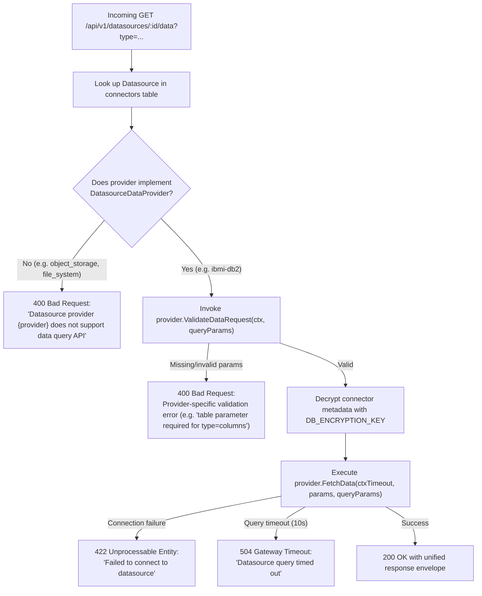
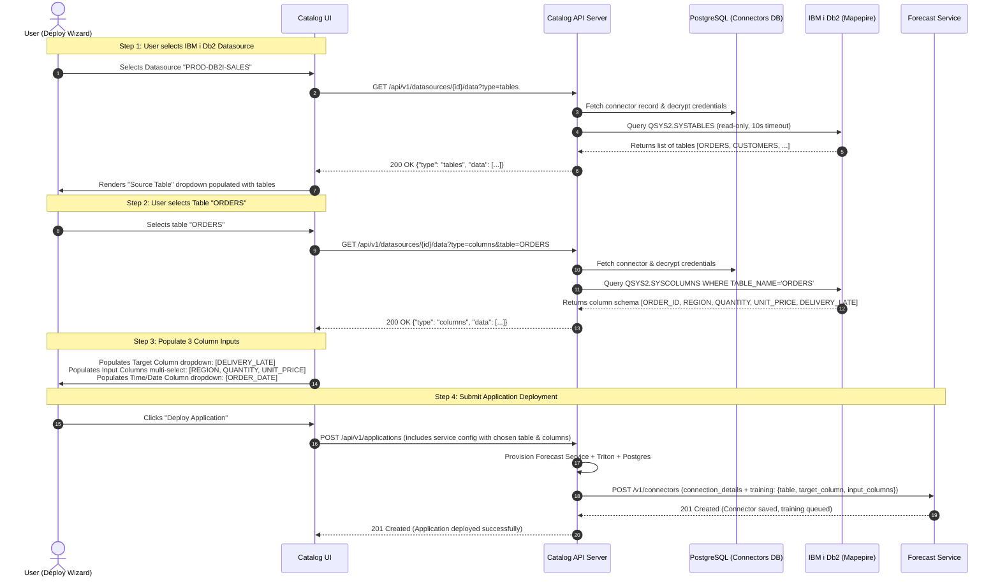
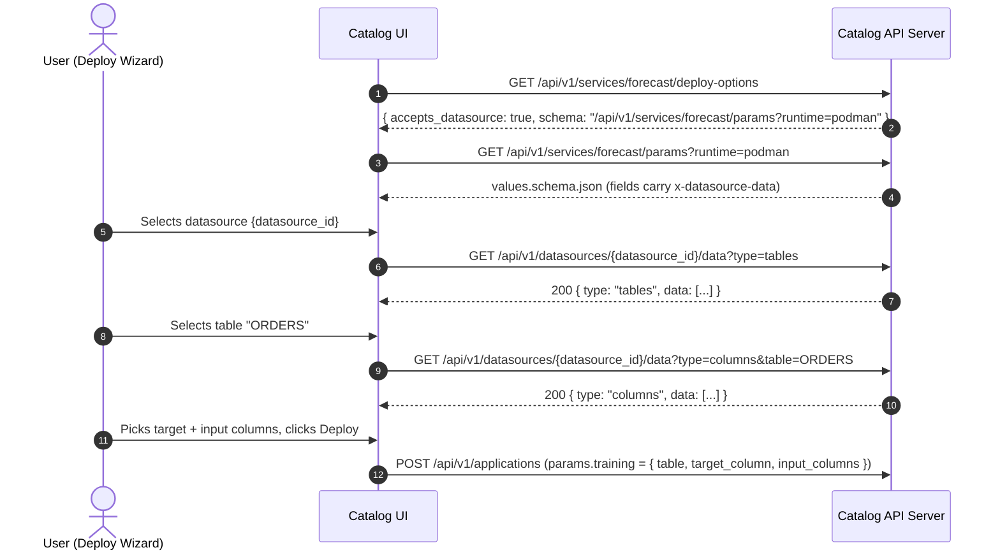

# Forecast Service Datasource Data API — Proposal & Design

## Table of Contents

1. [Executive Summary](#1-executive-summary)
2. [Generic Datasource Data API Specification](#2-generic-datasource-data-api-specification)
   - 2.1 [Endpoint Definition](#21-endpoint-definition)
   - 2.2 [Generic Request Parameters Model](#22-generic-request-parameters-model)
   - 2.3 [Optional Provider Capability & Validation Flow](#23-optional-provider-capability--validation-flow)
   - 2.4 [Unified Response Envelope](#24-unified-response-envelope)
3. [Provider-Specific Implementations](#3-provider-specific-implementations)
   - 3.1 [IBM i Db2 Provider (`ibmi-db2`) — Supported Queries](#31-ibm-i-db2-provider-ibmi-db2--supported-queries)
   - 3.2 [Unsupported Datasource Providers (`object_storage`, `file_system`)](#32-unsupported-datasource-providers-object_storage-file_system)
4. [Catalog Backend Interface & Implementation](#4-catalog-backend-interface--implementation)
   - 4.1 [`DatasourceDataProvider` Interface](#41-datasourcedataprovider-interface)
   - 4.2 [Datasource Service Dispatch & Decryption Flow](#42-datasource-service-dispatch--decryption-flow)
   - 4.3 [IBM i Db2 Mapepire Driver Integration](#43-ibm-i-db2-mapepire-driver-integration)
5. [Deployment Interaction Flow](#5-deployment-interaction-flow)
   - 5.1 [End-to-End Sequence Diagram](#51-end-to-end-sequence-diagram)
6. [Security, Performance & Error Handling](#6-security-performance--error-handling)
   - 6.1 [Credential Isolation & Zero-Leakage](#61-credential-isolation--zero-leakage)
   - 6.2 [Read-Only Query Safety & Timeouts](#62-read-only-query-safety--timeouts)
   - 6.3 [Standardized Error Codes](#63-standardized-error-codes)
7. [Deploy Options: Declaring Datasource Data API Calls for Service Params](#7-deploy-options-declaring-datasource-data-api-calls-for-service-params)
   - 7.1 [Approach](#71-approach)
   - 7.2 [`x-datasource-data` Schema Extension](#72-x-datasource-data-schema-extension)
   - 7.3 [Forecast Mapping](#73-forecast-mapping)
   - 7.4 [UI Behaviour](#74-ui-behaviour)
   - 7.5 [Backend Impact & Scope](#75-backend-impact--scope)

---

## 1. Executive Summary

When deploying the **Forecast Service** via the AI Services Catalog, users configure automated machine learning training against an external database (**IBM DB2 for i**). During deployment configuration, the UI needs to dynamically fetch and present available tables from the chosen database datasource, and upon table selection, fetch the available columns to populate the 3 column inputs required by Forecast (`target_column`, `input_columns`, and optional date/time column).

This proposal designs a **generic Datasource Data API**:

```http
GET /api/v1/datasources/{id}/data
```

### Key Design Highlights:

- **Generic & Extensible:** The API accepts arbitrary query parameters (passed as key-value pairs) so that each datasource provider defines and validates its own parameter schema.
- **Optional Provider Capability:** The data API is an optional capability. Datasource providers that do not support data exploration (such as `object_storage` and `file_system` in the current phase) explicitly return a standardized error indicating that the API is not supported for that provider.
- **Provider-Level Validation:** The core API server routes requests generically; the specific datasource provider validates the supplied parameters and executes the retrieval.
- **Secure Server-Side Execution:** The running Catalog API Server (`ai-services` backend) decrypts credentials in memory, connects to the target database in a strict read-only session with a 10-second timeout, and returns metadata without ever exposing credentials to the client.

---

## 2. Generic Datasource Data API Specification

### 2.1 Endpoint Definition

```http
GET /api/v1/datasources/{id}/data
```

- **Authentication:** Bearer JWT token required (`Authorization: Bearer <token>`).
- **Path Parameter:** `id` (UUID, required) — ID of the datasource connector.
- **Produces:** `application/json`

### 2.2 Generic Request Parameters Model

All request parameters are passed as query parameters. The API accepts any query parameter key-value pair and passes them directly to the provider.

| Query Parameter | Type     | Required               | Description                                                                                          |
| :-------------- | :------- | :--------------------- | :--------------------------------------------------------------------------------------------------- |
| `type`          | `string` | **Yes**                | Generic discriminator indicating the kind of data/metadata requested (e.g. `tables`, `columns`).     |
| `*` (dynamic)   | `string` | Optional / Conditional | Provider-specific parameters (e.g. `table`, `schema`, `filter`, `limit`). Validated by the provider. |

### 2.3 Optional Provider Capability & Validation Flow



### 2.4 Unified Response Envelope

All successful responses share a standard response envelope:

```json
{
  "datasource_id": "7c9e6679-7425-40de-944b-e07fc1f90ae7",
  "provider": "ibmi-db2",
  "type": "tables",
  "metadata": {
    "schema": "PRODDB",
    "total": 3
  },
  "data": [ ... ]
}
```

---

## 3. Provider-Specific Implementations

### 3.1 IBM i Db2 Provider (`ibmi-db2`) — Supported Queries

The `ibmi-db2` provider implements data exploration for relational database objects.

#### 1. Listing Tables (`type=tables`)

**Request:**

```http
GET /api/v1/datasources/7c9e6679-7425-40de-944b-e07fc1f90ae7/data?type=tables
```

**Parameters Validated by `ibmi-db2`:**

- `type=tables` (required)
- `schema` (optional): IBM i schema / library name (defaults to database configured in datasource).
- `filter` (optional): Substring filter on table name.

**Response (`200 OK`):**

```json
{
  "datasource_id": "7c9e6679-7425-40de-944b-e07fc1f90ae7",
  "provider": "ibmi-db2",
  "type": "tables",
  "metadata": {
    "schema": "PRODDB",
    "total": 3
  },
  "data": [
    {
      "name": "ORDERS",
      "schema": "PRODDB",
      "type": "TABLE",
      "row_count": 250000,
      "description": "Customer sales and order master table"
    },
    {
      "name": "CUSTOMERS",
      "schema": "PRODDB",
      "type": "TABLE",
      "row_count": 45000,
      "description": "Customer profile master"
    },
    {
      "name": "INVENTORY",
      "schema": "PRODDB",
      "type": "TABLE",
      "row_count": 12000,
      "description": "Warehouse stock inventory"
    }
  ]
}
```

---

#### 2. Listing Columns for a Table (`type=columns`)

**Request:**

```http
GET /api/v1/datasources/7c9e6679-7425-40de-944b-e07fc1f90ae7/data?type=columns&table=ORDERS
```

**Parameters Validated by `ibmi-db2`:**

- `type=columns` (required)
- `table` (**required**): Table name to inspect. Missing `table` returns `400 Bad Request`.
- `schema` (optional): Schema / library name.

**Response (`200 OK`):**

```json
{
  "datasource_id": "7c9e6679-7425-40de-944b-e07fc1f90ae7",
  "provider": "ibmi-db2",
  "type": "columns",
  "metadata": {
    "table": "ORDERS",
    "schema": "PRODDB",
    "total": 5
  },
  "data": [
    {
      "name": "ORDER_ID",
      "data_type": "BIGINT",
      "nullable": false,
      "is_primary_key": true,
      "description": "Unique order ID"
    },
    {
      "name": "REGION",
      "data_type": "VARCHAR(50)",
      "nullable": false,
      "is_primary_key": false,
      "description": "Sales region code"
    },
    {
      "name": "QUANTITY",
      "data_type": "INTEGER",
      "nullable": false,
      "is_primary_key": false,
      "description": "Item order count"
    },
    {
      "name": "UNIT_PRICE",
      "data_type": "DECIMAL(10,2)",
      "nullable": false,
      "is_primary_key": false,
      "description": "Unit item price"
    },
    {
      "name": "DELIVERY_LATE",
      "data_type": "CHAR(1)",
      "nullable": false,
      "is_primary_key": false,
      "description": "Target indicator: Y (late) or N (on-time)"
    }
  ]
}
```

---

### 3.2 Unsupported Datasource Providers (`object_storage`, `file_system`)

For datasource providers that do not implement the `DatasourceDataProvider` capability (currently `object_storage` and `file_system`), the API returns `400 Bad Request`.

**Request:**

```http
GET /api/v1/datasources/3f5a1122-8899-4cde-a1b2-c3d4e5f6a7b8/data?type=files
```

**Response (`400 Bad Request`):**

```json
{
  "error": "Datasource provider 'object_storage' does not support the data query API"
}
```

---

## 4. Catalog Backend Interface & Implementation

### 4.1 `DatasourceDataProvider` Interface

Defined in `internal/pkg/catalog/apiserver/repository/datasource_service/interface.go`:

```go
package datasourceservice

import (
	"context"
)

// DataResult wraps the retrieved data payload and optional metadata.
type DataResult struct {
	Metadata map[string]any `json:"metadata,omitempty"`
	Data     any            `json:"data"`
}

// DatasourceDataProvider is an optional interface implemented by datasource providers
// that support live data or schema querying.
type DatasourceDataProvider interface {
	// ValidateDataRequest performs provider-level validation for query parameters.
	// Returns a *ValidationError (e.g. 400 Bad Request) if parameters are missing or invalid.
	ValidateDataRequest(ctx context.Context, queryParams map[string]string) error

	// FetchData executes the query against the datasource using decrypted connection params.
	FetchData(ctx context.Context, params map[string]any, queryParams map[string]string) (*DataResult, error)
}
```

### 4.2 Datasource Service Dispatch & Decryption Flow

In `internal/pkg/catalog/apiserver/repository/datasource_service/datasource_service.go`:

```go
// GetDatasourceData executes generic data queries for supported datasource providers.
func (s *DatasourceService) GetDatasourceData(
	ctx context.Context,
	datasourceID uuid.UUID,
	queryParams map[string]string,
) (*apimodels.DatasourceDataResponse, error) {
	// 1. Fetch connector record from DB
	conn, err := s.connectorRepo.GetByID(ctx, datasourceID)
	if err != nil || conn == nil {
		return nil, &ValidationError{Code: http.StatusNotFound, Message: "Datasource not found"}
	}

	// 2. Check if provider supports the optional DatasourceDataProvider interface
	dataProvider, ok := s.dataProviders[conn.Provider]
	if !ok || dataProvider == nil {
		return nil, &ValidationError{
			Code:    http.StatusBadRequest,
			Message: fmt.Sprintf("Datasource provider %q does not support the data query API", conn.Provider),
		}
	}

	// 3. Provider-level query parameter validation
	if err := dataProvider.ValidateDataRequest(ctx, queryParams); err != nil {
		return nil, err
	}

	// 4. Decrypt sensitive credentials in memory
	decryptedParams, err := catalogutils.DecryptMetadata(conn.Metadata, s.encryptionKey)
	if err != nil {
		return nil, fmt.Errorf("failed to decrypt connection metadata: %w", err)
	}

	// 5. Execute query with strict 10s timeout
	ctxTimeout, cancel := context.WithTimeout(ctx, 10*time.Second)
	defer cancel()

	result, err := dataProvider.FetchData(ctxTimeout, decryptedParams, queryParams)
	if err != nil {
		return nil, err
	}

	dataType := queryParams["type"]

	return &apimodels.DatasourceDataResponse{
		DatasourceID: conn.ID,
		Provider:     conn.Provider,
		Type:         dataType,
		Metadata:     result.Metadata,
		Data:         result.Data,
	}, nil
}
```

### 4.3 IBM i Db2 Mapepire Driver Integration

In `internal/pkg/catalog/apiserver/repository/datasource_service/ibmi_db2_data.go`:

- **Driver:** Uses Mapepire Go SDK (`github.com/Mapepire-IBMi/mapepire-go`).
- **Validation:**
  - `type` is required; must be `"tables"` or `"columns"`.
  - When `type == "columns"`, `table` parameter is required.
- **SQL Execution:**
  - `type=tables`: Queries `QSYS2.SYSTABLES` with parameterized library/schema.
  - `type=columns`: Queries `QSYS2.SYSCOLUMNS` with parameterized schema and table name.

---

## 5. Deployment Interaction Flow

### 5.1 End-to-End Sequence Diagram



---

## 6. Security, Performance & Error Handling

### 6.1 Credential Isolation & Zero-Leakage

- **No Credentials to Client:** The browser only handles opaque `datasource_id` UUIDs. Raw credentials (`username`, `password`) are never sent in API responses.
- **In-Memory Decryption:** Credentials stored with AES-256-GCM in PostgreSQL are decrypted only in-memory for the duration of the query.
- **Safe Parameter Binding:** All queries strictly use parameterized SQL placeholders (`?`) to prevent SQL injection.

### 6.2 Read-Only Query Safety & Timeouts

- **Read-Only Session:** SQL connections are opened in read-only mode (`SET TRANSACTION READ ONLY`).
- **Strict Query Timeout:** A 10-second `context.WithTimeout` is applied to all remote queries.

### 6.3 Standardized Error Codes

| Status Code                | Error Message / Scenario                          | Example Response                                                                            |
| :------------------------- | :------------------------------------------------ | :------------------------------------------------------------------------------------------ |
| `400 Bad Request`          | Provider does not support data query API.         | `{"error": "Datasource provider 'object_storage' does not support the data query API"}`     |
| `400 Bad Request`          | Missing required generic or provider parameter.   | `{"error": "Parameter 'table' is required when type is 'columns'"}`                         |
| `400 Bad Request`          | Unknown or unsupported `type` parameter value.    | `{"error": "Invalid type 'indexes': supported types for 'ibmi-db2' are [tables, columns]"}` |
| `404 Not Found`            | Datasource ID does not exist or table not found.  | `{"error": "Datasource '7c9e6679-...' not found"}`                                          |
| `422 Unprocessable Entity` | Connection or authentication failed to target DB. | `{"error": "Failed to connect to IBM i Db2: authentication failed for user 'forecast_ro'"}` |
| `504 Gateway Timeout`      | Remote query exceeded 10-second timeout.          | `{"error": "Datasource query timed out after 10s"}`                                         |

---

## 7. Deploy Options: Declaring Datasource Data API Calls for Service Params

Sections 2–5 define the Datasource Data API and show the UI calling it. This section defines how the Forecast **deploy options (service params)** tell the UI that certain params must be populated by calling that API, instead of the UI hard-coding the knowledge that `table` and `*_column` are datasource-driven.

### 7.1 Approach

The deploy-options response is the contract between the Catalog backend and the UI. For fields whose values come from another API, the response must carry the call to make (a URL template with placeholders) rather than leave the UI to infer it. Forecast's datasource-driven fields are **service params** defined in `values.schema.json`, so the call is declared on the param itself, and the service entry in `GET /api/v1/services/forecast/deploy-options` already points to that schema:

| Aspect                                      | Forecast datasource data                                                                                                                                  |
| :------------------------------------------ | :-------------------------------------------------------------------------------------------------------------------------------------------------------- |
| Marker that a field is externally populated | `x-datasource-data` on the param property                                                                                                                 |
| Where the URL is declared                   | `x-datasource-data.url` in the service's `values.schema.json`, served by `GET /api/v1/services/forecast/params`                                           |
| Datasource picker signal                    | `accepts_datasource` on the service entry of deploy options                                                                                               |
| Placeholders                                | `{datasource_id}` (datasource picked in the wizard) and `{table}` (sibling param chosen earlier)                                                          |
| Submitted value                             | Ordinary `params.training.*` on the `services[]` entry of `POST /api/v1/applications` (no new request fields)                                             |

### 7.2 `x-datasource-data` Schema Extension

`x-datasource-data` is a JSON Schema extension keyword (ignored by standard validators) placed on a param property. It declares which Datasource Data API call supplies that param's options:

| Key          | Type      | Required | Description                                                                                                                                                                              |
| :----------- | :-------- | :------- | :--------------------------------------------------------------------------------------------------------------------------------------------------------------------------------------- |
| `url`        | `string`  | **Yes**  | Relative Catalog API URL template for `GET /api/v1/datasources/{id}/data`. Placeholders: `{datasource_id}` and `{<name>}` for each key in `depends_on`.                                  |
| `depends_on` | `object`  | Optional | Map of placeholder name → sibling param name in the same object. The UI must not call `url` until all dependencies have a value, and must clear and re-fetch the field when one changes. |
| `item_key`   | `string`  | Optional | For array params whose items are objects (e.g. `input_columns[].name`): the item property that receives each selected value. Omit for scalar params.                                    |
| `multiple`   | `boolean` | Optional | Render a multi-select instead of a single-select (used with array params).                                                                                                               |

The UI reads the option list from the `data` array of the unified response envelope (see [2.4](#24-unified-response-envelope)).

### 7.3 Forecast Mapping

| Forecast param                  | Datasource Data API call                                                  | Depends on          |
| :------------------------------ | :------------------------------------------------------------------------ | :------------------ |
| `training.table`                | `GET /api/v1/datasources/{datasource_id}/data?type=tables`                | selected datasource |
| `training.target_column`        | `GET /api/v1/datasources/{datasource_id}/data?type=columns&table={table}` | `training.table`    |
| `training.input_columns[].name` | `GET /api/v1/datasources/{datasource_id}/data?type=columns&table={table}` | `training.table`    |

Annotated `training` fragment of `ai-services/assets/services/forecast/podman/values.schema.json`:

```json
"training": {
  "type": "object",
  "required": ["table", "target_column", "input_columns"],
  "properties": {
    "table": {
      "type": "string",
      "title": "Database Table",
      "x-datasource-data": {
        "url": "/api/v1/datasources/{datasource_id}/data?type=tables"
      }
    },
    "target_column": {
      "type": "string",
      "title": "Target Column (Label)",
      "x-datasource-data": {
        "url": "/api/v1/datasources/{datasource_id}/data?type=columns&table={table}",
        "depends_on": { "table": "table" }
      }
    },
    "input_columns": {
      "type": "array",
      "title": "Input Feature Columns",
      "x-datasource-data": {
        "url": "/api/v1/datasources/{datasource_id}/data?type=columns&table={table}",
        "depends_on": { "table": "table" },
        "item_key": "name",
        "multiple": true
      },
      "items": {
        "type": "object",
        "required": ["name"],
        "properties": {
          "name": { "type": "string", "title": "Column Name" }
        }
      }
    }
  }
}
```

The submitted payload is unchanged: chosen values go into `params.training` of the `services[]` entry in `POST /api/v1/applications`.

### 7.4 UI Behaviour



1. The datasource picker is shown because the service entry in deploy options has `accepts_datasource`. `{datasource_id}` is bound to the selection.
2. For a param with `x-datasource-data`, the UI renders a dropdown (or multi-select when `multiple: true`) instead of a free-text input and fetches options from `url`.
3. A param with `depends_on` stays disabled until its dependencies are set. Changing the datasource or the table clears and re-fetches dependent params.


### 7.5 Backend Impact & Scope

- **No backend code change to serve the hint.** `GetServiceParams` ([`deploy_options.go`](../../../ai-services/internal/pkg/catalog/deploy_options.go)) returns `values.schema.json` as an untyped `map[string]any`, so `x-datasource-data` is passed through to `GET /api/v1/services/:id/params` unchanged. The change is the schema asset plus UI support.
- **Generic by design.** The keyword carries a URL template, not provider logic. Another datasource-aware service can annotate its own schema without any Forecast-specific branches in the UI or API.
- **Only meaningful for providers that implement the Data API.** Forecast is restricted to `db2_for_i`, which supports `type=tables` and `type=columns`. Providers that return `400` (see [3.2](#32-unsupported-datasource-providers-object_storage-file_system)) cannot populate these params from the API.
- **Security unchanged.** The browser only handles the opaque `datasource_id`; credentials are decrypted server-side as described in [6.1](#61-credential-isolation--zero-leakage).
