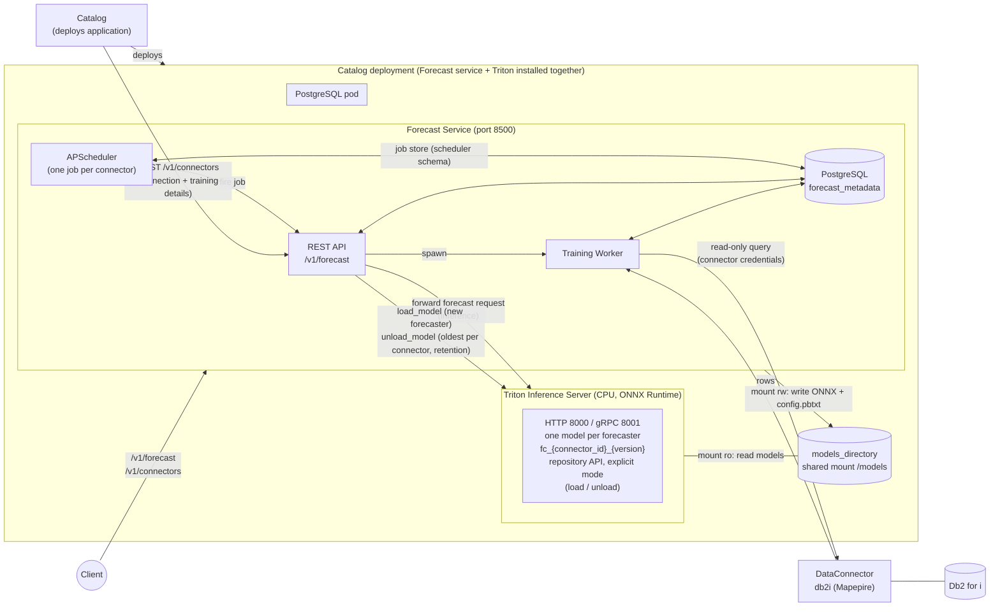
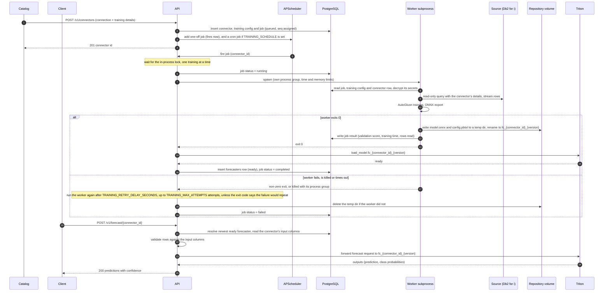
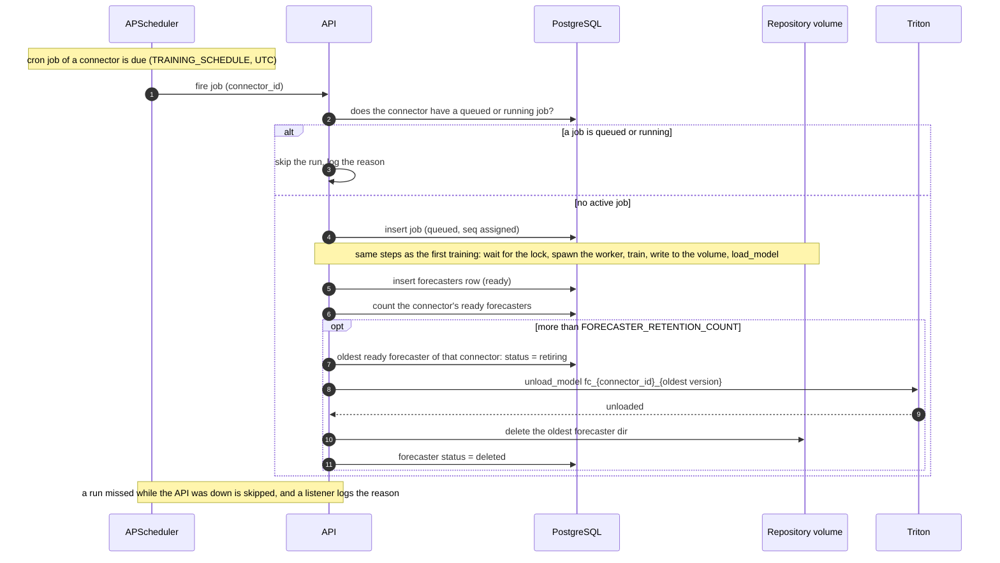

# Forecast Service — Implementation Proposal

## 1. Overview

This document proposes the design and implementation of the **Forecast** microservice for the AI-Services platform. The service trains machine-learning forecasters on tabular data from IBMi Db2, serves them for prediction with a confidence score, and retires the oldest ones under a retention policy.

Training is triggered by creating a connector. When a user submits a Db2 for i connector on Catalog, Catalog calls `POST /v1/connectors` on this service. The call carries the connection details and the details of the training job: the table, a target column, the input columns, and optionally a validation metric. AutoGluon chooses the algorithm. The service stores the connector and queues the training job.

When the job succeeds, the user calls the **forecast** endpoint (`POST /v1/forecast/{connector_id}`) on the resulting forecaster. Training also runs on a schedule (`TRAINING_SCHEDULE`), and each scheduled run trains a new forecaster. A trained forecaster is never updated. Training uses **AutoGluon**. The trained AutoGluon model is exported to **ONNX** and served by **NVIDIA Triton Inference Server** on CPU. Training is asynchronous. Prediction is synchronous and proxied through the service to Triton.

> **Terminology.** A **forecaster** is the named, versioned unit that a training job produces and the forecast endpoint serves. This document does not call it a "model", because "model" also names the learning algorithm AutoGluon trains. The word "model" appears only where another tool owns the name: Triton's *model repository* and *model control*, `model.onnx`, the AutoGluon and ONNX models inside a forecaster, and the Pydantic and ORM "models" in the code. The word "predictor" is avoided for the same reason, because AutoGluon uses it for its trainer classes. The inputs of a forecaster are called **input columns** (`feature_columns` in the API); its single output column is the **target**.

> **Scope notes.**
> - Conversion of an AutoGluon model to ONNX, and running Triton on Power, are treated as working capabilities and are not designed here. This document covers the service around them.
> - **The connector API is in scope; the connector implementation is not.** The service has `/v1/connectors` and a `connectors` table. It has no scanner and no background sync. The data loader runs inside the worker process and reads the source only when a job runs.
> - **Time-series forecasting is out of scope.** The forecaster is a tabular model over independent rows.
> - **Training and inference run on CPU only.** Spyre is not used.
> - **Resource sizing** (CPU, memory, scratch and volume size) is to be provided by DEV. This document names the knobs but does not set values.

The service follows the architectural patterns established by the digitize, translate and extract services where they apply:

- FastAPI application running as a Python service in a Podman container (ppc64le / RHEL).
- PostgreSQL (`forecast_metadata` database) for durable metadata, initialized by an idempotent init container.
- Single-replica deployment.
- Boot-time recovery scan that marks interrupted jobs as failed and cleans up leftovers.
- APScheduler inside the API process, with a persistent SQLAlchemy job store, as digitize uses it for its connector sync.
- A connector API with allowlist-encrypted credentials, as in digitize.

It also introduces three things that no existing service has:

- A **training worker that runs as a subprocess** of the API, one at a time, with its own process group, time limit and memory limit.
- A **Triton pod** in explicit model-control mode, sharing a repository volume with the API pod. The API owns every interaction with Triton. Triton is a Catalog component deployed like vLLM ([Section 9](#9-triton-inference-server--component-and-deployment)).
- A **second, restricted database role** for the worker, with column-level grants.

### 1.1 Concept-to-Design Mapping

| Concept                    | Design realization                                                                                                                                                                                                                                      |
|:---------------------------|:--------------------------------------------------------------------------------------------------------------------------------------------------------------------------------------------------------------------------------------------------------|
| Source of training data    | A table read through the stored connector (`connector_id`), named in the `POST /v1/connectors` call that created the job.                                                                                                                               |
| Connector                  | A row in `connectors` managed by `/v1/connectors`: type, connection details, secrets encrypted. No scanner and no sync.                                                                                                                                 |
| Inputs and target          | `feature_columns` (one or more, each with an optional type) and `target_column` (exactly one).                                                                                                                                                          |
| Scheduling                 | APScheduler in the API process, one job per connector, with its job store in PostgreSQL. A one-off job runs the first training and a cron job (`TRAINING_SCHEDULE`, UTC) runs the later ones.                                                           |
| Training run               | A **worker subprocess** spawned by the API: data loader → AutoGluon → ONNX export → write to the shared volume.                                                                                                                                         |
| Trained forecaster         | A row in `forecasters` plus a directory `fc_<connector_id>_<version>` on the shared repository volume. The version is the job's `jobs.seq`.                                                                                                             |
| Forecaster serving         | Triton in explicit model-control mode, on CPU. The API loads and unloads each forecaster as a Triton model of its own, through model-control calls.                                                                                                     |
| Prediction with confidence | `POST /v1/forecast/{connector_id}` — the API validates rows against the stored input columns, calls Triton, and returns a prediction and a `confidence` per row.                                                                                        |
| Retention                  | A new forecaster is loaded into Triton, then recorded as `ready`. When a connector has more than `FORECASTER_RETENTION_COUNT` `ready` forecasters, its oldest is set to `retiring`, unloaded from Triton, deleted from the volume and marked `deleted`. |
| Versioning                 | `jobs.seq` (identity column) is the version. API path prefix `/v1/` versions the API itself.                                                                                                                                                            |

---

## 2. Design Decisions

### 2.1 Decision — The training worker is a subprocess of the API

**Decision: training runs in a subprocess that the API spawns inside its own pod, one at a time.** It is not a separate pod, a Kubernetes Job or a thread.

- **Same image and code.** `python -m forecast.worker <job_id>` shares the DB models and loader code with the API. No container-runtime access, ServiceAccount or Podman socket is needed, which keeps the Podman and OpenShift deployments identical.
- **Killable.** AutoGluon trains with child processes and large memory use. The API starts the worker in its **own process group** and kills the whole group on timeout, so nothing keeps running.
- **Crash isolation from the event loop.** A worker that crashes or is killed by the kernel does not take the API's event loop with it, and the API can read the exit status.
- **Why not threads or a process pool.** AutoGluon and ONNX export are CPU- and memory-heavy, and AutoGluon forks. A subprocess per job gives a clean memory release at exit and a unit that can be killed.
- **The loader is part of this subprocess.** Reading the source is the first step of the worker, not a separate component, so every job gets a fresh, isolated read, and its result records how many rows it read.

**Trade-off — shared fate.** The API and the training run share one container, so they share its memory limit and its lifecycle. Training memory pressure can hurt the API, and an API redeploy kills a running training job. The worker therefore runs with a memory cap (`WORKER_MEMORY_LIMIT_MB`) and a time limit, and startup recovery fails any job that was queued or running when the container stopped.

### 2.2 Decision — The Forecast API owns all Triton interaction and all deletion

**Decision: only the API process talks to Triton, and only the API deletes forecaster files.**

- Triton runs in **explicit model-control mode**. Nothing is loaded until the API loads it. After a Triton restart, the API's startup step loads every `ready` row.
- The **database, not the volume, says what should be loaded.** A directory on the volume with no `ready` row is never served.
- The worker only **creates** a forecaster's directory, by writing a temporary directory on the same volume and renaming it, so the directory appears whole or not at all. The worker only **deletes** directories whose row is `retiring`, and the temporary directory of a job that failed.
- The API writes the `forecasters` row only after Triton has loaded the forecaster. A row is therefore always `ready`, `retiring` or `deleted`, and the worker has no write grant on `forecasters`.
- Retention is by count, per connector, and runs after each successful load. When the `ready` forecasters of one `connector_id` exceed `FORECASTER_RETENTION_COUNT`, the oldest of that connector is retired in this order: its row becomes `retiring`, it is unloaded from Triton, its directory is deleted, and its row becomes `deleted`. The row is kept. Forecasters of other connectors are not affected.

### 2.3 Decision — Single worker, enforced twice

**Decision: one training job runs at a time.** Other jobs wait as `queued`. The first training of a connector and its scheduled trainings share the same queue.

- Every run is started by an APScheduler job. The job function takes an in-process `asyncio.Lock` before it marks its row `running`, so runs go one at a time, in the order they asked for the lock. A run waits for the lock with its `jobs` row `queued`. This guard lives in the API process, so the API pod must run with `replicas: 1`.
- The database enforces the same rule: a unique partial index allows at most one `running` row (the `idx_jobs_single_running` index). If the in-process guard is ever wrong, the second claim fails instead of starting a second trainer.

### 2.4 Decision — `jobs.seq` is the forecaster version

An identity column on `jobs` provides the version. The worker never picks a version number, versions never collide, and they increase with submission order. A failed job leaves a gap in the sequence, which is harmless. The forecaster is named `fc_<connector_id>_<version>`. That name is its directory on the volume and its model name in Triton, so every forecaster is loaded and unloaded on its own and Triton's own model version is always `1`.

### 2.5 Decision — Connectors are stored records; there is no scanner

**Decision: the service has a connector CRUD API and a `connectors` table, and nothing more.** A connector holds the connection details of one source database, with secrets encrypted. The training job created with it names it by `connector_id`. The scanner, background sync and sync history that digitize attaches to a connector are not part of this service.

- **Same pattern as digitize.** Create, list, get, partial update and delete, with an allowlist of safe fields. Every other field is encrypted with AES-256-GCM (`DB_ENCRYPTION_KEY`) and never returned.
- **No credentials in jobs.** A job carries only `connector_id`. Credentials are not in the request, in `jobs`, in logs or in the job result.
- **The worker reads and decrypts.** It runs the loader as its first step, reads the connector row with a `SELECT`-only grant and decrypts it with the key the API passes in. Nothing reads the source database outside a job.
- **Rotation is an update.** Each job reads the connector when it runs, so changing a password with `PUT /v1/connectors/{id}` applies to the next job.
- **Referential safety.** A connector cannot be deleted while a `queued` or `running` job uses it. Finished jobs keep their rows with `connector_id` set to `NULL`.

### 2.6 Decision — APScheduler starts every training run

**Decision: APScheduler, inside the API process, starts every training run, both the first one and the scheduled ones.** There is no polling runner.

- **Same library as digitize.** An `AsyncIOScheduler` with a `SQLAlchemyJobStore` on the service's PostgreSQL database, in a `scheduler` schema that the init container creates. APScheduler is pinned to the version digitize uses. The persistent store keeps the schedules across restarts.
- **One job per connector.** Creating a connector registers a one-off job that fires at once for the first training and, when `TRAINING_SCHEDULE` is set, a cron job for the later ones. The cron runs in UTC. When `TRAINING_SCHEDULE` is unset, only the first training runs.
- **What a fired job does.** A cron run first checks that the connector has no `queued` or `running` job, and inserts its own `queued` row. The first run uses the row that `POST /v1/connectors` inserted. The job then waits for the lock, marks the row `running`, spawns the worker and waits for it. On success it loads the forecaster into Triton, inserts the `forecasters` row as `ready` and applies retention. When the last attempt fails, it marks the job `failed` and deletes the temporary directory that the worker left.
- **Retry of the worker step.** If the worker fails, the job function runs it again, up to `TRAINING_MAX_ATTEMPTS` attempts in total, and waits `TRAINING_RETRY_DELAY_SECONDS` between attempts. All attempts belong to one job: the same `jobs` row, the same version and the same lock. The job stays `running` while it retries, so no other training starts in between. Each attempt gets the full time limit, and the function deletes the temporary directory before the next attempt. The worker exits with a dedicated code for a failure that would only repeat (the connector is missing or cannot be decrypted, an unknown table or column, no rows, or more than `MAX_TRAINING_ROWS` rows), and the function does not retry that. Every other non-zero exit, a kill and a timeout are retried. After the last attempt the job is marked `failed` with the last error, and the number of attempts is recorded in `result`. Only the worker step is retried. The Triton load, the `forecasters` insert and retention run once, after a successful attempt. A restart of the API during the retries fails the job like any other interrupted run.
- **Missed runs are skipped.** The jobs use a short misfire grace time, so a late run is skipped instead of run late. A run missed while the API was down, or skipped because the connector still has a `queued` or `running` job, is logged with the reason.
- **Startup.** The API registers a cron job only for a connector that has none, and updates it when `TRAINING_SCHEDULE` has changed, so existing jobs keep their stored next run time. Digitize instead re-registers every job at startup. Jobs that were `queued` or `running` when the API stopped are marked `failed` by the boot recovery.

---

## 3. Non-Goals

- **Connector scanner and sync:** The connector API stores connection details. There is no scanner, no background sync and no sync history. The data loader inside the worker reads the source when a job runs.
- **Horizontal scaling and multi-worker training:** The service is architected for a single API replica and a single concurrent training run. Job ownership, claim columns, heartbeats and fencing are out of scope.
- **Time series:** Not supported. Rows are independent.
- **Spyre and accelerators:** Training and inference run on CPU.
- **UI:** No user interface is included in this document. The service is API-only.
- **ONNX conversion and Triton on Power:** Treated as working capabilities. Not designed here.
- **Manual deletion of forecasters:** Forecasters are removed only by the retention policy (`FORECASTER_RETENTION_COUNT`).
- **Incremental training:** Each job pulls the data it needs in full.
- **Writes to the source:** The loader is read-only.

---

## 4. Architecture



**Key interactions:**

- The **API pod** hosts the REST API and **APScheduler**. Each connector has a job that APScheduler fires for the first training and, when `TRAINING_SCHEDULE` is set, on that schedule. The fired job runs the whole pipeline: it queues the run, spawns the worker, enforces the time limit and detects failure, then loads the forecaster into Triton, records it and applies retention (unload, deletion).
- The **worker subprocess** owns the training work only. It has no polling loop. It reads its job, loads the data, trains, writes the forecaster's directory to the volume, records its result on the job row, and exits.
- The **Triton pod** and the API pod mount the same repository volume. The API pod needs write access because the API deletes old versions, so the mount is a regular shared mount rather than a read-only one.
- The **Postgres pod** holds `connectors`, `training_configs`, `jobs` and `forecasters`, and APScheduler's job store in the `scheduler` schema. The API connects as the DB owner. The worker connects as a restricted role.
- The service is exposed externally on **port 8500** (configurable). This avoids the ports used by digitize (4000/4001), summarize (6000), similarity (7000), translate (9000) and extract (9500).
- The service depends on three things beyond itself: PostgreSQL, Triton, and the data source.

---

## 5. Endpoints

| Method     | Endpoint                                | Description                                                                                                                                                    |
|:-----------|:----------------------------------------|:---------------------------------------------------------------------------------------------------------------------------------------------------------------|
| **GET**    | `/v1/forecast/{connector_id}`           | List the forecasters of a connector with status, schemas and metrics.                                                                                          |
| **POST**   | `/v1/forecast/{connector_id}`           | Run a forecast. The rows are validated, sent to Triton for the connector's newest `ready` forecaster, and returned with a prediction and a confidence per row. |
| **POST**   | `/v1/connectors`                        | Create a connector (source database connection, secrets encrypted) and queue its training job.                                                                 |
| **GET**    | `/v1/connectors`                        | List connectors with pagination and a name filter.                                                                                                             |
| **GET**    | `/v1/connectors/{connector_id}`         | Get a connector. Secrets are never returned.                                                                                                                   |
| **GET**    | `/v1/connectors/{connector_id}/metrics` | **Developer use only.** Training and availability metrics of a connector, such as training time and the versions available.                                    |
| **PUT**    | `/v1/connectors/{connector_id}`         | Partially update a connector (`name`, `connection_details`).                                                                                                   |
| **DELETE** | `/v1/connectors/{connector_id}`         | Delete a connector. Refused while a queued or running job uses it.                                                                                             |
| **GET**    | `/health`                               | Service health check (DB and Triton reachability).                                                                                                             |

---

## 6. API Specification

**Error format.** Every error uses the shared envelope of the other services, with the HTTP status repeated in the body:

```json
{
    "error": {
        "code": "RESOURCE_NOT_FOUND",
        "message": "Connector '7c9e6679-7425-40de-944b-e07fc1f90ae7' not found",
        "status": 404
    }
}
```

Digitize registers its error handler only for `HTTPException`, so its request-validation errors come back in FastAPI's default `{"detail": [...]}` shape. This service registers a handler for FastAPI's `RequestValidationError` as well, so a `422` uses this envelope with code `INVALID_REQUEST`.

### 6.1 Forecast

The forecast endpoints are keyed by `connector_id`, because each connector is trained into forecasters. The service never exposes Triton: clients call these endpoints and the service forwards the request to Triton.

#### GET /v1/forecast/{connector_id} — List the Forecasters of a Connector

Returns every forecaster of the connector that is not yet `deleted`, newest version first. The list is bounded by `FORECASTER_RETENTION_COUNT` plus any forecaster that is `retiring`, so it is not paginated. A connector with no forecaster yet returns an empty `data` array.

| Field in each `data` item | Description                                                                                                                       |
|:--------------------------|:----------------------------------------------------------------------------------------------------------------------------------|
| `version`                 | The version number (the `jobs.seq` of the training job).                                                                          |
| `status`                  | `ready` (loaded and served) or `retiring` (being unloaded).                                                                       |
| `metrics`                 | The validation metric name and score, and the training time in seconds.                                                           |
| `created_at`              | UTC timestamp at which the forecaster was loaded.                                                                                 |

**Sample response (200):**

```json
{
    "connector_id": "7c9e6679-7425-40de-944b-e07fc1f90ae7",
    "data": [
        {
            "version": 12,
            "status": "ready",
            "metrics": {"metric": "accuracy", "validation_score": 0.91, "training_seconds": 412},
            "created_at": "2026-10-26T09:12:00Z"
            "error": "NONE"
        }
    ]
}
```

| Status                               | Description                |
|:-------------------------------------|:---------------------------|
| 200 OK                               | The list, possibly empty.  |
| 404 Not Found (`RESOURCE_NOT_FOUND`) | No connector with this ID. |
| 500 Internal Server Error            | Database failure.          |

#### POST /v1/forecast/{connector_id} — Run a Forecast

Runs the connector's newest `ready` forecaster on the rows in the request. The service validates the rows against the connector's input columns (`forecast_columns`), forwards them to Triton, and returns one result per row in the same order. The call is synchronous.

**Content-Type:** `application/json`

| Field       | Type  | Required | Description                                                                                                         |
|:------------|:------|:---------|:--------------------------------------------------------------------------------------------------------------------|
| `instances` | array | Yes      | One or more rows. Each row is an object that has a value for every input column of the connector and no other keys. |

**Sample request:**

```bash
curl -X POST http://localhost:8500/v1/forecast/7c9e6679-7425-40de-944b-e07fc1f90ae7 \
  -H "Content-Type: application/json" \
  -d '{
        "instances": [
          {"REGION": "EMEA", "QUANTITY": 12, "UNIT_PRICE": 19.99},
          {"REGION": "APAC", "QUANTITY": 3,  "UNIT_PRICE": 249.0}
        ]
      }'
```

**Sample response (200):**

```json
{
    "connector_id": "7c9e6679-7425-40de-944b-e07fc1f90ae7",
    "version": 12,
    "predictions": [
        {"prediction": "N", "confidence": 0.87},
        {"prediction": "Y", "confidence": 0.64}
    ]
}
```

- `version` names the forecaster that answered.

| Status                                         | Description                                                                                        |
|:-----------------------------------------------|:---------------------------------------------------------------------------------------------------|
| 200 OK                                         | One result per row.                                                                                |
| 400 Bad Request (`INVALID_REQUEST`)            | `instances` is empty, or a row has a missing or unknown input column or a value of the wrong type. |
| 404 Not Found (`RESOURCE_NOT_FOUND`)           | No connector with this ID, or the connector has no `ready` forecaster yet. The message says which. |
| 422 Unprocessable Entity                       | The body is not valid JSON or `instances` is not an array.                                         |
| 500 Internal Server Error                      | Database failure, or Triton returned an error for the request.                                     |
| 503 Service Unavailable (`TRITON_UNAVAILABLE`) | Triton cannot be reached. A new error code: the shared `ErrorCode` enum has none for Triton.       |

### 6.2 Connectors

A connector stores the connection details of one source database, with its secrets encrypted. The training job created with it refers to it by `connector_id`. The endpoints follow `services/digitize/api/v1/connectors.py`: create, list, get, partial update and delete, with the allowlist encryption of `connectors/encryption.py`.

**What is in scope and what is not.** The scope here is the connector **API and its table**. There is no scanner, no sync, no sync history and no per-connector sync schedule. Scheduled training is separate and is set by `TRAINING_SCHEDULE`. Nothing reads the source database until a training job runs, and then the loader inside the worker does it. A connector therefore has no `status`, no `last_sync_at` and no file counters, which digitize's connectors have.

**Connector types.** `type` is validated against a fixed list. The first type is `db2_for_i`. Adding a database means adding its type, its required fields and its safe fields to the allowlist, and a driver in the loader.

**Secret handling.** Each type declares **safe fields**, which are stored in plaintext and returned in responses. Every other field is a secret: it is encrypted with AES-256-GCM using `DB_ENCRYPTION_KEY` before it is stored and is never returned. Listing safe fields, instead of listing secret fields, means a credential field that nobody thought of is encrypted by default and is never returned.

| Type        | Required fields (`connection_details`)     | Optional | Safe (plaintext, returned)             | Encrypted, never returned |
|:------------|:-------------------------------------------|:---------|:---------------------------------------|:--------------------------|
| `db2_for_i` | `host`, `database`, `username`, `password` | `port`   | `host`, `port`, `database`, `username` | `password`                |

#### POST /v1/connectors — Create a Connector

**Content-Type:** `application/json`

| Field                | Type   | Required | Description                                                                            |
|:---------------------|:-------|:---------|:---------------------------------------------------------------------------------------|
| `id`                 | string | No       | A UUID chosen by the client (for example a catalog). Generated when omitted.           |
| `name`               | string | Yes      | Unique, human-readable name, 1–255 characters.                                         |
| `type`               | string | Yes      | A supported connector type (`db2_for_i`).                                              |
| `connection_details` | object | Yes      | Fields for the type, as in the connector types table. Unknown fields are rejected.     |
| `training`           | object | Yes      | The details of the training job that the call queues. See the `training` object table. |

**`training` object:**

| Field               | Type   | Required | Description                                                                                                                                                                   |
|:--------------------|:-------|:---------|:------------------------------------------------------------------------------------------------------------------------------------------------------------------------------|
| `schema`            | string | Yes      | Schema that holds the table.                                                                                                                                                  |
| `table`             | string | Yes      | Table to train on.                                                                                                                                                            |
| `target_column`     | string | Yes      | The column to predict. Exactly one.                                                                                                                                           |
| `forecast_columns`   | array  | Yes      | The input columns. Each is an object with a `name` and, where AutoGluon needs it, a `type` (`string`, `integer` or `number`). The forecast endpoint checks rows against them. |
| `validation_metric` | string | No       | The metric AutoGluon validates on. Omitted means AutoGluon's default for the target.                                                                                          |

**Sample request:**

```bash
curl -X POST http://localhost:8500/v1/connectors \
  -H "Content-Type: application/json" \
  -d '{
        "name": "prod-sales-db",
        "type": "db2_for_i",
        "connection_details": {
          "host": "ibmi.example.com",
          "port": 8471,
          "database": "PRODDB",
          "username": "forecast_ro",
          "password": "********"
        },
        "training": {
          "schema": "SALES",
          "table": "ORDERS",
          "target_column": "DELIVERY_LATE",
          "forecast_columns": [
            {"name": "REGION", "type": "string"},
            {"name": "QUANTITY", "type": "integer"},
            {"name": "UNIT_PRICE", "type": "number"}
          ],
          "validation_metric": "accuracy"
        }
      }'
```

**Sample response (201):**

```json
{
    "id": "7c9e6679-7425-40de-944b-e07fc1f90ae7"
}
```

Duplicate checks run before the insert: a repeated `id` or `name` returns `409`. The call returns `201` once the connector, its training details and the training job are stored. It also registers the APScheduler jobs: a one-off job that starts the first training at once and, when `TRAINING_SCHEDULE` is set, a cron job for the later ones. Training continues asynchronously.

| Status                                | Description                                                                                                                                                         |
|:--------------------------------------|:--------------------------------------------------------------------------------------------------------------------------------------------------------------------|
| 201 Created                           | Connector stored, secrets encrypted, training job queued.                                                                                                           |
| 409 Conflict (`RESOURCE_LOCKED`)      | The `id` or the `name` already exists.                                                                                                                              |
| 422 Unprocessable Entity              | Body validation failed: unknown `type`, an `id` that is not a UUID, a missing or unknown field in `connection_details` or `training`. Same envelope as every error. |
| 429 Too Many Requests (`SERVER_BUSY`) | `MAX_QUEUED_JOBS` training jobs are already queued. The connector is not stored.                                                                                    |
| 500 Internal Server Error             | Database failure, or `DB_ENCRYPTION_KEY` missing or not 32 bytes.                                                                                                   |

#### GET /v1/connectors — List Connectors

| Parameter | Type   | Required | Description                                  |
|:----------|:-------|:---------|:---------------------------------------------|
| `limit`   | int    | No       | Records per page (1–200). Default: `50`.     |
| `offset`  | int    | No       | Records to skip. Default: `0`.               |
| `name`    | string | No       | Partial, case-insensitive match on the name. |

The list limits (50 default, 200 maximum) match digitize's connector list. The response uses the `{ "pagination": {...}, "data": [...] }` envelope. Digitize's connector list returns `{total, limit, offset, items}` instead.

**Sample response (200):**

```json
{
    "pagination": {"total": 1, "limit": 50, "offset": 0},
    "data": [
        {
            "id": "7c9e6679-7425-40de-944b-e07fc1f90ae7",
            "name": "prod-sales-db",
            "type": "db2_for_i",
            "created_at": "2026-10-26T08:55:00Z"
        }
    ]
}
```

#### GET /v1/connectors/{connector_id} — Get a Connector

Returns the list item plus `connection_details` limited to the safe fields and `updated_at`. Secrets are omitted, including any field that is stored but not on the allowlist.

```json
{
    "id": "7c9e6679-7425-40de-944b-e07fc1f90ae7",
    "name": "prod-sales-db",
    "type": "db2_for_i",
    "connection_details": {"host": "ibmi.example.com", "port": 8471, "database": "PRODDB", "username": "forecast_ro"},
    "model_training_status": "TRAINING"
    "last_trained_at": "2026-10-26T08:55:00Z"
    "errors": [{"2026-10-26T08:55:00Z": "COULD NOT FETCH DATA"}, ...]
    "created_at": "2026-10-26T08:55:00Z",
    "updated_at": "2026-10-26T08:55:00Z"
}
```

#### GET /v1/connectors/{connector_id}/metrics — Connector Metrics

**Developer use only.** Returns training and availability metrics for one connector, for debugging and capacity checks. The fields can change without notice and are not part of the stable API.

| Field                            | Description                                         |
|:---------------------------------|:----------------------------------------------------|
| `versions.ready`                 | Versions that are loaded in Triton and served.      |
| `training.jobs_completed`        | Completed runs among the connector's retained runs. |
| `training.jobs_failed`           | Failed runs among the connector's retained runs.    |
| `training.last_job_status`       | `queued`, `running`, `completed` or `failed`.       |
| `training.last_duration_seconds` | Training time of the last finished job.             |
| `training.last_completed_at`     | UTC timestamp at which the last job completed.      |

```json
{
    "connector_id": "7c9e6679-7425-40de-944b-e07fc1f90ae7",
    "versions": {"ready": [12]},
    "training": {
        "jobs_completed": 5,
        "jobs_failed": 1,
        "last_job_status": "completed",
        "last_duration_seconds": 412,
        "last_completed_at": "2026-10-26T09:12:00Z"
    }
}
```

Returns `200`, or `404 RESOURCE_NOT_FOUND` when the connector does not exist.

#### PUT /v1/connectors/{connector_id} — Update a Connector

**Content-Type:** `application/json`. All fields are optional. The request model forbids extra fields, so `type` and `training` cannot be changed and are rejected with `422`. Digitize's update model ignores extra fields instead; this service rejects them.

| Field                | Type   | Description                                                                                  |
|:---------------------|:-------|:---------------------------------------------------------------------------------------------|
| `name`               | string | New unique name.                                                                             |
| `connection_details` | object | Partial. Only the supplied keys are overwritten; the others, including stored secrets, stay. |

- A successful update returns `200` with an empty body. An empty request body is a no-op and also returns `200`.
- The merged details are validated against the type before anything is written. The stored secrets are decrypted for that check. A failure returns `400 INVALID_REQUEST`.
- Supplied secret fields are encrypted again before they are stored.
- A queued job reads the connector when it runs, not when it was created. An update therefore also applies to a job still in the queue and to later scheduled runs.

#### DELETE /v1/connectors/{connector_id} — Delete a Connector

Returns `204`. The delete is **refused with `409 RESOURCE_LOCKED` while a `queued` or `running` job uses the connector**, because that job could not read its source. Finished jobs (`completed`, `failed`) keep their rows and have `connector_id` set to `NULL`. The database enforces the refusal with a CHECK constraint on `jobs` (a `queued` or `running` job must keep its `connector_id`), so a job queued between the API's check and its delete also makes the delete fail, and the API returns the same `409`.

Digitize's delete is asynchronous: it returns 204 as soon as the connector is marked for deletion (404 if it does not exist) and tears down synced files in the background. There is nothing to tear down here, so the delete is a single statement and can fail with `409`.

| Status                               | Description                                                                                     |
|:-------------------------------------|:------------------------------------------------------------------------------------------------|
| 200 OK                               | List, get, metrics or update succeeded.                                                         |
| 204 No Content                       | Connector deleted.                                                                              |
| 400 Bad Request (`INVALID_REQUEST`)  | Update: the merged `connection_details` are not valid for the type.                             |
| 404 Not Found (`RESOURCE_NOT_FOUND`) | No connector with this ID.                                                                      |
| 409 Conflict (`RESOURCE_LOCKED`)     | Update: the new `name` is already used. Delete: a `queued` or `running` job uses the connector. |
| 422 Unprocessable Entity             | Body, `limit` or `offset` validation failed, or `type` or `training` sent in an update.         |
| 500 Internal Server Error            | Database failure, or an encryption key error.                                                   |

### 6.3 GET /health

Returns `200` when the API can reach PostgreSQL and `503` when it cannot. The response also reports Triton reachability. A Triton outage does not make the service unhealthy, because training and connector management still work; it makes forecast requests return `503 TRITON_UNAVAILABLE`.

```json
{
    "status": "ok",
    "checks": {"postgres": "ok", "triton": "unreachable"}
}
```

| Status                  | Description                                                                              |
|:------------------------|:-----------------------------------------------------------------------------------------|
| 200 OK                  | PostgreSQL is reachable. `checks.triton` is `ok` or `unreachable`.                       |
| 503 Service Unavailable | PostgreSQL is not reachable. `status` is `unavailable` and `checks.postgres` is `error`. |

---

## 7. Database Tables

The Postgres database `forecast_metadata` has four tables. Only the main columns are listed. APScheduler's job store table is kept separately, in the `scheduler` schema.

**`connectors`**

| Column       | Description                                                            |
|:-------------|:-----------------------------------------------------------------------|
| `id`         | Primary key (UUID).                                                    |
| `name`       | Unique, human-readable name.                                           |
| `type`       | Connector type, such as `db2_for_i`.                                   |
| `config`     | Connection details. Safe fields in plaintext, secret fields encrypted. |
| `created_at` | UTC creation time.                                                     |
| `updated_at` | UTC time of the last update.                                           |

**`training_configs`**

| Column              | Description                                                                |
|:--------------------|:---------------------------------------------------------------------------|
| `connector_id`      | Primary key. Foreign key to `connectors`.                                  |
| `source_schema`     | Schema that holds the table.                                               |
| `source_table`      | Table to train on.                                                         |
| `target_column`     | The column to predict.                                                     |
| `forecast_columns`   | The input columns, each with a name and, where AutoGluon needs it, a type. |
| `validation_metric` | The metric AutoGluon validates on. Empty means AutoGluon's default.        |
| `created_at`        | UTC time at which the row was stored.                                      |

**`jobs`**

| Column         | Description                                                                                                                                                                                                                                            |
|:---------------|:-------------------------------------------------------------------------------------------------------------------------------------------------------------------------------------------------------------------------------------------------------|
| `id`           | Primary key (UUID).                                                                                                                                                                                                                                    |
| `seq`          | Identity column. Its value is the forecaster version.                                                                                                                                                                                                  |
| `connector_id` | Foreign key to `connectors`. Set to `NULL` when the connector is deleted after the job has finished.                                                                                                                                                   |
| `status`       | `queued`, `running`, `completed` or `failed`.                                                                                                                                                                                                          |
| `error`        | Failure reason. Empty unless the job failed.                                                                                                                                                                                                           |
| `result`       | Written when training finishes. The worker writes the algorithm AutoGluon chose, the validation metric and score, the training time in seconds and the rows read. The API adds the number of attempts used. On a failed job only the attempts are set. |
| `created_at`   | UTC time at which the job was queued.                                                                                                                                                                                                                  |
| `started_at`   | UTC time at which the job started running.                                                                                                                                                                                                             |
| `finished_at`  | UTC time at which the job completed or failed.                                                                                                                                                                                                         |

**`forecast`**

| Column       | Description                                                                                                      |
|:-------------|:-----------------------------------------------------------------------------------------------------------------|
| `id`         | Primary key (UUID).                                                                                              |
| `job_id`     | Foreign key to the job that trained the forecaster. Set to `NULL` when run history deletes that job.             |
| `version`    | The `seq` of that job.                                                                                           |
| `name`       | `fc_<connector_id>_<version>`. Unique. It is also the directory name on the volume and the model name in Triton. |
| `status`     | `ready`, `retiring` or `deleted`.                                                                                |
| `metrics`    | Validation metric name and score, and the training time. Copied from the job's `result`.                         |
| `created_at` | UTC time at which the forecaster was loaded and recorded.                                                        |

**Constraints.**

- `idx_jobs_single_running`: a unique partial index that allows at most one `running` job.
- `forecasters.name` is unique.
- A CHECK constraint on `jobs` requires a `queued` or `running` job to keep its `connector_id`.
- `forecasters.job_id` is `ON DELETE SET NULL`, so deleting an old job does not delete its forecaster.

**Run history.** The `jobs` table is also the run history. Each finished job keeps its `status`, `error`, timestamps (the time taken is `finished_at - started_at`) and `result` (algorithm, validation metric and score, training time, rows read, attempts). After each run finishes, the API keeps the newest `FORECASTER_RETENTION_COUNT` finished jobs (`completed` or `failed`) of that `connector_id` and deletes the older ones. `queued` and `running` jobs are never deleted. The details a forecaster needs to be served live in its own `metrics`, so they survive the deletion of its job.

## 8. Data Loader

The loader is **new code that runs inside the worker**, as its first step. There is no separate scanner component and no background sync: the connector API only stores connection details, and the loader reads them when a job runs. It reads from a database table, applies the row selection, and writes a dataset to local scratch.

| Provider | `db_type` | Phase | Notes |
| :-- | :-- | :-- | :-- |
| IBM i Db2 via **Mapepire** | `db2i` | 1 (in scope) | Pure-Python websocket client; no JVM, no JT400. Works on ppc64le images without extra native packages. **The** Db2 for i path for this service. |
| IBM i Db2 via JT400/JDBC | `db2i_jdbc` | Not planned | Existing `Db2iConnector` (port 446) needs OpenJDK + `jaydebeapi`. Only revisit if the Mapepire server cannot be installed on target partitions. |
| CSV file | `csv` | Stretch | Not planned, will be taken up if current scope is achieved ahead of time. |

### 8.1 Database source

- The worker reads the job's connector row (`jobs.connector_id`) and the connector's `training_configs` row with its read-only grant, decrypts the secret fields with `DB_ENCRYPTION_KEY` and connects with the result. A connector that no longer exists or cannot be decrypted fails the job with an error that names the connector and never contains a secret.
- The session is opened **read-only** with a statement timeout where the database supports it. Authentication and network failures raise distinct errors so the job error tells the user which one occurred.
- The query is built from the validated `schema`, `table`, columns and `row_selection` of the `training` object.
- Rows are streamed with a server-side cursor in fixed-size chunks, inside one read-only transaction at the highest isolation level the database offers, so the snapshot is consistent.
- Every user-supplied identifier is quoted through the driver's identifier API, never concatenated into SQL. Raw SQL is not accepted as a source.
- The account named in the connector should be read-only. The read-only session is a second control; the account is the stronger one.

### 8.2 Stretch: CSV file connector

Not part of the committed scope. Sketch only, so the Phase 1 contract does not preclude it:

- Input is a `.csv` file on a mounted volume or a file upload 
- Header row required. Types are inferred from the whole file; values such as `5e+05` (present in the UCI credit-card CSV) must parse as numeric.
- `filters`, `order_by` and `limit` are applied in-process; `list_tables()` returns one logical table and `list_columns()` the inferred columns.
- Requires `source` to accept a file reference instead of `schema`/`table`; this is the only definition change.

---

## 9. Sequence

### 9.1 Sequence — create connector, first training, forecast (model load)



### 9.2 Sequence — scheduled training and retention (model unload)

A client never asks for an unload. The API unloads and deletes the oldest forecaster of a connector when retention requires it. The API calls Triton's model-control API, and the client only calls the forecast API.



---

## 9. Triton Inference Server — Component and Deployment

This section specifies how Triton becomes a Catalog **component**, the way vLLM is today, how it is deployed on Podman and OpenShift, and how the Forecast service and Triton share the model repository volume. Sections 2.2, 4 and 8 define *who* talks to Triton and *when*; this section defines *what is deployed* and *how the files get there*.

> **Status of the facts below.** Everything that describes the Catalog (asset layout, dependency wiring, volume labels, image collection) was checked against the current `ai-services` code and the vLLM, OpenSearch and digitize assets. Everything that describes Triton or the ppc64le image has not been run on the target image and must be proven there before implementation.

### 9.1 Catalog assets

```
ai-services/assets/components/ml_inference/triton-cpu/
├── metadata.yaml                      # type: component, component_type: ml_inference
├── podman/
│   ├── metadata.yaml                  # pod template list and resource requirements
│   ├── values.yaml                    # image and defaults
│   ├── values.schema.json             # no user parameters (empty properties)
│   └── templates/
│       └── triton-server.yaml.tmpl
└── openshift/
    ├── Chart.yaml
    ├── metadata.yaml
    ├── values.yaml
    ├── values.schema.json
    └── templates/
        ├── triton-deployment.yaml
        ├── triton-service.yaml
        └── triton-repository-pvc.yaml
```

The directory is named after the component type, as `llm/` and `embedding/` are. (`vector_db/opensearch` shows that the directory and the `component_type` need not match.)

**`metadata.yaml`** (same fields as `llm/vllm-cpu/metadata.yaml`):

```yaml
type: component
id: triton-cpu
version: "1.0.0"
name: "Triton Inference Server (CPU)"
description: "Serves ONNX forecasters over the KServe v2 protocol on CPU"
component_type: ml_inference
component_name: "Inference server"
default: true
```

**`podman/metadata.yaml`:**

```yaml
name: triton
version: "1.0.0"
podTemplateExecutions:
  - [triton-server.yaml.tmpl]
resources:
  cpu: 0        # TBD (DEV)
  memory: 0     # TBD (DEV), bytes
  storage: 0    # TBD (DEV), bytes: size of the repository volume
```

The three resource values are **to be provided by DEV**, as for the rest of this document (Section 1, Scope notes). The Catalog uses them for its capacity check.

**`podman/values.yaml`:**

```yaml
image: <registry>/tritonserver-ppc64le:<pinned tag>
```

The image must be a **pinned tag mirrored into the project registry**, the way `icr.io/ppc64le-oss/vllm-ppc64le:0.28.0` is. The `quay.io/powercloud/tritonserver:latest` image used in the POC is not acceptable for a product, because `latest` is not reproducible. The Catalog collects images from the rendered templates, so the Triton image appears automatically in the application's image list (`GET /api/v1/services/:id/images`) and in air-gapped image mirroring.

**Parameters.** The component takes **no user parameters**. One constraint on naming: the Catalog's model download step (`extractModelsFromParams`) treats any component *parameter* whose key contains `model` as a Hugging Face model name to download. No Triton parameter may use such a key (for example `modelRepository`), or deployment will try to download it. This applies to request parameters only, not to keys in `values.yaml`.

**Wiring in the Forecast service's `metadata.yaml`:**

```yaml
dependencies:
  - id: ml_inference
```

The service gets its endpoint the same way digitize gets `llm`: the deployer takes the Triton pod's name as `host` and the first container's first `containerPort` as `port`, and merges them, plus `instanceSlug`, into the service values. The Forecast template then uses:

```yaml
env:
  - name: TRITON_URL
    value: "http://{{ .Values.ml_inference.host }}:{{ .Values.ml_inference.port }}"
  - name: MODEL_REPO_PATH
    value: /models
```

**Triton's first `containerPort` must therefore be the HTTP port (8000).** The deployer picks the first port of the first container; if gRPC were listed first, the Forecast service would be given the gRPC port.

### 9.2 Podman deployment

The deployment order is fixed by the Catalog: all components are deployed first, then the services, then routes are registered. Triton is therefore running before the Forecast service starts. "Running" is not "ready", and the Forecast service must tolerate a Triton that is still starting (Section 9.4).

**`podman/templates/triton-server.yaml.tmpl`:**

```yaml
apiVersion: v1
kind: Pod
metadata:
  name: "triton-{{ .InstanceSlug }}"
  labels:
    ai-services.io/template: "{{ .TemplateID }}"
    ai-services.io/volume: "triton-repo-{{ .InstanceSlug }}"
spec:
  restartPolicy: always
  volumes:
    - name: repository
      persistentVolumeClaim:
        claimName: "triton-repo-{{ .InstanceSlug }}"
  containers:
    - name: triton
      image: "{{ .Values.image }}"
      args:
        - tritonserver
        - --model-repository=/models
        - --model-control-mode=explicit
        - --strict-readiness=false
        - --exit-on-error=false
        - --http-port=8000
        - --grpc-port=8001
        - --metrics-port=8002
      ports:
        - containerPort: 8000     # must be first: the deployer gives this port to consumers
        - containerPort: 8001
        - containerPort: 8002
      livenessProbe:
        httpGet:
          path: /v2/health/live
          port: 8000
        initialDelaySeconds: 30
        periodSeconds: 30
        timeoutSeconds: 5
        failureThreshold: 6
      resources:
        requests:
          memory: "<TBD (DEV)>"
        limits:
          memory: "<TBD (DEV)>"
      volumeMounts:
        - mountPath: /models:z
          name: repository
          readOnly: true
```

Why each flag:

| Flag | Reason |
|:--|:--|
| `--model-repository=/models` | The volume root is the repository. Triton starts with an empty repository. |
| `--model-control-mode=explicit` | Nothing is loaded until the Forecast API asks (Section 2.2). Triton also never loads a half-written directory on its own. |
| `--strict-readiness=false` | With the default, Triton reports not-ready if **any** model failed to load. One bad forecaster would then make the whole server unready. The Forecast API checks per-model state itself. |
| `--exit-on-error=false` | A failed model load must not take the server down. |
| No `--load-model` | Reloading after a Triton restart is the Forecast API's job (Section 9.4), driven by the database. |
| gRPC and metrics ports kept | The Forecast service uses HTTP only. gRPC (8001) and metrics (8002) stay available for later use and are not published. |

**What is deliberately absent from the template:**

- **No `ai-services.io/routes` and no `ai-services.io/ports`.** Without them the Catalog does not register the pod with Caddy and does not publish a host port. Triton is reachable only from other pods of the application, by pod name. This is how the design in Section 2.2 ("only the API talks to Triton") is enforced rather than just stated.
- **No secret and no API-key volume.** Triton has no authentication to configure.
- **No Spyre annotations and no `/dev/shm` volume.** Inference is on CPU with ONNX Runtime.

### 9.3 The shared repository volume

#### Ownership and naming

| Item | Value |
|:--|:--|
| Podman volume name | `triton-repo-<slug>`, where `<slug>` is the Triton component's instance slug |
| Created by | `podman kube play` of whichever pod references it first. The Triton pod is deployed first. |
| Referenced by | The Triton pod (`readOnly: true`, `/models`) and the Forecast pod (read-write, `/models`) |
| Name known to the Forecast pod through | `.Values.ml_inference.instanceSlug`, exactly as the extract service builds `vllm-secret-{{ .Values.llm.instanceSlug }}` |
| Cleanup | Listed in the **Triton** pod's `ai-services.io/volume` label only. When the component is deleted without `--keep-data`, the Catalog deletes the volume. The Forecast pod must **not** list it, or two pods would claim one volume. |

**Forecast pod additions** (the Forecast template is otherwise unchanged by this section):

```yaml
spec:
  securityContext:
    runAsUser: <forecast uid>      # same mechanism as the postgres (26) and opensearch (1000) templates
    fsGroup:  <forecast gid>
  volumes:
    - name: repository
      persistentVolumeClaim:
        claimName: "triton-repo-{{ .Values.ml_inference.instanceSlug }}"
  containers:
    - name: forecast-api
      volumeMounts:
        - mountPath: /models:z
          name: repository
```

`:z` is appended to the mount path in the same way as the vLLM and embedding templates, so that SELinux relabels the volume with a shared label that both pods can use.

#### Layout

```
/models/                                  volume root = Triton's --model-repository
├── .staging/<job_id>/                    worker scratch for an atomic publish (same filesystem)
├── <forecaster>_v<N>/                    one Triton model per forecaster version
│   ├── config.pbtxt
│   └── 1/
│       └── model.onnx
└── <forecaster>_v<N+1>/ ...
```

**One Triton model per forecaster version.** The Triton model name is `<forecaster name>_v<version>` (`forecasters.name` and `forecasters.version`), and its single Triton version is always `1`. This follows from how Triton works and from Section 2.2:

- Triton's unload call acts on a **whole model with all its versions**. There is no call to unload one version of a model.
- The service keeps several versions per connector and retires the oldest while the newest keeps serving.
- Making each forecaster version its own Triton model turns "load a forecaster", "unload a forecaster" and "delete its directory" into three operations on one directory, with no effect on the other versions.
- It also makes a version switch safe: the new version is loaded and `ready` **before** the old one is unloaded, so there is no gap.

`forecasters.name` therefore has to be safe as a directory name and as a Triton model name. The proposal does not say how a forecaster name is generated; this is an open question (Section 11).

#### Who writes what

| Actor | Allowed on the volume | Never |
|:--|:--|:--|
| Worker subprocess (runs as the Forecast container's user) | Creates `.staging/<job_id>/`, writes `model.onnx` and `config.pbtxt` there, then **renames** the directory to `<forecaster>_v<N>/` | Deletes anything; touches a directory that already has a `ready` row |
| Forecast API (same container) | Deletes `<forecaster>_v<N>/` for rows that are `retiring`; deletes leftover `.staging/` and directories with no live row at boot (Section 9.4) | Writes model files |
| Triton | Reads | Writes. The mount is read-only. |

The rename is atomic because `.staging/` and the model directories are on the same volume. Triton can only ever see a complete directory, and in explicit mode it does not look at a directory until it is told to load it.

#### Permissions

Two requirements, whatever mechanism provides them:

1. **The Forecast container's user can create, rename and delete under `/models`.** The postgres and opensearch templates solve the same problem for their volumes with `runAsUser` and `fsGroup` in the pod's `securityContext`; the Forecast pod does the same.
2. **Triton's user can read what the Forecast user writes.** The Forecast service creates directories as `0755` and files as `0644` (an explicit `umask 022` for the worker and API processes). Triton's user is whatever the ppc64le image runs as; it is not assumed to match the Forecast user.

Both depend on how the image's user and rootless Podman interact and must be verified on the ppc64le image before implementation.

### 9.4 Model lifecycle against Triton

This is the Triton-facing half of Sections 8.1 and 8.2. Triton is addressed over HTTP at `TRITON_URL`.

| Step | Triton call | Notes |
|:--|:--|:--|
| Load a staged forecaster | `POST /v2/repository/models/<model>/load` | Returns when the model has loaded or failed. The API then reads `POST /v2/repository/index` for the model's `state` and `reason`. The row becomes `ready` only when the state is `READY`. |
| Run a forecast | `POST /v2/models/<model>/infer` | `<model>` is that of the connector's newest `ready` forecaster. |
| Unload a retiring forecaster | `POST /v2/repository/models/<model>/unload` | The API then waits for `UNAVAILABLE` in the index before it deletes the directory, so a file is never removed under a loaded model. |
| Readiness of the server | `GET /v2/health/ready` | Used by `GET /health` (Section 6.3). |
| State of all models | `POST /v2/repository/index` | Used for load and unload checks and for reconciliation. |

**Reconciliation.** Explicit mode means Triton forgets every loaded model when it restarts, and the pod has `restartPolicy: always`. The database says what should be loaded (Section 2.2), so the API reconciles on boot and on every runner tick (`RUNNER_TICK_SECONDS`):

1. Wait for `GET /v2/health/ready`, for up to `TRITON_STARTUP_WAIT_S`, with backoff. The Forecast API must still start, answer `/health` and accept connectors while Triton is down (Section 6.3).
2. Read `/v2/repository/index`.
3. For every `ready` row whose model is not `READY` in Triton, call `load`.
4. For every `staged` row, `load` it and promote it to `ready` (the normal activation).
5. For every `retiring` row, `unload`, then delete the directory, then mark it `deleted`.

During the gap between a Triton restart and step 3, a forecast request returns `503 TRITON_UNAVAILABLE`. The gap is at most one runner tick plus the load time.

**Boot cleanup (API only).** At startup the API removes `.staging/*` (leftovers of a killed worker) and any `<forecaster>_v<N>/` directory that has no `staged`, `ready` or `retiring` row. This extends the existing boot-time recovery scan; the worker still never deletes.

**Load failure.** If Triton returns an error, the row stays `staged`, the `reason` from the index is logged with the job id, and the next tick retries. What happens after repeated failures is an open question (Section 11).

**`config.pbtxt`.** The worker writes it next to `model.onnx`. It is generated, never hand-edited. Its tensor definitions come from the ONNX export, which is outside this document; the service-owned parts are fixed:

```
name: "<forecaster>_v<N>"
backend: "onnxruntime"
max_batch_size: <TBD>
instance_group [ { kind: KIND_CPU, count: 1 } ]
# input / output tensor entries: produced by the ONNX export, one per input column in input_schema
```

### 9.5 OpenShift deployment

The OpenShift path uses plain Kubernetes objects, in the way `opensearch` and the service charts do, rather than a KServe `InferenceService` as `llm/vllm-cpu` does. The reason is that KServe's runtime model loads a model from a storage URI at deploy time, whereas here models arrive after the pod is up and are controlled through Triton's repository API.

| Object | Purpose |
|:--|:--|
| `Deployment` `triton` | One replica, strategy `Recreate`. Same image, args and probes as Section 9.2. Adds a `readinessProbe` on `/v2/health/ready` (OpenShift honours readiness; with `--strict-readiness=false` it does not depend on any model). Mounts the PVC read-only at `/models`. |
| `Service` `triton` | ClusterIP, port 8000 (and 8001, 8002). Not exposed through a `Route`. The Forecast chart uses `http://triton:8000`. |
| `PersistentVolumeClaim` `triton-repository` | Owned by the Triton chart, with `helm.sh/resource-policy: keep`, like `digitize-cache`. Mounted read-write by the Forecast Deployment and read-only by Triton. |

- **Access mode.** `ReadWriteMany`, as `digitize-cache` already uses. With `ReadWriteOnce` both pods would have to run on the same node; if the storage class does not offer RWX, that needs a pod affinity from the Forecast Deployment to the Triton pod. The storage class and size are to be provided by DEV.
- **Namespace.** The Catalog derives one namespace per application, so the fixed PVC name `triton-repository` is unique per application.
- **Permissions.** OpenShift assigns the `fsGroup` from the namespace's range under the default SCC, so no `runAsUser` is set. Both pods get the same `fsGroup`, which satisfies requirement 1 in Section 9.3; requirement 2 (group-readable files) still applies.

---

## 10. Configuration

| Variable                              | Description                                                                                                                                                                             | Default                          |
|:--------------------------------------|:----------------------------------------------------------------------------------------------------------------------------------------------------------------------------------------|:---------------------------------|
| `MODEL_REPO_PATH`                     | Root of the shared repository volume (Triton model repository).                                                                                                                         | `/models`                        |
| `SCRATCH_DIR`                         | Local training scratch, not shared.                                                                                                                                                     | `/var/cache/forecast/scratch`    |
| `DATA_DIR`                            | Read-only root of CSV training files. CSV paths in jobs are relative to it.                                                                                                             | `/data`                          |
| `DB_ENCRYPTION_KEY`                   | 32-byte AES-256-GCM key for connector secrets. Required by the API and passed to the worker.                                                                                            | —                                |
| `TRITON_URL`                          | Triton endpoint used for model control and inference.                                                                                                                                   | —                                |
| `TRITON_STARTUP_WAIT_S`               | How long the API waits for Triton to report ready at boot and on reconciliation before continuing without it.                  | `120`                            |
| `TRITON_LOAD_TIMEOUT_S`               | Timeout for one `load` or `unload` call and for the wait on the model's state.                                                 | `120`                            |
| `TRITON_INFER_TIMEOUT_S`              | Timeout for one inference request forwarded to Triton.                                                                         | `30`                             |
| `FORECASTER_RETENTION_COUNT`          | Forecasters kept per `connector_id`. When there are more, the oldest of that connector is unloaded from Triton, then deleted. Also the number of finished runs kept per `connector_id`. | `1`                              |
| `TRAINING_SCHEDULE`                   | Cron expression (5 fields, UTC) for scheduled training, applied per connector. Unset means only the first training runs.                                                                | —                                |
| `DEFAULT_TIME_LIMIT_SECONDS`          | Time limit applied to each training job.                                                                                                                                                | `1800`                           |
| `TRAINING_MAX_ATTEMPTS`               | Attempts of the worker step per job, the first one included. `1` means no retry. A failure that the worker marks as permanent is not retried.                                           | `2`                              |
| `TRAINING_RETRY_DELAY_SECONDS`        | Wait between two attempts of the same job. The job keeps the lock during the wait.                                                                                                      | `60`                             |
| `MAX_QUEUED_JOBS`                     | Queued jobs accepted before `POST /v1/connectors` returns `429`.                                                                                                                        | `10`                             |
| `MAX_TRAINING_ROWS`                   | Largest row count a job may train on (after the row selection).                                                                                                                         | `10000000`                       |
| `LOADER_CHUNK_ROWS`                   | Rows per chunk when streaming the source to scratch.                                                                                                                                    | `100000`                         |
| `WORKER_MEMORY_LIMIT_MB`              | Hard memory cap applied to the worker subprocess. Must be below the container limit.                                                                                                    | — (to be set after benchmarking) |
| `POSTGRES_HOST/PORT/DB/USER/PASSWORD` | Postgres connection for the API (`forecast_metadata`).                                                                                                                                  | —                                |
| `WORKER_POSTGRES_USER/PASSWORD`       | Credentials of the restricted `forecast_worker` role, passed to the subprocess.                                                                                                         | —                                |
| `DB_POOL_SIZE` / `DB_MAX_OVERFLOW`    | SQLAlchemy connection pool.                                                                                                                                                             | `5` / `5`                        |

---

## 11. Open Questions

These are undecided and need an answer before or during implementation.

1. **Promotion gate.** Whether a forecaster from a scheduled run must beat or match the current one on its validation metric before it becomes `ready`. The design activates every successful training.
2. **Resource sizing.** CPU, memory, scratch and volume sizes, and expected training duration for the target dataset sizes, are to be provided by DEV. They set `WORKER_MEMORY_LIMIT_MB` and `MAX_TRAINING_ROWS`.
3. **Loss of the repository volume.** If the volume is lost while the database survives, `ready` rows have no files. Whether reconciliation should mark them `deleted` and queue a retrain is undecided.
4. **Connector Deletion** If a DB2 connector already connected to a forecast service is deleted, what should be done to the existing schedule/forecast models.

---
