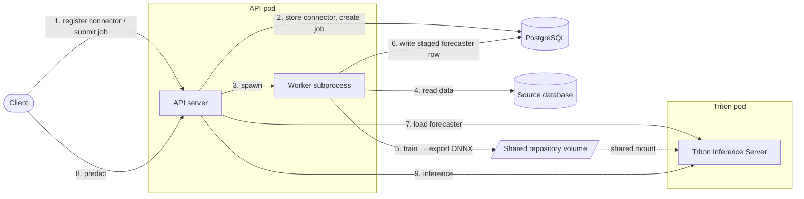
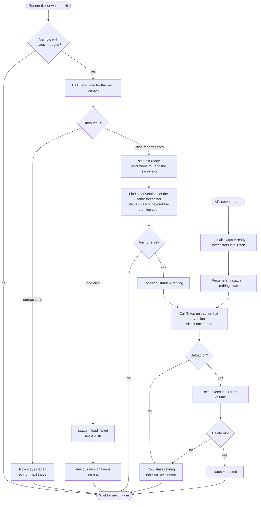
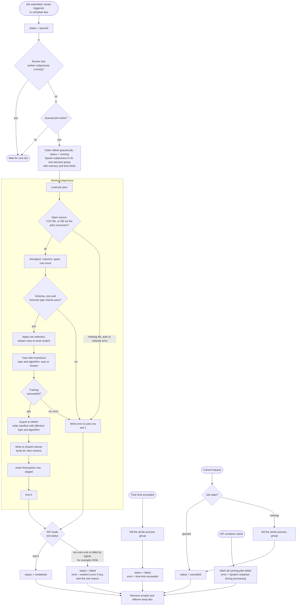
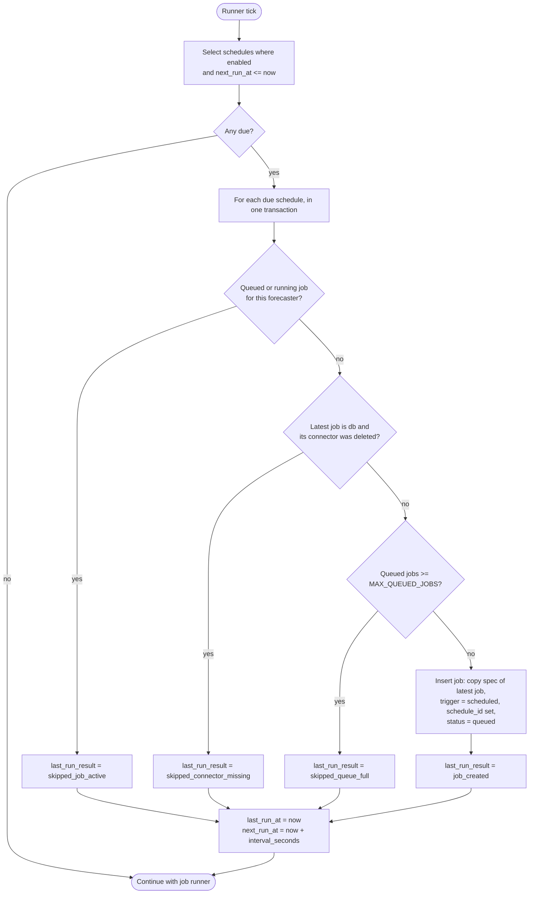
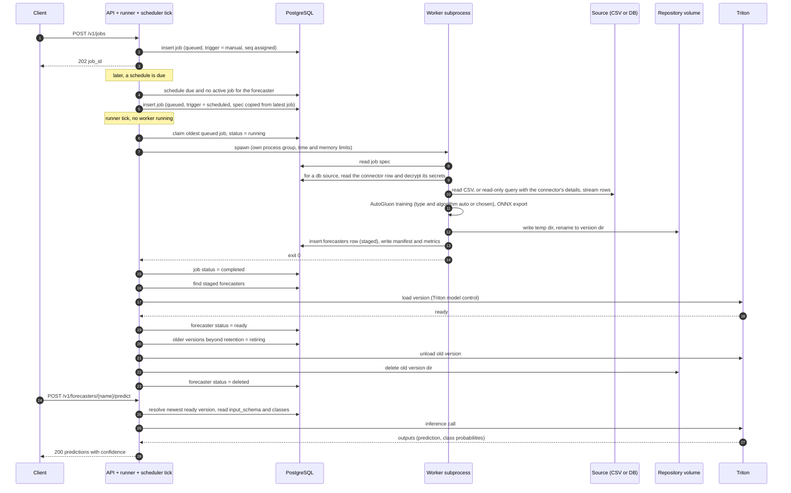
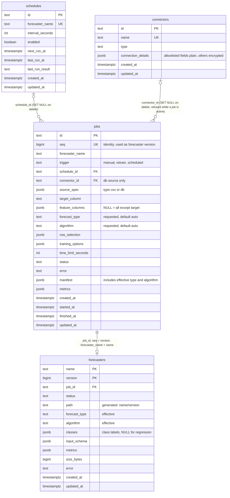

# Forecast Service — Implementation Proposal

## 1. Overview

This document proposes the design and implementation of the **Forecast** microservice for the AI-Services platform. The service trains machine-learning forecasters on tabular data from a CSV file or a database, serves them for prediction with a confidence score, and manages their versions and retraining.

A user submits a **training job** that names a data source (CSV or database), a target column, input columns, and optionally a forecast type, an algorithm and a row selection. When the job succeeds, the user calls a **predict** endpoint on the resulting forecaster. A forecaster can be retrained once, on demand, or on a schedule. Training uses **AutoGluon**. The trained AutoGluon model is exported to **ONNX** and served by **NVIDIA Triton Inference Server** on CPU. Training is asynchronous. Prediction is synchronous and proxied through the service to Triton.

> **Terminology.** A **forecaster** is the named, versioned unit that a training job produces and the predict endpoint serves. This document does not call it a "model", because "model" also names the learning algorithm AutoGluon trains. The word "model" appears only where another tool owns the name: Triton's *model repository* and *model control*, `model.onnx`, the AutoGluon and ONNX models inside a forecaster, and the Pydantic and ORM "models" in the code (`models.py`). The word "predictor" is avoided for the same reason, because AutoGluon uses it for its trainer classes. The inputs of a forecaster are called **input columns** (`feature_columns` in the API); its single output column is the **target**.

> **Scope notes.**
> - Conversion of an AutoGluon model to ONNX, and running Triton on Power, are treated as working capabilities and are not designed here. This document covers the service around them.
> - **The connector API is in scope; the connector implementation is not.** The service has `/v1/connectors` and a `connectors` table (§6.8). It has no scanner and no background sync. The data loader runs inside the worker process and reads the source only when a job runs (§2.5).
> - **Time-series forecasting is out of scope.** The forecaster is a tabular model over independent rows.
> - **Training and inference run on CPU only.** Spyre is not used.
> - **Resource sizing** (CPU, memory, scratch and volume size) is to be provided by DEV. This document names the knobs (§14) but does not set values.

The service follows the architectural patterns established by the digitize, translate and extract services where they apply:

- FastAPI application running as a Python service in a Podman container (ppc64le / RHEL).
- PostgreSQL (`forecast_metadata` database) for durable metadata, initialized by an idempotent init container.
- Single-replica deployment.
- Boot-time recovery scan that marks interrupted jobs as failed and cleans up leftovers.
- A recurring scheduler inside the API process (digitize uses APScheduler for its connector sync; §10 decides how forecast does it).
- A connector API with allowlist-encrypted credentials, as in digitize (§6.8).

It also introduces three things that no existing service has:

- A **training worker that runs as a subprocess** of the API, one at a time, with its own process group, time limit and memory limit.
- A **Triton pod** in explicit model-control mode, sharing a repository volume with the API pod. The API owns every interaction with Triton.
- A **second, restricted database role** for the worker, with column-level grants.

### 1.1 Concept-to-Design Mapping

| Concept                       | Design realization                                                                                                                                                  |
|:------------------------------|:--------------------------------------------------------------------------------------------------------------------------------------------------------------------|
| Source of training data       | The job's `source` object: `type: "csv"` (a file under `DATA_DIR`) or `type: "db"` (a table read through a stored connector, `connector_id`).                       |
| Connector                     | A row in `connectors` managed by `/v1/connectors`: type, connection details, secrets encrypted. No scanner and no sync.                                           |
| Inputs and target             | `feature_columns` (one or more; omitted means all columns except the target) and `target_column` (exactly one).                                                     |
| Forecast type                 | `forecast_type`: `auto` (default), `binary_classification`, `multiclass_classification`, `regression`. `auto` lets AutoGluon choose.                                |
| Forecast algorithm            | `algorithm`: `auto` (default), `lightgbm`, `xgboost`, and others from an allowlist. `auto` lets AutoGluon choose.                                                    |
| Training data selection       | `row_selection`: all rows, the first N, or the most recent N (by an ordering column).                                                                               |
| Training interval             | Once: a plain job. Triggered: `POST /v1/forecasters/{name}/retrain`. Scheduled: a row in `schedules` that creates a normal job each interval.                       |
| Training run                  | A **worker subprocess** spawned by the API: data loader → AutoGluon → ONNX export → write to the shared volume.                                                     |
| Trained forecaster            | A row in `forecasters` plus a version directory on the shared repository volume. The version number is the job's `jobs.seq`.                                        |
| Forecaster serving            | Triton in explicit model-control mode, on CPU. The API loads and unloads versions through Triton's model-control calls.                                             |
| Prediction with confidence    | `POST /v1/forecasters/{name}/predict` — the API validates rows against the stored input schema, calls Triton, and returns a prediction and a `confidence` per row.   |
| Replacing a forecaster        | A new version is `staged`, loaded into Triton, then marked `ready`. Older versions beyond the retention count are retired and their files deleted.                  |
| Versioning                    | `jobs.seq` (identity column) is the version. API path prefix `/v1/` versions the API itself.                                                                        |

---

## 2. Design Decisions

### 2.1 Decision — The training worker is a subprocess of the API

**Decision: training runs in a subprocess that the API spawns inside its own pod, one at a time.** It is not a separate pod, a Kubernetes Job or a thread.

- **Same image and code.** `python -m forecast.worker <job_id>` shares the DB models and loader code with the API. No container-runtime access, ServiceAccount or Podman socket is needed, which keeps the Podman and OpenShift deployments identical.
- **Killable.** AutoGluon trains with child processes and large memory use. The API starts the worker in its **own process group** and kills the whole group on cancel or timeout, so nothing keeps running.
- **Crash isolation from the event loop.** A worker that crashes or is killed by the kernel does not take the API's event loop with it, and the API can read the exit status.
- **Why not threads or a process pool.** AutoGluon and ONNX export are CPU- and memory-heavy, and AutoGluon forks. A subprocess per job gives a clean memory release at exit and a unit that can be killed.
- **The loader is part of this subprocess.** Reading the source is the first step of the worker, not a separate component, so every job gets a fresh, isolated read and a manifest of what it read.

**Trade-off — shared fate.** The API and the training run share one container, so they share its memory limit and its lifecycle. Training memory pressure can hurt the API, and an API redeploy kills a running training job. The worker therefore runs with a memory cap (`WORKER_MEMORY_LIMIT_MB`) and a time limit, and startup recovery fails any job that was running when the container stopped (§15.1).

### 2.2 Decision — The API owns all Triton interaction and all deletion

**Decision: only the API process talks to Triton, and only the API deletes forecaster files.**

- Triton runs in **explicit model-control mode**. Nothing is loaded until the API loads it. After a Triton restart, the API's startup step loads every `ready` row.
- The **database, not the volume, says what should be loaded.** A directory on the volume with no `ready` row is never served.
- The worker only **creates** new version directories. The API only **deletes** directories whose row is `retiring`. The two never write to the same directory.
- A version is retired only after a newer version of the same forecaster is `ready`, so a serving version always exists.

### 2.3 Decision — Single worker, enforced twice

**Decision: one training job runs at a time.** Other jobs wait as `queued`. Scheduled, triggered and manual jobs share the same queue.

- The runner in the API process spawns a subprocess only when none is running. This guard lives in the API process, so the API pod must run with `replicas: 1`.
- The database enforces the same rule: a unique partial index allows at most one `running` row (§13.2, the `idx_jobs_single_running` index). If the in-process guard is ever wrong, the second claim fails instead of starting a second trainer.

### 2.4 Decision — `jobs.seq` is the forecaster version

An identity column on `jobs` provides the version. The worker never picks a version number, versions never collide, and they increase with submission order. A failed or cancelled job leaves a gap in the sequence, which is harmless. A composite foreign key ties `(job_id, version, name)` in `forecasters` to `(id, seq, forecaster_name)` in `jobs`, so the database rejects a forecaster row whose version or name does not match its job. A retrain is just another job for the same `forecaster_name`, so it produces the next version.

### 2.5 Decision — Connectors are stored records; there is no scanner

**Decision: the service has a connector CRUD API and a `connectors` table, and nothing more.** A connector holds the connection details of one source database, with secrets encrypted. A `db` job names it by `connector_id`. The scanner, background sync and sync history that digitize attaches to a connector are not part of this service.

- **Same pattern as digitize.** Create, list, get, partial update and delete, with an allowlist of safe fields. Every other field is encrypted with AES-256-GCM (`DB_ENCRYPTION_KEY`) and never returned (§6.8).
- **No credentials in jobs.** A job carries only `connector_id`. Credentials are not in the request, in `jobs`, in `schedules`, in logs or in the manifest.
- **The worker reads and decrypts.** It runs the loader as its first step, reads the connector row with a `SELECT`-only grant and decrypts it with the key the API passes in (§8.3, §13.4). Nothing reads the source database outside a job.
- **Rotation is an update.** A scheduled retrain reads the connector each run, so changing a password with `PUT /v1/connectors/{id}` applies to the next run.
- **Referential safety.** A connector cannot be deleted while a `queued` or `running` job uses it (§6.8). Finished jobs keep their rows with `connector_id` set to `NULL`.

**Trade-off.** The service now stores credentials, so it needs an encryption key and key management that the digitize service already has. The key is also in the worker's environment, because the worker decrypts (§13.4).

### 2.6 Decision — Scheduled retraining creates ordinary jobs

**Decision: a schedule is a forecaster name plus an interval, and the spec comes from the forecaster's most recent job.** Each time the schedule fires it inserts a normal `jobs` row that copies that spec. Everything after that (queueing, the single worker, `seq` versioning, activation, retention) is reused unchanged. Details are in §10.

---

## 3. Non-Goals

- **Connector scanner and sync:** The connector API stores connection details (§6.8). There is no scanner, no background sync and no sync history. The data loader inside the worker reads the source when a job runs.
- **Horizontal scaling and multi-worker training:** The service is architected for a single API replica and a single concurrent training run. Job ownership, claim columns, heartbeats and fencing are out of scope.
- **Time series:** Not supported. Rows are independent.
- **Spyre and accelerators:** Training and inference run on CPU.
- **UI:** No user interface is included in this document. The service is API-only.
- **ONNX conversion and Triton on Power:** Treated as working capabilities. Not designed here.
- **Manual deletion of forecaster versions:** Versions are removed only by the retention policy (§7).
- **Incremental training from a watermark column:** Each job pulls the data it needs in full.
- **Writes to the source:** The loader is read-only.
- **Reuse of the digitize scanners:** The loader is new code. The digitize scanners read files from remote file systems, not rows from databases.

---

## 4. Architecture



Steps 1–7 are the training request, in the order it touches each entity. Steps 8–9 are a later predict request. The detail left out of this view (CSV source, schedules, retention, the table names) is in §6 to §13.

**Key interactions:**

- The **API pod** hosts the REST API, the job runner (scheduling, timeouts, cancellation, failure detection), the scheduler tick (creates jobs for due schedules) and the forecaster activator (Triton load/unload, retention, deletion).
- The **worker subprocess** owns the training work only. It has no polling loop. It reads its job, loads the data, trains, writes a version directory and a `staged` forecaster row, and exits.
- The **Triton pod** and the API pod mount the same repository volume. The API pod needs write access because the API deletes old versions, so the mount is a regular shared mount rather than a read-only one.
- The **Postgres pod** holds `connectors`, `schedules`, `jobs` and `forecasters`. The API connects as the DB owner. The worker connects as a restricted role (§13.4).
- `DATA_DIR` (CSV files) is a read-only mount in the API pod, provisioned from outside the service.
- The service is exposed externally on **port 8500** (configurable). This avoids the ports used by digitize (4000/4001), summarize (6000), similarity (7000), translate (9000) and extract (9500). The port has not been checked against every other service in the repo.
- The service depends on three things beyond itself: PostgreSQL, Triton, and the data source (a CSV mount or a customer database).

**Volume layout** (the repository volume holds Triton's model repository, with the repository root at `MODEL_REPO_PATH`):

```
/models/
└── {forecaster_name}/
    ├── {version}/              # version = jobs.seq
    │   └── model.onnx
    └── .tmp-{version}-{rand}/  # worker's temp dir, renamed to {version} on success
```

---

## 5. Endpoints

| Method     | Endpoint                           | Description                                                                         |
|:-----------|:-----------------------------------|:------------------------------------------------------------------------------------|
| **POST**   | `/v1/jobs`                         | Submit a training job. Returns `job_id`.                                            |
| **GET**    | `/v1/jobs`                         | List jobs with pagination and filters.                                              |
| **GET**    | `/v1/jobs/{job_id}`                | Job status, error, manifest, metrics and resulting forecaster version.              |
| **POST**   | `/v1/jobs/{job_id}/cancel`         | Cancel a queued or running job.                                                     |
| **GET**    | `/v1/forecasters`                  | List forecasters and their versions.                                                |
| **GET**    | `/v1/forecasters/{name}`           | Versions of one forecaster with status, schemas and metrics.                        |
| **POST**   | `/v1/forecasters/{name}/retrain`   | Trigger a retrain with the spec of the forecaster's latest job. Returns `job_id`.   |
| **POST**   | `/v1/forecasters/{name}/predict`   | Predict with the newest `ready` version, or a given version. Returns confidence.    |
| **POST**   | `/v1/connectors`                   | Create a connector (source database connection, secrets encrypted).                 |
| **GET**    | `/v1/connectors`                   | List connectors with pagination and a name filter.                                  |
| **GET**    | `/v1/connectors/{connector_id}`    | Get a connector. Secrets are never returned.                                        |
| **PUT**    | `/v1/connectors/{connector_id}`    | Partially update a connector (`name`, `connection_details`).                        |
| **DELETE** | `/v1/connectors/{connector_id}`    | Delete a connector. Refused while a queued or running job uses it.                  |
| **POST**   | `/v1/schedules`                    | Create a retraining schedule for a forecaster.                                      |
| **GET**    | `/v1/schedules`                    | List schedules.                                                                     |
| **GET**    | `/v1/schedules/{schedule_id}`      | Get one schedule, with its next and last run.                                       |
| **PUT**    | `/v1/schedules/{schedule_id}`      | Partially update a schedule (`interval_seconds`, `enabled`).                        |
| **DELETE** | `/v1/schedules/{schedule_id}`      | Delete a schedule. Jobs it already created keep running.                            |
| **GET**    | `/health`                          | Service health check (DB and Triton reachability).                                  |

All paths are resource-only (`/v1/jobs`, `/v1/forecasters`, `/v1/connectors`, `/v1/schedules`), as in digitize. Translate and extract put the service name in the path instead (`/v1/translate/jobs`). Every list endpoint returns the `{ "pagination": {...}, "data": [...] }` envelope used by digitize's jobs and documents lists and by translate and extract.

---

## 6. API Specification

### 6.0 Error format and status codes

Errors use the standard envelope from `services/common/error_utils.py`:

```json
{
    "error": {
        "code": "RESOURCE_NOT_FOUND",
        "message": "Forecaster 'units_sold' not found",
        "status": 404
    }
}
```

Two kinds of validation failure exist, as in digitize:

- **Automatic request validation by FastAPI and Pydantic** (wrong types, a bad `forecaster_name` pattern, an unknown `forecast_type`, an out-of-range `limit`) returns `422` with FastAPI's default error body. Neither digitize nor the other services install a handler that rewrites it, so it does not use the envelope above. This has not been run against a forecast service, because it does not exist yet.
- **Explicit checks in the handlers** use `APIError.raise_error(ErrorCode.INVALID_REQUEST, ...)`, which returns `400` with the envelope.

Error codes reused from `ErrorCode`: `INVALID_REQUEST` (400), `RESOURCE_NOT_FOUND` (404), `RESOURCE_LOCKED` (409), `REQUEST_TOO_LARGE` (413), `RATE_LIMIT_EXCEEDED` (429), `INTERNAL_SERVER_ERROR` (500), `DATABASE_ERROR` (500). One code is new: `TRITON_UNAVAILABLE` (503), because the only existing 503 codes are specific to the LLM and the vector store.

### 6.1 POST /v1/jobs — Submit a Training Job

**Content-Type:** `application/json`

| Field                | Type    | Required | Description                                                                                                                                  |
|:---------------------|:--------|:---------|:---------------------------------------------------------------------------------------------------------------------------------------------|
| `forecaster_name`    | string  | Yes      | Name of the forecaster. Lowercase letters, digits, `_` and `-`; 1–63 characters; must start with a letter or digit.                          |
| `source`             | object  | Yes      | Where the training data comes from. Discriminated by `type` (`csv` or `db`). See below.                                                      |
| `target_column`      | string  | Yes      | The one column to predict.                                                                                                                   |
| `feature_columns`    | array   | No       | One or more input columns. Omitted means all columns except the target.                                                                      |
| `forecast_type`      | string  | No       | `auto` (default), `binary_classification`, `multiclass_classification`, `regression`. `auto` lets AutoGluon choose from the target column.   |
| `algorithm`          | string  | No       | `auto` (default), `lightgbm`, `xgboost`, or another value from the allowlist. `auto` lets AutoGluon choose.                                  |
| `row_selection`      | object  | No       | Which rows to train on. Default `{"mode": "all"}`. See below.                                                                                |
| `training_options`   | object  | No       | Other AutoGluon options from an allowlist (for example `presets`). Unknown keys are rejected.                                                |
| `time_limit_seconds` | integer | No       | Hard time limit for the whole job. Default `DEFAULT_TIME_LIMIT_SECONDS`, maximum `MAX_TIME_LIMIT_SECONDS`.                                   |

**`source` — CSV:**

| Field  | Type   | Required | Description                                                                                       |
|:-------|:-------|:---------|:--------------------------------------------------------------------------------------------------|
| `type` | string | Yes      | `csv`.                                                                                            |
| `path` | string | Yes      | Path of the file, relative to `DATA_DIR`. Absolute paths and `..` segments are rejected.          |

**`source` — database:**

| Field          | Type   | Required | Description                                                                                       |
|:---------------|:-------|:---------|:--------------------------------------------------------------------------------------------------|
| `type`         | string | Yes      | `db`.                                                                                             |
| `connector_id` | string | Yes      | ID of a connector created with `POST /v1/connectors` (§6.8). No credentials in the job.           |
| `schema`       | string | No       | Schema of the table. Omitted means the connection's default schema.                               |
| `table`        | string | Yes      | Table to read. Raw SQL is not accepted.                                                           |

**`row_selection`:**

| Field      | Type    | Required                      | Description                                                                                                         |
|:-----------|:--------|:------------------------------|:--------------------------------------------------------------------------------------------------------------------|
| `mode`     | string  | No                            | `all` (default), `first_n` or `most_recent_n`.                                                                      |
| `n`        | integer | When `mode` is not `all`      | Number of rows. Greater than zero.                                                                                  |
| `order_by` | string  | See below                     | Ordering column, for example a timestamp or an id. `most_recent_n` takes the N rows with the largest values.        |

`order_by` is required for `most_recent_n`, and for `first_n` on a `db` source, because a table has no inherent row order. For a CSV, `first_n` without `order_by` means the first N lines of the file. The ordering column is read as ordinary data and is not used as an input column unless it is also listed in `feature_columns`. Note that this selects rows by position or value in a tabular dataset. It does not make the forecaster a time-series forecaster, which is out of scope.

**Validation rules:**

- `forecaster_name` must match `^[a-z0-9][a-z0-9_-]{0,62}$` (body validation, `422`). The name becomes a directory name on the shared volume, so it is validated strictly.
- `source`, `row_selection` and the request body reject unknown fields (body validation, `422`), so a `password` or any other credential sent inside `source` is refused rather than stored.
- `forecast_type` must be one of the four values and `algorithm` one of the allowlist (body validation, `422`).
- `time_limit_seconds` must be greater than zero (body validation, `422`) and not above the maximum (explicit check, `400`).
- If `feature_columns` is present it must be a non-empty array (body validation, `422`) and must not contain the target (explicit check, `400`).
- `row_selection`: `n` is required and positive when `mode` is not `all`, and `order_by` is required where stated above (explicit checks, `400`).
- CSV: `path` must resolve inside `DATA_DIR` (`400` otherwise) and the file must exist (`404 RESOURCE_NOT_FOUND`).
- Database: `connector_id` must name an existing connector (`404 RESOURCE_NOT_FOUND`). The API does not connect to the source database at submit time, so a wrong host or password shows up as a failed job, not as a rejected request.
- The API stores `connector_id` in its own column on `jobs` (a foreign key, §13.2) and the rest of `source` in `source_spec`. Both are copied by a retrain and by a schedule.
- Column and table names are checked against the real schema by the worker before any data is read (§9). A bad name fails the job with a clear error, not the request.
- If `forecast_type` is explicit, the worker checks it against the target column and fails the job when they disagree (for example `binary_classification` on a target with three distinct values).

**Processing flow (request thread):**

1. Validate the body.
2. Check that the number of `queued` jobs is below `MAX_QUEUED_JOBS`; otherwise return `429`.
3. Generate `job_id` (UUID).
4. Insert a row into `jobs` with `status='queued'` and `trigger='manual'`. The database assigns `seq`.
5. Return `202 Accepted` with `{ "job_id": "..." }`.

The runner (§8) picks the job up on its next tick.

**Sample request (database source, most recent 500,000 rows, everything left to AutoGluon):**

```bash
curl -X POST http://localhost:8500/v1/jobs \
  -H "Content-Type: application/json" \
  -d '{
        "forecaster_name": "units_sold",
        "source": {"type": "db", "connector_id": "7c9e6679-7425-40de-944b-e07fc1f90ae7", "schema": "SALES", "table": "ORDERS"},
        "target_column": "units_sold",
        "feature_columns": ["store_id", "price", "promo"],
        "forecast_type": "auto",
        "algorithm": "auto",
        "row_selection": {"mode": "most_recent_n", "n": 500000, "order_by": "order_ts"},
        "time_limit_seconds": 1800
      }'
```

**Sample request (CSV source, explicit type and algorithm):**

```bash
curl -X POST http://localhost:8500/v1/jobs \
  -H "Content-Type: application/json" \
  -d '{
        "forecaster_name": "churn",
        "source": {"type": "csv", "path": "customers/2026-q3.csv"},
        "target_column": "churned",
        "forecast_type": "binary_classification",
        "algorithm": "lightgbm"
      }'
```

**Sample response (202):**

```json
{
    "job_id": "a1b2c3d4-e5f6-7890-abcd-ef1234567890"
}
```

| Status                                        | Description                                                                                                                                                                        |
|:----------------------------------------------|:-----------------------------------------------------------------------------------------------------------------------------------------------------------------------------------|
| 202 Accepted                                  | Job queued.                                                                                                                                                                        |
| 400 Bad Request (`INVALID_REQUEST`)           | Explicit check failed: `feature_columns` contains the target, `time_limit_seconds` above the maximum, a bad `row_selection`, a CSV path outside `DATA_DIR`, or an unknown `training_options` key. |
| 404 Not Found (`RESOURCE_NOT_FOUND`)          | The CSV file or the connector does not exist.                                                                                                                                      |
| 422 Unprocessable Entity                      | Request-body validation failed: missing field, wrong type, unknown `forecast_type` or `algorithm`, or `forecaster_name` not matching its pattern.                                  |
| 429 Too Many Requests (`RATE_LIMIT_EXCEEDED`) | Too many queued jobs.                                                                                                                                                              |
| 500 Internal Server Error                     | Unexpected failure.                                                                                                                                                                |

---

### 6.2 GET /v1/jobs — List Jobs

**Query parameters:**

| Parameter         | Type   | Required | Description                                                      |
|:------------------|:-------|:---------|:-----------------------------------------------------------------|
| `limit`           | int    | No       | Records per page (1–100). Default: `20`.                         |
| `offset`          | int    | No       | Records to skip. Default: `0`.                                   |
| `status`          | string | No       | Filter: `queued`, `running`, `completed`, `failed`, `cancelled`. |
| `forecaster_name` | string | No       | Filter by forecaster name.                                       |
| `trigger`         | string | No       | Filter: `manual`, `retrain`, `scheduled`.                        |

**Sample response (200):**

```json
{
    "pagination": {"total": 3, "limit": 20, "offset": 0},
    "data": [
        {
            "job_id": "a1b2c3d4-e5f6-7890-abcd-ef1234567890",
            "forecaster_name": "units_sold",
            "trigger": "scheduled",
            "status": "completed",
            "created_at": "2026-10-26T09:00:00Z",
            "finished_at": "2026-10-26T09:24:12Z"
        }
    ]
}
```

| Status                    | Description                                  |
|:--------------------------|:---------------------------------------------|
| 200 OK                    | Paginated job list.                          |
| 422 Unprocessable Entity  | Invalid `limit`, `offset` or `status` value. |
| 500 Internal Server Error | Database failure.                            |

### 6.3 GET /v1/jobs/{job_id} — Job Details

Returns the full job row: spec, `trigger`, `schedule_id` (for scheduled jobs), `status`, `error`, `manifest`, `metrics`, `created_at`, `started_at`, `finished_at`, and, once the worker has staged it, the forecaster `version`, which equals the job's `seq`.

**`manifest`** is written by the worker and records what the training actually used: the source, the row selection applied, the row count, a schema hash, the time the data was read, and the **effective** forecast type and algorithm. When the request said `auto`, this is where the user finds out what AutoGluon chose. It makes a trained forecaster reproducible and auditable.

**`metrics`** is written by the worker: the validation scores AutoGluon reports. The metric names depend on the effective forecast type (for example accuracy and ROC AUC for classification, RMSE for regression).

**Sample response (200):**

```json
{
    "job_id": "a1b2c3d4-e5f6-7890-abcd-ef1234567890",
    "forecaster_name": "units_sold",
    "trigger": "manual",
    "schedule_id": null,
    "source": {"type": "db", "connector_id": "7c9e6679-7425-40de-944b-e07fc1f90ae7", "schema": "SALES", "table": "ORDERS"},
    "target_column": "units_sold",
    "forecast_type": "auto",
    "algorithm": "auto",
    "row_selection": {"mode": "most_recent_n", "n": 500000, "order_by": "order_ts"},
    "version": 7,
    "status": "completed",
    "error": null,
    "manifest": {
        "source": "SALES.ORDERS",
        "row_selection": {"mode": "most_recent_n", "n": 500000, "order_by": "order_ts"},
        "row_count": 500000,
        "schema_hash": "9f2c…",
        "read_at": "2026-10-26T09:02:11Z",
        "effective_forecast_type": "regression",
        "effective_algorithm": "LightGBM"
    },
    "metrics": {"rmse": 12.4},
    "created_at": "2026-10-26T09:00:00Z",
    "started_at": "2026-10-26T09:00:05Z",
    "finished_at": "2026-10-26T09:24:12Z"
}
```

| Status                               | Description                   |
|:-------------------------------------|:------------------------------|
| 200 OK                               | Full job status and metadata. |
| 404 Not Found (`RESOURCE_NOT_FOUND`) | No job with this ID.          |
| 500 Internal Server Error            | Database failure.             |

### 6.4 POST /v1/jobs/{job_id}/cancel — Cancel a Job

| State of the job                   | Behaviour                                                                           |
|:-----------------------------------|:------------------------------------------------------------------------------------|
| `queued`                           | Set to `cancelled` immediately.                                                     |
| `running`                          | The API sets `cancelled` first, then kills the worker's whole process group (§8.3). |
| `completed`, `failed`, `cancelled` | `409 RESOURCE_LOCKED`.                                                              |

Cancelling a job created by a schedule does not disable the schedule. The next run happens at the next interval.

| Status                               | Description                         |
|:-------------------------------------|:------------------------------------|
| 202 Accepted                         | Cancellation accepted.              |
| 404 Not Found (`RESOURCE_NOT_FOUND`) | No job with this ID.                |
| 409 Conflict (`RESOURCE_LOCKED`)     | Job is already in a terminal state. |

---

### 6.5 Forecasters

`GET /v1/forecasters` lists forecasters with their newest `ready` version. It accepts `limit` (1–100, default `20`) and `offset` (default `0`) and returns the standard `{ "pagination": {...}, "data": [...] }` envelope. `GET /v1/forecasters/{name}` lists every version row that is not `deleted`, with `status`, the effective `forecast_type` and `algorithm`, `input_schema`, `classes`, `metrics`, `size_bytes` and timestamps. A `load_failed` version carries its `error`. The versions of one forecaster are a small, bounded set (the retention count plus any in flight), so that response is not paginated.

Forecasters are listed from the `forecasters` table, so a forecaster appears here once its first version has been staged. Before that, `GET /v1/forecasters/{name}` returns `404`, and the job's progress is visible through `GET /v1/jobs`. `latest_ready_version` is `null` while every version is still `staged` or `load_failed`.

**Sample response — `GET /v1/forecasters` (200):**

```json
{
    "pagination": {"total": 1, "limit": 20, "offset": 0},
    "data": [
        {"name": "units_sold", "latest_ready_version": 7, "updated_at": "2026-10-26T09:24:12Z"}
    ]
}
```

**Sample response — `GET /v1/forecasters/units_sold` (200):**

```json
{
    "name": "units_sold",
    "versions": [
        {"version": 7, "status": "ready",
         "forecast_type": "regression", "algorithm": "LightGBM", "classes": null,
         "input_schema": [{"name": "store_id", "type": "int64"}, {"name": "price", "type": "float32"}],
         "metrics": {"rmse": 12.4}, "created_at": "2026-10-26T09:24:10Z"},
        {"version": 4, "status": "retiring", "created_at": "2026-10-20T11:02:44Z"}
    ]
}
```

| Status                               | Description                                                  |
|:-------------------------------------|:-------------------------------------------------------------|
| 200 OK                               | Forecaster list or versions.                                 |
| 404 Not Found (`RESOURCE_NOT_FOUND`) | No forecaster with this name (`GET /v1/forecasters/{name}`). |
| 422 Unprocessable Entity             | `limit` or `offset` out of range (`GET /v1/forecasters`).    |
| 500 Internal Server Error            | Database failure.                                            |

### 6.6 POST /v1/forecasters/{name}/retrain — Trigger a Retrain

Creates a job that repeats the spec of the forecaster's **most recent job** (highest `seq` for that `forecaster_name`, whatever its status). The new job has `trigger='retrain'` and goes through the same queue, so it yields the next version when it completes. The body is empty.

This is the *triggered* training interval. It is also how a client retrains after a deployment or after the source data changed. To change the spec (a different target, algorithm or row selection), submit a new job with `POST /v1/jobs` instead. A schedule then follows the new spec, because it also copies the most recent job (§10).

A retrain is refused with `409 RESOURCE_LOCKED` while a `queued` or `running` job exists for the same forecaster, so repeated calls cannot pile up duplicates.

If the latest job used a `db` source and its connector has since been deleted, there is nothing to copy and the retrain returns `404 RESOURCE_NOT_FOUND` naming the missing connector. Submit a new job with an existing connector to continue.

**Sample response (202):**

```json
{
    "job_id": "b2c3d4e5-f6a7-8901-bcde-f12345678901"
}
```

| Status                                        | Description                                                                |
|:----------------------------------------------|:---------------------------------------------------------------------------|
| 202 Accepted                                  | Retrain job queued.                                                        |
| 404 Not Found (`RESOURCE_NOT_FOUND`)          | No job has ever been submitted for this forecaster name, or the latest job's connector was deleted. |
| 409 Conflict (`RESOURCE_LOCKED`)              | A `queued` or `running` job already exists for this forecaster.            |
| 429 Too Many Requests (`RATE_LIMIT_EXCEEDED`) | Too many queued jobs.                                                      |
| 500 Internal Server Error                     | Unexpected failure.                                                        |

### 6.7 POST /v1/forecasters/{name}/predict — Predict

**Content-Type:** `application/json`

| Field       | Type    | Required | Description                                                        |
|:------------|:--------|:---------|:-------------------------------------------------------------------|
| `instances` | array   | Yes      | Rows to predict. Each row is an object keyed by input column name. |
| `version`   | integer | No       | A specific `ready` version. Default: the newest `ready` version.   |

**Processing flow:**

1. Resolve the version from the database. Only `ready` versions can be used.
2. Validate each row against the stored `input_schema`: every required column present, types compatible, no unknown columns.
3. Order and convert the columns into the tensors the ONNX model expects.
4. Call Triton for that forecaster and version.
5. Map the output back to one result per input row, and compute the confidence (below).

**Response fields.** The response has `forecaster`, `version`, `forecast_type` (the effective type of that version) and `predictions`, one object per input row, in order:

| Field           | Type                    | Description                                                                                                                                              |
|:----------------|:------------------------|:---------------------------------------------------------------------------------------------------------------------------------------------------------|
| `prediction`    | number or string        | The forecast. A class label for classification, a number for regression.                                                                                 |
| `confidence`    | number in [0, 1], or null | Classification: the probability the forecaster assigns to the predicted class. Regression: `null` (see below).                                         |
| `probabilities` | object, or null         | Classification only: probability per class label, summing to 1. Omitted for regression.                                                                  |

**What the confidence score is, and is not.** For classification it is the forecaster's own predicted class probability. It is **not** guaranteed to be calibrated: 0.9 does not mean the prediction is right 90 % of the time unless calibration was checked on held-out data. For regression there is no probability, so `confidence` is `null` in this proposal. A prediction interval would be a different quantity and would need a different training and export path. The output tensors needed (class probabilities) must come out of the ONNX export and be configured in Triton. That has not been verified.

**Sample request:**

```bash
curl -X POST http://localhost:8500/v1/forecasters/churn/predict \
  -H "Content-Type: application/json" \
  -d '{"instances": [{"tenure": 14, "plan": "pro"}, {"tenure": 2, "plan": "basic"}]}'
```

**Sample response — classification (200):**

```json
{
    "forecaster": "churn",
    "version": 12,
    "forecast_type": "binary_classification",
    "predictions": [
        {"prediction": "stay",    "confidence": 0.91, "probabilities": {"stay": 0.91, "churn": 0.09}},
        {"prediction": "churn",   "confidence": 0.74, "probabilities": {"stay": 0.26, "churn": 0.74}}
    ]
}
```

**Sample response — regression (200):**

```json
{
    "forecaster": "units_sold",
    "version": 7,
    "forecast_type": "regression",
    "predictions": [
        {"prediction": 128.4, "confidence": null},
        {"prediction": 97.1,  "confidence": null}
    ]
}
```

| Status                                         | Description                                                                                                                              |
|:-----------------------------------------------|:-----------------------------------------------------------------------------------------------------------------------------------------|
| 200 OK                                         | Predictions returned.                                                                                                                    |
| 400 Bad Request (`INVALID_REQUEST`)            | Explicit check against the stored `input_schema` failed: missing, unknown or wrongly typed column. The error names the offending column. |
| 404 Not Found (`RESOURCE_NOT_FOUND`)           | No `ready` version of this forecaster (or the requested version is not `ready`).                                                         |
| 413 Payload Too Large (`REQUEST_TOO_LARGE`)    | More than `MAX_PREDICT_ROWS` rows.                                                                                                       |
| 422 Unprocessable Entity                       | Request-body validation failed: `instances` missing or not an array.                                                                     |
| 503 Service Unavailable (`TRITON_UNAVAILABLE`) | Triton is unreachable or reports the ONNX model not ready.                                                                               |
| 500 Internal Server Error                      | Unexpected failure.                                                                                                                      |

A prediction request during a version switch is routed to a `ready` version according to the database. Because the new version is loaded into Triton **before** it is marked `ready`, the route never points to a version that is not loaded.

---

### 6.8 Connectors

A connector stores the connection details of one source database, with its secrets encrypted. A `db` job refers to it by `connector_id` (§6.1). The endpoints follow `services/digitize/api/v1/connectors.py`: create, list, get, partial update and delete, with the allowlist encryption of `connectors/encryption.py`.

> **The type and its fields below are a proposal.** They have not been checked against a Db2 for i driver, and the real field names and default port depend on the driver chosen (§9.3).

**What is in scope and what is not.** This section is the connector **API and its table**. There is no scanner, no sync, no sync history and no scheduler for connectors. Nothing reads the source database until a training job runs, and then the loader inside the worker does it (§9.3). A connector therefore has no `status`, no `last_sync_at` and no file counters, which digitize's connectors have.

**Connector types.** `type` is validated against a fixed list. The first type is `db2_for_i`. Adding a database means adding its type, its required fields and its safe fields (below) to the allowlist, and a driver in the loader.

**Secret handling.** Each type declares **safe fields**, which are stored in plaintext and returned in responses. Every other field is a secret: it is encrypted with AES-256-GCM using `DB_ENCRYPTION_KEY` before it is stored and is never returned. Listing safe fields, instead of listing secret fields, means a credential field that nobody thought of is encrypted by default and is never returned.

| Type         | Required fields (`connection_details`)    | Optional   | Safe (plaintext, returned)           | Encrypted, never returned |
|:-------------|:------------------------------------------|:-----------|:-------------------------------------|:--------------------------|
| `db2_for_i`  | `host`, `database`, `username`, `password`| `port`     | `host`, `port`, `database`, `username` | `password`              |

#### POST /v1/connectors — Create a Connector

**Content-Type:** `application/json`

| Field                | Type   | Required | Description                                                                                          |
|:---------------------|:-------|:---------|:-----------------------------------------------------------------------------------------------------|
| `id`                 | string | No       | A UUID chosen by the client (for example a catalog). Generated when omitted.                         |
| `name`               | string | Yes      | Unique, human-readable name, 1–255 characters.                                                       |
| `type`               | string | Yes      | A supported connector type (`db2_for_i`).                                                            |
| `connection_details` | object | Yes      | Fields for the type, as in the table above. Unknown fields are rejected.                             |

**Sample request:**

```bash
curl -X POST http://localhost:8500/v1/connectors \
  -H "Content-Type: application/json" \
  -d '{
        "name": "prod-sales-db",
        "type": "db2_for_i",
        "connection_details": {
          "host": "ibmi.example.com",
          "port": 8471,
          "database": "PRODDB",
          "username": "forecast_ro",
          "password": "********"
        }
      }'
```

**Sample response (201):**

```json
{
    "id": "7c9e6679-7425-40de-944b-e07fc1f90ae7"
}
```

Duplicate checks run before the insert: a repeated `id` or `name` returns `409`. The 201 differs from digitize, which returns 202 because it also starts a sync.

| Status                              | Description                                                                              |
|:------------------------------------|:-----------------------------------------------------------------------------------------|
| 201 Created                         | Connector stored, secrets encrypted.                                                     |
| 409 Conflict (`RESOURCE_LOCKED`)    | The `id` or the `name` already exists.                                                   |
| 422 Unprocessable Entity            | Body validation failed: unknown `type`, an `id` that is not a UUID, a missing or unknown field in `connection_details`. |
| 500 Internal Server Error           | Database failure, or `DB_ENCRYPTION_KEY` missing or not 32 bytes.                        |

#### GET /v1/connectors — List Connectors

| Parameter | Type   | Required | Description                                                        |
|:----------|:-------|:---------|:-------------------------------------------------------------------|
| `limit`   | int    | No       | Records per page (1–200). Default: `50`.                           |
| `offset`  | int    | No       | Records to skip. Default: `0`.                                     |
| `name`    | string | No       | Partial, case-insensitive match on the name.                       |

The list limits (50 default, 200 maximum) match digitize's connector list. The response uses the `{ "pagination": {...}, "data": [...] }` envelope. Digitize's connector list returns `{total, limit, offset, items}` instead.

**Sample response (200):**

```json
{
    "pagination": {"total": 1, "limit": 50, "offset": 0},
    "data": [
        {
            "id": "7c9e6679-7425-40de-944b-e07fc1f90ae7",
            "name": "prod-sales-db",
            "type": "db2_for_i",
            "created_at": "2026-10-26T08:55:00Z"
        }
    ]
}
```

#### GET /v1/connectors/{connector_id} — Get a Connector

Returns the list item plus `connection_details` limited to the safe fields and `updated_at`. Secrets are omitted, including any field that is stored but not on the allowlist.

```json
{
    "id": "7c9e6679-7425-40de-944b-e07fc1f90ae7",
    "name": "prod-sales-db",
    "type": "db2_for_i",
    "connection_details": {"host": "ibmi.example.com", "port": 8471, "database": "PRODDB", "username": "forecast_ro"},
    "created_at": "2026-10-26T08:55:00Z",
    "updated_at": "2026-10-26T08:55:00Z"
}
```

#### PUT /v1/connectors/{connector_id} — Update a Connector

**Content-Type:** `application/json`. All fields are optional and the body rejects unknown fields, so `type` cannot be changed.

| Field                | Type   | Description                                                                                      |
|:---------------------|:-------|:-------------------------------------------------------------------------------------------------|
| `name`               | string | New unique name.                                                                                 |
| `connection_details` | object | Partial. Only the supplied keys are overwritten; the others, including stored secrets, stay.     |

- An empty body is a no-op and returns `200`.
- The merged details are validated against the type before anything is written. The stored secrets are decrypted for that check. A failure returns `400 INVALID_REQUEST`.
- Supplied secret fields are encrypted again before they are stored.
- A queued job reads the connector when it runs, not when it was submitted. An update therefore also applies to jobs already in the queue, and a scheduled run uses the current details.

#### DELETE /v1/connectors/{connector_id} — Delete a Connector

Returns `204`. The delete is **refused with `409 RESOURCE_LOCKED` while a `queued` or `running` job uses the connector**, because that job could not read its source. Finished jobs (`completed`, `failed`, `cancelled`) keep their rows and have `connector_id` set to `NULL`. The database enforces the refusal with a CHECK constraint (§13.2), so a job queued between the API's check and its delete also makes the delete fail, and the API returns the same `409`.

Digitize's delete is asynchronous and always returns 204 because it tears down synced files. There is nothing to tear down here, so the delete is a single statement and can fail with `409`.

| Status                               | Description                                                                       |
|:-------------------------------------|:----------------------------------------------------------------------------------|
| 200 OK                               | List, get or update succeeded.                                                    |
| 204 No Content                       | Connector deleted.                                                                |
| 400 Bad Request (`INVALID_REQUEST`)  | Update: the merged `connection_details` are not valid for the type.               |
| 404 Not Found (`RESOURCE_NOT_FOUND`) | No connector with this ID.                                                        |
| 409 Conflict (`RESOURCE_LOCKED`)     | Update: the new `name` is already used. Delete: a `queued` or `running` job uses the connector. |
| 422 Unprocessable Entity             | Body, `limit` or `offset` validation failed, or `type` sent in an update.         |
| 500 Internal Server Error            | Database failure, or an encryption key error.                                     |

---

### 6.9 Schedules

A schedule retrains one forecaster at a fixed interval. It stores only the forecaster name, the interval and its state. The training spec is **not** stored on the schedule: each run copies the spec of the forecaster's most recent job (§10).

#### POST /v1/schedules — Create a Schedule

**Content-Type:** `application/json`

| Field              | Type    | Required | Description                                                                                       |
|:-------------------|:--------|:---------|:--------------------------------------------------------------------------------------------------|
| `forecaster_name`  | string  | Yes      | Forecaster to retrain. At least one job must exist for it.                                        |
| `interval_seconds` | integer | Yes      | Time between runs. At least `MIN_SCHEDULE_INTERVAL_SECONDS`.                                      |
| `enabled`          | boolean | No       | Default `true`.                                                                                   |

The first run is `interval_seconds` after creation. Creating a schedule does not start a job. One schedule per forecaster is allowed.

**Sample request:**

```bash
curl -X POST http://localhost:8500/v1/schedules \
  -H "Content-Type: application/json" \
  -d '{"forecaster_name": "units_sold", "interval_seconds": 86400}'
```

**Sample response (201):**

```json
{
    "schedule_id": "d4e5f6a7-b8c9-0123-def0-123456789abc"
}
```

| Status                               | Description                                                                         |
|:-------------------------------------|:------------------------------------------------------------------------------------|
| 201 Created                          | Schedule stored.                                                                    |
| 400 Bad Request (`INVALID_REQUEST`)  | `interval_seconds` below `MIN_SCHEDULE_INTERVAL_SECONDS`.                           |
| 404 Not Found (`RESOURCE_NOT_FOUND`) | No job has ever been submitted for this forecaster name.                            |
| 409 Conflict (`RESOURCE_LOCKED`)     | A schedule for this forecaster already exists.                                      |
| 422 Unprocessable Entity             | Request-body validation failed.                                                     |
| 500 Internal Server Error            | Database failure.                                                                   |

#### GET /v1/schedules — List Schedules

| Parameter         | Type    | Required | Description                              |
|:------------------|:--------|:---------|:-----------------------------------------|
| `limit`           | int     | No       | Records per page (1–100). Default: `20`. |
| `offset`          | int     | No       | Records to skip. Default: `0`.           |
| `forecaster_name` | string  | No       | Filter by forecaster name.               |
| `enabled`         | boolean | No       | Filter by state.                         |

**Sample response (200):**

```json
{
    "pagination": {"total": 1, "limit": 20, "offset": 0},
    "data": [
        {
            "schedule_id": "d4e5f6a7-b8c9-0123-def0-123456789abc",
            "forecaster_name": "units_sold",
            "interval_seconds": 86400,
            "enabled": true,
            "next_run_at": "2026-10-27T09:00:00Z",
            "last_run_at": "2026-10-26T09:00:00Z",
            "last_run_result": "job_created"
        }
    ]
}
```

#### GET /v1/schedules/{schedule_id} — Get a Schedule

Returns one item of the list above. `last_run_result` is `job_created`, `skipped_job_active` (a queued or running job for the forecaster already existed), `skipped_queue_full`, `skipped_connector_missing` (the latest job's connector was deleted, §10.2), or `null` before the first run.

#### PUT /v1/schedules/{schedule_id} — Update a Schedule

**Content-Type:** `application/json`. All fields are optional.

| Field              | Type    | Description                                                                                                    |
|:-------------------|:--------|:---------------------------------------------------------------------------------------------------------------|
| `interval_seconds` | integer | New interval. Sets `next_run_at` to now plus the new interval.                                                 |
| `enabled`          | boolean | `false` stops runs. Setting it back to `true` sets `next_run_at` to now plus the interval, with no catch-up.   |

An empty body is a no-op and returns `200`.

#### DELETE /v1/schedules/{schedule_id} — Delete a Schedule

Returns `204`. Jobs the schedule already created keep their rows and keep running, with `schedule_id` set to `NULL`.

| Status                               | Description                                                                |
|:-------------------------------------|:---------------------------------------------------------------------------|
| 200 OK                               | List, get or update succeeded.                                             |
| 204 No Content                       | Schedule deleted.                                                          |
| 400 Bad Request (`INVALID_REQUEST`)  | `interval_seconds` below `MIN_SCHEDULE_INTERVAL_SECONDS` (update).         |
| 404 Not Found (`RESOURCE_NOT_FOUND`) | No schedule with this ID.                                                  |
| 422 Unprocessable Entity             | Body, `limit` or `offset` validation failed.                               |
| 500 Internal Server Error            | Database failure.                                                          |

---

### 6.10 GET /health

Returns `200` when the API can reach PostgreSQL. The response also reports Triton reachability. A Triton outage does not make the service unhealthy, because training and job management still work; it makes predictions return `503 TRITON_UNAVAILABLE`.

---

## 7. Forecaster Activation and Retention

The API's forecaster activator runs after every worker exit, on every runner tick, and at startup. It moves forecaster rows through their status values.



**Forecaster row status values**

- `staged` → `ready` or `load_failed`.
- `ready` → `retiring` → `deleted`.
- `load_failed` is terminal for a version that never loaded.

**Rules:**

- The retention count is `FORECASTER_RETENTION_COUNT` (default `1`: only the newest `ready` version is kept; set higher to keep versions for rollback). Scheduled retraining creates a version per run, so retention is what bounds disk use.
- A version is retired only after its successor is `ready`.
- Unload and delete are retried on the next trigger. A row stays `retiring` until both succeed, so a crash between them leaves a visible, resumable state rather than an orphan.
- Rows are kept after `deleted`, so version numbers stay unique and there is an audit trail.
- A retrained forecaster can change its input columns or classes between versions. Predict validates against the **version's own** `input_schema`, so a client that pins `version` is unaffected, and one that does not gets the newest schema.

---

## 8. Training Job Lifecycle

The API process owns scheduling, timeouts, cancellation and failure detection. The worker subprocess owns the training work. A job is the same whether it was submitted by a client, triggered as a retrain, or created by a schedule.



### 8.1 Job status values

- `queued` → `running` → `completed` or `failed`.
- `queued` → `cancelled`, and `running` → `cancelled`.

### 8.2 Who writes what

- **The API** sets every job status (`running`, `completed`, `failed`, `cancelled`) and every `forecasters` status change after `staged`. It also writes `schedules` and inserts `jobs` rows (for manual, retrain and scheduled jobs).
- **The worker** writes only its own `error`, `manifest` and `metrics` on its `jobs` row, and inserts one `forecasters` row as `staged`.

This split is enforced by database grants (§13.4), not only by convention.

### 8.3 Process control

- **Process group.** The worker starts in its own process group. On cancel or timeout the API kills the whole group, so AutoGluon's child processes do not survive.
- **Status precedence.** When the API kills the worker for a cancel or a timeout, it sets the job status **first**. The exit status of the killed process is then ignored, so a cancelled job is never overwritten with `failed`.
- **Exit mapping.** Exit `0` → `completed`. A non-zero exit or a kill signal (for example the OOM killer) → `failed`, keeping the worker's own error message if it wrote one, otherwise recording the exit reason.
- **Limits.** The worker is started with a time limit from the job and a memory cap well below the container limit (`WORKER_MEMORY_LIMIT_MB`, §14).
- **Credentials.** The API passes the restricted DB role's credentials and `DB_ENCRYPTION_KEY` to the subprocess explicitly. Source-database credentials are not passed: the worker reads the connector row and decrypts it itself (§2.5).

### 8.4 Cleanup after every outcome

After each job, whatever its outcome, the API removes the job's scratch directory and any leftover temp directory (`.tmp-*`) the worker left on the repository volume.

---

## 9. Data Loader

The loader is **new code that runs inside the worker**, as its first step. There is no separate scanner component and no background sync: the connector API (§6.8) only stores connection details, and the loader reads them when a job runs. It reads either a CSV file or a database table, applies the row selection, and writes a dataset to local scratch.

### 9.1 Common steps

1. **Open the source** (CSV or database, below).
2. **Introspect** column names and types, and a row count.
3. **Validate** `target_column`, `feature_columns` and the `row_selection.order_by` column against the introspected schema. Anything missing fails the job before data is read.
4. **Check the forecast type.** For an explicit `forecast_type`, compare it with the target: `regression` needs a numeric target, `binary_classification` exactly two distinct values, `multiclass_classification` three or more. A mismatch fails the job with a message naming the column and the distinct-value count. For `auto`, nothing is checked here and AutoGluon infers the type from the target.
5. **Check size.** If the number of rows to be read (after the row selection) exceeds `MAX_TRAINING_ROWS`, or the estimated dataset exceeds the scratch space, the job fails before training with a clear error.
6. **Apply the row selection and stream** the selected rows to Parquet on local scratch in fixed-size chunks. The whole dataset is never held in memory by the loader.
7. **Write the manifest**: source, row selection applied, row count, schema hash, read time. After training the worker adds the effective forecast type and algorithm.

### 9.2 CSV source

- The path is resolved against `DATA_DIR` and must stay inside it (symlinks resolved), so a request cannot read an arbitrary file.
- The file is read in chunks. A header row is required. Column types are inferred from the data, and the inferred types go into the manifest.
- `first_n` without `order_by` takes the first N data lines. With `order_by` the loader needs to sort, which for a large file means an external sort on scratch; this cost has not been measured.
- JSON files are listed in the product requirements as a source format. They are not designed here.

### 9.3 Database source

- The worker reads the job's connector row (`jobs.connector_id`) with its read-only grant, decrypts the secret fields with `DB_ENCRYPTION_KEY` and connects with the result. A connector that no longer exists or cannot be decrypted fails the job with an error that names the connector and never contains a secret.
- **Db2 for i is the first target** in the requirements. The Db2 (LUW) documentation says a Linux client can reach a Db2 for i (System i) server through the IBM Data Server Client or Driver with Db2 Connect capability, and that this needs a Db2 Connect license activated at the client. That text is from the Db2 10.5 and 9.7 era documentation. It does not say whether the driver is available for ppc64le Linux, whether it fits a container image, or how licensing works for a containerized client. Whether to use that driver or an IBM i ODBC driver is not decided here.
- The session is opened **read-only** with a statement timeout where the database supports it. Authentication and network failures raise distinct errors so the job error tells the user which one occurred.
- The query is built from the validated `schema`, `table`, columns and `row_selection`. For `most_recent_n` it orders by `order_by` descending and limits to N; for `first_n` it orders ascending and limits to N. Row-limiting syntax differs between databases and is part of the per-type driver code.
- Rows are streamed with a server-side cursor in fixed-size chunks, inside one read-only transaction at the highest isolation level the database offers, so the snapshot is consistent.
- Every user-supplied identifier is quoted through the driver's identifier API, never concatenated into SQL. Raw SQL is not accepted as a source.
- The account named in the connector should be read-only. The read-only session is a second control; the account is the stronger one.

---

## 10. Scheduled Retraining

The requirements give three training intervals. All three end in the same place, a `jobs` row in `queued`:

- **Once:** `POST /v1/jobs`.
- **Triggered:** `POST /v1/forecasters/{name}/retrain` (§6.6).
- **Scheduled:** a row in `schedules` that the scheduler turns into a job each time it is due.

### 10.1 Design

- A schedule holds a forecaster name and an interval, not a copy of the training spec. When it fires, the scheduler copies the spec of that forecaster's **most recent job**. To change what a schedule trains, submit a new job with the new spec; the next scheduled run follows it. This avoids a second place where a spec can go stale.
- **The scheduler is a step of the existing runner tick**, not a separate scheduling library. Each tick (every `RUNNER_TICK_SECONDS`) it looks for due schedules in the database. Digitize uses APScheduler with in-memory triggers and re-registers them at startup; here the due time is stored in `schedules.next_run_at`, so there is nothing to re-register after a restart and no second scheduler to keep consistent with the database. The cost is a resolution of one tick, which is fine for intervals of minutes or more.
- The interval is a fixed number of seconds (`interval_seconds`, at least `MIN_SCHEDULE_INTERVAL_SECONDS`). Cron expressions and calendar times are not supported.

### 10.2 Tick algorithm



- **No catch-up.** `next_run_at` is set to *now plus the interval*, not to the previous due time plus the interval. If the API was down for three intervals, it runs **once** after restart and then resumes the normal cadence, instead of queuing three trainings.
- **Overlap policy.** A run is skipped when a job for the same forecaster is already `queued` or `running`. The skip is recorded in `last_run_result`, so a schedule that keeps being skipped (training takes longer than the interval) is visible.
- **Queue-full policy.** A run is skipped, not delayed, when the queue is at `MAX_QUEUED_JOBS`.
- **One process.** Only the API process runs the tick (`replicas: 1`), so a schedule cannot fire twice. `SELECT ... FOR UPDATE SKIP LOCKED` is used anyway so that a second API process during a rolling update would not double-fire.
- **A schedule needs a job to copy.** Creating one requires that a job exists for the forecaster. If the latest job's CSV file has since disappeared, the scheduled job is created and then fails in the worker with a clear error, and the schedule keeps firing.
- **A deleted connector cannot be copied.** If the latest job used a connector that was deleted, its `connector_id` is `NULL` and a new `db` job could not be queued (§13.2). The run is skipped with `last_run_result = skipped_connector_missing`. Submitting a new job with an existing connector fixes it, because the schedule then follows that job.
- **Disabled schedules** are not selected. Re-enabling sets `next_run_at` to now plus the interval.
- **Failures do not disable a schedule.** A failed scheduled job leaves the previous `ready` version serving. Repeated failure shows in `GET /v1/jobs?trigger=scheduled&status=failed`. Automatic disabling after N failures is not included.

### 10.3 Effect on versions and storage

Each successful run produces a new version, which goes through the normal activation (§7). Because a schedule can produce a version every few minutes, `FORECASTER_RETENTION_COUNT` and `MIN_SCHEDULE_INTERVAL_SECONDS` together bound disk use and Triton churn. The default minimum interval is chosen high enough that one training normally finishes before the next is due.

---

## 11. Async Workflow Sequence Diagram



---

## 12. Storage Layout

### 12.1 Overview

Durable metadata lives in **PostgreSQL**: the service gets its own database, `forecast_metadata`, in its own Postgres pod, following the per-service `{service_name}_metadata` convention established by the digitize migration.

File-based storage is used for:

- **The repository volume** (`MODEL_REPO_PATH`, shared with the Triton pod): finished forecaster versions in Triton's layout (§4). On OpenShift this is a PVC that needs `ReadWriteMany` if the API and Triton pods can land on different nodes. On Podman it is a host mount shared by both pods.
- **Training scratch** (`SCRATCH_DIR`, local to the API pod): the dataset and AutoGluon's working files for the running job. Removed after every job. It is not shared with Triton.
- **CSV data** (`DATA_DIR`): read-only mount of training files, provisioned from outside the service.

### 12.2 Lifecycle of Storage Artifacts

| Artifact               | Created at                                              | Updated during                                                          | Deleted at                                                                    |
|:-----------------------|:--------------------------------------------------------|:------------------------------------------------------------------------|:------------------------------------------------------------------------------|
| `connectors` row       | `POST /v1/connectors`                                   | `PUT`                                                                   | `DELETE`, refused while a `queued` or `running` job uses it                   |
| `schedules` row        | `POST /v1/schedules`                                    | `PUT`; the scheduler tick sets `next_run_at`, `last_run_*`              | `DELETE`                                                                      |
| `jobs` row             | `POST /v1/jobs`, `retrain`, or the scheduler (`queued`) | API sets status and times; worker writes `error`, `manifest`, `metrics` | Not exposed via API currently                                                 |
| Scratch directory      | Worker start                                            | —                                                                       | API deletes after every outcome                                               |
| Temp version directory | Worker, while exporting                                 | —                                                                       | Renamed on success; removed by the API on failure, cancel, timeout or restart |
| Version directory      | Worker, by rename                                       | —                                                                       | API, only when the row is `retiring` and Triton has unloaded it               |
| `forecasters` row      | Worker (`staged`)                                       | API changes status                                                      | Never deleted; kept as `deleted`                                              |

---

## 13. Database Schema

Conventions follow `services/digitize/db/scripts/init_schema.sql`: `TIMESTAMPTZ`, `IF NOT EXISTS` so the script is idempotent, CHECK constraints for enums, partial indexes, and the shared `update_updated_at_column()` trigger.

### 13.1 Entity-relationship diagram



### 13.2 Schema Creation via Init Container

Identical pattern to the digitize, translate and extract services: an init container (`forecast-db-init`) runs before the main `forecast-api` container, executing an idempotent `init_schema.sql` through `db/scripts/init_db.py`.

**Script: `services/forecast/db/scripts/init_schema.sql`**

```sql
-- Forecast service — idempotent schema initialization

CREATE TABLE IF NOT EXISTS connectors (
    id                 TEXT PRIMARY KEY,
    name               TEXT NOT NULL UNIQUE,
    type               TEXT NOT NULL,                   -- validated in the API against the supported connector types
    connection_details JSONB NOT NULL,                  -- allowlisted fields in plaintext, every other field AES-256-GCM encrypted
    created_at         TIMESTAMPTZ NOT NULL DEFAULT CURRENT_TIMESTAMP,
    updated_at         TIMESTAMPTZ NOT NULL DEFAULT CURRENT_TIMESTAMP,
    CONSTRAINT chk_connectors_name CHECK (length(name) BETWEEN 1 AND 255),
    CONSTRAINT chk_connectors_details CHECK (jsonb_typeof(connection_details) = 'object')
);

CREATE TABLE IF NOT EXISTS schedules (
    id               TEXT PRIMARY KEY,
    forecaster_name  TEXT NOT NULL UNIQUE,             -- one schedule per forecaster
    interval_seconds INTEGER NOT NULL,
    enabled          BOOLEAN NOT NULL DEFAULT TRUE,
    next_run_at      TIMESTAMPTZ NOT NULL,
    last_run_at      TIMESTAMPTZ,
    last_run_result  TEXT,
    created_at       TIMESTAMPTZ NOT NULL DEFAULT CURRENT_TIMESTAMP,
    updated_at       TIMESTAMPTZ NOT NULL DEFAULT CURRENT_TIMESTAMP,
    CONSTRAINT chk_schedules_name CHECK (forecaster_name ~ '^[a-z0-9][a-z0-9_-]{0,62}$'),
    CONSTRAINT chk_schedules_interval CHECK (interval_seconds > 0),
    CONSTRAINT chk_schedules_result CHECK (last_run_result IS NULL
        OR last_run_result IN ('job_created','skipped_job_active','skipped_queue_full','skipped_connector_missing'))
);

CREATE TABLE IF NOT EXISTS jobs (
    id                 TEXT PRIMARY KEY,
    seq                BIGINT GENERATED ALWAYS AS IDENTITY UNIQUE,
    forecaster_name    TEXT NOT NULL,
    trigger            TEXT NOT NULL DEFAULT 'manual',
    schedule_id        TEXT REFERENCES schedules(id) ON DELETE SET NULL,
    connector_id       TEXT REFERENCES connectors(id) ON DELETE SET NULL,  -- db source only; NULL after the connector is deleted
    source_spec        JSONB NOT NULL,                  -- {"type":"csv","path":...} or {"type":"db","schema":...,"table":...}
    target_column      TEXT NOT NULL,
    feature_columns    JSONB,
    forecast_type      TEXT NOT NULL DEFAULT 'auto',    -- requested
    algorithm          TEXT NOT NULL DEFAULT 'auto',    -- requested; allowlist validated in the API
    row_selection      JSONB NOT NULL DEFAULT '{"mode":"all"}'::jsonb,
    training_options   JSONB NOT NULL DEFAULT '{}'::jsonb,
    time_limit_seconds INTEGER NOT NULL,
    status             TEXT NOT NULL DEFAULT 'queued',
    error              TEXT,
    manifest           JSONB,
    metrics            JSONB,
    created_at         TIMESTAMPTZ NOT NULL DEFAULT CURRENT_TIMESTAMP,
    started_at         TIMESTAMPTZ,
    finished_at        TIMESTAMPTZ,
    updated_at         TIMESTAMPTZ NOT NULL DEFAULT CURRENT_TIMESTAMP,
    CONSTRAINT chk_jobs_status CHECK (status IN ('queued','running','completed','failed','cancelled')),
    CONSTRAINT chk_jobs_trigger CHECK (trigger IN ('manual','retrain','scheduled')),
    CONSTRAINT chk_jobs_forecaster_name CHECK (forecaster_name ~ '^[a-z0-9][a-z0-9_-]{0,62}$'),
    CONSTRAINT chk_jobs_time_limit CHECK (time_limit_seconds > 0),
    CONSTRAINT chk_jobs_feature_columns CHECK (feature_columns IS NULL OR jsonb_typeof(feature_columns) = 'array'),
    CONSTRAINT chk_jobs_forecast_type CHECK (forecast_type IN
        ('auto','binary_classification','multiclass_classification','regression')),
    -- COALESCE: a missing key yields NULL, and a CHECK that evaluates to NULL passes
    CONSTRAINT chk_jobs_source_type CHECK (COALESCE(source_spec->>'type', '') IN ('csv','db')),
    CONSTRAINT chk_jobs_row_selection CHECK (
        COALESCE(row_selection->>'mode', '') IN ('all','first_n','most_recent_n')
        AND (row_selection->>'mode' = 'all' OR COALESCE(row_selection->>'n', '') ~ '^[1-9][0-9]*$')),
    -- A csv job has no connector. A db job needs one while it is queued or running, so a connector
    -- cannot be deleted under an active job (ON DELETE SET NULL would violate this and the delete fails).
    CONSTRAINT chk_jobs_connector CHECK (
        (source_spec->>'type' = 'csv' AND connector_id IS NULL)
        OR (source_spec->>'type' = 'db' AND (connector_id IS NOT NULL OR status NOT IN ('queued','running')))),
    CONSTRAINT uq_jobs_id_seq_name UNIQUE (id, seq, forecaster_name)  -- target of the forecasters FK
);

CREATE TABLE IF NOT EXISTS forecasters (
    name          TEXT NOT NULL,
    version       BIGINT NOT NULL,
    job_id        TEXT NOT NULL UNIQUE,
    status        TEXT NOT NULL DEFAULT 'staged',
    path          TEXT GENERATED ALWAYS AS (name || '/' || version::text) STORED,
    forecast_type TEXT NOT NULL,                        -- effective, never 'auto'
    algorithm     TEXT NOT NULL,                        -- effective, never 'auto'
    classes       JSONB,                                -- class labels; NULL for regression
    input_schema  JSONB NOT NULL,
    metrics       JSONB,
    size_bytes    BIGINT,
    error         TEXT,
    created_at    TIMESTAMPTZ NOT NULL DEFAULT CURRENT_TIMESTAMP,
    updated_at    TIMESTAMPTZ NOT NULL DEFAULT CURRENT_TIMESTAMP,
    PRIMARY KEY (name, version),
    CONSTRAINT fk_forecasters_job FOREIGN KEY (job_id, version, name)
        REFERENCES jobs (id, seq, forecaster_name),
    CONSTRAINT chk_forecasters_status CHECK (status IN ('staged','ready','load_failed','retiring','deleted')),
    CONSTRAINT chk_forecasters_version CHECK (version > 0),
    CONSTRAINT chk_forecasters_size CHECK (size_bytes IS NULL OR size_bytes >= 0),
    CONSTRAINT chk_forecasters_type CHECK (forecast_type IN
        ('binary_classification','multiclass_classification','regression')),
    CONSTRAINT chk_forecasters_classes CHECK (
        (forecast_type = 'regression' AND classes IS NULL)
        OR (forecast_type <> 'regression' AND classes IS NOT NULL AND jsonb_typeof(classes) = 'array'))
);

-- At most one running job (database-enforced single worker)
CREATE UNIQUE INDEX IF NOT EXISTS idx_jobs_single_running ON jobs ((TRUE)) WHERE status = 'running';
CREATE INDEX IF NOT EXISTS idx_jobs_queued             ON jobs (seq) WHERE status = 'queued';
CREATE INDEX IF NOT EXISTS idx_jobs_active_by_forecaster ON jobs (forecaster_name) WHERE status IN ('queued','running');
CREATE INDEX IF NOT EXISTS idx_jobs_latest_by_forecaster ON jobs (forecaster_name, seq DESC);
CREATE INDEX IF NOT EXISTS idx_jobs_schedule_id        ON jobs (schedule_id);
CREATE INDEX IF NOT EXISTS idx_jobs_connector_id       ON jobs (connector_id);
CREATE INDEX IF NOT EXISTS idx_schedules_due           ON schedules (next_run_at) WHERE enabled;
CREATE INDEX IF NOT EXISTS idx_forecasters_ready       ON forecasters (name, version DESC) WHERE status = 'ready';
CREATE INDEX IF NOT EXISTS idx_forecasters_pending     ON forecasters (status, created_at) WHERE status IN ('staged','retiring');

-- Same trigger function as digitize
CREATE OR REPLACE FUNCTION update_updated_at_column()
RETURNS TRIGGER AS $$
BEGIN
    NEW.updated_at = CURRENT_TIMESTAMP;
    RETURN NEW;
END;
$$ language 'plpgsql';

DO $$
BEGIN
    IF NOT EXISTS (SELECT 1 FROM pg_trigger WHERE tgname = 'update_forecast_connectors_updated_at') THEN
        CREATE TRIGGER update_forecast_connectors_updated_at BEFORE UPDATE ON connectors
            FOR EACH ROW EXECUTE FUNCTION update_updated_at_column();
    END IF;
    IF NOT EXISTS (SELECT 1 FROM pg_trigger WHERE tgname = 'update_forecast_schedules_updated_at') THEN
        CREATE TRIGGER update_forecast_schedules_updated_at BEFORE UPDATE ON schedules
            FOR EACH ROW EXECUTE FUNCTION update_updated_at_column();
    END IF;
    IF NOT EXISTS (SELECT 1 FROM pg_trigger WHERE tgname = 'update_forecast_jobs_updated_at') THEN
        CREATE TRIGGER update_forecast_jobs_updated_at BEFORE UPDATE ON jobs
            FOR EACH ROW EXECUTE FUNCTION update_updated_at_column();
    END IF;
    IF NOT EXISTS (SELECT 1 FROM pg_trigger WHERE tgname = 'update_forecast_forecasters_updated_at') THEN
        CREATE TRIGGER update_forecast_forecasters_updated_at BEFORE UPDATE ON forecasters
            FOR EACH ROW EXECUTE FUNCTION update_updated_at_column();
    END IF;
END
$$;
```

### 13.4 Worker role and grants

The API connects as the DB owner. The worker connects as a separate login role, `forecast_worker`, created by the DB-init step with a password from a secret. No existing service template creates a second role, so this is new. The grants are column-level, so the worker cannot set a status even by mistake:

```sql
GRANT SELECT ON jobs, forecasters, connectors TO forecast_worker;
GRANT UPDATE (error, manifest, metrics) ON jobs TO forecast_worker;
GRANT INSERT (name, version, job_id, forecast_type, algorithm, classes, input_schema, metrics, size_bytes)
    ON forecasters TO forecast_worker;
```

- `status` is not in the `forecasters` INSERT list, so a worker-inserted row is always `staged`.
- `SELECT` on `forecasters` is needed for `INSERT ... RETURNING` and for reading existing versions.
- The worker has **no access to `schedules`**. It reads its own job and, for a `db` source, the connector row that job references. It cannot change a connector.
- Connector secrets are encrypted in the row. The worker decrypts them with `DB_ENCRYPTION_KEY`, which the API passes to the subprocess explicitly (§8.3). The key is therefore in the worker's environment.
- This is weaker than separate pods: both run in the same pod with the same mounted secrets and mounts. It guards against mistakes, not against a determined attacker.


---

## 14. Configuration

| Variable                              | Description                                                                                  | Default                       |
|:--------------------------------------|:---------------------------------------------------------------------------------------------|:------------------------------|
| `MODEL_REPO_PATH`                     | Root of the shared repository volume (Triton model repository).                              | `/models`                     |
| `SCRATCH_DIR`                         | Local training scratch, not shared.                                                          | `/var/cache/forecast/scratch` |
| `DATA_DIR`                            | Read-only root of CSV training files. CSV paths in jobs are relative to it.                  | `/data`                       |
| `DB_ENCRYPTION_KEY`                   | 32-byte AES-256-GCM key for connector secrets. Required by the API and passed to the worker (§2.5). | —                    |
| `TRITON_URL`                          | Triton endpoint used for model control and inference.                                        | —                             |
| `FORECASTER_RETENTION_COUNT`          | `ready` versions kept per forecaster. Older ones are retired.                                | `1`                           |
| `RUNNER_TICK_SECONDS`                 | Interval of the runner, scheduler and forecaster-activator tick.                             | `5`                           |
| `MIN_SCHEDULE_INTERVAL_SECONDS`       | Smallest `interval_seconds` a schedule may use.                                              | `3600`                        |
| `DEFAULT_TIME_LIMIT_SECONDS`          | Time limit when a job does not give one.                                                     | `1800`                        |
| `MAX_TIME_LIMIT_SECONDS`              | Largest time limit a job may request.                                                        | `14400`                       |
| `MAX_QUEUED_JOBS`                     | Queued jobs accepted before `429`.                                                           | `10`                          |
| `MAX_TRAINING_ROWS`                   | Largest row count a job may train on (after the row selection).                              | `10000000`                    |
| `LOADER_CHUNK_ROWS`                   | Rows per chunk when streaming the source to scratch.                                         | `100000`                      |
| `WORKER_MEMORY_LIMIT_MB`              | Hard memory cap applied to the worker subprocess. Must be below the container limit.         | — (to be provided by DEV)     |
| `MAX_PREDICT_ROWS`                    | Largest `instances` array in one predict call.                                               | `1000`                        |
| `POSTGRES_HOST/PORT/DB/USER/PASSWORD` | Postgres connection for the API (`forecast_metadata`).                                       | —                             |
| `WORKER_POSTGRES_USER/PASSWORD`       | Credentials of the restricted `forecast_worker` role, passed to the subprocess.              | —                             |
| `DB_POOL_SIZE` / `DB_MAX_OVERFLOW`    | SQLAlchemy connection pool.                                                                  | `5` / `5`                     |

The defaults above are starting values and have not been tuned. **CPU, memory, scratch size and volume size for the API pod and the Triton pod are to be provided by DEV** and are not set in this document.

---

## 15. Recovery Strategy and Failure Handling

Adapted from the digitize, translate and extract pattern for PostgreSQL, extended for forecasters and schedules:

1. **Jobs:** on API startup, any `jobs` row with `status='running'` is a zombie, because its subprocess died with the container. Update to `status='failed'`, `error='System restarted during processing'`, `finished_at=now()`, transactionally.
2. **Cleanup:** delete the scratch directory and any `.tmp-*` directory on the repository volume.
3. **Forecasters:** load every `ready` row into Triton (Triton starts empty in explicit mode). Resume `retiring` rows by unloading and deleting. Retry `staged` rows.
4. **Schedules:** nothing to re-register. Due times are in the database, so the first tick after startup finds any schedule whose `next_run_at` has passed and runs it **once** (no catch-up, §10.2).

---

## 16. Open Questions

These are undecided and need an answer before or during implementation.

1. **Data drift or change detection.** A schedule retrains whether or not the data changed. A "skip if the source has not changed" check is not included.
2. **Full pull or incremental.** Each job currently reads the data in full. Incremental training by watermark column is deferred.
3. **Retention count.** Keep only the newest version, or keep N for rollback (`FORECASTER_RETENTION_COUNT` supports both). With scheduled retraining, a bad retrain replaces a good version; keeping N makes manual rollback possible, but rollback itself is not in the API.
4. **Promotion gate.** Whether a retrained version must beat or match the current version on its validation metric before it becomes `ready`. The design activates every successful training.
5. **Orphan cleanup.** Version directories with no forecaster row (crash between rename and insert), leftover temp directories, and `load_failed` directories.
6. **Graceful shutdown.** On SIGTERM, whether the API kills the subprocess and marks the job `failed`, or leaves it to startup recovery.
7. **Resource sizing.** CPU, memory, scratch and volume sizes, and expected training duration for the target dataset sizes, are to be provided by DEV. They set `WORKER_MEMORY_LIMIT_MB`, `MAX_TRAINING_ROWS` and `MIN_SCHEDULE_INTERVAL_SECONDS`.
---
