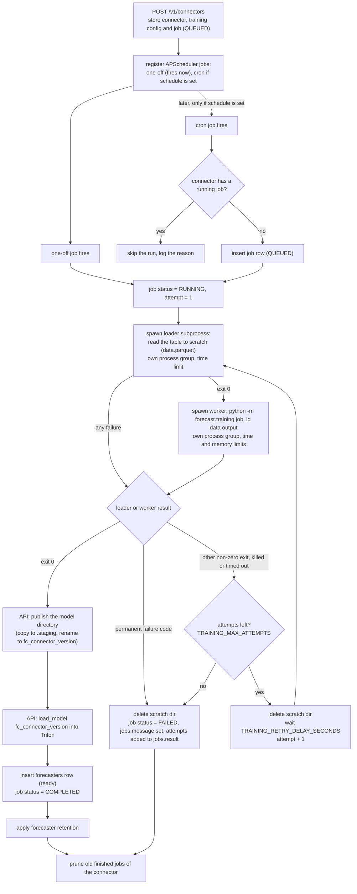
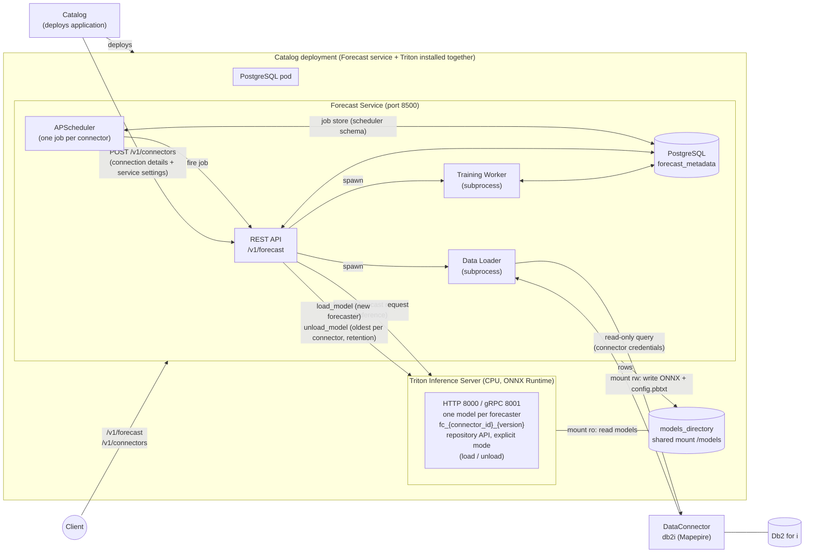
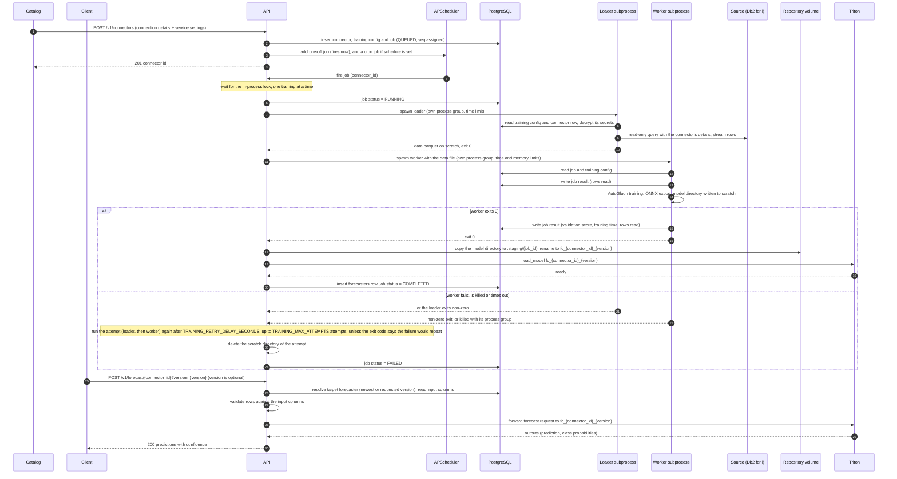
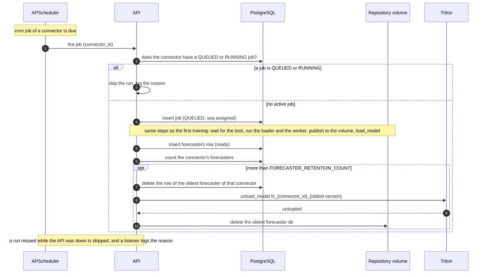

# Forecast Service — Implementation Proposal

## 1. Overview

This document proposes the design and implementation of the **Forecast** microservice for the AI-Services platform. The service trains machine-learning forecasters on tabular data from IBMi Db2, serves them for prediction with a confidence score, and retires the oldest ones under a retention policy.

Training is triggered by creating a connector. When a user submits a Db2 for i connector on Catalog, Catalog calls `POST /v1/connectors` on this service. The call carries the connection details and the details of the training job: the table, a target column, the input columns, and optionally a validation metric. AutoGluon chooses the algorithm. The service stores the connector and queues the training job.

When the job succeeds, the user calls the **forecast** endpoint (`POST /v1/forecast/{connector_id}`) on the resulting forecaster. Training also runs on a schedule which is provided along with connector details, and each scheduled run trains a new forecaster. A trained forecaster is never updated. Training uses **AutoGluon**. The trained AutoGluon model is exported to **ONNX** and served by **NVIDIA Triton Inference Server** on CPU. Training is asynchronous. Prediction is synchronous and proxied through the service to Triton.

> **Terminology.** A **forecaster** is the named, versioned unit that a training job produces and the forecast endpoint serves. This document does not call it a "model", because "model" also names the learning algorithm AutoGluon trains. The word "model" appears only where another tool owns the name: Triton's *model repository* and *model control*, `model.onnx`, the AutoGluon and ONNX models inside a forecaster, and the Pydantic and ORM "models" in the code. The word "predictor" is avoided for the same reason, because AutoGluon uses it for its trainer classes. The inputs of a forecaster are called **input columns** (`inputColumns` in the create request, `input_columns` in the database); its single output column is the **target**.

> **Scope notes.**
> - Conversion of an AutoGluon model to ONNX, and running Triton on Power, are treated as working capabilities and are not designed here. This document covers the service around them.
> - **The connector API is in scope; the connector implementation is not.** The service has `/v1/connectors` and a `connectors` table. It has no scanner and no background sync. The data loader runs in its own subprocess of the API, before the worker starts, and reads the source only when a job runs.
> - **Time-series forecasting is out of scope.** The forecaster is a tabular model over independent rows.
> - **Training and inference run on CPU only.** Spyre is not used.
> - **Resource sizing** (CPU, memory, scratch and volume size) is to be provided by DEV. This document names the knobs but does not set values.

The service follows the architectural patterns established by the digitize, translate and extract services where they apply:

- FastAPI application running as a Python service in a Podman container (ppc64le / RHEL).
- PostgreSQL (`forecast_metadata` database) for durable metadata, initialized by an idempotent init container.
- Single-replica deployment.
- Boot-time recovery scan that marks interrupted jobs as failed and cleans up leftovers.
- APScheduler inside the API process, with a persistent SQLAlchemy job store, as digitize uses it for its connector sync.
- A connector API with allowlist-encrypted credentials, as in digitize.

It also introduces three things that no existing service has:

- A **training worker that runs as a subprocess** of the API, one at a time, with its own process group, time limit and memory limit.
- A **Triton Inference Server pod** running on CPU with explicit model control. The Forecast API manages all model loading, unloading, and prediction requests over a shared model repository volume ([Section 10](#10-triton-inference-server--component-and-deployment)).
- A **second, restricted database role** for the worker, with column-level grants.

### 1.1 Concept-to-Design Mapping

| Concept                    | Design realization                                                                                                                                                                                                                                      |
|:---------------------------|:--------------------------------------------------------------------------------------------------------------------------------------------------------------------------------------------------------------------------------------------------------|
| Source of training data    | A table read through the stored connector (`connector_id`), named in the `POST /v1/connectors` call that created the job.                                                                                                                               |
| Connector                  | A row in `connectors` managed by `/v1/connectors`: type, connection details, secrets encrypted. No scanner and no sync.                                                                                                                                 |
| Inputs and target          | `inputColumns` (one or more column names) and `targetColumn` (exactly one), in `service_settings.forecast`.                                                                                                                                                          |
| Scheduling                 | APScheduler in the API process, one job per connector, with its job store in PostgreSQL. A one-off job runs the first training and a cron job runs the later ones.                                                           |
| Training run               | Orchestrated by the API: a **data loader subprocess** writes the table to scratch → a **worker subprocess** runs AutoGluon and the ONNX export on scratch → the API publishes the forecaster's directory to the shared volume and loads it into Triton.                                                                                                                                         |
| Trained forecaster         | A row in `forecasters` plus a directory `fc_<connector_id>_<version>` on the shared repository volume. The version is the job's `jobs.seq`.                                                                                                             |
| Forecaster serving         | NVIDIA Triton Inference Server (CPU) in explicit model-control mode. The Forecast API dynamically loads, unloads, and serves each forecaster as an independent model via HTTP.                                                                           |
| Prediction with confidence | `POST /v1/forecast/{connector_id}` — the API validates rows against the stored input columns, calls Triton (using the newest forecaster by default, or the version specified in `?version=`), and returns a prediction and a `confidence` per row. |
| Retention                  | A new forecaster is loaded into Triton, then recorded in `forecasters`. When a connector has more than `FORECASTER_RETENTION_COUNT` forecasters, the row of its oldest is deleted, and the forecaster is unloaded from Triton and deleted from the volume. |
| Versioning                 | `jobs.seq` (identity column) is the version. API path prefix `/v1/` versions the API itself.                                                                                                                                                            |

---

## 2. Design Decisions

### 2.1 Decision — The training worker is a subprocess of the API

**Decision: training runs in a subprocess that the API spawns inside its own pod, one at a time.** It is not a separate pod, a Kubernetes Job or a thread.

- **Same image and code.** `python -m forecast.training <job_id> <data_path> <output_dir>` shares the DB models with the API. No container-runtime access, ServiceAccount or Podman socket is needed, which keeps the Podman and OpenShift deployments identical.
- **Killable.** AutoGluon trains with child processes and large memory use. The API starts the worker in its **own process group** and kills the whole group on timeout, so nothing keeps running.
- **Crash isolation from the event loop.** A worker that crashes or is killed by the kernel does not take the API's event loop with it, and the API can read the exit status.
- **Why not threads or a process pool.** AutoGluon and ONNX export are CPU- and memory-heavy, and AutoGluon forks. A subprocess per job gives a clean memory release at exit and a unit that can be killed.
- **The loader is not part of training.** Reading the source is a step of the API's orchestration. The API runs it in its own subprocess, with its own process group and time limit, before it spawns the worker. A slow or hung source therefore uses none of the training time limit and cannot block the API's event loop. A bad credential, a missing table or an unreachable host fails the job before a training process exists. The loader writes the table to a Parquet file on local scratch and the worker reads that file, so every job still gets a fresh, isolated read, and its result records how many rows it read.

**Trade-off — shared fate.** The API and the training run share one container, so they share its memory limit and its lifecycle. Training memory pressure can hurt the API, and an API redeploy kills a running training job. The worker therefore runs with a memory cap (`WORKER_MEMORY_LIMIT_MB`) and a time limit, and startup recovery fails any job that was queued or running when the container stopped.

### 2.2 Decision — The API and APScheduler tick owns all Triton interaction and all deletion

**Decision: The API process and APScheduler tick talks to Triton, and only the APScheduler tick deletes forecaster files.**

- Triton runs in **explicit model-control mode** (`--model-control-mode=explicit`). No model is loaded automatically; the API explicitly issues load requests after successful training and during startup reconciliation.
- The **database state is authoritative**: Triton serves only forecasters with an active `ready` record in PostgreSQL. Unregistered directories are never loaded.
- The worker writes the forecaster's Triton directory (`config.pbtxt` and `1/model.onnx`) to **local scratch** and never touches the repository volume. The API **publishes** it: it copies the directory to `.staging/<job_id>/` on the volume and renames it to `fc_<connector_id>_<version>`, so the directory appears whole or not at all. The API also **deletes**: directories whose row is `retiring`, the staging directory of a publish that failed, and leftovers at boot.
- The APScheduler writes the `forecasters` row only after Triton has loaded the forecaster. A row is therefore always `ready`, `retiring` or `deleted`, and the worker has no write grant on `forecasters`.
- Retention is by count, per connector, and runs after each successful load. When the `ready` forecasters of one `connector_id` exceed `FORECASTER_RETENTION_COUNT`, the oldest of that connector is retired in this order: its row becomes `retiring`, it is unloaded from Triton, its directory is deleted, and its row becomes `deleted`. The row is kept. Forecasters of other connectors are not affected.

### 2.3 Decision — Single worker, enforced twice

**Decision: one training job runs at a time.**

- Every run is started by an APScheduler job. In case of multiple jobs started for the same connector, the newest queued job is skipped and the event is logged. In the future, we will manage multiple jobs with a queue and a lock.

### 2.4 Decision — `jobs.seq` is the forecaster version

An identity column on `jobs` provides the version. The worker never picks a version number, versions never collide, and they increase with submission order. A failed job leaves a gap in the sequence, which is harmless. The forecaster is named `fc_<connector_id>_<version>`. That name is its directory on the volume and its model name in Triton, so every forecaster is loaded and unloaded on its own and Triton's own model version is always `1`.

### 2.5 Decision — Connectors are stored records; there is no scanner

**Decision: the service has a connector CRUD API and a `connectors` table, and nothing more.** A connector holds the connection details of one source database, with secrets encrypted. The training job created with it names it by `connector_id`. The scanner, background sync and sync history that digitize attaches to a connector are not part of this service.

- **Same pattern as digitize.** Create, list, get and partial update (delete is not part of this release), with an allowlist of safe fields. Every other field is encrypted with AES-256-GCM (`DB_ENCRYPTION_KEY`) and never returned.
- **The loader reads and decrypts.** The loader subprocess reads the connector row with the API's database role and decrypts the secret fields with `DB_ENCRYPTION_KEY`. The worker's role has no grant on `connectors`, so the credentials never reach the training process. Nothing reads the source database outside a job.
- **Rotation is an update.** Each job reads the connector when it runs, so changing a password with `PUT /v1/connectors/{id}` applies to the next job.
- **Referential safety.** A connector cannot be deleted while a `QUEUED` or `RUNNING` job uses it. Finished jobs keep their rows with `connector_id` set to `NULL`.

### 2.6 Decision — APScheduler starts every training run

**Decision: APScheduler, inside the API process, starts every training run, both the first one and the scheduled ones.** There is no polling runner.

- **Same library as digitize.** An `AsyncIOScheduler` with a `SQLAlchemyJobStore` on the service's PostgreSQL database, in a `scheduler` schema that the init container creates. APScheduler is pinned to the version digitize uses. The persistent store keeps the schedules across restarts.
- **One job per connector.** Creating a connector registers a one-off job that fires at once for the first training and, when a training schedule is set, a cron job for the later ones. The cron runs in UTC. When training schedule is unset, only the first training runs.
- **What a fired job does.** A fired job runs the loader subprocess, then spawns the worker with the data file and waits for it. On success it publishes the forecaster's directory to the volume, loads it into Triton, inserts the `forecasters` row as `ready` and applies retention. When the last attempt fails, it marks the job `FAILED` and deletes the scratch directory of the attempt.
- **Retry of the attempt.** An attempt is the loader followed by the worker. If either fails, the job function runs the attempt again, up to `TRAINING_MAX_ATTEMPTS` attempts in total, and waits `TRAINING_RETRY_DELAY_SECONDS` between attempts. All attempts belong to one job: the same `jobs` row, the same version and the same lock. The job stays `RUNNING` while it retries, so no other training starts in between. Each attempt gets the full time limit, and the function deletes the scratch directory of the attempt (the data file and the model directory) before the next attempt, so a retry reads the source again. The loader and the worker exit with a dedicated code for a failure that would only repeat (the connector is missing or cannot be decrypted, authentication fails, an unknown table or column, no rows, a target with fewer than two different values, or fewer than 10 rows with a target value), and the function does not retry that. Every other non-zero exit, a kill and a timeout are retried. This includes data that AutoGluon cannot fit: its error does not say whether the data or the run is at fault, and a retry reads the table again. After the last attempt the job is marked `FAILED` with the last error, and the number of attempts is recorded in `result`. Only the attempt is retried. The publish, the Triton load, the `forecasters` insert and retention run once, after a successful attempt. A restart of the API during the retries fails the job like any other interrupted run.
- **Missed runs are skipped.** The jobs use a short misfire grace time, so a late run is skipped instead of run late. A run missed while the API was down, or skipped because the connector still has a `QUEUED` or `RUNNING` job, is logged with the reason.
- **Startup.** The API registers a cron job only for a connector that has none, so existing jobs keep their stored next run time. Digitize instead re-registers every job at startup. Jobs that are in `RUNNING` state when the API stopped are marked `FAILED` by the boot recovery.
- **Startup Recovery for one-off jobs** Startup recovery marks all in-progress jobs as failed, in case of a one-off job getting marked failed in such a way, the job is requeued to ensure at least one training getting completed.



---

## 3. Non-Goals

- **Connector scanner and sync:** The connector API stores connection details. There is no scanner, no background sync and no sync history. The data loader, which the API runs before the worker, reads the source when a job runs.
- **Horizontal scaling and multi-worker training:** The service is architected for a single API replica and a single concurrent training run. Job ownership, claim columns, heartbeats and fencing are out of scope.
- **Time series:** Not supported. Rows are independent.
- **Spyre and accelerators:** Training and inference run on CPU.
- **UI:** No user interface is included in this document. The service is API-only.
- **ONNX conversion and Triton on Power:** Treated as working capabilities. Not designed here.
- **Manual deletion of forecasters:** Forecasters are removed only by the retention policy (`FORECASTER_RETENTION_COUNT`).
- **Incremental training:** Each job pulls the data it needs in full.
- **Writes to the source:** The loader is read-only.

---

## 4. Architecture



**Key interactions:**

- The **API pod** hosts the REST API and **APScheduler**. Each connector has a job that APScheduler fires for the first training and, when training schedule is set, on that schedule. The fired job runs the whole pipeline: it queues the run, spawns the loader and then the worker, enforces the time limits and detects failure, then publishes the forecaster's directory to the volume, loads it into Triton, records it and applies retention (unload, deletion).
- The **loader subprocess** reads the source table with the connector's credentials and writes it to scratch. The **worker subprocess** owns the training work only. It has no polling loop and no access to the source or the volume. It reads its job and the data file, trains, writes the forecaster's directory to scratch, records its result on the job row, and exits.
- The **Triton and API pods** share the model repository volume (`/models`). The Forecast API mounts it read-write to publish and prune model artifacts, while Triton mounts it read-only to serve models safely.
- The **Postgres pod** holds `connectors`, `training_configs`, `jobs` and `forecasters`, and APScheduler's job store in the `scheduler` schema. The API connects as the DB owner. The worker connects as a restricted role.
- The service is exposed externally on **port 8500** (configurable). This avoids the ports used by digitize (4000/4001), summarize (6000), similarity (7000), translate (9000) and extract (9500).
- The service depends on three things beyond itself: PostgreSQL, Triton, and the data source.

---

## 5. Endpoints

| Method     | Endpoint                                | Description                                                                                                                                                    |
|:-----------|:----------------------------------------|:---------------------------------------------------------------------------------------------------------------------------------------------------------------|
| **GET**    | `/v1/forecast`           | List the forecasters of a connector with their version, metrics and creation time. **NOTE: This endpoint will be removed once multi-connector support is added.**                                                                                          |
| **GET**    | `/v1/forecast/{connector_id}`           | List the forecasters of a connector with their version, metrics and creation time.                                                                                          |
| **POST**   | `/v1/forecast`           | Run a forecast. The rows are validated, sent to Triton for the connector's newest forecaster (or the version specified in `?version=`), and returned with predictions and confidence.**NOTE: This endpoint will be removed once multi-connector support is added.** |
| **POST**   | `/v1/forecast/{connector_id}`           | Run a forecast. The rows are validated, sent to Triton for the connector's newest forecaster (or the version specified in `?version=`), and returned with predictions and confidence. |
| **POST**   | `/v1/connectors`                        | Create a connector (source database connection, secrets encrypted) and queue its training job.                                                                 |
| **GET**    | `/v1/connectors`                        | List connectors with pagination and a name filter.                                                                                                             |
| **GET**    | `/v1/connectors/{connector_id}`         | Get a connector. Secrets are never returned.                                                                                                                   |
| **GET**    | `/v1/connectors/{connector_id}/metrics` | **Developer use only.** Training and availability metrics of a connector, such as training time and the versions available.                                    |
| **PUT**    | `/v1/connectors/{connector_id}`         | Partially update a connector (`name`, `connection_details`).                                                                                                   |
| **GET**    | `/health`                               | Service health check (DB and Triton reachability).                                                                                                             |

---

## 6. API Specification

**Error format.** Every error uses the shared envelope of the other services, with the HTTP status repeated in the body:

```json
{
    "error": {
        "code": "RESOURCE_NOT_FOUND",
        "message": "Connector '7c9e6679-7425-40de-944b-e07fc1f90ae7' not found",
        "status": 404
    }
}
```

Digitize registers its error handler only for `HTTPException`, so its request-validation errors come back in FastAPI's default `{"detail": [...]}` shape. This service registers a handler for FastAPI's `RequestValidationError` as well, so a `422` uses this envelope with code `INVALID_REQUEST`.

### 6.1 Forecast

The forecast endpoints are keyed by `connector_id`, because each connector is trained into forecasters. The service never exposes Triton: clients call these endpoints and the service forwards the request to Triton.

#### GET /v1/forecast/ — List the Forecasters of the default Connector

**NOTE: This endpoint will be removed once multiple connector support is added.**

Returns every forecaster of the default connector, newest version first. The list is bounded by `FORECASTER_RETENTION_COUNT`. A connector with no forecasters returns an empty list `[]`.

| Field in each item | Type | Description |
|:---|:---|:---|
| `version` | integer | The version number (the `jobs.seq` of the training job). |
| `metrics` | object (nullable) | The validation metric name and score, and the training time in seconds. |
| `created_at` | string (ISO 8601 UTC) | UTC timestamp at which the forecaster was loaded. |

**Sample response (200):**

```json
[
    {
        "version": 12,
        "metrics": {"metric": "accuracy", "validation_score": 0.91, "training_seconds": 412},
        "created_at": "2026-10-26T09:12:00Z"
    },
    {
        "version": 11,
        "metrics": {"metric": "accuracy", "validation_score": 0.90, "training_seconds": 399},
        "created_at": "2026-10-25T09:12:00Z"
    },
    {
        "version": 10,
        "metrics": {"metric": "accuracy", "validation_score": 0.93, "training_seconds": 400},
        "created_at": "2026-10-24T09:12:00Z"
    }
]
```

| Status                               | Description                |
|:-------------------------------------|:---------------------------|
| 200 OK                               | The list, possibly empty.  |
| 404 Not Found (`RESOURCE_NOT_FOUND`) | No connector found.        |
| 429 Too Many Requests (`SERVER_BUSY`)| Database connection pool is busy. |
| 500 Internal Server Error            | Database failure.          |

#### GET /v1/forecast/{connector_id} — List the Forecasters of a Connector

Returns every forecaster of the connector, newest version first. The list is bounded by `FORECASTER_RETENTION_COUNT`. A connector with no forecasters returns an empty list `[]`.

| Field in each item | Type | Description |
|:---|:---|:---|
| `version` | integer | The version number (the `jobs.seq` of the training job). |
| `metrics` | object (nullable) | The validation metric name and score, and the training time in seconds. |
| `created_at` | string (ISO 8601 UTC) | UTC timestamp at which the forecaster was loaded. |

**Sample response (200):**

```json
[
    {
        "version": 12,
        "metrics": {"metric": "accuracy", "validation_score": 0.91, "training_seconds": 412},
        "created_at": "2026-10-26T09:12:00Z"
    },
    {
        "version": 11,
        "metrics": {"metric": "accuracy", "validation_score": 0.90, "training_seconds": 399},
        "created_at": "2026-10-25T09:12:00Z"
    },
    {
        "version": 10,
        "metrics": {"metric": "accuracy", "validation_score": 0.93, "training_seconds": 400},
        "created_at": "2026-10-24T09:12:00Z"
    }
]
```

| Status                               | Description                |
|:-------------------------------------|:---------------------------|
| 200 OK                               | The list, possibly empty.  |
| 404 Not Found (`RESOURCE_NOT_FOUND`) | No connector with this ID. |
| 429 Too Many Requests (`SERVER_BUSY`)| Database connection pool is busy. |
| 500 Internal Server Error            | Database failure.          |

#### POST /v1/forecast/ — Run a Forecast on the default connector
**NOTE: This endpoint will be removed once multiple connector support is added.**
Runs a forecast against a connector's trained forecaster on the rows in the request. By default, the service selects the connector's newest forecaster. If the `version` query parameter is provided, it targets that specific retained version. The service validates the rows against the connector's input columns (`input_columns`: it checks the column names, and rejects a `null` and a JSON object, array or boolean as a value), forwards them to Triton, and returns one result per row in the same order. The call is synchronous.

**Query Parameters:**

| Parameter | Type    | Required | Description                                                                                                                                           |
|:----------|:--------|:---------|:------------------------------------------------------------------------------------------------------------------------------------------------------|
| `version` | integer | No       | Specific retained forecaster version (`jobs.seq`) to run inference against. If omitted, defaults to the newest forecaster for the connector. |

**Content-Type:** `application/json`

**Sample request (newest version by default):**

```bash
curl -X POST http://localhost:8500/v1/forecast \
  -H "Content-Type: application/json" \
  -d '[
          {"REGION": "EMEA", "QUANTITY": 12, "UNIT_PRICE": 19.99},
          {"REGION": "APAC", "QUANTITY": 3,  "UNIT_PRICE": 249.0}
      ]'
```

**Sample request (targeting a specific older retained version):**

```bash
curl -X POST "http://localhost:8500/v1/forecast?version=11" \
  -H "Content-Type: application/json" \
  -d '[
          {"REGION": "EMEA", "QUANTITY": 12, "UNIT_PRICE": 19.99},
          {"REGION": "APAC", "QUANTITY": 3,  "UNIT_PRICE": 249.0}
      ]'
```

**Sample response (200):**

```json
{
    "version": 12,
    "predictions": [
        {"prediction": "N", "confidence": 0.87},
        {"prediction": "Y", "confidence": 0.64}
    ]
}
```

- `version` names the forecaster that answered.

| Status                                         | Description                                                                                                                                           |
|:-----------------------------------------------|:------------------------------------------------------------------------------------------------------------------------------------------------------|
| 200 OK                                         | One result per row.                                                                                                                                   |
| 400 Bad Request (`INVALID_REQUEST`)            | An empty row list is provided, a row has a missing or unknown column, a `null`, or a JSON object, array or boolean as a value, or `version` query parameter is not a positive integer. |
| 404 Not Found (`RESOURCE_NOT_FOUND`)           | No default connector found, the connector has no forecaster yet, or the specified `version` does not exist. |
| 422 Unprocessable Entity                       | The body is not valid JSON or not an array of row objects.                                                                                            |
| 429 Too Many Requests (`SERVER_BUSY`)          | Database connection pool is busy.                                                                                                                     |
| 500 Internal Server Error                      | Database failure, or Triton returned an error for the request.                                     |
| 503 Service Unavailable (`TRITON_UNAVAILABLE`) | Triton cannot be reached. A new error code: the shared `ErrorCode` enum has none for Triton.       |


#### POST /v1/forecast/{connector_id} — Run a Forecast on a Connector

Runs a forecast against a connector's trained forecaster on the rows in the request. By default, the service selects the connector's newest forecaster. If the `version` query parameter is provided, it targets that specific retained version. The service validates the rows against the connector's input columns (`input_columns`: it checks the column names, and rejects a `null` and a JSON object, array or boolean as a value), forwards them to Triton, and returns one result per row in the same order. The call is synchronous.

**Query Parameters:**

| Parameter | Type    | Required | Description                                                                                                                                           |
|:----------|:--------|:---------|:------------------------------------------------------------------------------------------------------------------------------------------------------|
| `version` | integer | No       | Specific retained forecaster version (`jobs.seq`) to run inference against. If omitted, defaults to the newest forecaster for the connector. |

**Content-Type:** `application/json`

**Request Body:**

A JSON array of one or more row objects. Each row is an object that has a value for every input column of the connector and no other keys.

**Sample request (newest version by default):**

```bash
curl -X POST http://localhost:8500/v1/forecast/7c9e6679-7425-40de-944b-e07fc1f90ae7 \
  -H "Content-Type: application/json" \
  -d '[
          {"REGION": "EMEA", "QUANTITY": 12, "UNIT_PRICE": 19.99},
          {"REGION": "APAC", "QUANTITY": 3,  "UNIT_PRICE": 249.0}
      ]'
```

**Sample request (targeting a specific older retained version):**

```bash
curl -X POST "http://localhost:8500/v1/forecast/7c9e6679-7425-40de-944b-e07fc1f90ae7?version=11" \
  -H "Content-Type: application/json" \
  -d '[
          {"REGION": "EMEA", "QUANTITY": 12, "UNIT_PRICE": 19.99},
          {"REGION": "APAC", "QUANTITY": 3,  "UNIT_PRICE": 249.0}
      ]'
```

**Sample response (200):**

```json
{
    "version": 12,
    "predictions": [
        {"prediction": "N", "confidence": 0.87},
        {"prediction": "Y", "confidence": 0.64}
    ]
}
```

- `version` names the forecaster that answered.

| Status                                         | Description                                                                                                                                           |
|:-----------------------------------------------|:------------------------------------------------------------------------------------------------------------------------------------------------------|
| 200 OK                                         | One result per row.                                                                                                                                   |
| 400 Bad Request (`INVALID_REQUEST`)            | An empty row list is provided, a row has a missing or unknown column, a `null`, or a JSON object, array or boolean as a value, or `version` query parameter is not a positive integer. |
| 404 Not Found (`RESOURCE_NOT_FOUND`)           | No connector with this ID, the connector has no forecaster yet, or the specified `version` does not exist. |
| 422 Unprocessable Entity                       | The body is not valid JSON or not an array of row objects.                                                                                            |
| 429 Too Many Requests (`SERVER_BUSY`)          | Database connection pool is busy.                                                                                                                     |
| 500 Internal Server Error                      | Database failure, or Triton returned an error for the request.                                     |
| 503 Service Unavailable (`TRITON_UNAVAILABLE`) | Triton cannot be reached. A new error code: the shared `ErrorCode` enum has none for Triton.       |

### 6.2 Connectors

A connector stores the connection details of one source database, with its secrets encrypted. The training job created with it refers to it by `connector_id`. The endpoints follow `services/digitize/api/v1/connectors.py`: create, list, get and partial update (delete is not part of this release), with the allowlist encryption of `connectors/encryption.py`.

**What is in scope and what is not.** The scope here is the connector **API and its table**. There is no scanner, no sync and no sync history. Scheduled training is set by `service_settings.forecast.schedule` in the connector Create request. Nothing reads the source database until a training job runs, and then the loader, which the API runs before the worker, does it. A connector therefore has no `last_sync_at` and no file counters, which digitize's connectors have.

**Connector types.** `type` is validated against a fixed list. The first type is `db2_for_i`. Adding a database means adding its type, its required fields and its safe fields to the allowlist, and a driver in the loader.

**Secret handling.** Each type declares **safe fields**, which are stored in plaintext and returned in responses. Every other field is a secret: it is encrypted with AES-256-GCM using `DB_ENCRYPTION_KEY` before it is stored and is never returned. Listing safe fields, instead of listing secret fields, means a credential field that nobody thought of is encrypted by default and is never returned.

| Type        | Required fields (`connection_details`)     | Optional                                          | Safe (plaintext, returned)                                                   | Encrypted, never returned |
|:------------|:-------------------------------------------|:--------------------------------------------------|:-----------------------------------------------------------------------------|:--------------------------|
| `db2_for_i` | `host`, `database`, `username`, `password` | `port`, `ignore_secure_connection`, `certificate` | `host`, `port`, `database`, `username`, `ignore_secure_connection`           | `password`, `certificate` |

For `db2_for_i`, `certificate` is the PEM certificate that the server's TLS certificate is verified against, and `ignore_secure_connection` (a JSON boolean, `false` by default) turns the verification off. When both are set, `ignore_secure_connection` wins. `ignore_secure_connection` is not a secret, so `GET /v1/connectors` shows whether the verification is off. `certificate` must contain the text `-----BEGIN CERTIFICATE-----` and the text `-----END CERTIFICATE-----` and is at most 65,536 characters. The check is only a first filter: it does not parse the certificate, so a value that holds both markers but is not a valid certificate is stored and fails when the loader uses it.

#### POST /v1/connectors — Create a Connector

**Content-Type:** `application/json`

| Field                | Type   | Required | Description                                                                            |
|:---------------------|:-------|:---------|:---------------------------------------------------------------------------------------|
| `id`                 | string | Yes      | Unique connector identifier (UUID).                                                    |
| `name`               | string | Yes      | Unique, human-readable name, 1–255 characters.                                         |
| `type`               | string | Yes      | A supported connector type (`db2_for_i`).                                              |
| `connection_details` | object | Yes      | Fields for the type, as in the connector types table, `ignore_secure_connection` and `certificate` included. Unknown fields are rejected. |
| `service_settings`   | object | Yes      | The settings chosen when the service was deployed, grouped by the part of the service they are for. This service reads the `forecast` group. See the `service_settings.forecast` object table. Unknown fields, in any group, are ignored: the catalog forwards every setting of the deployed service. |

**`service_settings.forecast` object** (required; the keys are camelCase):

| Field             | Type   | Required | Description                                                                                                                                                                   |
|:------------------|:-------|:---------|:------------------------------------------------------------------------------------------------------------------------------------------------------------------------------|
| `table`           | string | Yes      | Table to train on.                                                                                                                                                            |
| `targetColumn`    | string | Yes      | The column to predict. Exactly one.                                                                                                                                           |
| `inputColumns`    | array  | Yes      | The names of the input columns, an array of strings. The forecast endpoint checks the names of the columns of each row against them. |
| `schedule`        | enum   | No       | Training cadence: `hourly`, `daily`, `weekly`, `monthly` or `yearly`. When it is unset, only the first training runs.                                                         |

**Sample request:**

```bash
curl -X POST http://localhost:8500/v1/connectors \
  -H "Content-Type: application/json" \
  -d '{
        "id": "7c9e6679-7425-40de-944b-e07fc1f90ae7",
        "name": "prod-sales-db",
        "type": "db2_for_i",
        "connection_details": {
          "host": "ibmi.example.com",
          "port": 8471,
          "database": "PRODDB",
          "username": "forecast_ro",
          "password": "********",
          "ignore_secure_connection": false,
          "certificate": "-----BEGIN CERTIFICATE-----\nMIID...\n-----END CERTIFICATE-----"
        },
        "service_settings": {
          "forecast": {
            "table": "ORDERS",
            "targetColumn": "DELIVERY_LATE",
            "inputColumns": ["REGION", "QUANTITY", "UNIT_PRICE"],
            "schedule": "daily"
          }
        }
      }'
```

**Sample response (201):**

```json
{
    "id": "7c9e6679-7425-40de-944b-e07fc1f90ae7"
}
```

The first connector is answered with `201` whether or not it can be accepted: without a usable `DB_ENCRYPTION_KEY` it is stored as `FAILED`. A second connector is answered with `409`, and nothing is stored. Training continues asynchronously.

**Behavior.** The first rows are answered with `201`. The other rows are answered with an error and store nothing.

| Case | Response | `connectors` row | `training_configs` row, job and schedule | Visible in `GET /v1/connectors` |
|:-----|:---------|:-----------------|:-----------------------------------------|:--------------------------------|
| New connector: no other connector exists | 201 | Inserted with status `ACCEPTED`. | Row inserted, job `QUEUED`. APScheduler jobs registered: a one-off job that starts the first training at once and, when `schedule` is set, a cron job for the later ones. | Yes, status `ACCEPTED`. |
| The `id` already exists (a repeated request) | 201 | Not changed. | Not changed. No second job, no second schedule. | The existing connector. |
| No other connector exists, and `DB_ENCRYPTION_KEY` is missing or not 32 bytes | 201 | Inserted with status `FAILED` and the message "Connector encryption key not found. Ensure the DB_ENCRYPTION_KEY environment variable is set before starting the service." (or the 32-byte message). Only the safe fields are stored: the secrets (the password and the certificate) cannot be encrypted, and they are never stored in plain text. `ignore_secure_connection` is one of the safe fields and is kept. | None. | Yes, status `FAILED` with the message. |
| A connector already exists, with any status, `FAILED` included, and the `id` is a new one | 409 `RESOURCE_CONFLICT` | Nothing inserted. The existing connector is not changed. The message says "A connector already exists. Only one connector is supported." | None. | No. The existing connector only. |
| The lock on the `connectors` table times out | 409 `RESOURCE_LOCKED` | Nothing inserted. | None. | No. |
| The database pool is exhausted | 429 `SERVER_BUSY` | Nothing inserted. | None. | No. |
| A database write or the commit fails | 500 `DATABASE_ERROR` | Rolled back, nothing inserted. | None. | No. |

- **Which reason wins.** An existing connector is checked first, then the encryption key. A repeated `id` is answered before either of them.
- **One transaction.** The checks and the insert run in one transaction that holds a lock on the `connectors` table, so two requests cannot both pass the single-connector check. A failed write rolls back the whole transaction. Schedules are registered only after the commit.
- **`FAILED` connectors.** A `FAILED` connector keeps its `connection_details` (with the secrets encrypted, or only the safe fields when `DB_ENCRYPTION_KEY` was unusable), and `status` and `message` give the reason. It counts as a connector: while it exists, every later create with a new `id` is answered with `409`. It has no `training_configs` row and no forecaster, so `POST /v1/forecast` answers `404` for it, and the list endpoints return an empty array. It keeps its `id`: a later create with the same `id` returns `201` without changing the row.
- **Catalog.** The catalog validates the body before it calls the service, and it treats `201` and `409` as success. The `201` for a connector that is stored as `FAILED` because of the encryption key, and the `409` for a second connector, are therefore both seen as success by the catalog. Only the `status` and `message` of `GET /v1/connectors` tell that the connector is not trained, and the body of the `409` tells that it was not stored.
- **Secrets.** No secret appears in a `message`, a response or a log.

| Status                                | Description                                                                                                                                                       |
|:--------------------------------------|:------------------------------------------------------------------------------------------------------------------------------------------------------------------|
| 201 Created                           | The request was valid. The connector is accepted, or stored as `FAILED` because `DB_ENCRYPTION_KEY` is unusable, or the `id` already exists.                       |
| 409 Conflict (`RESOURCE_CONFLICT`)    | A connector already exists, whatever its status, and the `id` is a new one. Nothing is stored. The catalog treats `409` as success.                                |
| 409 Conflict (`RESOURCE_LOCKED`)      | The lock on the `connectors` table timed out, or a `PUT` renames a connector to a `name` that is taken. The catalog treats `409` as success.                      |
| 422 Unprocessable Entity              | The body cannot be parsed: unknown `type`, an `id` that is not a UUID, an unknown field in `connection_details`, or a missing or invalid field in `connection_details` (a `certificate` that lacks the PEM markers or is over 65,536 characters, or an `ignore_secure_connection` that is not a boolean, included) or `service_settings.forecast` (a missing `forecast` group included). Unknown fields in `service_settings` are ignored. Same envelope as every error. |
| 429 Too Many Requests (`SERVER_BUSY`) | The database connection pool is exhausted. Retry shortly.                                        |
| 500 Internal Server Error             | A database write failed, or a `PUT` that changes `connection_details` finds `DB_ENCRYPTION_KEY` missing or invalid.                                                                                        |

#### GET /v1/connectors — List Connectors

| Parameter | Type   | Required | Description                                  |
|:----------|:-------|:---------|:---------------------------------------------|
| `limit`   | int    | No       | Records per page (1–200). Default: `50`.     |
| `offset`  | int    | No       | Records to skip. Default: `0`.               |
| `name`    | string | No       | Partial, case-insensitive match on the name. |

The list limits (50 default, 200 maximum) match digitize's connector list. The response uses the `{ "pagination": {...}, "data": [...] }` envelope. Digitize's connector list returns `{total, limit, offset, items}` instead. Possible status values are `{ACCEPTED, TRAINING, TRAINED, FAILED}`

**Sample response (200):**

```json
{
    "pagination": {"total": 1, "limit": 50, "offset": 0},
    "data": [
        {
            "id": "7c9e6679-7425-40de-944b-e07fc1f90ae7",
            "name": "prod-sales-db",
            "type": "db2_for_i",
            "created_at": "2026-10-26T08:55:00Z",
            "last_trained_at": "2026-10-26T08:55:00Z",
            "status": "TRAINING",
            "table": "prod-sales-db",
            "target_column": "price",
            "message": ""
        }
    ]
}
```

#### GET /v1/connectors/{connector_id} — Get a Connector

Returns the list item plus `connection_details` limited to the safe fields and `updated_at`. Secrets are omitted, including any field that is stored but not on the allowlist. `ignore_secure_connection` is shown as stored. A connector stored before the field existed has no such key in its details, which means `false`.

```json
{
    "id": "7c9e6679-7425-40de-944b-e07fc1f90ae7",
    "name": "prod-sales-db",
    "type": "db2_for_i",
    "table": "customers",
    "target_column": "price",
    "schedule": "daily",
    "connection_details": {"host": "ibmi.example.com", "port": 8471, "database": "PRODDB", "username": "forecast_ro", "ignore_secure_connection": false},
    "status": "TRAINING",
    "last_trained_at": "2026-10-26T08:55:00Z",
    "message": "Training on {n} rows",
    "created_at": "2026-10-26T08:55:00Z",
    "updated_at": "2026-10-26T08:55:00Z"
}
```

#### GET /v1/connectors/{connector_id}/metrics — Connector Metrics

**Developer use only.** Returns training and availability metrics for one connector, for debugging and capacity checks. The fields can change without notice and are not part of the stable API.

| Field                            | Description                                         |
|:---------------------------------|:----------------------------------------------------|
| `versions.ready`                 | Versions that are loaded in Triton and served.      |
| `training.jobs_completed`        | Completed runs among the connector's retained runs. |
| `training.jobs_failed`           | Failed runs among the connector's retained runs.    |
| `training.last_job_status`       | `QUEUED`, `RUNNING`, `COMPLETED` or `FAILED`.       |
| `training.last_duration_seconds` | Training time of the last finished job.             |
| `training.last_completed_at`     | UTC timestamp at which the last job completed.      |
| `jobs`                           | The retained runs, newest first, with `seq`, `status`, timestamps, `message` and `result`. |

```json
{
    "connector_id": "7c9e6679-7425-40de-944b-e07fc1f90ae7",
    "versions": {"ready": [12, 11]},
    "training": {
        "jobs_completed": 5,
        "jobs_failed": 1,
        "last_job_status": "COMPLETED",
        "last_duration_seconds": 412,
        "last_completed_at": "2026-10-26T09:12:00Z"
    },
    "jobs": [
        {
            "seq": 12,
            "status": "COMPLETED",
            "created_at": "2026-10-26T09:00:00Z",
            "started_at": "2026-10-26T09:05:00Z",
            "finished_at": "2026-10-26T09:12:00Z",
            "message": "",
            "result": {"rows_read": 120000, "algorithm": "LightGBM", "training_seconds": 412, "attempts": 1}
        }
    ]
}
```

Returns `200`, or `404 RESOURCE_NOT_FOUND` when the connector does not exist.

#### PUT /v1/connectors/{connector_id} — Update a Connector

**Content-Type:** `application/json`. All fields are optional. The request model forbids extra fields, so `type` and `service_settings` cannot be changed and are rejected with `422`. Digitize's update model ignores extra fields instead; this service rejects them.

| Field                | Type   | Description                                                                                  |
|:---------------------|:-------|:---------------------------------------------------------------------------------------------|
| `name`               | string | New unique name.                                                                             |
| `connection_details` | object | Partial. Only the supplied keys are overwritten; the others, including stored secrets, stay. |

- A successful update returns `200` with an empty body. An empty request body is a no-op and also returns `200`.
- The merged details are validated against the type before anything is written. The stored secrets are decrypted for that check. A failure returns `400 INVALID_REQUEST`.
- Supplied secret fields are encrypted again before they are stored.
- A new `password` is required when `host`, `port`, `database`, `username` or `ignore_secure_connection` changes, and whenever a `certificate` is supplied (`null` clears it: the key stays stored with the value `null`, which the loader must treat as no certificate). Without it the call returns `400`, so the stored password is never replayed to another target or under a weaker TLS check. A connector stored before these fields existed has `ignore_secure_connection` unset, which counts as `false`.
- A `PUT` on a `FAILED` connector is accepted when it is valid, but it does not change the status and does not queue a job.
- A `PUT` that changes `connection_details` needs a usable `DB_ENCRYPTION_KEY`, because the stored secrets are decrypted and the supplied ones are encrypted. Without one it returns `500` and writes nothing. A rename does not need the key.
- A queued job reads the connector when it runs, not when it was created. An update therefore also applies to a job still in the queue and to later scheduled runs.

### 6.3 GET /health

Returns `200` when the API can reach PostgreSQL and `503` when it cannot. The response also reports Triton reachability. A Triton outage does not make the service unhealthy, because training and connector management still work; it makes forecast requests return `503 TRITON_UNAVAILABLE`.

```json
{
    "status": "ok",
    "checks": {"postgres": "ok", "triton": "unreachable"}
}
```

| Status                  | Description                                                                              |
|:------------------------|:-----------------------------------------------------------------------------------------|
| 200 OK                  | PostgreSQL is reachable. `checks.triton` is `ok` or `unreachable`.                       |
| 503 Service Unavailable | PostgreSQL is not reachable. `status` is `unavailable` and `checks.postgres` is `error`. |

---

## 7. Database Tables

The Postgres database `forecast_metadata` has four tables. Only the main columns are listed. APScheduler's job store table is kept separately, in the `scheduler` schema.

**`connectors`**

| Column               | Description                                                                                                  |
|:---------------------|:-------------------------------------------------------------------------------------------------------------|
| `id`                 | Primary key (UUID).                                                                                          |
| `name`               | Unique, human-readable name (up to 255 characters).                                                          |
| `type`               | Connector type, such as `db2_for_i`.                                                                         |
| `connection_details` | JSON object (`{}` by default). Connection details. Safe fields in plaintext, secret fields encrypted.        |
| `attached_at`        | UTC time at which the connector was attached.                                                                |
| `updated_at`         | UTC time of the last update. Kept current by the `update_connectors_updated_at` database trigger.            |
| `last_trained_at`    | UTC time at which training last completed. `NULL` until then.                                                |
| `status`             | `ACCEPTED`, `TRAINING`, `TRAINED` or `FAILED`.                                                               |
| `message`            | Relevant information from the connector. Can be empty.                                                       |

**`training_configs`**

| Column          | Description                                                                                                                                              |
|:----------------|:---------------------------------------------------------------------------------------------------------------------------------------------------------|
| `connector_id`  | Primary key. Foreign key to `connectors`. `ON DELETE CASCADE`, so the row is removed with the connector.                                                 |
| `source_table`  | Table to train on.                                                                                                                                       |
| `target_column` | The column to predict.                                                                                                                                   |
| `input_columns` | JSON array of the names of the input columns, such as `["REGION", "QUANTITY"]`.                                                                         |
| `schedule`      | `hourly`, `daily`, `weekly`, `monthly` or `yearly` (compared in lower case). `NULL`: only the first training runs.                                       |

**`jobs`**

| Column         | Description                                                                                                                                                                                                                                            |
|:---------------|:-------------------------------------------------------------------------------------------------------------------------------------------------------------------------------------------------------------------------------------------------------|
| `seq`          | Primary key. Identity column (`GENERATED ALWAYS`), so the database assigns it. Its value is the forecaster version.                                                                                                                                    |
| `connector_id` | Foreign key to `connectors`. Set to `NULL` when the connector is deleted after the job has finished.                                                                                                                                                   |
| `status`       | `QUEUED`, `RUNNING`, `COMPLETED` or `FAILED`.                                                                                                                                                                                                          |
| `message`      | Failure reason. Empty unless the job failed. It is a message written for the user, such as "Table X has no rows", or a fixed text that names only the class of an unexpected error. The details of an unexpected error go to the worker log, because they can carry hosts, user names or data.                                                                                                                                                                                                           |
| `result`       | JSON object. The worker writes `rows_read` (the number of rows available for training) once, when it has read the data file that the loader wrote. When training finishes it overwrites the object with `rows_read` repeated plus `algorithm` (the algorithm AutoGluon chose), `validation_metric`, `validation_score` (AutoGluon's score on its own validation rows), `test_score` (the same metric on a held-out 20% of the rows the model never saw) and `training_seconds`. The API adds `attempts` after the worker exits. A failed job keeps `rows_read` if the failure came after the load, and always has `attempts`. Readers must tolerate missing keys. |
| `created_at`   | UTC time at which the job was queued.                                                                                                                                                                                                                  |
| `started_at`   | UTC time at which the job started running.                                                                                                                                                                                                             |
| `finished_at`  | UTC time at which the job completed or failed.                                                                                                                                                                                                         |

**`forecasters`**

| Column         | Description                                                                                                          |
|:---------------|:---------------------------------------------------------------------------------------------------------------------|
| `connector_id` | Part of the primary key. Foreign key to `connectors`. `ON DELETE CASCADE`, so the row is removed with the connector. |
| `job_id`       | Foreign key to `jobs.seq`: the job that trained the forecaster. Set to `NULL` when run history deletes that job.     |
| `version`      | Part of the primary key. The `seq` of that job.                                                                      |
| `metrics`      | JSON object with the algorithm and the training time. Copied from the job's `result`.                                |
| `created_at`   | UTC time at which the forecaster was loaded and recorded.                                                            |

**Constraints.**

- `idx_jobs_single_running`: a unique partial index that allows at most one `RUNNING` job.
- `forecasters` primary key `(connector_id, version)` guarantees uniqueness per connector.
- A CHECK constraint on `jobs` requires a `QUEUED` or `RUNNING` job to keep its `connector_id`.
- `forecasters.job_id` is `ON DELETE SET NULL`, so deleting an old job does not delete its forecaster.

**Run history.** The `jobs` table is also the run history. Each finished job keeps its `status`, `message`, timestamps (the time taken is `finished_at - started_at`) and `result` (algorithm, validation metric and score, training time, rows read, attempts). After each run finishes, the API keeps the newest `FORECASTER_RETENTION_COUNT` finished jobs (`COMPLETED` or `FAILED`) of that `connector_id` and deletes the older ones. `QUEUED` and `RUNNING` jobs are never deleted. The details a forecaster needs to be served live in its own `metrics`, so they survive the deletion of its job.

## 8. Data Loader

The loader is **new code that the API runs in its own subprocess**, before it spawns the worker. There is no separate scanner component and no background sync: the connector API only stores connection details, and the loader reads them when a job runs. It reads from a database table, applies the row selection, and writes a dataset to local scratch, which the worker then reads.

| Provider | `db_type` | Phase | Notes |
| :-- | :-- | :-- | :-- |
| IBM i Db2 via **Mapepire** | `db2i` | 1 (in scope) | Pure-Python websocket client; no JVM, no JT400. Works on ppc64le images without extra native packages. **The** Db2 for i path for this service. |
| CSV file | `csv` | Stretch | Not planned, will be taken up if current scope is achieved ahead of time. |

### 8.1 Database source

- The loader reads the job's connector row (`jobs.connector_id`) and the connector's `training_configs` row with the API's database role, decrypts the secret fields with `DB_ENCRYPTION_KEY` and connects with the result. The worker's role cannot read `connectors`. A connector that no longer exists or cannot be decrypted fails the job with an error that names the connector and never contains a secret.
- The session is opened **read-only** with a statement timeout where the database supports it. Authentication and network failures raise distinct errors so the job error tells the user which one occurred.
- The raised error messages are stored in the jobs table.
- The query is built from the validated `table` of the `service_settings.forecast` object.
- Rows are streamed with a server-side cursor in fixed-size chunks, inside one read-only transaction at the highest isolation level the database offers, so the snapshot is consistent.
- Every user-supplied identifier is quoted through the driver's identifier API, never concatenated into SQL. Raw SQL is not accepted as a source.
- The account named in the connector should be read-only. The read-only session is a second control; the account is the stronger one.

### 8.2 Stretch: CSV file connector

Not part of the committed scope. Sketch only, so the Phase 1 contract does not preclude it:

- Input is a `.csv` file on a mounted volume or a file upload 
- Header row required. Types are inferred from the whole file; values such as `5e+05` (present in the UCI credit-card CSV) must parse as numeric.
- `filters`, `order_by` and `limit` are applied in-process; `list_tables()` returns one logical table and `list_columns()` the inferred columns.
- Requires `source` to accept a file reference instead of `schema`/`table`; this is the only definition change.

---

## 9. Sequence

### 9.1 Sequence — create connector, first training, forecast (model load)



### 9.2 Sequence — scheduled training and retention (model unload)

A client never asks for an unload. The API deletes the row of the oldest forecaster of a connector when retention requires it, so no request selects it any more, and then unloads it and deletes its directory. The API calls Triton's model-control API, and the client only calls the forecast API.



---

## 10. Triton Inference Server — Component and Deployment

This section details the Catalog **component specification** for Triton Inference Server (CPU), its deployment topology on Podman and OpenShift, and the shared volume architecture with the Forecast service.

### 10.1 Catalog assets

```
ai-services/assets/components/ml_inference/triton-cpu/
├── metadata.yaml                      # type: component, component_type: ml_inference
├── podman/
│   ├── metadata.yaml                  # pod template list and resource requirements
│   ├── values.yaml                    # image and defaults
│   ├── values.schema.json             # no user parameters (empty properties)
│   └── templates/
│       └── triton-server.yaml.tmpl
└── openshift/
    ├── Chart.yaml
    ├── metadata.yaml
    ├── values.yaml
    ├── values.schema.json
    └── templates/
        ├── triton-deployment.yaml
        ├── triton-service.yaml
        └── triton-repository-pvc.yaml
```

The directory is named after the component type, as `llm/` and `embedding/` are.

**`metadata.yaml`** :

```yaml
type: component
id: triton-cpu
version: "1.0.0"
name: "Triton Inference Server (CPU)"
description: "Serves ONNX forecasters over the KServe v2 protocol on CPU"
component_type: ml_inference
component_name: "Inference server"
default: true
```

**`podman/metadata.yaml`:**

```yaml
name: triton
version: "1.0.0"
podTemplateExecutions:
  - [triton-server.yaml.tmpl]
resources:
  cpu: 0        # TBD (DEV)
  memory: 0     # TBD (DEV), bytes
  storage: 0    # TBD (DEV), bytes: size of the repository volume
```

The three resource values are **to be provided by DEV**, as for the rest of this document (Section 1, Scope notes). The Catalog uses them for its capacity check.

**`podman/values.yaml`:**

```yaml
image: quay.io/powercloud/tritonserver:2.70.0-0
```

**Wiring in the Forecast service's `metadata.yaml`:**

```yaml
dependencies:
  - id: ml_inference
```

The service gets its endpoint the same way digitize gets `llm`: the deployer takes the Triton pod's name as `host` and the first container's first `containerPort` as `port`, and merges them, plus `instanceSlug`, into the service values. The Forecast template then uses:

```yaml
env:
  - name: TRITON_URL
    value: "http://{{ .Values.ml_inference.host }}:{{ .Values.ml_inference.port }}"
  - name: MODEL_REPO_PATH
    value: /models
```

**Triton's first `containerPort` must therefore be the HTTP port (8000).** The deployer picks the first port of the first container

### 10.2 Podman deployment

The deployment order is fixed by the Catalog: all components are deployed first, then the services, then routes are registered. Triton is therefore running before the Forecast service starts. "Running" is not "ready", and the Forecast service must tolerate a Triton that is still starting (Section 10.4).

**`podman/templates/triton-server.yaml.tmpl`:**

```yaml
apiVersion: v1
kind: Pod
metadata:
  name: "triton-{{ .InstanceSlug }}"
  labels:
    ai-services.io/template: "{{ .TemplateID }}"
    ai-services.io/volume: "triton-repo-{{ .InstanceSlug }}"
spec:
  restartPolicy: always
  volumes:
    - name: repository
      persistentVolumeClaim:
        claimName: "triton-repo-{{ .InstanceSlug }}"
  containers:
    - name: triton
      image: "{{ .Values.image }}"
      args:
        - tritonserver
        - --model-repository=/models
        - --model-control-mode=explicit
        - --strict-readiness=false
        - --exit-on-error=false
        - --http-port=8000
        - --grpc-port=8001
        - --metrics-port=8002
      ports:
        - containerPort: 8000     # must be first: the deployer gives this port to consumers
        - containerPort: 8001
        - containerPort: 8002
      livenessProbe:
        httpGet:
          path: /v2/health/live
          port: 8000
        initialDelaySeconds: 30
        periodSeconds: 30
        timeoutSeconds: 5
        failureThreshold: 6
      resources:
        requests:
          memory: "<TBD (DEV)>"
        limits:
          memory: "<TBD (DEV)>"
      volumeMounts:
        - mountPath: /models:z
          name: repository
          readOnly: true
```

Why each flag:

| Flag | Reason |
|:--|:--|
| `--model-repository=/models` | The volume root is the repository. Triton starts with an empty repository. |
| `--model-control-mode=explicit` | Nothing is loaded until the Forecast API asks (Section 2.2). Triton also never loads a half-written directory on its own. |
| `--strict-readiness=false` | With the default, Triton reports not-ready if **any** model failed to load. One bad forecaster would then make the whole server unready. The Forecast API checks per-model state itself. |
| `--exit-on-error=false` | A failed model load must not take the server down. |
| No `--load-model` | Reloading after a Triton restart is the Forecast API's job (Section 10.4), driven by the database. |
| gRPC and metrics ports kept | The Forecast service uses HTTP only. gRPC (8001) and metrics (8002) stay available for later use and are not published. |

**What is deliberately absent from the template:**

- **No `ai-services.io/routes` and no `ai-services.io/ports`.** Without them the Catalog does not register the pod with Caddy and does not publish a host port. Triton is reachable only from other pods of the application, by pod name. This is how the design in Section 2.2 ("only the API talks to Triton") is enforced rather than just stated.
- **No secret and no API-key volume.** Triton has no authentication to configure.
- **No Spyre annotations and no `/dev/shm` volume.** Inference is on CPU with ONNX Runtime.

### 10.3 The shared repository volume

#### Ownership and naming

| Item | Value |
|:--|:--|
| Podman volume name | `triton-repo-<slug>`, where `<slug>` is the Triton component's instance slug |
| Created by | `podman kube play` of whichever pod references it first. The Triton pod is deployed first. |
| Referenced by | The Triton pod (`readOnly: true`, `/models`) and the Forecast pod (read-write, `/models`) |
| Name known to the Forecast pod through | `.Values.ml_inference.instanceSlug`, exactly as the extract service builds `vllm-secret-{{ .Values.llm.instanceSlug }}` |
| Cleanup | Listed in the **Triton** pod's `ai-services.io/volume` label only. When the component is deleted without `--keep-data`, the Catalog deletes the volume. The Forecast pod must **not** list it, or two pods would claim one volume. |

**Forecast pod additions** (the Forecast template is otherwise unchanged by this section):

```yaml
spec:
  securityContext:
    runAsUser: <forecast uid>      # same mechanism as the postgres (26) and opensearch (1000) templates
    fsGroup:  <forecast gid>
  volumes:
    - name: repository
      persistentVolumeClaim:
        claimName: "triton-repo-{{ .Values.ml_inference.instanceSlug }}"
  containers:
    - name: forecast-api
      volumeMounts:
        - mountPath: /models:z
          name: repository
```

`:z` is appended to the mount path in the same way as the vLLM and embedding templates, so that SELinux relabels the volume with a shared label that both pods can use.

#### Layout

```
/models/                                  volume root = Triton's --model-repository
├── .staging/<job_id>/                    the API's staging for an atomic publish (same filesystem)
├── fc_<connector_id>_<version>/          one Triton model per forecaster version
│   ├── config.pbtxt
│   └── 1/
│       └── model.onnx
└── fc_<connector_id>_<version+1>/ ...
```

**One Triton model per forecaster version.** The Triton model name is `fc_<connector_id>_<version>` (where `version` is `jobs.seq`), and its single Triton model version directory is always `1`. This follows from how Triton works and from Section 2.2:

- Triton's unload call acts on a **whole model with all its versions**. There is no call to unload one version of a model.
- The service keeps several versions per connector and retires the oldest while the newest keeps serving.
- Making each forecaster version its own Triton model turns "load a forecaster", "unload a forecaster" and "delete its directory" into three operations on one directory, with no effect on the other versions.
- It also makes a version switch safe: the new version is loaded and recorded **before** the old one is retired, so there is no gap.

The forecaster name format `fc_<connector_id>_<version>` (Section 2.4, Section 7) is safe both as a filesystem directory name and as a Triton model identifier.

#### Who writes what

| Actor | Allowed on the volume | Never |
|:--|:--|:--|
| Worker subprocess (runs as the Forecast container's user) | Writes `model.onnx` and `config.pbtxt` to its output directory on local scratch | Touches the volume at all |
| APScheduler function (same container) | Publishes: copies the worker's directory to `.staging/<job_id>/` and **renames** it to `fc_<connector_id>_<version>/`; deletes `fc_<connector_id>_<version>/` for rows that are `retiring`; deletes leftover `.staging/` and directories with no live row at boot (Section 10.4) | Touches a directory that already has a `ready` row; generates model files (the worker does) |
| Triton | Reads | Writes. The mount is read-only. |

The rename is atomic because `.staging/` and the model directories are on the same volume. Triton can only ever see a complete directory, and in explicit mode it does not look at a directory until it is told to load it.

#### Permissions

Two requirements, whatever mechanism provides them:

1. **The Forecast container's user can create, rename and delete under `/models`.** The postgres and opensearch templates solve the same problem for their volumes with `runAsUser` and `fsGroup` in the pod's `securityContext`; the Forecast pod does the same.
2. **Triton's user can read what the Forecast user writes.** The Forecast service creates directories as `0755` and files as `0644` (an explicit `umask 022` for the worker and API processes). Triton's user is whatever the ppc64le image runs as; it is not assumed to match the Forecast user.

Both depend on how the image's user and rootless Podman interact and must be verified on the ppc64le image before implementation.

### 10.4 Model lifecycle against Triton

This is the Triton-facing half of Sections 9.1 and 9.2. Triton is addressed over HTTP at `TRITON_URL`.

| Step | Triton call | Notes |
|:--|:--|:--|
| Load a new forecaster | `POST /v2/repository/models/<model>/load` | `<model>` is `fc_<connector_id>_<version>`. The API calls this once the worker finishes. Returns when the model has loaded or failed. The API checks `POST /v2/repository/index` for the model's `state` and `reason`. The row is inserted only when the state is `READY`. |
| Run a forecast | `POST /v2/models/<model>/infer` | `<model>` is `fc_<connector_id>_<version>` of the connector's newest forecaster (or the requested `?version=`). |
| Unload a retired forecaster | `POST /v2/repository/models/<model>/unload` | The API deletes the row first, then unloads the model, and waits for `UNAVAILABLE` in the repository index before deleting the directory. |
| Readiness of the server | `GET /v2/health/ready` | Used by `GET /health` (Section 6.3) and boot reconciliation. |
| State of all models | `POST /v2/repository/index` | Used for load and unload checks and for boot reconciliation. |

**Reconciliation.** Explicit mode means Triton forgets every loaded model when it restarts, and the pod has `restartPolicy: always`. The database says what should be loaded (Section 2.2), so the API reconciles on boot and whenever the connection to Triton is restored:

1. Wait for `GET /v2/health/ready`, for up to `TRITON_STARTUP_WAIT_S`, with backoff. The Forecast API still starts, answers `/health` and accepts connectors while Triton is down (Section 6.3).
2. Read `/v2/repository/index` to check currently loaded models in Triton.
3. For every row in `forecasters` whose model is not `READY` in Triton, call `POST /v2/repository/models/fc_<connector_id>_<version>/load`.

During the gap between a Triton restart and step 3, a forecast request returns `503 TRITON_UNAVAILABLE`.

**Boot cleanup (API only).** At startup the API removes `.staging/*` (leftovers of an interrupted publish) and any `fc_*` directory on the volume that has no corresponding `ready` or `retiring` row in PostgreSQL. This extends the existing boot-time recovery scan; the worker still never deletes.

**Load failure.** If Triton returns an error on model load, the directory that the API published is deleted, the job is marked `FAILED`, and no `ready` row is written to `forecasters`. The load is not retried (Section 2.6).

**`config.pbtxt`.** The worker writes it next to `model.onnx`. It is generated, never hand-edited. Its tensor definitions come from the ONNX export, which is outside this document; the service-owned parts are fixed:

```
name: "fc_<connector_id>_<version>"
backend: "onnxruntime"
max_batch_size: 0
instance_group [ { kind: KIND_CPU, count: 1 } ]
# input / output tensor entries: produced by the ONNX export, one per input column in input_columns
```

**Model contract between the worker and the Forecast API.**

- **Inputs.** One tensor per input column, named as the column, of datatype `TYPE_STRING` and shape `[-1, 1]`. The API sends every value as text (`BYTES`), whatever the column's type, because an input column has no declared type. The API does not check that a value fits its column: a value that the graph cannot parse (text in a numeric column, for example) is rejected by Triton, and the API answers `500`. The graph turns a numeric column into a number and looks up a category column in the list of values seen in training. A category value that was not seen in training does not fail the request. It maps to an index below every known category.
- **Outputs, classification.** `prediction` (`TYPE_STRING`, the class value) and `probabilities` (`TYPE_FP32`, one column per class). The confidence of a row is the largest probability.
- **Regression is not supported.** The ONNX export can already produce a `prediction` output for a regression target, but the API requires a confidence and a regression model has none.

### 10.5 OpenShift deployment

The OpenShift path uses plain Kubernetes objects, in the way `opensearch` and the service charts do, rather than a KServe `InferenceService` as `llm/vllm-cpu` does. The reason is that KServe's runtime model loads a model from a storage URI at deploy time, whereas here models arrive after the pod is up and are controlled through Triton's repository API.

| Object | Purpose |
|:--|:--|
| `Deployment` `triton` | One replica, strategy `Recreate`. Same image, args and probes as Section 10.2. Adds a `readinessProbe` on `/v2/health/ready` (OpenShift honours readiness; with `--strict-readiness=false` it does not depend on any model). Mounts the PVC read-only at `/models`. |
| `Service` `triton` | ClusterIP, port 8000 (and 8001, 8002). Not exposed through a `Route`. The Forecast chart uses `http://triton:8000`. |
| `PersistentVolumeClaim` `triton-repository` | Owned by the Triton chart, with `helm.sh/resource-policy: keep`, like `digitize-cache`. Mounted read-write by the Forecast Deployment and read-only by Triton. |

- **Access mode.** `ReadWriteMany`, as `digitize-cache` already uses. With `ReadWriteOnce` both pods would have to run on the same node; if the storage class does not offer RWX, that needs a pod affinity from the Forecast Deployment to the Triton pod. The storage class and size are to be provided by DEV.
- **Namespace.** The Catalog derives one namespace per application, so the fixed PVC name `triton-repository` is unique per application.
- **Permissions.** OpenShift assigns the `fsGroup` from the namespace's range under the default SCC, so no `runAsUser` is set. Both pods get the same `fsGroup`, which satisfies requirement 1 in Section 10.3; requirement 2 (group-readable files) still applies.

---

## 11. Configuration

| Variable                              | Description                                                                                                                                                                             | Default                          |
|:--------------------------------------|:----------------------------------------------------------------------------------------------------------------------------------------------------------------------------------------|:---------------------------------|
| `MODEL_REPO_PATH`                     | Root of the shared repository volume (Triton model repository).                                                                                                                         | `/models`                        |
| `SCRATCH_DIR`                         | Local training scratch, not shared.                                                                                                                                                     | `/var/cache/forecast/scratch`    |
| `DATA_DIR`                            | Read-only root of CSV training files. CSV paths in jobs are relative to it.                                                                                                             | `/data`                          |
| `DB_ENCRYPTION_KEY`                   | 32-byte AES-256-GCM key for connector secrets. Used by the API (create and update) and by the loader subprocess (decrypt); the worker does not get it. Without a valid key the API still starts and logs an error, and `POST /v1/connectors` stores the connector as `FAILED`.                                                                                            | —                                |
| `TRITON_URL`                          | Triton endpoint used for model control and inference.                                                                                                                                   | —                                |
| `TRITON_STARTUP_WAIT_S`               | How long the API waits for Triton to report ready at boot and on reconciliation before continuing without it.                  | `120`                            |
| `TRITON_LOAD_TIMEOUT_S`               | Timeout for one `load` or `unload` call and for the wait on the model's state.                                                 | `120`                            |
| `TRITON_INFER_TIMEOUT_S`              | Timeout for one inference request forwarded to Triton.                                                                         | `30`                             |
| `FORECASTER_RETENTION_COUNT`          | Forecasters kept per `connector_id`. When there are more, the oldest of that connector is unloaded from Triton, then deleted. Also the number of finished runs kept per `connector_id`. | `5`                              |
| `DEFAULT_TIME_LIMIT_SECONDS`          | Time limit applied to each training job.                                                                                                                                                | `1800`                           |
| `TRAINING_MAX_ATTEMPTS`               | Attempts of the worker step per job, the first one included. `1` means no retry. A failure that the worker marks as permanent is not retried.                                           | `2`                              |
| `TRAINING_RETRY_DELAY_SECONDS`        | Wait between two attempts of the same job. The job keeps the lock during the wait.                                                                                                      | `60`                             |
| `MAX_INFERENCE_ROWS`                  | Largest row count a forecast may use for inference                        | `5000`                           |
| `LOADER_CHUNK_ROWS`                   | Rows per chunk when streaming the source to scratch.                                                                                                                                    | `100000`                         |
| `PARQUET_COMPRESSION`                 | Parquet compression codec for data extracted to scratch.                                                                                                                                | `snappy`                         |
| `MAPEPIRE_PORT`                       | Mapepire daemon port for Db2 for i connectors that do not set one.                                                                                                                      | `8076`                           |
| `CONNECTOR_CONNECT_TIMEOUT_S`         | Timeout for opening a connection to the source database and for its reply to the connect request. A timeout is a transient failure.                                                     | `30`                             |
| `CONNECTOR_QUERY_TIMEOUT_S`           | Time allowed for the whole extraction query, from execute to the last row. A timeout is a transient failure and the attempt is retried.                                                 | `3600`                           |
| `WORKER_MEMORY_LIMIT_MB`              | Hard memory cap applied to the worker subprocess. Must be below the container limit.                                                                                                    | `2048`                           |
| `POSTGRES_HOST/PORT/DB/USER/PASSWORD` | Postgres connection for the API (`forecast_metadata`).                                                                                                                                  | —                                |
| `WORKER_POSTGRES_USER/PASSWORD`       | Credentials of the restricted `forecast_worker` role, passed to the subprocess.                                                                                                         | —                                |
| `DB_POOL_SIZE` / `DB_MAX_OVERFLOW`    | SQLAlchemy connection pool.                                                                                                                                                             | `5` / `5`                        |

---

## 12. Open Questions

These are undecided and need an answer before or during implementation.

1. **Promotion gate.** Whether a forecaster from a scheduled run must beat or match the current one on its validation metric before it becomes `ready`. The design activates every successful training.
2. **Resource sizing.** CPU, memory, scratch and volume sizes, and expected training duration for the target dataset sizes, are to be provided by DEV. They set `WORKER_MEMORY_LIMIT_MB`. Training has no row limit, so the memory limit is the only bound on the size of a table.
3. **Loss of the repository volume.** If the volume is lost while the database survives, `ready` rows have no files. Whether reconciliation should mark them `deleted` and queue a retrain is undecided.
4. **Connector Deletion** If a DB2 connector already connected to a forecast service is deleted, what should be done to the existing schedule/forecast models.

---

## 13. Future Enhancements

These are the items we do not have in scope for the initial release of the service and plan on taking up in the future

1. **CSV Support** Allowing training using data gathered from CSV file(s)
2. **Multi-Connector Support** Allowing multiple connectors to be served using the same forecast service instance. This would entail using locks for training to ensure that only a single training job runs at one time.
3. **Redundancy Check** Having a check for new information in the DB. In case of no new information since the last successful training, we should add an ability to skip the training step entirely with an appropriate message in the logs/UI.
4. **Training/Inferencing Column Mutability** Allowing users to change training or prediction columns for an existing connector
5. **Connector Deletion** Providing the ability to delete connectors from an existing forecast deployment.

---

## 14. Jira Stories

These stories break the design above into units of work. Each one has a description, acceptance criteria and its dependencies. The larger stories list subtasks, which can be created as Jira sub-tasks. The stories carry no sizes and no delivery order beyond their dependencies.

**Assumptions the stories rely on.**

- ONNX conversion and Triton on Power already work (see the scope notes). No story covers them. The stories cover the service around them.
- **One connector is attached at a time.** The service enforces it: while any connector exists, whatever its status (`FAILED` included), `POST /v1/connectors` answers `409` and stores nothing. A connector in an error state therefore blocks a new one until an operator removes it from the database.
- **One training runs at a time, with no lock and no queue.** If the connector already has a `QUEUED` or `RUNNING` job, a new run is skipped and logged. The unique `RUNNING` index is the database backstop.
- **Boot recovery marks `QUEUED` and `RUNNING` jobs `FAILED`.**

| #  | Story                                    | Depends on |
|:---|:-----------------------------------------|:-----------|
| 1  | Service skeleton                         | —          |
| 2  | Database and init container              | 1          |
| 3  | Forecast service and Postgres deployment | 1, 2       |
| 4  | Connectors API                           | 2          |
| 5  | Data loader                              | 2          |
| 6  | Training worker                          | 2, 4, 5    |
| 7  | Training orchestration                   | 4, 6       |
| 8  | Scheduled training and boot recovery     | 7          |
| 9  | Triton component and deployment          | 1          |
| 10 | Triton integration and retention         | 7, 9       |
| 11 | Forecast API                             | 10         |

### 14.1 Story 1 — Service skeleton

**Description.** Create the FastAPI application that every other story builds on: configuration, the shared error format and the health check.

**Subtasks.**

- Project layout, and loading of the variables in the Configuration section.
- Error envelope `{"error": {"code", "message", "status"}}`, with a handler for FastAPI's `RequestValidationError` that returns code `INVALID_REQUEST`, and the new `TRITON_UNAVAILABLE` code.
- `GET /health`.
- Container image build for ppc64le.

**Acceptance criteria.**

- The service starts on port 8500 and reads its configuration from the environment.
- Every error response uses the shared envelope, and a `422` uses it too.
- `GET /health` returns `200` with `checks.postgres` and `checks.triton` when PostgreSQL is reachable, and `503` when it is not. An unreachable Triton does not make the response `503`.
- The image builds for ppc64le and runs the API and `python -m forecast.training` from the same code.

### 14.2 Story 2 — Database and init container

**Description.** Create the `forecast_metadata` database objects with an idempotent init container.

**Acceptance criteria.**

- The init container creates `connectors`, `training_configs`, `jobs` and `forecasters` with the columns in the Database Tables section, and runs again without error.
- The constraints exist: the unique partial index `idx_jobs_single_running`, the primary key `(connector_id, version)` on `forecasters`, the CHECK constraint that keeps `connector_id` on a `QUEUED` or `RUNNING` job, and `forecasters.job_id` as `ON DELETE SET NULL`.
- `jobs.seq` is an identity column.
- The `scheduler` schema exists for the APScheduler job store.
- The restricted `forecast_worker` role has column-level grants: it can read the training configuration and the job's identity but not the connector, and can write the job's `result` and `message`. It has no write grant on `forecasters`.

### 14.3 Story 3 — Forecast service and Postgres deployment

**Description.** Package the Forecast service and its PostgreSQL pod as Catalog assets.

**Acceptance criteria.**

- The service deploys on Podman and OpenShift, with PostgreSQL in a pod of its own and the init container running before the API.
- The service declares the `ml_inference` dependency and receives `TRITON_URL` and `MODEL_REPO_PATH` from it.
- The shared repository volume is mounted read-write at `/models`, with the security context and the `:z` label described in the shared volume section.
- The API runs with a single replica.
- Resource values are left as "to be provided by DEV".

### 14.4 Story 4 — Connectors API

**Description.** Implement the connector endpoints and the service settings that `POST /v1/connectors` carries.

**Subtasks.**

- Connector type `db2_for_i` with required, optional, safe and encrypted fields; AES-256-GCM encryption with `DB_ENCRYPTION_KEY`.
- `POST /v1/connectors`: parse the body, store the connector and its `training_configs` row from `service_settings.forecast`, insert a `QUEUED` job, register the APScheduler jobs (Story 7) and return `201` with the id. A second connector returns `409` and is not stored. A connector whose secrets cannot be encrypted is stored as `FAILED` and returns `201`.
- `GET /v1/connectors` with `limit`, `offset` and the `name` filter.
- `GET /v1/connectors/{connector_id}`.
- `PUT /v1/connectors/{connector_id}` with a partial merge of `connection_details`.
- `GET /v1/connectors/{connector_id}/metrics`

**Acceptance criteria.**

- A secret field is never returned, and a field that is not on the allowlist is encrypted.
- `POST` returns `201` when the `id` already exists. Nothing changes: no second job, no schedule.
- `POST` returns `409` when a connector already exists, whatever its status, `FAILED` included, and the `id` is a new one. Nothing is stored.
- `POST` returns `201` when `DB_ENCRYPTION_KEY` is missing or not 32 bytes. The connector is stored with status `FAILED` and the reason in `message`, with no `training_configs` row, no job and no schedule. A missing or invalid `DB_ENCRYPTION_KEY` does not stop the service from starting: it is logged as an error at startup, and the connector is stored without its secrets.
- A secret never appears in a `message` or in a log.
- `POST` returns `422` for an unknown type, an `id` that is not a UUID, an unknown field in `connection_details`, or a missing or invalid field in `connection_details` (a `certificate` that lacks the PEM markers or is over 65,536 characters, or an `ignore_secure_connection` that is not a boolean, included) or `service_settings.forecast` (a missing `forecast` group included). Unknown fields in `service_settings` are ignored.
- The list and get responses return `status`, `message`, and `last_trained_at` from the `connectors` row.
- `PUT` rejects `type` and `service_settings` with `422`, validates the merged details before writing, and returns `400` when they are not valid for the type, and when `host`, `port`, `database`, `username` or `ignore_secure_connection` changes, or a `certificate` is supplied, without a new `password`.
- Cleanup of the schedule and the forecasters of a deleted connector is not part of this story.

### 14.5 Story 5 — Data loader

**Description.** Read the training table from Db2 for i through Mapepire, in a subprocess that the API runs before the worker.

**Acceptance criteria.**

- The loader reads the connector and its training configuration with the API's database role, decrypts the secrets with `DB_ENCRYPTION_KEY` and connects. The data is written to a Parquet file on local scratch.
- The query is read-only (`FOR READ ONLY` with uncommitted read). Mapepire has no server-side statement timeout, so the loader enforces `CONNECTOR_CONNECT_TIMEOUT_S` and `CONNECTOR_QUERY_TIMEOUT_S` on the client, and a timeout is a transient failure. Rows are streamed in chunks of `LOADER_CHUNK_ROWS` to local scratch.
- Every identifier supplied by the user is quoted, with embedded quotes doubled. Raw SQL is not accepted: the loader has no filter parameter and builds the only query it runs.
- A connector that no longer exists or cannot be decrypted fails with an error that names the connector and holds no secret.
- Authentication and network failures raise distinct errors, and the error message is stored on the job.
- Every row of the table is read. There is no limit on the number of rows.
- `DATE` and `TIMESTAMP` columns are requested from Db2 in ISO format and written as Parquet date and timestamp types. `DECIMAL` columns are written as 64-bit floats and `TIME` columns as strings. A requested `BINARY`, `VARBINARY` or `BLOB` column fails the job with a permanent-failure error that names the column, because Mapepire does not return its value.
- The loader has been run against a real Db2 for i.

### 14.6 Story 6 — Training worker

**Description.** Implement `python -m forecast.training <job_id> <data_path> <output_dir>`: read the data file, train with AutoGluon, export to ONNX and write the forecaster's Triton directory to the output directory on scratch.

**Subtasks.**

- Worker entry point that reads the job and the training configuration, and the data file.
- AutoGluon training on the input columns and the target, and ONNX export.
- Write `model.onnx` and `config.pbtxt` to the output directory on local scratch. The API publishes it (Story 7).
- Write `jobs.result`: the algorithm AutoGluon chose, the validation metric and score, the training time and the rows read.
- Exit codes, including a dedicated code for a failure that would only repeat. A failure message for the user is stored in `jobs.message`. An unexpected error is stored as a fixed text and its details go to the log.
- Memory and time measurement on the target image, to set `WORKER_MEMORY_LIMIT_MB`.

**Acceptance criteria.**

- A successful run leaves a complete Triton model directory in the output directory and exits `0`.
- The worker never touches the repository volume, never reads the connector and never writes to `forecasters`.
- The permanent-failure exit code is used when the job's connector or training configuration no longer exists, the data file has no rows, the target column has fewer than two different values, or fewer than 10 rows have a target value. An error of AutoGluon on the data is retried like any other failure.
- Directories and files are created as `0755` and `0644`.
- `WORKER_MEMORY_LIMIT_MB` has a measured value.

### 14.7 Story 7 — Training orchestration

**Description.** Start every training from APScheduler in the API process, run the worker as a subprocess and handle its outcome.

**Subtasks.**

- `AsyncIOScheduler` with a `SQLAlchemyJobStore` in the `scheduler` schema, at the version digitize uses.
- The one-off job that `POST /v1/connectors` registers.
- Loader and worker subprocess launch, each with its own process group and time limit, and the memory cap for the worker.
- Publish: copy the worker's directory to `.staging/<job_id>/` on the volume and rename it to `fc_<connector_id>_<version>`.
- Retry of the attempt (loader, then worker).
- Failure handling and cleanup.

**Acceptance criteria.**

- The one-off job fires at once, uses the `QUEUED` row that `POST` inserted, sets it `RUNNING` with `started_at`, runs the loader and then spawns the worker.
- A run is skipped, and the reason is logged, when the connector already has a `QUEUED` or `RUNNING` job.
- On exit `0` of the worker, the job function publishes the directory, hands the result to Story 10 and then sets the job `COMPLETED` with `finished_at`.
- On any other non-zero exit of the loader or the worker, a kill or a timeout, the attempt is run again after `TRAINING_RETRY_DELAY_SECONDS`, up to `TRAINING_MAX_ATTEMPTS` attempts in total. The permanent-failure exit code is not retried. The process group is killed on a timeout.
- The scratch directory of the attempt (the data file and the model directory) is deleted before each new attempt and after the last one.
- After the last failed attempt the job is `FAILED`, `message` holds the last error, and the number of attempts is added to `result`.
- An unexpected exception in the job function also marks the job `FAILED`, so a `RUNNING` row never blocks later trainings.
- Database and Triton calls do not block the event loop.

### 14.8 Story 8 — Scheduled training and boot recovery

**Description.** Run later trainings on set schedule and bring the service to a clean state after a restart.

**Subtasks.**

- Cron job per connector, in UTC.
- Startup registration of cron jobs.
- Boot recovery.
- Run-history pruning.

**Acceptance criteria.**

- When schedule is set, a connector has a cron job that inserts its own `QUEUED` job and runs it as in Story 7. When it is unset, only the first training runs.
- The jobs use a short misfire grace time. A run missed while the API was down is skipped and logged with the reason.
- At startup, the API registers a cron job only for a connector that has none. Existing jobs keep their stored next run time.
- Boot recovery marks every `QUEUED` and `RUNNING` job `FAILED`, removes `.staging/*` and any `fc_*` directory with no `forecasters` row, and finishes before the scheduler starts.
- After each run finishes, the newest `FORECASTER_RETENTION_COUNT` finished jobs of the connector are kept and the older ones are deleted. `QUEUED` and `RUNNING` jobs are never deleted.

### 14.9 Story 9 — Triton component and deployment

**Description.** Add Triton Inference Server (CPU) as a Catalog component with a shared repository volume.

**Subtasks.**

- Catalog component `triton-cpu` with Podman and OpenShift assets.
- Podman pod template with the flags in the deployment section.
- Shared repository volume and its permissions.
- OpenShift `Deployment`, `Service` and `PersistentVolumeClaim`.

**Acceptance criteria.**

- Triton starts with `--model-control-mode=explicit`, an empty repository, `--strict-readiness=false` and `--exit-on-error=false`, and its first `containerPort` is the HTTP port 8000.
- The pod has no `ai-services.io/routes` and no `ai-services.io/ports` label, so only other pods of the application can reach it.
- The repository volume is listed in the Triton pod's volume label only. Triton mounts it read-only and the Forecast pod mounts it read-write.
- The Forecast user can create, rename and delete under `/models`, and Triton's user can read what it writes. This has been verified on the ppc64le image.
- On OpenShift the volume is a `ReadWriteMany` claim that is kept when the chart is removed, and Triton has a readiness probe on `/v2/health/ready`.
- CPU, memory and storage values are provided by DEV.

### 14.10 Story 10 — Triton integration and retention

**Description.** Let the API load, unload and reconcile forecasters in Triton, and apply retention.

**Subtasks.**

- Triton client for load, unload, repository index, health and inference.
- Load after a successful training, and the `forecasters` insert.
- Retention.
- Boot reconciliation.
- `TRITON_UNAVAILABLE` handling.

**Acceptance criteria.**

- After a successful worker run, the API calls `load` for `fc_<connector_id>_<version>`, reads the repository index, and inserts the `forecasters` row only when the state is `READY`.
- When the load fails, the job is `FAILED`, no `forecasters` row is written, and the published directory is removed. The load is not retried.
- After each load, when the connector has more than `FORECASTER_RETENTION_COUNT` forecasters, the oldest is retired in this order: delete its row, `unload`, wait for `UNAVAILABLE`, delete the directory.
- At boot, the API waits for Triton to be ready for up to `TRITON_STARTUP_WAIT_S`, reads the repository index, loads every forecaster that is not `READY`, and removes every `fc_*` directory that has no row. The API starts and answers `/health` while Triton is down.
- Calls use `TRITON_LOAD_TIMEOUT_S` and `TRITON_INFER_TIMEOUT_S`.
- Only the API process talks to Triton.

### 14.11 Story 11 — Forecast API

**Description.** Implement the two forecast endpoints.

**Acceptance criteria.**

- `GET /v1/forecast/{connector_id}` lists the forecasters of the connector, newest first, with `version`, `metrics` and `created_at`. A connector with none returns an empty array `[]`, and an unknown connector returns `404`.
- `POST /v1/forecast/{connector_id}` validates the request rows against the connector's input columns, sends them to the newest forecaster by default (or to the specific version when `?version=` query parameter is supplied), and returns one prediction and a `confidence` per row, in order, with the `version` that answered.
- It returns `400` for an empty rows array, an invalid `version` query parameter, or a row with a missing or unknown input column or an invalid value; `404` for an unknown connector, one with no forecaster, or when the specified `version` does not exist; `422` for a body that is not valid JSON or not an array; `500` for a database failure or a Triton error; and `503 TRITON_UNAVAILABLE` when Triton cannot be reached.

---
