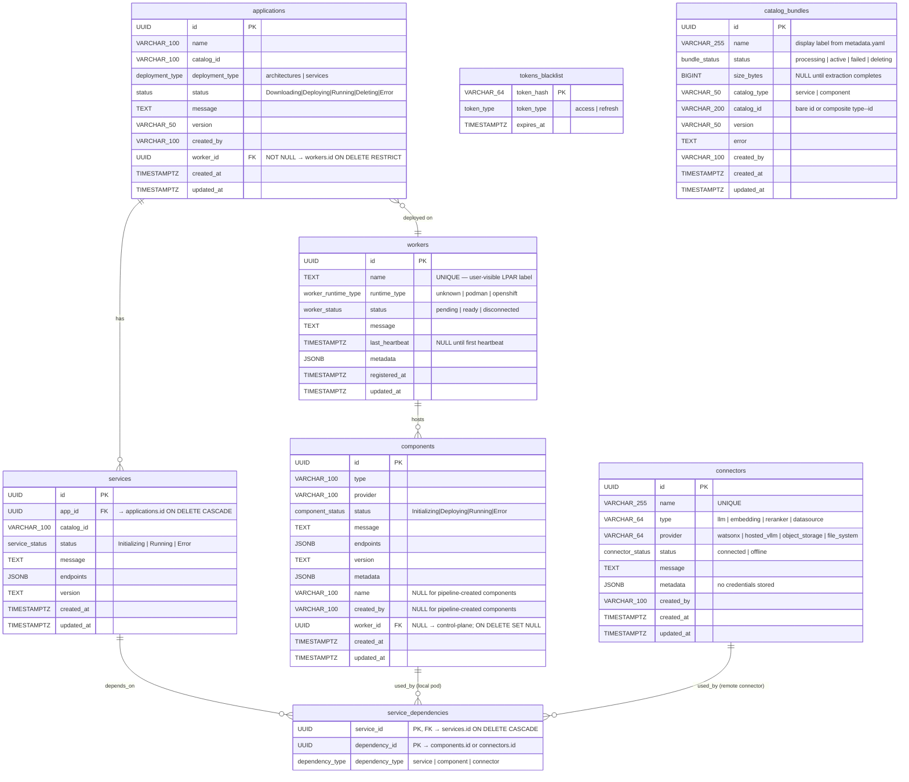

# Model Management & Connectors — Low-Level Design

**Version:** 1.1
**Date:** October 2026
**Status:** Draft / Proposal
**See also:** [`model-management-architecture.md`](model-management-architecture.md) — High-Level Architecture and UX Designs

---

## Table of Contents

1. [Executive Summary](#1-executive-summary)
2. [Background and Motivation](#2-background-and-motivation)
3. [LiteLLM Gateway Integration](#3-litellm-gateway-integration)
   - [LiteLLM as a Catalog Asset](#litellm-as-a-catalog-asset)
   - [Route Registration](#route-registration)
   - [Virtual Key Provisioning](#virtual-key-provisioning)
   - [WatsonX via Connector](#watsonx-via-connector)
   - [Tokenize Passthrough](#tokenize-passthrough)
4. [New Concepts](#4-new-concepts)
   - [4.1 Models](#41-models)
   - [4.2 Connectors](#42-connectors)
   - [4.3 Supported Provider Params](#43-supported-provider-params)
5. [Database Schema](#5-database-schema)
   - [5.1 Guiding Principle](#51-guiding-principle)
   - [5.2 Additions to Existing `components` Table](#52-additions-to-existing-components-table)
   - [5.3 Reuse of Shared `connectors` Table](#53-reuse-of-shared-connectors-table-for-remote-model-connectors)
   - [5.4 Reuse of `service_dependencies`](#54-reuse-of-service_dependencies-for-model-connector-links)
   - [5.5 Connector Status Values](#55-connector-status-values)
   - [5.6 New `workers` Table](#56-new-workers-table)
   - [5.7 Migration Plan](#57-migration-plan)
   - [5.8 Full Entity Relationship Diagram](#58-full-entity-relationship-diagram)
6. [API Specification](#6-api-specification)
   - [6.1 Model Endpoints (polymorphic)](#61-model-endpoints-polymorphic--components--connectors-tables)
   - [6.2 Connector Provider-Discovery Endpoints](#62-connector-provider-discovery-endpoints-read-only)
   - [6.3 Extensions to Existing Endpoints](#63-extensions-to-existing-endpoints)
   - [6.4 Public Key Endpoint](#64-public-key-endpoint)
7. [API Endpoint Details](#7-api-endpoint-details)
   - [7.1 Create a Model (polymorphic)](#71-create-a-model-polymorphic)
   - [7.2 List Models (polymorphic)](#72-list-models-polymorphic)
   - [7.3 Get Model Details](#73-get-model-details)
   - [7.4 Update a Remote Model's Credentials](#74-update-a-remote-models-credentials)
   - [7.5 Delete / Undeploy a Model](#75-delete--undeploy-a-model)
   - [7.6 Generate Public Key](#76-generate-public-key)
8. [Pre-flight Resource Check](#8-pre-flight-resource-check)
9. [Deployment Flow](#9-deployment-flow)
   - [Flow: Application Create with Managed Model (model already deployed)](#flow-application-create--model-already-deployed-pre-deployed-path)
   - [Flow: Application Create with Managed Model (new deploy)](#flow-application-create--new-model-deploy)
   - [Flow: Application Create with Model Connector](#flow-application-create--model-connector-remote)
10. [Key Design Decisions](#10-key-design-decisions)
11. [Common Queries](#11-common-queries)
12. [Error Handling](#12-error-handling)
13. [Future Considerations](#13-future-considerations)
14. [CLI Commands](#14-cli-commands)
    - [14.0 Catalog Configure](#140-catalog-configure)
    - [14.1 Model Commands](#141-model-commands)
    - [14.2 Connector Commands](#142-connector-commands)
    - [14.3 LiteLLM Gateway Commands](#143-litellm-gateway-commands)
    - [14.4 Command Summary](#144-command-summary)
15. [Key Rotation](#15-key-rotation)

---

## 1. Executive Summary

This proposal extends the existing Catalog Service with two new capabilities:

1. **Model Management** — dynamic deploy, undeploy, list, and status of model inference backends (`llm`, `embedding`, `reranker`) across all supported runtimes (Podman, OpenShift, Docker Compose). Models are no longer bundled statically inside application pods; they are standalone deployable components managed independently and exposed to consumer services through a **LiteLLM Gateway** — a universal model proxy that sits between applications and any backend provider.

2. **Connectors** — a way to register external model endpoints (WatsonX, hosted vLLM) without deploying any local pod. Credentials are passed directly to the **LiteLLM Gateway** at route-registration time and stored there — they never enter the Catalog database or a Podman secret.

> **`modelmanager` is a Go package inside the Catalog API server process** — not a separate service or sidecar. The HTTP handlers call into it directly; there is no inter-process communication. It owns the full lifecycle (deploy, update, undeploy, status) of all three component types: `llm`, `embedding`, and `reranker` — for both local pods and remote connectors.

**Core design principle: two tables, cleanly separated.**

| Kind | Table | Pod? | Credentials stored in | Examples |
|---|---|---|---|---|
| Local pod | `components` | ✅ | None (virtual keys live only in the LiteLLM Gateway DB) | vLLM (cpu, spyre) |
| Remote connector | `connectors` | ❌ | LiteLLM Gateway DB (provider secrets and virtual keys) | WatsonX, hosted vLLM |

Three new columns on `components` (`name`, `created_by`, `worker_id`) and a new `workers` table are the complete schema delta. Remote model connectors reuse the shared `connectors` table (same as datasource connectors). Credentials and virtual keys never touch the Catalog database.

---

## 2. Background and Motivation

### Current State

The current catalog deploys vLLM or WatsonX as `components` that are tightly coupled to an application at creation time. Changing the model requires deleting and recreating the entire application. There is no concept of reusing a running model backend across applications, no support for dynamically switching providers at runtime, and no way to register an externally-hosted model endpoint without forking a template.

### Problems

- Model lifecycle is locked to application lifecycle; a model upgrade forces full application re-deployment.
- No mechanism to connect to an already-running WatsonX or vLLM endpoint outside of the platform.
- `component_status` enum only has `Initializing`, `Running`, `Error` — insufficient to express the `Deploying` lifecycle state needed for async model deployment.

### Goals

1. Decouple model lifecycle from application lifecycle.
2. Introduce a universal gateway (LiteLLM) so consumer services are provider-agnostic.
3. Enable connection to external model endpoints via Connectors without deploying local pods.
4. Gate all model deployments behind a pre-flight resource check.
5. Persist all model state in the Catalog DB — local models in `components`, remote connectors in the shared `connectors` table. Virtual keys are **not** stored in the Catalog DB; they live only in LiteLLM.

---

## 3. LiteLLM Gateway Integration

### LiteLLM as a Catalog Asset

The LiteLLM Gateway is promoted from a static WatsonX-only component to the **universal model proxy** for all providers. It is deployed **once, as part of `catalog configure`** — the same command that starts PostgreSQL, Caddy, and the Catalog API server. It is not deployed per-application.

The gateway lives inside the Catalog asset (`assets/catalog/podman/templates/`) alongside the existing Catalog templates. Two new files are added: `litellm-master-key-secret.yaml.tmpl` (generates the `LITELLM_MASTER_KEY` Podman secret) and `litellm.yaml.tmpl` (starts the gateway pod). These are rendered as part of the existing `podTemplateExecutions` sequence in [`assets/catalog/podman/metadata.yaml`](ai-services/assets/catalog/podman/metadata.yaml).

All applications share the single LiteLLM gateway instance. Consumer services point to it at creation time and never need reconfiguring when the backing model provider changes — only the gateway route table changes.

### LiteLLM PostgreSQL Instance

LiteLLM is configured with its **own dedicated PostgreSQL instance**, separate from the Catalog API database. This is deployed as part of `catalog configure` alongside the gateway pod itself.

**Why a separate Postgres instance for LiteLLM:**

| Reason | Detail |
|---|---|
| **Credential persistence** | LiteLLM stores the full `litellm_params` for every registered route — including secret fields (`api_key`, `token`, etc.) that the Catalog DB deliberately never holds. Without a DB these secrets are lost on gateway restart, breaking all connector routes. |
| **Route table durability** | On gateway restart, LiteLLM rehydrates its in-memory route table from the DB. Without it, every registered model (local and remote alike) would need to be re-registered by the Catalog API, introducing a complex reconciliation loop at startup. |
| **Separation of concerns** | Connector credentials must never enter the Catalog DB (design decision §11.2). Routing them through a LiteLLM-owned DB keeps the secret boundary clean — LiteLLM owns and manages what it stores; the Catalog API never reads it back. |
| **Spend / audit tracking** | LiteLLM uses its DB to persist request logs and spend data per virtual key. This enables per-model usage reporting without coupling it to the Catalog schema. |

**Configuration:**

```
DATABASE_URL=postgresql://litellm:<password>@localhost:5433/litellm
```

The LiteLLM DB runs on port **5433** to avoid conflict with the Catalog API's PostgreSQL instance on port **5432**. Both are started by `catalog configure`; both are backed by Podman secrets for their passwords.

`litellm.yaml.tmpl` passes `DATABASE_URL` as an environment variable to the LiteLLM pod. LiteLLM runs its own schema migrations on first start (`litellm --run_gunicorn` applies them automatically).

### Route Registration

When a model reaches `Running` status (pod healthy / connector validated), the platform registers a route via the LiteLLM Admin API using **tag-based routing**. The provider suffix (`--vllm-spyre`, `--vllm-cpu`, etc.) is removed from the consumer-facing model identifier — consumer services call LiteLLM using the full model name as configured (e.g. `ibm-granite/granite-3.3-8b-instruct`), and LiteLLM selects the route tagged with the deployment ID.

**Register (on deploy):**
```
POST http://litellm:4000/model/new
Authorization: Bearer <LITELLM_MASTER_KEY>

{
  "model_name": "ibm-granite/granite-3.3-8b-instruct",
  "litellm_params": {
    "model": "hosted_vllm/ibm-granite/granite-3.3-8b-instruct",
    "api_base": "http://llm-5b6297a4b5:8000/v1",
    "tags": ["7f3a1c2d-8e4b-4f5a-9d6e-1a2b3c4d5e6f"]
  }
}
```

Equivalent `curl`:

```bash
curl -k -X POST https://litellm-api.10.20.185.165.nip.io/model/new \
  -H "Authorization: Bearer $LITELLM_KEY" \
  -H "Content-Type: application/json" \
  -d '{
    "model_name": "ibm-granite/granite-3.3-8b-instruct",
    "litellm_params": {
      "model": "hosted_vllm/ibm-granite/granite-3.3-8b-instruct",
      "api_base": "http://llm-5b6297a4b5:8000/v1",
      "tags": ["7f3a1c2d-8e4b-4f5a-9d6e-1a2b3c4d5e6f"]
    }
  }'
```

> **Notes:**
> - `model_name` is the full model name as configured in `params.model` — no provider suffix. This is exactly what consumer services pass in the `model` field.
> - `model` uses the `hosted_vllm/<model-name>` prefix — LiteLLM infers the provider from the prefix. No separate `custom_llm_provider` field and no `api_key` are needed for local vLLM endpoints.
> - `api_base` for **llm** and **embedding** routes **must** include a `/v1` suffix (e.g. `http://llm-52db58ac5a:8000/v1`). The `hosted_vllm` provider does not prepend it automatically — omitting it causes LiteLLM to call `/chat/completions` directly, which vLLM does not serve, resulting in a `404`. For **reranker** routes, use the **bare** base URL (no `/v1`) — the Cohere `ClientV2` constructs `/v2/rerank` itself from the base.
> - `tags` is nested inside **`litellm_params`** on the `/model/new` request body. Every route carries exactly one tag: the **deployment ID** — `components.id` for a local model, `connectors.id` for a remote connector (the same `id` returned by `GET /api/v1/models`). The deployment ID uniquely identifies one deployment; its row already records the provider, worker (`components.worker_id`) and profile (`components.metadata.profile`), so nothing else needs to be encoded in the tag.
> - Tag enforcement is enabled gateway-wide via `router_settings.enable_tag_filtering: true` in the LiteLLM config rendered by `litellm.yaml.tmpl` — it is not set per route.
> - The same `model_name` may be registered multiple times (once per deployment, e.g. a `vllm-cpu` and a `vllm-spyre` deployment of granite, or the same Spyre model on two workers or at `compact-4k` and `standard`). Each registration is a separate LiteLLM deployment distinguished by its deployment ID tag.
> - For **embedding** and **reranker** component types, a `model_info` block is also included to tell LiteLLM the routing mode: `{ "model_info": { "mode": "embedding" } }` or `{ "model_info": { "mode": "rerank" } }`. This is omitted for `llm` type routes.

**Deregister (on undeploy):**
```
DELETE http://litellm:4000/model/delete
Authorization: Bearer <LITELLM_MASTER_KEY>

{ "model_name": "ibm-granite/granite-3.3-8b-instruct" }
```

No UUID lookup needed — `model_name` is the stable, unique identifier for the route.

**Tag-based routing convention:**

Each route carries exactly one tag in `litellm_params.tags`:

| Tag | Example | Purpose |
|---|---|---|
| Deployment ID | `7f3a1c2d-8e4b-4f5a-9d6e-1a2b3c4d5e6f` | `components.id` (local) or `connectors.id` (remote). Uniquely identifies one deployment — its provider, worker and profile are all recoverable from the row. Used by both `internal` and `public` keys |

The `model_name` is the full `params.model` value (e.g. `ibm-granite/granite-3.3-8b-instruct`, `BAAI/bge-m3`, `BAAI/bge-reranker-v2-m3`). Deployment is tracked via the ID tag rather than being encoded in the model name.

Tags reach the router from two sources:
- **Virtual key metadata** — `metadata.tags` on a key (see [Virtual Key Provisioning](#virtual-key-provisioning)) lists what the key is allowed to reach. An `internal` key holds exactly one deployment ID — the instance the user chose at application create; a `public` key holds one deployment ID per selected deployment (e.g. `["7f3a1c2d-…", "a91b44e0-…"]`). LiteLLM applies these tags to every request made with that key.
- **Request metadata** (optional) — a consumer may pass `metadata.tags` on an individual request to narrow to one of the key's tags.

With `enable_tag_filtering` on, a request is only eligible for deployments of the requested `model_name` whose `litellm_params.tags` intersect the request/key tags. A key tagged `["7f3a1c2d-…"]` reaches only that one deployment — the Spyre granite pod on `lpar-1` at `compact-4k`, for example — and no other deployment of the same model. Because a UUID is unique, it cannot accidentally match a different route.

Since `model_name` is the full `params.model` value and is unique per model, there is no need to derive or store a route ID string in the Catalog DB.

### Virtual Key Provisioning

Virtual keys are bearer tokens used to authenticate inference requests against the LiteLLM Gateway. They are distinct from the `LITELLM_MASTER_KEY` — an internal admin credential that is never exposed outside the platform.

> **Virtual keys are not stored in the Catalog DB.** There is no `keys` table. LiteLLM is the only system that holds a key. Registering a model route (local deploy or remote connector create) does **not** generate a key.

Every key is tagged with `metadata.type` so the two kinds can be told apart:

| `metadata.type` | Used by | Generated | Delivered via | Scope (`metadata.tags`) | How many |
|---|---|---|---|---|---|
| `internal` | Service pods of a deployed application | At application create | Podman Secret `litellm-secret-<instance-slug>` (see §10.11) | Exactly one deployment ID (the chosen instance) | One per application and model |
| `public` | Humans, CI pipelines and scripts calling LiteLLM from outside the platform | On demand, by a user, for a chosen model and deployment(s) — each deployment is a specific worker and profile | Shown **once** in the generate response | One or more deployment IDs, chosen by the user | **At most one per model** |

**Internal key (application create):**

```
POST http://litellm:4000/key/generate
Authorization: Bearer <LITELLM_MASTER_KEY>

{
  "key_name": "ibm-granite/granite-3.3-8b-instruct",
  "models": ["ibm-granite/granite-3.3-8b-instruct"],
  "duration": null,
  "metadata": {
    "type": "internal",
    "tags": ["7f3a1c2d-8e4b-4f5a-9d6e-1a2b3c4d5e6f"]
  }
}
```

`"models"` scopes the key to routes registered under that model name — calls to any other model return `401`. `"metadata.tags"` holds exactly **one deployment ID** — the `components.id` (or `connectors.id`) of the instance the user selected for the application; LiteLLM attaches it to every request made with the key, so tag filtering restricts the request to that instance, on its worker and at its profile. The key is injected into the service pod through a Podman Secret and is never written to the Catalog DB.

> **Note:** `metadata.tags` accepts multiple tags, which lets LiteLLM route (load-balance) across the matching deployments of the same `model_name`. Internal keys are deliberately pinned to the single instance the user chose, so a service never drifts to another worker or profile of the same model. A `public` key is pinned to specific deployments by ID in the same way, and may list several when the user asks for it.

**Public key (on demand, per model):**

A user asks the Catalog API for a public key for one model and one or more of its **deployments** (`POST /api/v1/models/keys`, see §7.6). A deployment is a `components` row, which already fixes the provider, the worker (`worker_id`) and the profile (`metadata.profile`), so the user picks *where* and *at which profile* the key may reach by picking deployments. `modelmanager` validates the request, then performs two calls against LiteLLM:

```
# 1. Revoke the existing public key for this model, if any (looked up by its alias)
POST http://litellm:4000/key/delete
Authorization: Bearer <LITELLM_MASTER_KEY>

{ "key_aliases": ["public-ibm-granite/granite-3.3-8b-instruct"] }

# 2. Generate the new one
POST http://litellm:4000/key/generate
Authorization: Bearer <LITELLM_MASTER_KEY>

{
  "key_alias": "public-ibm-granite/granite-3.3-8b-instruct",
  "models": ["ibm-granite/granite-3.3-8b-instruct"],
  "duration": null,
  "metadata": {
    "type": "public",
    "tags": ["7f3a1c2d-8e4b-4f5a-9d6e-1a2b3c4d5e6f", "a91b44e0-3c2d-4e7f-8a10-5b6c7d8e9f01"],
    "created_by": "user@example.com"
  }
}
```

Equivalent `curl` for step 2:

```bash
curl -k -X POST 'https://litellm-api.10.20.185.165.nip.io/key/generate' \
  -H "Authorization: Bearer $LITELLM_KEY" \
  -H 'Content-Type: application/json' \
  -d '{
    "key_alias": "public-ibm-granite/granite-3.3-8b-instruct",
    "models": ["ibm-granite/granite-3.3-8b-instruct"],
    "metadata": {
      "type": "public",
      "tags": ["7f3a1c2d-8e4b-4f5a-9d6e-1a2b3c4d5e6f"]
    }
  }'
```

- **Scoped to one model and the chosen deployments.** `"models"` limits the key to that `model_name`; `"metadata.tags"` lists the deployment ID(s) the key may reach, and each ID implies one worker and one profile. With tag filtering enabled, a request made with this key is only eligible for routes whose `litellm_params.tags` contain one of those IDs. A caller may narrow further with request `metadata.tags`, but cannot widen beyond the key's tags.
- **At most one public key per model.** The alias is `public-<model_name>`, which LiteLLM enforces as unique, and `metadata.type: "public"` identifies the key. Generating a new key for a model always revokes that model's previous public key first, so the old key stops working immediately (in-flight requests receive `401`). A "key not found" response from step 1 is ignored — it just means no public key existed yet. Public keys for other models are untouched.
- **Shown once.** The new `sk-...` value is returned in the response of step 2 and passed straight back to the caller. The Catalog API neither stores nor logs it, so it cannot be retrieved again. A user who loses it generates a new one for the same model, which invalidates the lost one.
- **Validated up front.** The model must have at least one registered route, and every requested deployment ID must be a `components` or `connectors` row serving that `model_name` with a registered route. Otherwise the request is rejected before anything is revoked.
- **Outlives model changes.** Deleting a deployment does not revoke the public key. The key can only reach routes tagged with its deployment IDs, and deployment IDs are never reused, so once the route is gone the key grants nothing for it; regenerating replaces the key. Redeploying the model creates a new `components.id`, so the user must generate a new key to reach it.
- **Serialised.** `modelmanager` holds a lock around the revoke-then-generate pair so two concurrent requests for the same model cannot interleave.

**Consumers of virtual keys:**

| Consumer | Key type | How it receives the key |
|---|---|---|
| **Internal consumer services** (chatbot, digitize, similarity, summarize) | `internal` | Rendered into a Podman Secret at application create and mounted into the pod at `/etc/secret/litellm-secret/LITELLM_VIRTUAL_KEY` (see §10.11). No call to the Catalog API is needed |
| **External callers** (developers, CI pipelines) | `public` | The user generates it for a model and deployment(s) with `ai-services model litellm key generate` (see §14.3) or `POST /api/v1/models/keys`, and copies it from the one-time response |

**Usage by callers:**

Callers send the key as a standard bearer token. Routing is driven by the key's `metadata.tags`; a request may additionally pass `metadata.tags` to narrow to one of the key's tags (for example a `public` key tagged with two deployment IDs can pin one of them):

```
POST http://litellm:4000/chat/completions
Authorization: Bearer <virtual-key>

{
  "model": "ibm-granite/granite-3.3-8b-instruct",
  "messages": [{ "role": "user", "content": "Hello" }],
  "metadata": {
    "tags": ["7f3a1c2d-8e4b-4f5a-9d6e-1a2b3c4d5e6f"]
  }
}
```

The `model` field is the **full model name** as configured — no provider suffix. Request-level `metadata.tags` is optional; when present it must match a route's `litellm_params.tags`. LiteLLM uses `enable_tag_filtering` to enforce this — only the route tagged with that deployment ID is eligible to serve this request. When omitted, the key's own `metadata.tags` apply. Callers never need to embed the provider in the model name.

### Probe Check

After every route registration, `modelmanager` fires a health probe against the LiteLLM gateway to confirm the backend is reachable and responding.

- **Local models** (`components`): probe is **async** — `POST /api/v1/models` returns `202` immediately; the probe runs in the background and drives `components.status`.
- **Remote connectors** (`connectors`): probe is **synchronous** — if it fails, the LiteLLM route is deregistered and `422` is returned; `INSERT into connectors` only happens on success.

**Probe request:**

```
GET http://litellm:4000/health?model=ibm-granite/granite-3.3-8b-instruct
Authorization: Bearer <LITELLM_MASTER_KEY>
```

The `model` query parameter is the `model_name` registered in the previous step (i.e. the full model name from `params.model`, e.g. `ibm-granite/granite-3.3-8b-instruct`).

**Healthy response — set `status = Running` (local) / `connected` (connector):**

```json
{
  "healthy_endpoints": [
    {
      "api_base": "http://llm-d295596cd0:8000/v1",
      "model": "hosted_vllm/ibm-granite/granite-3.3-8b-instruct",
      "max_tokens": 5,
      "model_id": "d3d7aa41-67b1-4785-a7ae-d0a7ee1e6211"
    }
  ],
  "unhealthy_endpoints": [],
  "healthy_count": 1,
  "unhealthy_count": 0
}
```

`healthy_count > 0` → set `Running`/`connected` (local: `components.status`; connector: `connectors.status`).

**Unhealthy response — set `status = Error` / `offline`:**

```json
{
  "healthy_endpoints": [],
  "unhealthy_endpoints": [
    {
      "api_base": "http://llm-d295596cd0:8000/v1",
      "model": "hosted_vllm/ibm-granite/granite-3.3-8b-instruct",
      "error": "litellm.InternalServerError: InternalServerError: Hosted_vllmException - Cannot connect to host llm-d295596cd0:8000 ssl:... [Name or service not known]",
      "model_id": "d3d7aa41-67b1-4785-a7ae-d0a7ee1e6211",
      "exception_status": 500
    }
  ],
  "healthy_count": 0,
  "unhealthy_count": 1
}
```

`unhealthy_count > 0` → local: `components.status = 'Error'`; connector: abort and return `422`.

**Probe logic summary:**

| `healthy_count` | `unhealthy_count` | Local model action | Connector action |
|---|---|---|---|
| `> 0` | `0` | `components.status = 'Running'`, clear `message` | `connectors.status = 'connected'`, persist row, return `201` |
| `0` | `> 0` | `components.status = 'Error'`, store error in `message` | DELETE LiteLLM route, return `422` with error |
| `0` | `0` | `components.status = 'Error'`, store `"No endpoints returned"` | DELETE LiteLLM route, return `422` |

> For local models the probe is fire-and-forget (`POST /api/v1/models` with `deployment_type=local` returns `202` immediately). Callers poll `GET /api/v1/models/:id` to observe `Deploying` → `Running` / `Error`. For remote models the probe is blocking — `POST /api/v1/models` with `deployment_type=remote` only returns `201` after the probe passes.

### Status Sync Service

The one-time probe at creation only confirms the model was healthy at registration time. The **status sync service** is a background goroutine inside `modelmanager` that continuously re-checks all registered models and connectors and keeps their status in sync with reality — detecting pods that have crashed, remote credentials that have expired, or network connectivity that has been lost since creation.

**Trigger:** runs on a configurable interval (default: **60 seconds**) using a `time.Ticker` started when the Catalog API server boots. It is not a separate process or sidecar — it runs inside the same `modelmanager` package as the rest of the lifecycle logic.

**What it checks:**

| Target | Source | Health call |
|---|---|---|
| Local models (`components`) | All rows with `type IN ('llm','embedding','reranker')` and `status != 'Error'` and `created_by IS NOT NULL` | `GET /health?model=<model_name>` on LiteLLM |
| Remote connectors (`connectors`) | All rows with `type = 'models'` and `status IN ('connected','offline')` | `GET /health?model=<metadata.model_name>` on LiteLLM |

The `model` query parameter is the model name stored in `components.metadata->>'model'` (local) or `connectors.metadata->>'model_name'` (remote).

**Status transitions:**

| Previous status | Probe result | New status | Action |
|---|---|---|---|
| `Running` / `connected` | healthy | unchanged | — |
| `Running` / `connected` | unhealthy | `Error` / `offline` | Update status + write error message |
| `Error` / `offline` | healthy | `Running` / `connected` | Update status + clear message |
| `Error` / `offline` | unhealthy | unchanged | Update message if error text changed |
| `Deploying` | — | skipped | Pods still starting are not probed |

**Implementation sketch:**

```go
// inside modelmanager package, started from catalog server boot
func (s *SyncService) Start(ctx context.Context) {
    ticker := time.NewTicker(s.interval) // default 60s, configurable
    defer ticker.Stop()
    for {
        select {
        case <-ticker.C:
            s.syncLocalModels(ctx)
            s.syncRemoteConnectors(ctx)
        case <-ctx.Done():
            return
        }
    }
}
```

`syncLocalModels` queries `components` for all managed model rows not in `Deploying`, probes each via LiteLLM `/health`, and writes back any status change. `syncRemoteConnectors` does the same for `connectors` rows with `type = 'models'`.

**Back-off on repeated failures:** if a model has been `Error`/`offline` for more than a configurable threshold (default: **5 consecutive failed probes**), the sync service stops probing it and sets `message = "Health checks suspended after N consecutive failures — manual intervention required"`. It resumes on the next explicit action (e.g. credential update via `PUT /api/v1/models/:id`).

**No probe storms:** all probes in a single tick run sequentially (not concurrently) to avoid flooding the LiteLLM gateway.

### WatsonX via Connector

When deploying with `provider: watsonx`, no local pod is created. Credentials are passed directly to LiteLLM at route-registration time — they are never stored in the Catalog DB or a Podman secret. LiteLLM stores and manages them internally:

```
POST http://litellm:4000/model/new
Authorization: Bearer <LITELLM_MASTER_KEY>
Content-Type: application/json

{
  "model_name": "ibm/granite-4-h-small",
  "litellm_params": {
    "model": "watsonx/ibm/granite-4-h-small",
    "api_base": "https://us-south.ml.cloud.ibm.com",
    "api_key": "<params.api_key>",
    "project_id": "<params.project_id>",
    "tags": ["<connectors.id>"]
  }
}
```

| `litellm_params` field | Source |
|---|---|
| `model` | `"{provider_id}/{params.model_name}"` — e.g. `watsonx/ibm/granite-4-h-small`. LiteLLM infers the provider from the prefix; no `custom_llm_provider` field is needed |
| `api_base` | `params.api_base` |
| `api_key` | `params.api_key` — passed to LiteLLM at registration; **never stored in Catalog DB** |
| `project_id` | `params.project_id` |
| `tags` | `[connectors.id]`. The connector `id` is generated up front (before route registration) so it can be used as the tag; the row is inserted with that same `id` once the probe succeeds |

### Tokenize Passthrough

LiteLLM does not natively proxy the vLLM `/tokenize` endpoint. This endpoint is used by consumer services to count tokens against a specific model's tokenizer — the result directly drives context-window budget calculations and prompt truncation. Because tokenization is model-specific (each model has its own vocabulary and BPE merges), each service must call `/tokenize` against the correct model's tokenizer.

#### Services and their `/tokenize` dependency

| Service | Tokenizer model used | Why |
|---|---|---|
| **chatbot** | LLM model | Token-budget context building (`query_vllm_payload`), history truncation, query rephrasing length calculation |
| **summarize** | LLM model | Input token count, chunk sizing, merge-window validation |
| **translate** | LLM model | Input length check, chunk budget calculation |
| **extract** | LLM model | Prompt overhead calculation, schema-fit validation |
| **chatbot** (query validation) | Embedding model | Measures query length against the embedding model's token limit |
| **digitize** | Embedding model | Measures chunk length against the embedding model's token limit |

#### LiteLLM passthrough configuration

To make `/tokenize` reachable through the LiteLLM gateway, a **passthrough endpoint** is registered in LiteLLM for **each deployed local vLLM instance** (`component_id`) and for **each remote `hosted_vllm` connector** (`connector_id`).

Because multiple vLLM instances or models may run simultaneously, the gateway path is **scoped per instance UUID**:

```
/tokenize/{UUID}   →   http://<target-pod-or-host>:8000/tokenize
```

where `{UUID}` is:
- `components.id` for a **locally deployed vLLM instance** (`vllm-cpu`, `vllm-spyre`).
- `connectors.id` for a **remote `hosted_vllm` connector**.

The passthrough endpoint is registered via LiteLLM's `POST /config/pass_through_endpoint` API with `"auth": false`.

> **Security & Authentication Boundary:**
> LiteLLM virtual keys do not enforce authentication on passthrough endpoints. Therefore, `"auth": false` is configured on LiteLLM passthrough routes for internal consumption by platform services.
> To prevent unauthorized external access, **Caddy's public ingress (port 443) explicitly blocks all requests matching `/tokenize` (and `/tokenize/*`)**, ensuring the tokenize endpoint is only reachable internally across the private service network and never exposed to the public internet.

#### Registration payload examples

**1. Local control-plane vLLM instance (e.g. `components.id = "7a465ce2-1234-5678-90ab-cdef12345678"`, pod name `llm-7a465ce212`):**

```bash
curl -k -X POST "https://<litellm-host>/config/pass_through_endpoint" \
  -H "Authorization: Bearer $LITELLM_MASTER_KEY" \
  -H "Content-Type: application/json" \
  -d '{
    "id": "vllm-token-passthrough-7a465ce2-1234-5678-90ab-cdef12345678",
    "path": "/tokenize/7a465ce2-1234-5678-90ab-cdef12345678",
    "target": "http://llm-7a465ce212:8000/tokenize",
    "methods": ["POST"],
    "auth": false
  }'
```

**2. Local remote-worker vLLM instance (deployed on worker LPAR `lpar-1`, routed via Caddy proxy):**

```bash
curl -k -X POST "https://<litellm-host>/config/pass_through_endpoint" \
  -H "Authorization: Bearer $LITELLM_MASTER_KEY" \
  -H "Content-Type: application/json" \
  -d '{
    "id": "vllm-token-passthrough-9b123456-789a-bcde-f012-3456789abcde",
    "path": "/tokenize/9b123456-789a-bcde-f012-3456789abcde",
    "target": "http://ai-services--caddy:8080/worker/lpar-1/models/<caddyRouteID>/tokenize",
    "methods": ["POST"],
    "auth": false
  }'
```

**3. Remote `hosted_vllm` connector (e.g. `connectors.id = "c-4f8a12bc-90ab-cdef-1234-567890abcdef"`, remote target `https://remote-vllm.corp.internal:8000`):**

```bash
curl -k -X POST "https://<litellm-host>/config/pass_through_endpoint" \
  -H "Authorization: Bearer $LITELLM_MASTER_KEY" \
  -H "Content-Type: application/json" \
  -d '{
    "id": "vllm-token-passthrough-c-4f8a12bc-90ab-cdef-1234-567890abcdef",
    "path": "/tokenize/c-4f8a12bc-90ab-cdef-1234-567890abcdef",
    "target": "https://remote-vllm.corp.internal:8000/tokenize",
    "methods": ["POST"],
    "auth": false
  }'
```

| Field | Description / Value |
|---|---|
| `id` | `vllm-token-passthrough-{UUID}` — unique identifier for the passthrough entry |
| `path` | `/tokenize/{UUID}` — scoped path using `components.id` (local) or `connectors.id` (remote `hosted_vllm`), preventing conflicts across models and instances |
| `target` | Direct upstream URL pointing to the backing vLLM instance `/tokenize` endpoint |
| `methods` | `["POST"]` |
| `auth` | `false` — LiteLLM virtual keys do not enforce authentication on passthrough endpoints; public ingress security is enforced at the Caddy ingress layer (blocking `/tokenize/*` on port 443) |

#### Lifecycle

- **Registration:**
  - Local vLLM instance: Registered after the pod passes its readiness/liveness probe, alongside route registration (`POST /model/new`).
  - Remote `hosted_vllm` connector: Registered during connector creation after the connectivity probe succeeds, alongside route registration (`POST /model/new`).
- **Deregistration:**
  - Local vLLM instance: Removed during model undeployment via `DELETE /config/pass_through_endpoint` (with `{"id": "vllm-token-passthrough-<components.id>"}`), alongside `DELETE /model/delete`.
  - Remote `hosted_vllm` connector: Removed during connector deletion via `DELETE /config/pass_through_endpoint` (with `{"id": "vllm-token-passthrough-<connectors.id>"}`), alongside `DELETE /model/delete`.

#### Consumer service configuration

Each consumer service is configured with the **instance-scoped tokenize URL** pointing to the LiteLLM gateway:

| Config variable | Example value |
|---|---|
| `LLM_ENDPOINT` | `https://litellm-api:4000` (inference via LiteLLM route) |
| `LLM_TOKENIZE_ENDPOINT` | `https://litellm-api:4000/tokenize/7a465ce2-1234-5678-90ab-cdef12345678` |
| `EMB_ENDPOINT` | `https://litellm-api:4000` (embeddings via LiteLLM route) |
| `EMB_TOKENIZE_ENDPOINT` | `https://litellm-api:4000/tokenize/c-4f8a12bc-90ab-cdef-1234-567890abcdef` |

Internal consumer services reach the LiteLLM gateway over the internal network using `LLM_TOKENIZE_ENDPOINT` / `EMB_TOKENIZE_ENDPOINT`. External requests hitting public ingress on Caddy (port 443) for `/tokenize/*` are rejected with `403 Forbidden`.

---

## 4. New Concepts

### 4.1 Models

A **Model** is an inference backend for a specific role (`llm`, `embedding`, `reranker`) deployed and managed independently of an application. `/api/v1/models` is a **polymorphic API**: a single surface that covers both local pod-backed models and remote connector-backed models. The `deployment_type` field in the request body selects the backend; responses always carry the same `deployment_type` field so callers can tell them apart.

| Kind | `deployment_type` | Storage table | Example providers | Pod? | Credentials location |
|---|---|---|---|---|---|
| Local | `local` | `components` | `vllm-cpu`, `vllm-spyre` | ✅ Yes | None — a local vLLM endpoint needs no upstream credential |
| Remote | `remote` | `connectors` | `watsonx`, `hosted_vllm` | ❌ No | LiteLLM Gateway DB |

Both kinds are registered as a route in the **LiteLLM Gateway** pod. Consumer services only ever talk to the LiteLLM gateway — they have no knowledge of which table is behind it.

The key differences from today's application-coupled components:

| | Today | New |
|---|---|---|
| Created by | Application deployment | `POST /api/v1/models` (either `deployment_type`) |
| Lifecycle | Deleted with application | Explicit undeploy/delete required |
| Provider endpoint | Exposed directly to services | Always proxied via LiteLLM Gateway |
| Pre-flight resource check | None | Required for `local` models only |
| WatsonX | Deploys a per-app LiteLLM proxy pod | `deployment_type=remote` → `connectors` row — credentials stored in LiteLLM, no pod |

### 4.2 Connectors

A **Connector** is a static entity in the `connectors` table — a registered connection to an external service. In the catalog assets, connectors are categorized under `connector_type = "models"` (`assets/connectors/models/<provider_id>/`) for remote model providers, and `connector_type = "datasource"` (`assets/connectors/datasource/<provider_id>/`) for data sources. Provider schemas are served via `/api/v1/connectors/:connector_type/providers/:provider_id/params`.

Model connectors have no local pod and no Podman secret. Credentials are passed directly to the **LiteLLM Gateway** at route-registration time — LiteLLM stores and manages them. The Catalog DB stores only non-secret connection config (`metadata.model_name`, `metadata.api_base`, `metadata.project_id`, etc.) — never the secret values themselves. Sensitive fields are identified from the provider's `schema.json` (properties with `"format": "password"`), the same mechanism used by datasource connectors.

> **Relationship between `/api/v1/models` and `/api/v1/connectors`:** All model entity CRUD lives on `/api/v1/models`. `/api/v1/connectors` is **read-only** — it serves provider definitions and `schema.json` files only, exactly mirroring its role for datasource connectors. `GET /api/v1/models` unifies both the `components` and `connectors` tables in one paginated list; `/api/v1/connectors` is never used for model entity reads or writes.

**Connector categories and providers (`assets/connectors/`):**

| `connector_type` | `provider` | Description | Sensitive `params` (`format: password`) |
|---|---|---|---|
| `models` | `watsonx` | IBM watsonx.ai | `api_key` |
| `models` | `hosted_vllm` | Externally hosted vLLM endpoint (OpenAI-compatible API) | `api_key` (optional) |
| `datasource` | `object_storage` | S3-compatible Object Storage | `secret_key` |
| `datasource` | `file_system` | SSH / SFTP file system | `password` / `private_key` |

Supported model connector providers are **`watsonx`** and **`hosted_vllm`**. Provider IDs follow the LiteLLM provider prefix so the catalog `provider` value maps directly to `litellm_params.model` (e.g. `hosted_vllm/<model_name>`, `watsonx/<model_name>`).

### 4.3 Supported Provider Params

The credential fields for each provider follow LiteLLM's provider credential definitions. Each field `key` is passed unchanged into `litellm_params` on `POST /model/new`. Each provider's fields are defined in `assets/connectors/models/<provider_id>/schema.json`. A field with `format: "password"` is passed to LiteLLM and stripped before `params` is saved to `connectors.metadata`. Every other field is saved as non-sensitive metadata.

#### `hosted_vllm` — vLLM

Defined in [`assets/connectors/models/hosted_vllm/schema.json`](../../../ai-services/assets/connectors/models/hosted_vllm/schema.json) (`additionalProperties: false`).

| Key | Label | Required | Field type | Sensitive | Description / Section |
|---|---|---|---|---|---|
| `model_name` | Large language model (LLM) | Yes | `string` | No | Chat/Instruct model name |
| `api_base` | API Base | No | `string` (`format: uri`) | No | Base URL of your vLLM instance (Connection) |
| `project_id` | Project ID | No | `string` | No | Optional: Project ID (Connection) |
| `api_key` | API Key | Yes | `string` (`format: password`) | Yes | API key / token (Authentication) |

#### `watsonx` — Watsonx

Defined in [`assets/connectors/models/watsonx/schema.json`](../../../ai-services/assets/connectors/models/watsonx/schema.json) (`additionalProperties: false`).

| Key | Label | Required | Field type | Sensitive | Description / Section |
|---|---|---|---|---|---|
| `model_name` | Large language model (LLM) | Yes | `enum` / `string` | No | `oneOf` list (default `ibm/granite-4-h-small`) |
| `api_base` | API Base | No | `string` (`format: uri`) | No | Base URL of your WatsonX instance (Connection) |
| `project_id` | Project ID | No | `string` | No | Optional: Your Watsonx.ai Project ID (Connection) |
| `api_key` | API Key | Yes | `string` (`format: password`) | Yes | IBM Cloud API key (Authentication) |

> **Note:** For `watsonx`, `api_key` is the only field marked `"ui:section": "Authentication"`, so it is the only updatable field on `PUT /api/v1/models/:id`.

---

## 5. Database Schema

### 5.1 Guiding Principle

> **Two tables, cleanly separated.** Locally deployed pods live in the existing `components` table. Remote model endpoint registrations (connectors) live in the shared `connectors` table — the same table used by datasource connectors, discriminated by `type`. Credential secrets and virtual keys never enter the Catalog DB — remote credentials and all virtual keys live in LiteLLM's own DB.

| Provider | Storage table | `type` value | Pod? | Credentials location |
|---|---|---|---|---|
| vLLM (cpu / spyre) | `components` | — | ✅ | None (local endpoint needs no credential) |
| WatsonX (`watsonx`) | `connectors` | `llm` / `embedding` | ❌ | LiteLLM Gateway |
| Hosted vLLM (`hosted_vllm`) | `connectors` | `llm` / `embedding` / `reranker` | ❌ | LiteLLM Gateway |

`service_dependencies.dependency_id` points at `components.id` for local models and at `connectors.id` for remote model connectors — both already use `dependency_type = 'connector'` from §4.2 of the datasource proposal, so no new enum value is needed.

---

### 5.2 Additions to Existing `components` Table

No existing columns are changed or removed. **Three** new columns are added; `component_status` is extended with one new lifecycle value.

#### New columns

```sql
ALTER TABLE components
    ADD COLUMN name       VARCHAR(100),  -- human-readable label supplied by the user at deploy time
    ADD COLUMN created_by VARCHAR(100),  -- NULL for app-pipeline infra
    ADD COLUMN worker_id  UUID REFERENCES workers(id) ON DELETE SET NULL;  -- NULL = control-plane Podman deploy
```

| Column | Data Type | Nullable | Description |
|---|---|---|---|
| `name` | VARCHAR(100) | Yes | Human-readable label for this deployed instance (3–100 chars, slug-safe), e.g. `"granite-llm"`. NULL for components created by the application pipeline |
| `created_by` | VARCHAR(100) | Yes | User who triggered `POST /api/v1/models`. NULL for components created by the application pipeline |
| `worker_id` | UUID | Yes | FK to `workers.id`. NULL when the model is deployed on the control-plane Podman socket. Set to NULL automatically when the referenced worker row is deleted (`ON DELETE SET NULL`) |

> **No credentials column.** Virtual keys (the `sk-...` bearer tokens used to call LiteLLM) are never stored in the Catalog DB or in the `components` row — see [Virtual Key Provisioning](#virtual-key-provisioning).

#### Extended `component_status` enum

One new value is added for the local model pod lifecycle. Existing values are unchanged.

```sql
ALTER TYPE component_status ADD VALUE 'Deploying';  -- async pod creation in progress
```

Full `component_status` values relevant to local models after migration:

| Value | Meaning |
|---|---|
| `Initializing` | Infra container starting |
| `Deploying` | Async pod creation in progress |
| `Running` | Pod healthy |
| `Error` | Deployment failure |

#### `metadata` JSONB — local model fields

The `components` table already has a `metadata JSONB` column (no migration needed). Local model rows store their config there:

`local` model rows (`vllm-spyre`) — value stored in `components.metadata`:
```json
{
  "model": "ibm-granite/granite-3.3-8b-instruct",
  "profile": "compact-4k"
}
```

> `name` and `worker_id` are separate top-level columns on `components`, not keys inside `metadata`. `profile` is the resolved hardware profile (see `model-profiles.md`); it is recorded so a deployment's worker and profile can be read from its row, which is what a `public` key is tied to via the component ID route tag.

#### `litellm` section in provider `metadata.yaml`

Each provider's `metadata.yaml` (e.g. `assets/components/llm/vllm-cpu/metadata.yaml`) carries a `litellm:` block that declares the LiteLLM-specific registration behaviour for that provider. This makes the values data-driven rather than hard-coded in Go switch statements:

```yaml
litellm:
  provider: "hosted_vllm"   # prefix used in litellm_params.model: "{provider}/{model_name}"
  api_base_suffix: "/v1"    # appended to the pod URL to form api_base ("" for reranker)
```

| Key | Type | Description |
|---|---|---|
| `provider` | string | LiteLLM provider prefix — combined with the model name to form `litellm_params.model` (e.g. `hosted_vllm/ibm-granite/granite-3.3-8b-instruct`) |
| `api_base_suffix` | string | Path suffix appended to the pod base URL before registering with LiteLLM. `/v1` for `llm` and `embedding` (vLLM serves `/v1/chat/completions`, `/v1/embeddings`). Empty string `""` for `reranker` — the Cohere `ClientV2` constructs `/v2/rerank` itself from the bare base URL |

**Per-provider values:**

| Provider | `component_type` | `litellm.provider` | `litellm.api_base_suffix` |
|---|---|---|---|
| `vllm-cpu` / `vllm-spyre` | `llm` | `hosted_vllm` | `/v1` |
| `vllm-cpu` / `vllm-spyre` | `embedding` | `hosted_vllm` | `/v1` |
| `vllm-cpu` / `vllm-spyre` | `reranker` | `hosted_vllm` | `""` |

---

### 5.3 Reuse of Shared `connectors` Table for Remote Model Connectors

Remote model connectors (`watsonx`, `hosted_vllm`) are stored in the **same `connectors` table** defined in the datasource connectors proposal (§4.1). No new table is required. The existing `type` column discriminates between datasource and model connector records.

A model connector record in the `connectors` table:

| Column | Example Value |
|---|---|
| `id` | `uuid` |
| `name` | `"prod-watsonx"` (unique, case-insensitive) |
| `type` | `"models"` (fixed value — discriminates model connectors from datasource connectors; the specific model role is in `metadata.component_type`) |
| `provider` | `"watsonx"` / `"hosted_vllm"` |
| `status` | `"connected"` / `"offline"` (lowercase, reuses `connector_status` enum) |
| `message` | `null` / `"Endpoint reachable and credentials accepted"` |
| `metadata` | `{"component_type": "llm", "model_name": "ibm/granite-4-h-small", "api_base": "https://...", "project_id": "..."}` |
| `created_by` | `"user@example.com"` |
| `created_at` | timestamp |
| `updated_at` | timestamp |

> **No credentials in `metadata`.** Sensitive `params` fields (those marked `"format": "password"` in the provider's `schema.json`, e.g. `api_key`) are passed directly to LiteLLM at route-registration time and are **stripped before** `params` is written to `connectors.metadata`. All other `params` fields are stored as-is (flat, same shape as datasource connectors).

`metadata` JSONB — value stored in `connectors.metadata` (WatsonX LLM example):
```json
{
  "component_type": "llm",
  "model_name": "ibm/granite-4-h-small",
  "api_base": "https://us-south.ml.cloud.ibm.com",
  "project_id": "my-watsonx-project-id"
}
```

| `metadata` key | Required for |
|---|---|
| `component_type` | all model connectors (`llm`, `embedding`, `reranker`) — records the model role |
| `model_name` | all providers |
| `api_base` | `hosted_vllm` (optional for `watsonx`) |
| `project_id` | optional (`watsonx` only) |

The Go `Connector` DB model struct (already defined for datasources) is reused without modification. The `connected_services` count for list responses is fetched via `svcDepRepo.GetServiceCountByDependency` — not stored on the row.

---

### 5.4 Reuse of `service_dependencies` for Model Connector Links

No new join table or new enum value is required. Model connector links reuse the existing `dependency_type = 'connector'` value already added by the datasource migration. `dependency_id` points at `connectors.id`.

**Query: find all model connector links for a service:**

```sql
SELECT sd.dependency_id AS connector_id,
       sd.service_id
FROM service_dependencies sd
WHERE sd.service_id      = $1
  AND sd.dependency_type = 'connector';
```

To distinguish model connectors from datasource connectors in a query, join back to `connectors` and filter on `type`:

```sql
SELECT sd.dependency_id AS connector_id,
       sd.service_id
FROM service_dependencies sd
JOIN connectors c ON c.id = sd.dependency_id
WHERE sd.service_id      = $1
  AND sd.dependency_type = 'connector'
  AND c.type IN ('llm', 'embedding', 'reranker');
```

**Cascade behaviour** is already correct: `ON DELETE CASCADE` on `service_id` means deleting a service automatically removes its connector links.

---

### 5.5 Connector Status Values

Model connectors reuse the existing `connector_status` enum defined in the datasource migration (§4.3 of the datasource proposal):

| Value | Meaning |
|---|---|
| `connected` | The connectivity test successfully reached the endpoint — credentials valid, LiteLLM route active |
| `offline` | The connectivity test failed — invalid credentials, endpoint unreachable, or network error. `message` contains the specific error |

---

### 5.6 New `workers` Table

The `workers` table stores the registered Worker LPARs that the `modelmanager` package can target for remote pod deployment via the WorkerGateway gRPC stream. It is referenced by both `components.worker_id` (nullable) and `applications.worker_id` (NOT NULL).

```sql
CREATE TYPE worker_runtime_type AS ENUM ('unknown', 'podman', 'openshift');
CREATE TYPE worker_status       AS ENUM ('pending', 'ready', 'disconnected');

CREATE TABLE workers (
    id             UUID                PRIMARY KEY DEFAULT gen_random_uuid(),
    name           TEXT                NOT NULL UNIQUE,    -- user-visible LPAR label, e.g. 'lpar-1'
    runtime_type   worker_runtime_type NOT NULL DEFAULT 'unknown',
    status         worker_status       NOT NULL DEFAULT 'pending',
    message        TEXT,                                   -- human-readable reason for current status
    last_heartbeat TIMESTAMPTZ,                            -- NULL until first heartbeat arrives
    metadata       JSONB,
    registered_at  TIMESTAMPTZ         NOT NULL DEFAULT NOW(),
    updated_at     TIMESTAMPTZ         NOT NULL DEFAULT NOW()
);

CREATE INDEX ON workers(status);
CREATE INDEX ON workers(runtime_type);
```

| Column | Description |
|---|---|
| `name` | User-visible label shown in the UI and CLI (e.g. `"lpar-1"`). Unique |
| `runtime_type` | `'unknown'` until the worker connects and declares its runtime; then `'podman'` or `'openshift'` |
| `status` | `'pending'` — pre-registered, not yet connected; `'ready'` — daemon connected via gRPC; `'disconnected'` — stream no longer active |
| `message` | Human-readable reason for the current status, set by the catalog on status transitions |
| `last_heartbeat` | Timestamp of the most recent heartbeat received from the worker daemon; NULL until the first heartbeat arrives |
| `metadata` | Arbitrary JSON set by the worker daemon at registration time (e.g. capacity, labels) |
| `registered_at` | When the worker first registered with the system |

---

### 5.7 Migration Plan

Model management adds the following goose migration files:

| File | Purpose |
|---|---|
| `20260430094510_alter_components_model_columns.sql` | Adds `name` and `created_by` columns to `components`; adds `'Deploying'` to `component_status` enum |
| `20260801000002_create_workers_table.sql` | Creates `worker_runtime_type` enum (`unknown\|podman\|openshift`), `worker_status` enum (`pending\|ready\|disconnected`), and `workers` table (`name`, `runtime_type`, `status`, `message`, `last_heartbeat`, `metadata`, `registered_at`, `updated_at`) with status and runtime_type indexes |
| `20260801000003_add_worker_fk_to_applications.sql` | Adds `worker_id UUID NOT NULL` FK column to `applications` (ON DELETE RESTRICT) with index |
| `20260801000004_add_worker_fk_to_components.sql` | Adds `worker_id UUID` nullable FK column to `components` (ON DELETE SET NULL) |
| `20260901000001_create_model_profiles_table.sql` | Creates `model_profiles` table (`provider_id`, `profile_id`, `title`, `description`, `is_default`, `params JSONB`, `created_by`) with unique index on `(provider_id, profile_id)`; seeds built-in profiles from `profiles.yaml` via `ON CONFLICT DO NOTHING` |

> There is no migration for virtual keys: they are not stored in the Catalog DB. If an earlier draft migration `20260430094511_create_keys_table.sql` was already applied in a development environment, add a follow-up migration that runs `DROP TABLE keys`.

> `connectors`, `connector_status`, and `dependency_type = 'connector'` are already present from the datasource migration — no re-creation needed.

> The `worker_id` FK on `components` is in a separate migration (`20260801000004`) from the column additions in `20260430094510` because the `workers` table must exist before the FK reference can be added.

> `applications.worker_id` is NOT NULL (every application is deployed through a worker; the local worker is used for local deployments). `components.worker_id` is nullable (NULL = control-plane Podman).

---

### 5.8 Full Entity Relationship Diagram



**Enum reference**

| Enum type | Values |
|---|---|
| `status` | `Downloading`, `Deploying`, `Running`, `Deleting`, `Error` |
| `service_status` | `Initializing`, `Running`, `Error` |
| `component_status` | `Initializing`, `Deploying`, `Running`, `Error` |
| `connector_status` | `connected`, `offline` |
| `worker_status` | `pending`, `ready`, `disconnected` |
| `worker_runtime_type` | `unknown`, `podman`, `openshift` |
| `dependency_type` | `service`, `component`, `connector` |
| `deployment_type` | `architectures`, `services` |
| `token_type` | `access`, `refresh` |
| `bundle_status` | `processing`, `active`, `failed`, `deleting` |

> **No credentials column.** `name` and `worker_id` are dedicated top-level columns on `components`. Virtual keys are never stored in the Catalog DB: `internal` (per-application) keys are written to Podman Secrets at deploy time, and each `public` key is shown once to the user that generates it; both live only in LiteLLM. Remote credentials are passed directly to LiteLLM and never touch the Catalog DB. `catalog_bundles` has a partial unique index on `(catalog_type, catalog_id)` WHERE `status = 'active'`, enforcing at most one active bundle per item.

---

## 6. API Specification

All endpoints require `Authorization: Bearer <access_token>`. All routes are under `/api/v1` and protected by the existing `AuthMiddleware`.

### 6.1 Model Endpoints (polymorphic — `components` + `connectors` tables)

`/api/v1/models` is a **polymorphic** surface. The `deployment_type` field in the request body (`local` | `remote`) determines which table backs the operation. List and detail endpoints return items from both tables in a unified shape. `GET :id` and `DELETE :id` resolve the UUID against `components` first, then `connectors`.

| Method | Path | Description | Response |
|---|---|---|---|
| `GET` | `/api/v1/models/catalog` | List all catalog model names, each with the providers that support it and their `component_type` and `deployment_type`. Read-only, no DB access | `200 OK` |
| `POST` | `/api/v1/models` | Create a model — `deployment_type=local` deploys a pod; `deployment_type=remote` registers a remote connector | `202 Accepted` (local) / `201 Created` (remote) |
| `GET` | `/api/v1/models` | List all models (both local and remote); filter with `?type=`, `?deployment_type=`, `?provider_id=`, `?model_name=`, `?profile=` and `?status=` | `200 OK` |
| `GET` | `/api/v1/models/:id` | Get full status and details of any model (local or remote) | `200 OK` |
| `PUT` | `/api/v1/models/:id` | Update credentials of a remote model (`deployment_type=remote` only) | `200 OK` |
| `DELETE` | `/api/v1/models/:id` | Undeploy/delete a model — resolves to the right table by UUID | `202 Accepted` (local) / `204 No Content` (remote) |

### 6.2 Connector Provider-Discovery Endpoints (read-only)

`/api/v1/connectors` is **read-only and purely for provider discovery** — exactly mirroring the role it plays in the [datasource connectors proposal](../data-source-connectors/catalog-datasource-connectors-proposal.md) (§5.1). There are no CRUD operations here. All model entity CRUD (create, read, update, delete) lives on `/api/v1/models`.

These two endpoints are already implemented and shared with datasource connectors. No new routes or handlers are needed for model connector types.

| Method | Path | Description | Response |
|---|---|---|---|
| `GET` | `/api/v1/connectors?type=<type>` | List all registered provider definitions for a connector type (`models`, `datasource`). Omit `type` to list all. | `200 OK` |
| `GET` | `/api/v1/components/:component_type/providers/:provider_id/profiles` | Return all hardware profiles for the given local provider, optionally filtered to one model via `?model=<model_name>`. Each entry has `id`, `title`, `description`, `default` and `params`. Providers without a `profiles.yaml` return `[]`. See [`model-profiles.md §11.5`](model-profiles.md#115-new-api-endpoint--get-apiv1componentscomponent_typeproviderssprovider_idprofiles) | `200 OK` |
| `GET` | `/api/v1/connectors/:connector_type/providers/:provider_id/params` | Return the provider's `schema.json` (field definitions, required fields, sensitive-field markers). Examples: `/api/v1/connectors/models/providers/watsonx/params` | `200 OK` |

#### Reuse check against the current implementation

Both endpoints are already registered in [`router.go`](../../../ai-services/internal/pkg/catalog/apiserver/router.go) and served by [`CatalogHandler.ListConnectorProviders`](../../../ai-services/internal/pkg/catalog/apiserver/handlers/catalog.go) and [`CatalogHandler.GetConnectorProviderParams`](../../../ai-services/internal/pkg/catalog/apiserver/handlers/catalog.go). Neither handler hard-codes `datasource`:

| Check | Result |
|---|---|
| Route and handler | ✅ Generic. `connector_type` and `provider_id` come straight from the path or query string |
| Asset discovery | ✅ The catalog loader picks up any `assets/connectors/<connector_type>/<provider_id>/metadata.yaml` (a 4-part path) and stores it under the key `connectors/<connector_type>/<provider_id>` |
| Schema serving | ✅ [`GetConnectorProviderParams`](../../../ai-services/internal/pkg/catalog/deploy_options.go) reads `schema.json` from the provider directory and returns it unchanged, so property order is kept |
| List response | ✅ [`ToConnectorResponse`](../../../ai-services/internal/pkg/catalog/types/types.go) builds `provider.schema` as `/api/v1/connectors/<connector_type>/providers/<id>/params` for any type |
| Sensitive / updatable fields | ✅ The same `schema.json` conventions apply. `"format": "password"` marks a sensitive field and `"ui:section": "Authentication"` marks an updatable one (see §4.3) |

**Provider assets directory structure:**

```
assets/connectors/
├── datasource/
│   ├── file_system/       metadata.yaml, schema.json
│   └── object_storage/    metadata.yaml, schema.json
└── models/
    ├── hosted_vllm/       metadata.yaml, schema.json
    └── watsonx/           metadata.yaml, schema.json
```

`assets/connectors/models/watsonx/metadata.yaml`:

```yaml
type: connector
id: watsonx
name: "Watsonx"
description: "Connect to models hosted on IBM watsonx.ai"

connector_type: models
connector_name: "Models"
```

`assets/connectors/models/hosted_vllm/metadata.yaml`:

```yaml
type: connector
id: hosted_vllm
name: "VLLM"
description: "Connect to models hosted on VLLM"

connector_type: models
connector_name: "Models"
```

**Example: `GET /api/v1/connectors?type=models`** (provider listing, not entity listing):

```json
[
  {
    "type": "models",
    "name": "Models",
    "provider": {
      "id": "watsonx",
      "name": "Watsonx",
      "description": "Connect to models hosted on IBM watsonx.ai",
      "schema": "/api/v1/connectors/models/providers/watsonx/params"
    }
  },
  {
    "type": "models",
    "name": "Models",
    "provider": {
      "id": "hosted_vllm",
      "name": "VLLM",
      "description": "Connect to models hosted on VLLM",
      "schema": "/api/v1/connectors/models/providers/hosted_vllm/params"
    }
  }
]
```

**Example: `GET /api/v1/connectors/models/providers/hosted_vllm/params`** returns `schema.json`:

```json
{
  "$schema": "http://json-schema.org/draft-07/schema#",
  "type": "object",
  "additionalProperties": false,
  "required": ["model_name", "api_base"],
  "properties": {
    "model_name": {
      "type": "string",
      "title": "Model name",
      "minLength": 1,
      "ui:section": "Model"
    },
    "api_base": {
      "type": "string",
      "title": "API Base",
      "format": "uri",
      "ui:placeholder": "https://...",
      "ui:section": "Connection"
    },
    "api_key": {
      "type": "string",
      "title": "vLLM API Key",
      "format": "password",
      "ui:section": "Authentication"
    }
  }
}
```

Error responses: `404 {"error": "connector type \"<type>\" not found"}` for an unknown type, and `404` for an unknown provider.

### 6.3 Extensions to Existing Endpoints

| Existing Endpoint | Change |
|---|---|
| `POST /api/v1/applications` | `services[].connectors[]` accepts `{type, id}` entries with `type = "models"`, referencing remote model connectors in the `connectors` table (alongside `type = "datasource"`). The model role (`llm`, `embedding`, `reranker`) is resolved from `connectors.metadata.component_type`. A given model role can be set via `components` or `connectors`, not both. See [Flow: Application Create — Model Connector](#flow-application-create--model-connector-remote) |
| `POST /api/v1/applications` | `services[].components[]` entries of type `llm` / `embedding` / `reranker` may carry an `instance_id` — the `components.id` of an existing `Running` instance. The entry is then just `{component_type, instance_id}`; `provider_id`, `version` and `params` are omitted because they are read from that row. Without `instance_id` the entry keeps its existing shape. See [Flow: Application Create — Model Already Deployed](#flow-application-create--model-already-deployed-pre-deployed-path) |
| `GET /api/v1/applications/:id` | Response includes model connectors from `connectors` table alongside `services` and local `components` |
| `GET /api/v1/architectures/:id/deploy-options` | `providers` list under `llm`/`embedding`/`reranker` includes connector provider options (`watsonx`, `hosted_vllm`) alongside `vllm-cpu`, `vllm-spyre`; worker list included for target-worker selection |

### 6.4 Public Key Endpoint

| Method | Path | Description | Response |
|---|---|---|---|
| `POST` | `/api/v1/models/{id}/keys` | Generate a **public** LiteLLM key for the model identified by `{id}`, for use by callers outside the platform. Any existing public key for that model is revoked first. The key is returned once and never stored | `201 Created` |

There is no endpoint to read a key back. Internal consumer services do not call the Catalog API for a key; they receive theirs through a Podman Secret (§10.11).

---

## 7. API Endpoint Details

### 7.1 Model Catalog

**Endpoint:** `GET /api/v1/models/catalog`

**Description:** Returns all catalog model names, each with the list of providers that support it. Sourced entirely from catalog assets — no database access. The UI uses this to drive the **Add Model** form: first pick a model name, then choose from the providers that support it.

**Data sources:**
- Local providers — `assets/components/<component_type>/<provider_id>/values.schema.json` (`model.oneOf[]`)
- Remote providers — `assets/connectors/models/<provider_id>/schema.json` (`model_name.oneOf[]`)
- `hosted_vllm` has no fixed model list (`model_name` is a free-text field) — it appears as an `open: true` provider on every entry

**Query Parameters:**

| Parameter | Type | Required | Description |
|---|---|---|---|
| `component_type` | string | No | Filter by model role: `llm`, `embedding`, `reranker`. Omit for all types |

**Response `200 OK`:**

Each element is one `model_name`. `providers[]` lists every provider (local or remote) that supports it.

```json
[
  {
    "model_name": "ibm-granite/granite-3.3-8b-instruct",
    "component_type": "llm",
    "description": "An 8b-parameter instruction-tuned LLM used for natural language understanding and generation tasks. Powers tasks such as prompt-based reasoning, summarization, and answer generation.\n\n**Model strengths**: Reliable instruction-following, natural conversation, strong reasoning, and enterprise-grade accuracy.\n\n**Supported Languages**: English (primary), Spanish, French, German, Portuguese, Italian, Japanese, Korean, Chinese, Arabic, and 100+ more.",
    "providers": [
      {
        "id": "vllm-spyre",
        "name": "Red Hat AI Inference with Spyre",
        "deployment_type": "local",
        "profiles": "/api/v1/components/llm/providers/vllm-spyre/profiles?model=ibm-granite%2Fgranite-3.3-8b-instruct"
      },
      {
        "id": "vllm-cpu",
        "name": "AI Inference on CPU",
        "deployment_type": "local",
        "profiles": "/api/v1/components/llm/providers/vllm-cpu/profiles?model=ibm-granite%2Fgranite-3.3-8b-instruct"
      }
    ]
  },
  {
    "model_name": "ibm-granite/granite-4.1-8b-fp8",
    "component_type": "llm",
    "description": "An 8b-parameter instruction-tuned LLM used for natural language understanding and generation tasks. Powers tasks such as prompt-based reasoning, summarization, and answer generation.\n\n**Model strengths**: Reliable instruction-following, natural conversation, strong reasoning, and enterprise-grade accuracy.\n\n**Supported Languages**: English (primary), Spanish, French, German, Portuguese, Italian, Japanese, Korean, Chinese, Arabic, and 100+ more.",
    "providers": [
      {
        "id": "vllm-spyre",
        "name": "Red Hat AI Inference with Spyre",
        "deployment_type": "local",
        "profiles": "/api/v1/components/llm/providers/vllm-spyre/profiles?model=ibm-granite%2Fgranite-4.1-8b-fp8"
      }
    ]
  },
  {
    "model_name": "ibm-granite/granite-4.1-8b",
    "component_type": "llm",
    "description": "An 8b-parameter instruction-tuned LLM used for natural language understanding and generation tasks. Powers tasks such as prompt-based reasoning, summarization, and answer generation.\n\n**Model strengths**: Reliable instruction-following, natural conversation, strong reasoning, and enterprise-grade accuracy.\n\n**Supported Languages**: English (primary), Spanish, French, German, Portuguese, Italian, Japanese, Korean, Chinese, Arabic, and 100+ more.",
    "providers": [
      {
        "id": "vllm-cpu",
        "name": "AI Inference on CPU",
        "deployment_type": "local",
        "profiles": "/api/v1/components/llm/providers/vllm-cpu/profiles?model=ibm-granite%2Fgranite-4.1-8b"
      }
    ]
  },
  {
    "model_name": "ibm/granite-4-h-small",
    "component_type": "llm",
    "description": "A 32B parameter long-context instruct model finetuned from Granite-4.0-H-Small-Base. Powers tasks such as summarization, text classification, text extraction, question-answering, RAG, code-related tasks, function-calling, and multilingual dialog.\n\n**Model strengths**: Improved instruction following, tool-calling capabilities, natural conversation, strong reasoning, and enterprise-grade accuracy.\n\n**Supported Languages**: English, German, Spanish, French, Japanese, Portuguese, Arabic, Czech, Italian, Korean, Dutch, and Chinese.",
    "providers": [
      {
        "id": "watsonx",
        "name": "Watsonx",
        "deployment_type": "remote",
        "profiles": null
      }
    ]
  },
  {
    "model_name": "ibm-granite/granite-embedding-278m-multilingual",
    "component_type": "embedding",
    "description": "**Languages:** Multilingual (100+ languages)\n\n**Use Cases:** Cross-lingual semantic search, multilingual document retrieval, international content matching.\n\n**Strengths:** Excellent multilingual support, efficient 278M parameter model, strong performance across diverse languages.",
    "providers": [
      {
        "id": "vllm-cpu",
        "name": "AI Inference on CPU",
        "deployment_type": "local",
        "profiles": "/api/v1/components/embedding/providers/vllm-cpu/profiles?model=ibm-granite%2Fgranite-embedding-278m-multilingual"
      }
    ]
  },
  {
    "model_name": "BAAI/bge-reranker-v2-m3",
    "component_type": "reranker",
    "description": "A multilingual, cross-encoder–based reranker model used to improve retrieval quality by scoring and ranking candidate documents. Enhances search relevance by providing high-accuracy reranking on top of initial vector retrieval.\n\n**Supported Languages**: English (primary), Spanish, French, German, Portuguese, Italian, Japanese, Korean, Chinese, Arabic, and 90+ more.",
    "providers": [
      {
        "id": "vllm-spyre",
        "name": "Red Hat AI Inference with Spyre",
        "deployment_type": "local",
        "profiles": "/api/v1/components/reranker/providers/vllm-spyre/profiles?model=BAAI%2Fbge-reranker-v2-m3"
      },
      {
        "id": "vllm-cpu",
        "name": "AI Inference on CPU",
        "deployment_type": "local",
        "profiles": "/api/v1/components/reranker/providers/vllm-cpu/profiles?model=BAAI%2Fbge-reranker-v2-m3"
      }
    ]
  }
]
```

> **`hosted_vllm` is not listed here** — its `model_name` field is free-text (no `oneOf`), so there are no catalog entries to enumerate. When a user selects `hosted_vllm` as provider, the model name is typed in directly. The provider's schema is available at `GET /api/v1/connectors/models/providers/hosted_vllm/params`.

**Response field notes:**

| Field | Description |
|---|---|
| `model_name` | The model identifier — value to pass as `params.model` (local) or `params.model_name` (remote) when calling `POST /api/v1/models` |
| `component_type` | Model role: `llm`, `embedding`, or `reranker` |
| `description` | Human-readable model description sourced from the `description` field of the matching `oneOf` entry in the provider's schema file |
| `providers[].id` | Value to pass as `provider_id` in `POST /api/v1/models` |
| `providers[].name` | Human-readable name from `metadata.yaml` |
| `providers[].deployment_type` | `local` (pod) or `remote` (connector) |
| `providers[].profiles` | URL to fetch hardware profiles for this model + provider combination (`local` only); `null` for remote |

**Implementation note:** Served entirely from the in-memory catalog asset loader — walks `assets/components/*/providers/*/values.schema.json` and `assets/connectors/models/*/schema.json`, collects each `model.oneOf[]` / `model_name.oneOf[]` entry, and groups results by `model_name`. No DB queries.

**Error Responses:** `401 Unauthorized`

---


### 7.2 Create a Model (polymorphic)

**Endpoint:** `POST /api/v1/models`

**Description:** Creates a model. `deployment_type=local` starts a pod and registers a LiteLLM route (async, `202 Accepted`). `deployment_type=remote` registers an external endpoint as a connector, validates connectivity, and returns synchronously (`201 Created`).

**Request Headers:**
```
Authorization: Bearer <access_token>
Content-Type: application/json
```

**Request Body — `deployment_type=local` (example: vLLM-Spyre LLM on Worker LPAR):**

```json
{
  "deployment_type": "local",
  "type": "llm",
  "name": "granite-llm",
  "provider_id": "vllm-spyre",
  "worker_selector": "lpar-1",
  "params": {
    "model": "ibm-granite/granite-3.3-8b-instruct",
    "profile": "compact-4k"
  }
}
```

**Request Body — `deployment_type=remote` (example: WatsonX LLM connector):**

```json
{
  "deployment_type": "remote",
  "name": "prod-watsonx",
  "provider_id": "watsonx",
  "params": {
    "component_type": "llm",
    "model_name": "ibm/granite-4-h-small",
    "api_base": "https://us-south.ml.cloud.ibm.com",
    "project_id": "my-watsonx-project-id",
    "api_key": "sk-xxxxxxxxxxxxxxxxxxxxxxxxxxxxxxxx"
  }
}
```

**Common Request Schema:**

| Field | Type | Required | Description |
|---|---|---|---|
| `deployment_type` | string | Yes | `local` (pod) or `remote` (connector — no pod) |
| `type` | string | `local` only | Model role for local models: `llm`, `embedding`, `reranker`. **Not present for `remote`** — the model role is passed as `params.component_type` instead |
| `name` | string | Yes | Human-readable label (3–100 chars, slug-safe, unique case-insensitively) |
| `provider_id` | string | Yes | Provider identifier — local: `vllm-cpu`, `vllm-spyre`; remote: `watsonx`, `hosted_vllm` |
| `params` | object | Yes | Model and provider config — validated against the provider's asset schema |

> **`connectors.type` is always `"models"` for remote models — it is set server-side and is not a request field.** The client does not send it. It is the fixed discriminator that separates model connectors from datasource connectors in the shared `connectors` table, and is the value `ConnectorRef.type` must match when an application references the connector (`{ "type": "models", "id": "<uuid>" }`).

**Additional fields for `deployment_type=local`:**

| Field | Type | Required | Description |
|---|---|---|---|
| `worker_selector` | string | No | Target worker name (e.g. `"lpar-1"`). Resolved to `workers.id` UUID before storage. Omit to deploy on the control-plane Podman socket |

**Polymorphic `params` by `provider_id`:**

The `modelmanager` package validates `params` against the provider's asset schema. Adding a new provider requires only a new asset file.

| `deployment_type` | `provider_id` | Required `params` fields | Sensitive fields |
|---|---|---|---|
| `local` | `vllm-cpu`, `vllm-spyre` | `model_name` (optional: `profile` — defaults to the model's default profile, see `model-profiles.md`; stored in `components.metadata.profile`) | — |
| `remote` | `watsonx` | `component_type`, `model_name`, `api_key` (optional: `api_base`, `project_id`) | `api_key` |
| `remote` | `hosted_vllm` | `component_type`, `model_name`, `api_base` | `api_key` (optional) |

**Response — `deployment_type=local`, `202 Accepted` (async):**

```json
{ "id": "7f3a1c2d-8e4b-4f5a-9d6e-1a2b3c4d5e6f", "deployment_type": "local" }
```

> Use `GET /api/v1/models/:id` to poll status and full details.

**Response — `deployment_type=remote`, `201 Created` (sync):**

```json
{ "id": "c1d2e3f4-a5b6-7890-cdef-123456789abc", "deployment_type": "remote" }
```

**Error Responses:**

| Status | Condition |
|---|---|
| `400 Bad Request` | Missing required fields, unknown `deployment_type`, unknown `type`, or unknown `provider_id` |
| `401 Unauthorized` | Invalid or missing access token |
| `404 Not Found` | `worker_selector` refers to an unknown worker name; or `provider_id` not found for the given `type` |
| `409 Conflict` | A local model of the same `type` is already `Running` or `Deploying`; or a connector with the same `name` already exists |
| `422 Unprocessable Entity` | Pre-flight resource check failed (local); or connectivity check failed (remote) |
| `500 Internal Server Error` | Pod start failure (local); LiteLLM route registration failure (remote) |

---

### 7.3 List Models (polymorphic)

**Endpoint:** `GET /api/v1/models`

**Description:** Lists all models — both local (`components` table) and remote (`connectors` table with model types). Optionally filter by type, deployment type, provider, model name, profile or status. All filters are combined with AND. The application deploy form uses this endpoint to populate its **Instance** dropdown (see [Populating the Instance dropdown](#populating-the-instance-dropdown)).

**Query Parameters:**

| Parameter | Type | Required | Default | Description |
|---|---|---|---|---|
| `type` | string | No | — | Filter by model role: `llm`, `embedding`, `reranker`. Omit for all types |
| `deployment_type` | string | No | — | Filter by kind: `local` or `remote`. Omit to return both |
| `provider_id` | string | No | — | Filter by provider (e.g. `vllm-spyre`, `vllm-cpu`, `watsonx`). Matches `components.provider` / `connectors.provider` |
| `model_name` | string | No | — | Filter by full model name (e.g. `ibm-granite/granite-3.3-8b-instruct`). Matches `components.metadata->>'model'` for local models and `connectors.metadata->>'model_name'` for remote ones |
| `profile` | string | No | — | Filter by hardware profile (e.g. `compact-4k`). Matches `components.metadata->>'profile'`. Remote models have no profile and never match |
| `status` | string | No | — | Filter by status: `Running`, `Deploying`, `Error` (local) or `connected`, `offline` (remote) |
| `page` | integer | No | 1 | Page number (1-indexed) |
| `page_size` | integer | No | 20 | Items per page (max 100) |

**Response `200 OK`:**

```json
{
  "data": [
    {
      "id": "7f3a1c2d-8e4b-4f5a-9d6e-1a2b3c4d5e6f",
      "deployment_type": "local",
      "name": "granite-llm",
      "type": "llm",
      "provider": { "id": "vllm-spyre", "name": "vLLM (Spyre)" },
      "worker": { "id": "lpar-1", "runtime_type": "spyre", "status": "ready" },
      "metadata": { "model": "ibm-granite/granite-3.3-8b-instruct", "profile": "compact-4k" },
      "status": "Running",
      "created_at": "2026-07-01T10:00:00Z",
      "updated_at": "2026-07-01T10:05:00Z"
    },
    {
      "id": "c1d2e3f4-a5b6-7890-cdef-123456789abc",
      "deployment_type": "remote",
      "name": "prod-watsonx",
      "type": "llm",
      "provider": { "id": "watsonx", "name": "WatsonX" },
      "worker": null,
      "status": "connected",
      "created_at": "2026-07-01T11:00:00Z",
      "updated_at": "2026-07-01T11:05:00Z"
    }
  ],
  "pagination": {
    "page": 1,
    "page_size": 20,
    "total_items": 2,
    "total_pages": 1,
    "has_next": false,
    "has_prev": false
  }
}
```

> `worker` is `null` for remote models and for local models deployed on the control-plane Podman socket. The `status` field uses `component_status` values (`Running`, `Deploying`, `Error`) for local models and `connector_status` values (`connected`, `offline`) for remote models.

#### Populating the Instance dropdown

The application deploy form needs the existing instances of one model at one profile. It does not need a dedicated endpoint: the UI calls this list endpoint with filters, and each returned item already carries everything a dropdown option needs.

```
GET /api/v1/models?deployment_type=local&type=llm&provider_id=vllm-spyre
                  &model_name=ibm-granite/granite-3.3-8b-instruct&profile=compact-4k&status=Running
```

| Dropdown part | Source in each item |
|---|---|
| Option label | `name` (e.g. `granite-llm`) |
| Option detail | `worker.id` (`Local` when `worker` is `null`) and `status` |
| Value sent as `instance_id` | `id` (the `components.id`) |

Each of the three form steps is backed by one call:

| Step | Call |
|---|---|
| 1. Model | The model list from the provider's params schema: `GET /api/v1/components/:component_type/providers/:provider_id/params` (the `model` `oneOf`) |
| 2. Profile | `GET /api/v1/components/:component_type/providers/:provider_id/profiles?model=<selected_model>` — returns only the profiles valid for that model; the entry with `"default": true` is pre-selected (see `model-profiles.md §11.5`) |
| 3. Instance | `GET /api/v1/models` with the filters above, using the selections from steps 1 and 2 |

The UI sets `deployment_type=local`, `type`, `provider_id`, `model_name`, `profile` and `status=Running`, because application create accepts only `Running` local instances. An empty result means no instance exists yet at that profile, and the form tells the user to deploy one from the Models page first. The list is paginated (`page_size` up to 100), which is ample for one model and profile.

---

### 7.4 Get Model Details

**Endpoint:** `GET /api/v1/models/:id`

**Description:** Returns the full record for a model. Resolves the UUID against `components` first, then `connectors`. The `deployment_type` field in the response indicates which table was matched.

**Response `200 OK` — `deployment_type=local`:**

```json
{
  "id": "7f3a1c2d-8e4b-4f5a-9d6e-1a2b3c4d5e6f",
  "deployment_type": "local",
  "name": "granite-llm",
  "type": "llm",
  "provider": { "id": "vllm-spyre", "name": "vLLM (Spyre)" },
  "worker": { "id": "lpar-1", "runtime_type": "spyre", "status": "ready" },
  "metadata": { "model": "ibm-granite/granite-3.3-8b-instruct", "profile": "compact-4k" },
  "status": "Running",
  "message": "Model running",
  "endpoints": [
    { "type": "api", "url": "http://worker-caddy-lpar-1:443/v1" }
  ],
  "applications": [
    {
      "id": "a1b2c3d4-1234-5678-abcd-ef0123456789",
      "name": "my-rag-app"
    }
  ],
  "created_by": "user@example.com",
  "created_at": "2026-07-01T10:00:00Z",
  "updated_at": "2026-07-01T10:05:00Z"
}
```

**Response `200 OK` — `deployment_type=remote`:**

```json
{
  "id": "c1d2e3f4-a5b6-7890-cdef-123456789abc",
  "deployment_type": "remote",
  "name": "prod-watsonx",
  "type": "llm",
  "provider": { "id": "watsonx", "name": "WatsonX" },
  "worker": null,
  "status": "connected",
  "message": "Endpoint reachable and credentials accepted",
  "metadata": {
    "model_name": "ibm/granite-4-h-small",
    "api_base": "https://us-south.ml.cloud.ibm.com",
    "project_id": "my-watsonx-project-id"
  },
  "applications": [
    {
      "id": "a1b2c3d4-1234-5678-abcd-ef0123456789",
      "name": "my-rag-app"
    }
  ],
  "created_by": "user@example.com",
  "created_at": "2026-07-01T11:00:00Z",
  "updated_at": "2026-07-01T11:05:00Z"
}
```

> `worker` is `null` for remote models and for local models deployed on the control-plane Podman socket. For local models, `endpoints[].url` points to the worker Caddy — consumers always route through it. For remote models, `endpoints` is omitted; consumers route through LiteLLM. Secret fields are stripped from remote model `metadata` before serialisation.

> `applications` uses `dependency_type = 'component'` for local and `dependency_type = 'connector'` for remote when querying `service_dependencies`.

**Error Responses:** `401 Unauthorized`, `404 Not Found`

---

### 7.5 Update a Remote Model's Credentials

**Endpoint:** `PUT /api/v1/models/:id`

**Path Parameters:**

| Parameter | Description |
|---|---|
| `:id` | UUID of the remote model (`connectors` table). Applying this to a local model UUID returns `405 Method Not Allowed`. |

**Description:** Updates the credential fields of a `deployment_type=remote` model. Only `"ui:section": "Authentication"` fields (i.e. sensitive fields) from the provider's `schema.json` may be updated. Structural fields (`name`, `type`, `provider`, `api_base`, `model_name`) are immutable after creation. Non-updatable fields in the request body are silently ignored. The connectivity check is always re-run before saving.

| `provider_id` | Updatable `params` fields |
|---|---|
| `watsonx` | `api_key` |
| `hosted_vllm` | `api_key` |

**Request Body:**

```json
{
  "params": {
    "api_key": "sk-new-key-here"
  }
}
```

**Processing steps:**

1. Read the connector's current params from `connectors.metadata` (stored credential fields, `project_id`, `model_name`, etc.).
2. Merge the supplied credential fields over the stored values to produce the updated params set.
3. Call `POST /model/update` on the LiteLLM Gateway with the merged params — the `model_name`, `model_info.id`, and any non-secret `litellm_params` (e.g. `project_id`) are sourced from `connectors.metadata`; only the rotated credential field(s) come from the request body:
   ```
   POST https://<litellm-host>/model/update
   Authorization: Bearer <litellm-master-key>
   Content-Type: application/json

   {
     "model_name": "<model_name>--<provider>--<worker>",
     "model_info": {
       "id": "<model_name>--<provider>"
     },
     "litellm_params": {
       "api_key": "<updated_api_key>",
       "project_id": "<project_id_from_metadata>"
     }
   }
   ```
4. Run connectivity check — if it fails, return `422` and leave the `connectors` row unchanged. Note: `POST /model/update` has no transactional rollback; if a revert is needed, re-issue the call with the previous key.
5. Merge supplied credential fields into `connectors.metadata` (omitted keys preserved); update `connectors.status = 'connected'` and `updated_at`.

**Response `200 OK`:** Updated model object (same shape as `GET /api/v1/models/:id`, without secret fields):

```json
{
  "id": "c1d2e3f4-a5b6-7890-cdef-123456789abc",
  "deployment_type": "remote",
  "name": "prod-watsonx",
  "type": "llm",
  "provider": { "id": "watsonx", "name": "WatsonX" },
  "status": "connected",
  "message": "",
  "created_by": "user@example.com",
  "created_at": "2026-07-01T11:00:00Z",
  "updated_at": "2026-07-01T12:00:00Z"
}
```

**Response `422 Unprocessable Entity`:**

```json
{ "error": "connection test failed: 401 Unauthorized" }
```

**Error Responses:**

| Status | Condition |
|---|---|
| `400 Bad Request` | Invalid field values |
| `401 Unauthorized` | Invalid or missing access token |
| `403 Forbidden` | Authenticated user is not `created_by` |
| `404 Not Found` | Model not found |
| `405 Method Not Allowed` | UUID resolves to a local model (`components` table) — local models have no updatable credentials |
| `422 Unprocessable Entity` | Connectivity check failed after credential update |
| `500 Internal Server Error` | LiteLLM route update failure |

---

### 7.6 Delete / Undeploy a Model

**Endpoint:** `DELETE /api/v1/models/:id`

**Description:** Deletes a model. The UUID is resolved against `components` first, then `connectors`, to determine the teardown path. Local models (`deployment_type=local`) are removed asynchronously (`202 Accepted`); remote models (`deployment_type=remote`) are removed synchronously (`204 No Content`).

**Teardown — local model (async):**

| Step | Call | Detail |
|---|---|---|
| 1 | `DELETE /model/delete` on LiteLLM | Removes route and credentials from gateway |
| 2 | `StopPod` / `DeletePod` | Control-plane: local Podman. Worker: `COMMAND_TYPE_DELETE_POD` via gRPC to worker daemon |
| 3 | Delete `components` row | Final cleanup |

**Teardown — remote model (sync):**

| Step | Call | Detail |
|---|---|---|
| 1 | `DELETE /model/delete` on LiteLLM | Removes route and credentials from gateway |
| 2 | Delete `connectors` row | Final cleanup |

**Response `202 Accepted` (local):**

```json
{
  "id": "7f3a1c2d-8e4b-4f5a-9d6e-1a2b3c4d5e6f",
  "deployment_type": "local",
  "message": "Undeploy initiated"
}
```

**Response `204 No Content` (remote):** Connector deleted.

**Error Responses:**

| Status | Condition |
|---|---|
| `401 Unauthorized` | Invalid or missing access token |
| `403 Forbidden` | Authenticated user is not `created_by` |
| `404 Not Found` | Model not found in either table |
| `409 Conflict` | Model is in use by one or more active applications; or is already being deleted (local) |

---

### 7.7 Generate Public Key

**Endpoint:** `POST /api/v1/models/{id}/keys`

**Description:** Generates a **public** LiteLLM virtual key (`metadata.type = "public"`) for developers, CI pipelines and scripts that call the LiteLLM Gateway from outside the platform. The key is scoped to the model identified by `{id}` and covers all its active deployments. If a public key already exists for that model it is **revoked first**, so at most one public key per model is valid at any time. The new key is returned **once** in this response; it is not stored by the platform and cannot be retrieved again. See [Virtual Key Provisioning](#virtual-key-provisioning) for the LiteLLM calls involved.

No request body. `created_by` is taken from the access token.

**Response `201 Created`:**

```json
{
  "key": "sk-WJIFUdKHNK8Jv9Iqa8Bn9w",
  "type": "public",
  "model_name": "ibm-granite/granite-3.3-8b-instruct",
  "deployments": [
    { "id": "7f3a1c2d-8e4b-4f5a-9d6e-1a2b3c4d5e6f", "provider_id": "vllm-spyre", "worker": "lpar-1", "profile": "compact-4k" },
    { "id": "a91b44e0-3c2d-4e7f-8a10-5b6c7d8e9f01", "provider_id": "vllm-cpu",   "worker": "Local",  "profile": "standard" }
  ],
  "created_by": "user@example.com",
  "created_at": "2026-08-01T10:15:00Z",
  "message": "Copy this key now. It will not be shown again. Any previous public key for this model has been revoked."
}
```

> The `key` value is the raw bearer token to be sent as `Authorization: Bearer <key>` when calling LiteLLM. It is never logged by the Catalog API server. `worker` is `Local` for the control-plane Podman socket; `profile` is `null` for remote connectors.

**Error Responses:**

| Status | Condition |
|---|---|
| `400 Bad Request` | Model `{id}` has no active deployments with a registered route |
| `401 Unauthorized` | Invalid or missing access token |
| `404 Not Found` | Model `{id}` does not exist |
| `502 Bad Gateway` | LiteLLM unreachable or rejected the request. If the old key was already revoked when this happens, **no public key exists for the model** and the user must call the endpoint again |

---

## 8. Pre-flight Resource Check

Before any model pod is created, the platform validates that the host or cluster has sufficient CPU, memory, and Spyre accelerator cards. All constraint violations are collected and returned together — not just the first failure.

**Triggered by:** `POST /api/v1/models` for `local` providers.

**Check sequence:**

1. Load `ResourceRequirements` from `assets/components/<type>/<provider>/<runtime>/metadata.yaml`.
2. Query the existing `GET /api/v1/resources` for current system info (CPU, memory, accelerators).
3. Check CPU available >= required.
4. Check Memory available >= required.
5. If `provider == vllm-spyre` and runtime is Podman: enumerate `/dev/vfio` for free Spyre cards; check `free >= required["ibm.com/spyre_pf"]`.
6. If runtime is OpenShift: query node allocatable for accelerator resources via Kubernetes API.
7. If any check fails: return `HTTP 422` with the full violations array.

**Error Response (422 Unprocessable Entity):**

```json
{
  "error": "Model deployment pre-flight check failed",
  "violations": [
    {
      "resource": "memory",
      "required": "150Gi",
      "available": "42Gi",
      "unit": "bytes",
      "satisfied": false
    },
    {
      "resource": "accelerators.ibm.com/spyre_pf",
      "required": "4",
      "available": "1",
      "unit": "cards",
      "satisfied": false
    },
    {
      "resource": "cpu",
      "required": "8",
      "available": "12",
      "unit": "cores",
      "satisfied": true
    }
  ]
}
```

---

## 9. Deployment Flow

### Flow: Catalog Configure — LiteLLM Gateway (one-time setup)

```
catalog configure  (same command that starts postgres, caddy, catalog API)

  Read assets/catalog/podman/metadata.yaml → podTemplateExecutions sequence

  Existing steps (unchanged):
    1. Render catalog-secret.yaml.tmpl, catalog-db-secret.yaml.tmpl, auth-secret.yaml.tmpl
    2. Render catalog-db.yaml.tmpl, caddy.yaml.tmpl
    3. Render catalog.yaml.tmpl

  New steps added to the sequence:
    4. [NEW] Generate LITELLM_MASTER_KEY (UUID)
    5. [NEW] Render litellm-master-key-secret.yaml.tmpl → CreateSecret (LITELLM_MASTER_KEY)
    6. [NEW] Render litellm.yaml.tmpl → CreatePod (LiteLLM Gateway)
    7. [NEW] Poll InspectPod until liveness probe passes
    8. [NEW] INSERT components (type='llm', provider='litellm',
                                status='Running', created_by=NULL,
                                metadata={model_name: "litellm"})
    9. [NEW] POST https://<litellm-host>/config/update (Authorization: Bearer <LITELLM_MASTER_KEY>)
                body: { "router_settings": { "enable_tag_filtering": true } }
             Enables gateway-wide tag filtering so virtual key tags pin requests to the correct deployment.

  No virtual key is generated at configure time or on model deploy.
  Internal keys are generated per application at application create; a public key is generated on demand per model.
  All applications share this single gateway instance.
```

### Flow: Deploy vLLM — control-plane Podman (no `worker_selector`)

```
POST /api/v1/models
{ type: "llm", name: "granite-llm", provider_id: "vllm-spyre",
  params: {model: "ibm-granite/granite-3.3-8b-instruct"} }

  Read assets/components/llm/vllm-spyre/metadata.yaml → deployment_strategy: pod
  worker_selector absent → look up Local worker UUID → use LocalRuntime (control-plane Podman)

  1. Validate request fields
  2. Pre-flight check via LocalRuntime.GetSystemInfo → 422 if insufficient
  3. INSERT into components (type=llm, provider=vllm-spyre,
                             status='Deploying', name='granite-llm', created_by=<user>,
                             worker_id=<local-worker-uuid>,
                             metadata={model: "ibm-granite/granite-3.3-8b-instruct", profile: <resolved profile>})
  4. Return 202 { id: components.id }
  5. [async] LocalRuntime.CreatePod → Render vllm-server.yaml.tmpl → podman kube play
  6. [async] Poll InspectPod until liveness probe passes
  7. [async] Register routes in LiteLLM Gateway:
       a. POST /model/new (model_name="ibm-granite/granite-3.3-8b-instruct",
                          model="hosted_vllm/ibm-granite/granite-3.3-8b-instruct",
                          api_base="http://<pod-name>:8000/v1",
                          litellm_params.tags=[<components.id>])
       b. POST /config/pass_through_endpoint:
                          { id: "vllm-token-passthrough-" + <components.id>,
                            path: "/tokenize/" + <components.id>,
                            target: "http://<pod-name>:8000/tokenize",
                            methods: ["POST"], auth: false }
  8. [async] Probe GET /health?model=ibm-granite/granite-3.3-8b-instruct → UPDATE components.status = 'Running' or 'Error'
```

### Flow: Deploy vLLM (Podman + Spyre) — Remote Worker (`worker_selector=lpar-1`)

```
POST /api/v1/models
{ type: "llm", name: "granite-llm", provider_id: "vllm-spyre",
  worker_selector: "lpar-1",
  params: {model: "ibm-granite/granite-3.3-8b-instruct"} }

  Read assets/components/llm/vllm-spyre/metadata.yaml → deployment_strategy: pod
  worker_selector = "lpar-1" → workerRepo.GetByName("lpar-1") → worker.ID (UUID) → use RemoteRuntime
  Registry.WorkerInfoByID(worker.ID) → name="lpar-1", address="https://worker-caddy-lpar-1:443"

  1. Validate request fields; verify lpar-1 exists in workers table and status='ready'
  2. Pre-flight check via RemoteRuntime.GetSystemInfo:
       WorkerGateway sends COMMAND_TYPE_GET_SYSTEM_INFO over gRPC stream to Worker Daemon
       Daemon: podman system info + VFIO Spyre count → returns cpu/memory/spyre_count
       → 422 if insufficient
  3. INSERT into components (type=llm, provider=vllm-spyre,
                             status='Deploying', name='granite-llm', created_by=<user>,
                             worker_id=<lpar-1-uuid>,
                             metadata={model: "ibm-granite/granite-3.3-8b-instruct", profile: <resolved profile>})
  4. Return 202 { id: components.id }
  5. [async] RemoteRuntime.CreatePod:
       WorkerGateway sends COMMAND_TYPE_CREATE_POD over gRPC stream to Worker Daemon
       Daemon: podman kube play vllm-server.yaml → pod starts on worker LPAR
  6. [async] Poll InspectPod (via gRPC COMMAND_TYPE_INSPECT_POD) until liveness probe passes
  7. [async] Register routes in LiteLLM Gateway:
       a. POST /model/new (model_name="ibm-granite/granite-3.3-8b-instruct",
                          model="hosted_vllm/ibm-granite/granite-3.3-8b-instruct",
                          api_base="http://ai-services--caddy:8080/worker/lpar-1/models/<caddyRouteID>",
                          litellm_params.tags=[<components.id>])
       b. POST /config/pass_through_endpoint:
                          { id: "vllm-token-passthrough-" + <components.id>,
                            path: "/tokenize/" + <components.id>,
                            target: "http://ai-services--caddy:8080/worker/lpar-1/models/<caddyRouteID>/tokenize",
                            methods: ["POST"], auth: false }
  8. [async] Probe GET /health?model=ibm-granite/granite-3.3-8b-instruct → UPDATE components.status = 'Running' or 'Error'
```

### Flow: Register WatsonX Connector — remote (no pod)

```
POST /api/v1/models          (deployment_type=remote)

{ deployment_type: "remote", name: "prod-watsonx", provider_id: "watsonx",
  params: {component_type: "llm", model_name: "ibm/granite-4-h-small",
           api_base: "https://us-south.ml.cloud.ibm.com", project_id: "my-watsonx-project-id",
           api_key: "<watsonx-api-key>"} }

  Read assets/connectors/models/watsonx/ (metadata.yaml + schema.json)

  1. Validate request fields (name uniqueness, required params)
  2. No pod, no pre-flight resource check
  2a. Generate connectors.id up front (used as a route tag and as the row id)
  3. POST /model/new to LiteLLM Gateway (passing sensitive params, e.g. api_key, directly — never stored in Catalog DB)
            body: { model_name: "ibm/granite-4-h-small",
                    litellm_params: { model:      "watsonx/ibm/granite-4-h-small",
                                      api_base:   params.api_base,
                                      api_key:    params.api_key,
                                      project_id: params.project_id,
                                      tags:       [<connectors.id>] } }
  4. Run connectivity probe via LiteLLM GET /health?model=ibm/granite-4-h-small → if fails, DELETE /model/delete and return 422
  5. INSERT into connectors (id=<connectors.id from 2a>, name='prod-watsonx', type='models', provider='watsonx',
                             status='connected', created_by=<user>,
                             metadata={component_type: ...,    ← from request params.component_type
                                       model_name: ...,        ← from request params.model_name
                                       api_base: ...,          ← from request params.api_base
                                       project_id: ...})       ← from request params.project_id
                                                                ← api_key (format: password) stripped, not stored
     (on INSERT failure: DELETE /model/delete → 500)
  6. Return 201 { id: connectors.id }
     No virtual key is generated here — see Virtual Key Provisioning.
```

### Flow: Register Hosted vLLM Connector — remote (no pod)

```
POST /api/v1/models          (deployment_type=remote)

{ deployment_type: "remote", name: "external-vllm", provider_id: "hosted_vllm",
  params: {component_type: "llm", model_name: "ibm-granite/granite-3.3-8b-instruct",
           api_base: "https://remote-vllm.corp.internal:8000/v1",
           api_key: "<optional-api-key>"} }

  Read assets/connectors/models/hosted_vllm/ (metadata.yaml + schema.json)

  1. Validate request fields (name uniqueness, required params)
  2. No pod, no pre-flight resource check
  2a. Generate connectors.id up front (used as a route tag, passthrough path ID, and as the row id)
  3. POST /model/new to LiteLLM Gateway:
            body: { model_name: "ibm-granite/granite-3.3-8b-instruct",
                    litellm_params: { model:      "hosted_vllm/ibm-granite/granite-3.3-8b-instruct",
                                      api_base:   params.api_base,
                                      api_key:    params.api_key,
                                      tags:       [<connectors.id>] } }
  4. Run connectivity probe via LiteLLM GET /health?model=ibm-granite/granite-3.3-8b-instruct → if fails, DELETE /model/delete and return 422
  5. POST /config/pass_through_endpoint to LiteLLM Gateway:
            { id: "vllm-token-passthrough-" + <connectors.id>,
              path: "/tokenize/" + <connectors.id>,
              target: "<params.api_base_without_/v1>/tokenize",
              methods: ["POST"], auth: false }
  6. INSERT into connectors (id=<connectors.id from 2a>, name='external-vllm', type='models', provider='hosted_vllm',
                             status='connected', created_by=<user>,
                             metadata={component_type: ...,    ← from request params.component_type
                                       model_name: ...,
                                       api_base: ...})
  7. Return 201 { id: connectors.id }
```

### Flow: Application Create — Model Already Deployed (pre-deployed path)

The user picks the **model**, then one of the **profiles** that model supports, then an existing **instance**. The UI sends that instance's `components.id` as `instance_id`. The component entry is the existing `components[]` shape reduced to the two fields that are still needed: `component_type` (always required, and what the duplicate-type and connector-conflict checks use) and `instance_id`. `provider_id`, `version` and `params` are not sent: provider, model, profile and worker are read from the referenced `components` row.

**Example request body:**

```json
{
  "name": "My App",
  "catalog_id": "rag-pattern",
  "version": "1.0.0",
  "worker_name": "lpar-1",
  "services": [
    {
      "catalog_id": "summarize",
      "version": "2.0.0",
      "components": [
        { "component_type": "llm", "instance_id": "7f3a1c2d-8e4b-4f5a-9d6e-1a2b3c4d5e6f" }
      ]
    },
    {
      "catalog_id": "digitize",
      "version": "1.2.0",
      "components": [
        { "component_type": "embedding", "instance_id": "a91b44e0-3c2d-4e7f-8a10-5b6c7d8e9f01" }
      ],
      "connectors": [
        { "type": "models", "id": "c1d2e3f4-a5b6-7890-cdef-123456789abc" }
      ]
    }
  ]
}
```

In this example, `summarize` uses an existing `llm` instance. `digitize` uses an existing `embedding` instance and gets its `llm` from a WatsonX connector. Each component entry carries only `component_type` and `instance_id`.

**`worker_name` and `instance_id`:** an `instance_id` already fixes the worker the model runs on (`components.worker_id`). `worker_name` therefore does **not** move the model. It only decides where the application's own service pods (`summarize`, `digitize`) are deployed. The two can differ: services on `lpar-1` can use a model instance running on `lpar-3`, reached through LiteLLM. Omitting `worker_name` deploys the service pods locally.

**Flow:**

```
POST /api/v1/applications
{ services: [{catalog_id: "summarize", components: [{component_type: "llm",
                                                     instance_id: "7f3a1c2d-8e4b-4f5a-9d6e-1a2b3c4d5e6f"}]}],
  worker_name: "lpar-1" }

  Validate (per component carrying instance_id):
    ComponentRepo.GetByID(instance_id)
    → 400 if missing, status != Running, or its type != component_type
    → 400 if provider_id / version / params are also sent (they come from the row)

  PlanDeployment → insertComponentRecords:
    instance_id present → comp.PreDeployed = true, comp.DatabaseID = instance_id
    → no new components row inserted
    → the existing row already carries created_by, worker_id, name and metadata.profile

  executeDeploymentAsync:
    resolveModelsAndPrepareKeys:
      resolveModelComponent(ctx, plan, comp):
        → fetch existing component from DB (endpoints, metadata)
        → copy endpoints into ComponentPlan so deployer sees host/port
        → GET /model/info on LiteLLM (match model_name + deployment ID tag) → no route yet → firstRegistration = true
          → extract podHost from stored service endpoint
          → resolveAPIBase:
              local worker → apiBase = http://<pod-name>:8000
              remote worker → register mTLS ingress on worker Caddy :8443
                            → register mTLS egress on CP Caddy :8080
                            → apiBase = http://ai-services--caddy:8080/worker/<name>/models/<caddyRouteID>
          → POST /model/new to LiteLLM (model_name=modelName, api_base=apiBase, litellm_params.tags=[componentID])
        → generate per-app virtual key: POST /key/generate {key_name: modelName, models:[modelName], duration:null, metadata:{type:"internal", tags:[componentID]}}
        → injectLiteLLMIntoServices:
            svc.Values["litellm"]["key"] = appVirtualKey
            svc.Values["llm"]["host"] / ["port"] / ["prefixPath"] / ["model"] → LiteLLM coordinates
    plan.PostComponentHook = buildPostComponentHook (no-op for PreDeployed components)

  deployServices:
    render litellm-secret.yaml.tmpl → {{if .Values.litellm.key}} → Podman Secret created
                                       LITELLM_VIRTUAL_KEY = appVirtualKey
    render summarize-api.yaml.tmpl → volume + volumeMount for litellm-secret included
                                    → LLM_API_KEY exported from /etc/secret/litellm-secret/LITELLM_VIRTUAL_KEY
                                    → LLM_ENDPOINT = http://<litellm-host>:<port><prefixPath>
                                    → LLM_MODEL = modelName (e.g. ibm-granite/granite-3.3-8b-instruct)
```

> **Model change:** `apimodels.Component` currently marks `provider_id` and `version` as `binding:"required"`. They become optional when `instance_id` is set, and the validator rejects them (and `params`) in that case. `component_type` stays required.

Because the key is tagged with the component ID, the application reaches exactly the instance the user picked — on its worker and at its profile — even when other deployments of the same model exist.

---

### Flow: Application Create — New Model Deploy

Unchanged shape: the component entry has no `instance_id` and carries `provider_id`, `version` and `params`. The chosen profile is sent as `params.profile` (see `model-profiles.md`).

```
POST /api/v1/applications
{ services: [{catalog_id: "summarize", components: [{component_type: "llm", provider_id: "vllm-cpu", version: "1.0.0",
                                                     params: {model: "ibm-granite/granite-3.3-8b-instruct",
                                                              profile: "compact-4k"}}]}],
  worker_name: "lpar-1" }

  PlanDeployment → insertComponentRecords:
    GetRunningByTypeAndProvider → nil (no running component) → new components row inserted
    managed-model component gets: created_by=<user>, worker_id=<worker-uuid>, name=<model-param>,
                                  metadata={model: ..., profile: "compact-4k"}

  executeDeploymentAsync:
    resolveModelsAndPrepareKeys → comp.PreDeployed=false → skipped (nothing to do pre-deploy)
    plan.PostComponentHook = buildPostComponentHook(plan)   ← hook wired for post-component phase

  deployComponents:
    render vllm-server.yaml.tmpl → podman kube play (pod starts on worker)
    deployer polls until pod healthy → mergeComponentEndpoints → comp.Endpoints["llm"]["host"] = podName

  PostComponentHook (called by deployer after all component pods up, before services):
    handleNewlyDeployedModel:
      modelName from comp.Params["model"]
      caddyRouteID = modelName + "--" + componentID[:8]
      podHost from comp.Endpoints["llm"]["host"]
      resolveAPIBase:
          local → apiBase = http://<pod-name>:8000
          remote → register mTLS ingress + egress Caddy routes
                 → apiBase = http://ai-services--caddy:8080/worker/<name>/models/<caddyRouteID>
      POST /model/new to LiteLLM (model_name=modelName, api_base=apiBase, litellm_params.tags=[componentID])
      generate per-app virtual key → POST /key/generate {key_name: modelName, models:[modelName], duration:null, metadata:{type:"internal", tags:[componentID]}}
      injectLiteLLMIntoServices → svc.Values["litellm"]["key"] = appVirtualKey
                                → svc.Values["llm"]["host/port/prefixPath/model"] = LiteLLM coords

  deployServices:
    render litellm-secret.yaml.tmpl → Podman Secret created with LITELLM_VIRTUAL_KEY = appVirtualKey
    render summarize-api.yaml.tmpl → volume + volumeMount for litellm-secret
                                   → LLM_ENDPOINT / LLM_MODEL point at LiteLLM
                                   → LLM_API_KEY exported from secret at pod startup
```

---

### Flow: Application Create — Model Connector (remote)

A service can use a pre-registered remote model connector (created via `POST /api/v1/models` with `deployment_type=remote`) instead of a local model component. It is referenced from the service's `connectors` list using the standard [`ConnectorRef`](../data-source-connectors/catalog-datasource-connectors-proposal.md) shape: `{ "type": "models", "id": "<uuid>" }` (where `type` matches `connectors.type = "models"` in the DB).

**Example request body:**

```json
{
  "name": "My App",
  "catalog_id": "rag-pattern",
  "version": "1.0.0",
  "services": [
    {
      "catalog_id": "summarize",
      "version": "2.0.0",
      "components": [],
      "connectors": [
        { "type": "models", "id": "c1d2e3f4-a5b6-7890-cdef-123456789abc" }
      ]
    },
    {
      "catalog_id": "digitize",
      "version": "1.2.0",
      "components": [
        {
          "component_type": "embedding",
          "provider_id": "vllm-cpu",
          "version": "1.0.0",
          "params": { "model": "ibm-granite/granite-embedding-278m-multilingual" }
        }
      ],
      "connectors": [
        { "type": "models", "id": "c1d2e3f4-a5b6-7890-cdef-123456789abc" },
        { "type": "datasource", "id": "550e8400-e29b-41d4-a716-446655440000" }
      ]
    }
  ]
}
```

In this example, `summarize` gets its `llm` from a WatsonX model connector (`type: "models"`). `digitize` gets its `llm` from the same connector, deploys a local `embedding` component, and attaches a datasource connector (`type: "datasource"`).

**Validation rules (per service, before deployment begins):**

These extend the datasource `ConnectorRef` rules.

- `ConnectorRef.type` must be `"datasource"` or `"models"`.
- `ConnectorRef.id` must reference a `connectors` row whose `type` matches `ConnectorRef.type` and whose `status` is `connected`. An unknown, type-mismatched or non-`connected` ID returns `400 Bad Request`.
- For model connectors (`type = "models"`), the backend resolves its specific model role from `connectors.metadata.component_type` (e.g. `"llm"`, `"embedding"`, `"reranker"`).
- **Mutual Exclusivity per Model Role:** For each model role (`llm`, `embedding`, `reranker`), a service may have **either** a `components[]` entry with that `component_type` **or** a `connectors[]` entry resolving to that model role. Setting both returns `400 Bad Request`. For example, a service cannot have both `components: [{component_type: "llm", instance_id: "<id>"}]` and `connectors: [{type: "models", id: "<watsonx-connector-id>"}]`. An `llm` connector plus an `embedding` component in the same service is valid.
- At most one connector per model role per service: two model connectors that both serve `component_type = "llm"` in the same service return `400 Bad Request`.
- The same model connector `id` may appear in multiple services' `connectors` lists. Each one creates its own `service_dependencies` row.

**Flow:**

```
POST /api/v1/applications
{ services: [{catalog_id: "summarize", components: [],
              connectors: [{type: "models", id: "c1d2e3f4-..."}]}] }

  Validate (per service):
    for each ConnectorRef with type == "models":
      conn = ConnectorRepo.GetByID(id) → 400 if missing, type != 'models', or status != 'connected'
      role = conn.Metadata["component_type"] (e.g. "llm")
      reject if components[] has component_type == role   → 400
      reject if another connectors[] entry also has role  → 400

  PlanDeployment:
    no components row inserted for the connector-supplied type (no pod, no pre-flight)
    INSERT service_dependencies (service_id, dependency_type='connector', dependency_id=<connector id>)

  executeDeploymentAsync → resolveModelsAndPrepareKeys:
    modelName = connectors.metadata.model_name  (e.g. "ibm/granite-4-h-small")
    The route is already registered with LiteLLM at connector create time — no POST /model/new here.
    generate per-app virtual key → POST /key/generate {key_name: modelName, models: [modelName], duration: null, metadata: {type: "internal", tags: [connectors.id]}}
    injectLiteLLMIntoServices:
      svc.Values["litellm"]["key"] = appVirtualKey
      svc.Values["llm"]["host"] / ["port"] / ["prefixPath"] / ["model"=modelName] → LiteLLM coordinates

  deployServices:
    identical to the local-model path. The service only talks to LiteLLM and cannot tell
    whether the backend is a local vLLM pod or a remote WatsonX endpoint.
```

---

### Flow: Undeploy local model

```
DELETE /api/v1/models/:id

  Server loads components row by id
  modelName = components.metadata["model"]  (e.g. "ibm-granite/granite-3.3-8b-instruct")
  worker_id = components.worker_id  (NULL = control-plane; else workerRegistry.WorkerInfoByID → name)

  1. Verify created_by=user
  2. Return 202
  3. [async] Deregister routes from LiteLLM Gateway:
       a. DELETE /model/delete { "model_name": modelName }
       b. DELETE /config/pass_through_endpoint { "id": "vllm-token-passthrough-" + components.id }
  4. [async] StopPod → DeletePod
       control-plane: LocalRuntime.StopPod / DeletePod (local Podman)
       worker: RemoteRuntime → WorkerGateway sends COMMAND_TYPE_DELETE_POD over gRPC to Worker Daemon
  5. [async] DELETE components row
```

### Flow: Delete remote connector

```
DELETE /api/v1/models/:id          (resolves to connectors table — same handler)

  Server loads connectors row by id; checks no service_dependencies reference it → 409 if any

  modelName = connectors.metadata["model_name"]  (e.g. "ibm/granite-4-h-small")

  1. Verify created_by=user
  2. Deregister from LiteLLM Gateway:
       a. DELETE /model/delete { "model_name": modelName } (removes route + upstream credentials from LiteLLM DB)
       b. If provider='hosted_vllm': DELETE /config/pass_through_endpoint { "id": "vllm-token-passthrough-" + connectors.id }
  3. DELETE connectors row
  4. Return 204 No Content

  Note: no Podman secret to delete.
```

---

## 10. Key Design Decisions

### 1. Two Tables, One `dependency_type`: `components` for Local, `connectors` for Remote

Local pod models live in `components`; remote model connectors live in the shared `connectors` table (same table used by datasource connectors, discriminated by `type`). Both are linked from `service_dependencies` using `dependency_type = 'connector'` for remote and `dependency_type = 'component'` for local. No UNION queries, no schema divergence.

The API surface reflects this cleanly: `/api/v1/models` is a **polymorphic CRUD facade** that routes operations to the correct table based on `deployment_type` (or UUID resolution for read/update/delete). `/api/v1/connectors` is **read-only** — provider discovery only, mirroring its role in the datasource connectors design. All entity operations for both local and remote models go through `/api/v1/models`.

### 2. Credentials and Virtual Keys Never Enter the Catalog DB

Virtual keys are not stored in the Catalog DB — there is no `keys` table. `internal` keys are delivered to service pods through Podman Secrets; each `public` key is shown once to the user who generates it. LiteLLM is the only place a key lives. Remote credentials (sensitive `params` marked `"format": "password"` in the provider's `schema.json`) are passed directly to the LiteLLM Gateway at route-registration time and stripped before `params` is stored in `connectors.metadata`. At delete time, both local and remote models only call `DELETE /model/delete` on LiteLLM and remove their own row. Keys are not revoked: an `internal` key lives and dies with its application, and a `public` key can only reach routes registered under its `model_name`, so it grants nothing once those routes are gone.

### 3. Table Is the Only Branch Point

At read/update/delete time, the `modelmanager` package determines the path by which table the record came from:
- `components` row → stop pod + delete pod + delete `components` row (`deployment_type=local`, async `202`)
- `connectors` row → `DELETE /model/delete` on LiteLLM + delete `connectors` row (`deployment_type=remote`, sync `204`)

### 4. Managed Model Identity: `created_by IS NOT NULL`

The API layer distinguishes user-created components from infrastructure components deployed by the application pipeline by `created_by IS NOT NULL` on the `components` table. All `connectors` rows are user-created by definition (`created_by` is NOT NULL there).

### 5. Delete Always Removes the Row

`DELETE /api/v1/models/:id` resolves the UUID — `components` first, then `connectors` — and removes the matched row. Local models are removed asynchronously (`202`); remote models synchronously (`204`). There is no separate delete path via `/api/v1/connectors`; that surface is read-only.

### 6. `deployment_strategy` and `litellm` in `metadata.yaml` Drive the `modelmanager` Package

`deployment_strategy: pod | remote` means zero provider string comparisons in Go code at deploy time. Adding a new provider (e.g., `azure-openai`) needs only a new `metadata.yaml` — no code change.

The `litellm:` block in each provider's `metadata.yaml` similarly externalises LiteLLM registration behaviour — `provider` sets the `litellm_params.model` prefix and `api_base_suffix` controls whether `/v1` is appended to the pod URL. This means a new provider with different routing characteristics (e.g. one that serves on `/v2` instead of `/v1`) requires only a `metadata.yaml` change, not a Go code change.

### 7. `connected` is the Healthy State for Connectors

`connector_status.connected` means the last connectivity probe reached the endpoint with valid credentials. UI status display: green = `connected`, red = `offline`. Local model status uses `component_status` (`Running` / `Deploying` / `Error`).

### 8. Tag-Based Routing — Deployment ID Only in Tags

Routes are registered with `litellm_params.tags: [<deployment-id>]` (e.g. `["7f3a1c2d-…"]`), and tag filtering is enabled gateway-wide (`router_settings.enable_tag_filtering: true`). `internal` virtual keys carry `metadata.tags` with the single deployment ID of the instance the user chose for the application, so a service always reaches exactly that instance. `public` keys carry the deployment ID(s) the user selected, which ties the key to specific workers and profiles; with several tags LiteLLM may route across those deployments. Consumer services call LiteLLM using the full model name as configured (e.g. `ibm-granite/granite-3.3-8b-instruct`); routing to a deployment is decided by the key tags (optionally narrowed by request `metadata.tags`) — the provider suffix is never encoded in the model name.

| Property | Old | New |
|---|---|---|
| Consumer `model` field | `"ibm-granite/granite-3.3-8b-instruct--vllm-spyre"` | `"ibm-granite/granite-3.3-8b-instruct"` |
| Deployment communicated via | Encoded in model name string | Virtual key `metadata.tags` (deployment ID), optionally request `metadata.tags` |
| `tags` field on `/model/new` | Inside `litellm_params` (full model name) | Inside `litellm_params` (deployment ID only — `components.id` / `connectors.id`) |
| Tag value | Full model name | Deployment ID (`components.id` / `connectors.id`) — provider, worker and profile are all recoverable from the row |
| Stored in Catalog DB | `model_id` in `components.metadata` + derived string in the keys table | Nothing extra — routes are addressed by `model_name`; the deployment ID tag is the existing `components.id` / `connectors.id` |
| Swap provider (e.g. cpu → spyre) | Consumer model name config must change | Key `metadata.tags` updated (or request `metadata.tags`) — `model` field unchanged |
| Deregister call | `{ "id": "ibm-granite-granite-3.3-8b-instruct--vllm-spyre" }` | `{ "model_name": "ibm-granite/granite-3.3-8b-instruct" }` |

Deregistration uses `model_name` (`DELETE /model/delete { "model_name": ... }`), so no LiteLLM-assigned model UUID has to be kept in the Catalog DB. The `model_name` in `POST /model/new` is the full model name from `params.model`; the deployment ID in `litellm_params.tags` is the only tag — `model_name` never changes when the provider changes.

The `litellm_params.model` field uses the `hosted_vllm/<upstream-model-name>` prefix. LiteLLM infers the provider from this prefix — no separate `custom_llm_provider` field is required, and no `api_key` is needed for local vLLM endpoints.

### 9. Pre-flight Returns All Violations, Not Just First

The pre-flight response always includes every constraint result (satisfied or not) so operators see the full resource gap at once. Connector providers skip pre-flight entirely — they consume no local resources.

### 10. Application Create Reuses or Deploys Managed Models

When `POST /api/v1/applications` references a managed-model component type (`llm`, `embedding`, `reranker`), the component entry decides what happens:

- **`instance_id` present**: the user picked an existing instance (model → profile it supports → instance). The entry is `{component_type, instance_id}` only; `provider_id`, `version` and `params` are omitted and read from the `components` row. The row must be `Running` and its type must equal `component_type`, otherwise `400`. It is used as is (`PreDeployed = true`): no new pod is started and the existing component's endpoints are copied into the deployment plan. If the model has no LiteLLM route yet, the route is registered. A fresh `internal` per-application virtual key, tagged with that component ID, is always generated.
- **`instance_id` absent**: the existing behaviour. The `components` table is checked for a running instance of that type and provider; if none exists, the component pod is deployed normally with the chosen profile in `params.profile`. After the pod is healthy, a `PostComponentHook` registers the LiteLLM route and generates an `internal` per-application virtual key.

In both cases the component row is written with `created_by`, `worker_id`, and `name` populated so it appears in `GET /api/v1/models`.

### 11. Internal Virtual Keys Are Pod-Scoped, Not DB-Scoped

Each application receives a unique LiteLLM virtual key (`metadata.type = "internal"`) scoped to the model's route. This key is generated fresh at application create time, injected into `svc.Values["litellm"]["key"]`, and rendered into a Podman Secret (`litellm-secret-<instance-slug>`) by the `litellm-secret.yaml.tmpl` catalog template. Service pods read it via a volume mount at `/etc/secret/litellm-secret/LITELLM_VIRTUAL_KEY` and export it as `LLM_API_KEY` (or `EMB_API_KEY` for embedding). The key is **never stored in the Catalog DB**.

### 12. LiteLLM `api_base` Differs for Local vs Remote Workers

When registering a LiteLLM route during application create (both pre-deployed and new-deploy paths), the `api_base` is resolved by `resolveAPIBase`:

- **Local worker**: `http://<pod-name>:8000` — LiteLLM and the vLLM pod share the same Podman network; direct DNS is sufficient.
- **Remote worker**: two Caddy routes are registered (mTLS ingress on worker Caddy `:8443`, mTLS egress on CP Caddy `:8080`) and `api_base = http://ai-services--caddy:8080/worker/<workerName>/models/<caddyRouteID>`. LiteLLM calls the CP Caddy egress which tunnels over mTLS to the worker. The `caddyRouteID = modelName + "--" + componentID[:8]` ensures Caddy route uniqueness per deployment while keeping the LiteLLM `model_name` clean.

This mirrors the exact same logic used by `model_service.deployAsync`.

### 13. One Public Key per Model, Identified by Metadata, Enforced by Alias

Callers outside the platform need a key, but the platform must not accumulate them. Instead of persisting keys in a table, the `public` key is distinguished in LiteLLM itself: `metadata.type = "public"` marks its purpose and the alias `public-<model_name>` lets LiteLLM enforce one key per model. The key is generated for a chosen model and deployment(s), so it is tied to specific workers and profiles and grants only what the user asked for. Using the deployment ID (`components.id` / `connectors.id`) as the tag means no worker or profile string has to be composed or parsed: the ID is already unique, and the row behind it holds the worker and profile. Generating a new one for the same model revokes the old one first, shows the new value once, and stores nothing. `internal` keys carry `metadata.type = "internal"` so the two kinds can always be told apart. This removes the `keys` table, `KeyRepository`, and the read-key API, and means a leaked public key is recovered with a single regenerate.

---

## 11. Common Queries

### All active local models:
```sql
SELECT
    id, name, type, provider, status,
    endpoints,
    metadata->>'model' AS model_name
FROM components
WHERE created_by IS NOT NULL
  AND type IN ('llm', 'embedding', 'reranker')
  AND status != 'Error'
ORDER BY type;
```

### All active remote model connectors:
```sql
SELECT
    id, name, type, provider, status,
    metadata->>'model_name' AS model_name
FROM connectors
WHERE type IN ('llm', 'embedding', 'reranker')
  AND status = 'connected'
ORDER BY type;
```

### Full application view — services + local models + remote connectors:
```sql
-- Local models used by an application
SELECT
    a.id AS app_id, a.name AS app_name,
    s.id AS service_id, s.catalog_id AS service_type,
    c.id AS model_id, 'local' AS model_source,
    c.type AS model_role, c.provider, c.status AS model_status,
    c.metadata->>'model' AS model_name
FROM applications a
LEFT JOIN services s ON s.app_id = a.id
LEFT JOIN service_dependencies sd ON sd.service_id = s.id AND sd.dependency_type = 'component'
LEFT JOIN components c ON c.id = sd.dependency_id AND c.created_by IS NOT NULL
WHERE a.id = 'application-uuid-here'

UNION ALL

-- Remote connectors used by an application
SELECT
    a.id AS app_id, a.name AS app_name,
    s.id AS service_id, s.catalog_id AS service_type,
    cn.id AS model_id, 'remote' AS model_source,
    cn.type AS model_role, cn.provider, cn.status::text AS model_status,
    cn.metadata->>'model_name' AS model_name
FROM applications a
LEFT JOIN services s ON s.app_id = a.id
LEFT JOIN service_dependencies sd ON sd.service_id = s.id AND sd.dependency_type = 'connector'
LEFT JOIN connectors cn ON cn.id = sd.dependency_id AND cn.type IN ('llm', 'embedding', 'reranker')
WHERE a.id = 'application-uuid-here'
ORDER BY model_role, model_source;
```

### Get connectors in offline state (probe failed):
```sql
SELECT id, name, provider, message, updated_at
FROM connectors
WHERE type IN ('llm', 'embedding', 'reranker')
  AND status = 'offline'
ORDER BY updated_at DESC;
```

---

## 12. Error Handling

All error responses follow the existing catalog error format:

```json
{ "error": "Human-readable error message" }
```

Pre-flight failures extend this with a `violations` array (see §8):

```json
{
  "error": "Model deployment pre-flight check failed",
  "violations": [ ... ]
}
```

### HTTP Status Codes

| Code | Usage |
|---|---|
| `200 OK` | Successful synchronous request |
| `201 Created` | Connector created |
| `202 Accepted` | Async operation initiated (model deploy, undeploy) |
| `204 No Content` | Connector deleted |
| `400 Bad Request` | Missing required fields, invalid enum values, malformed body |
| `401 Unauthorized` | Missing or invalid Bearer token |
| `403 Forbidden` | Authenticated but not the `created_by` owner |
| `404 Not Found` | Component/connector/application not found |
| `409 Conflict` | Duplicate name; model already active; connector in use by an application |
| `422 Unprocessable Entity` | Pre-flight resource check failed (local model); connectivity check failed (connector) |
| `500 Internal Server Error` | Unexpected server error |

---

## 13. Future Considerations

1. **Component Swap API** — `PUT /api/v1/models/:id/swap` to atomically swap the active model under a given LiteLLM alias with zero consumer-service downtime (register new route before removing the old one).
2. **Multiple Models Per Role (Fallback)** — LiteLLM supports listing multiple models under the same alias for automatic failover. Relax the one-active-model-per-role constraint to allow a primary + fallback pair per role.
3. **Model Catalog Browse** — `GET /api/v1/model-catalog` to enumerate available providers, their resource requirements, and compatible model IDs from component `metadata.yaml` assets — analogous to the architecture/service catalog endpoints.
4. **RBAC on Connectors** — Connectors currently belong to the creating user. Future: share connectors across a team, or mark them platform-wide, via a `visibility` field (`private` / `shared` / `global`).
5. **Connector Key Rotation** — Scheduled validation jobs to proactively detect stale API keys before they impact deployed models.
6. **Audit Logging** — Add `updated_by` to `connectors` and populate it on credential update or status change.
7. **OpenShift Accelerator Pre-flight** — Extend `GetSystemInfo` on the OpenShift runtime to surface node-level allocatable GPU/accelerator counts from the Kubernetes node API, replacing the VFIO-based Spyre enumeration used on Podman.
8. **Deployment History** — Consider adding an audit/history table to record past component deployments if operators need a record after row deletion.

---

## 14. CLI Commands

All model commands live under `ai-services model` and map to the `/api/v1/models` endpoints. Both local (pod) and remote (connector) model operations use the same command group — distinguished by `--deployment-type local|remote`. All commands follow the same flag style as `ai-services application`.

---

### 14.0 Catalog Configure

`catalog configure` is extended to deploy the LiteLLM Gateway as part of the one-time platform setup sequence. No new top-level command is added — the existing command picks up the new steps automatically.

**What changes:**

```
ai-services catalog configure --runtime podman
```

The existing steps (secrets, postgres, caddy, catalog API) are unchanged. The following are appended to the sequence:

| Step | Action |
|---|---|
| Generate master key | A UUID is generated and stored as Podman Secret `LITELLM_MASTER_KEY` |
| Deploy LiteLLM pod | `litellm.yaml.tmpl` is rendered and `podman kube play` is called |
| Wait for readiness | Liveness probe polled until healthy |
| Register in DB | `components` row inserted (`provider='litellm'`, `status='Running'`) |
| Enable tag filtering | `POST /config/update` sent to the gateway with `router_settings.enable_tag_filtering: true` |

**Tag filtering config call (step 5):**

```bash
curl -k -X POST https://<litellm-host>/config/update \
  -H "Authorization: Bearer $LITELLM_MASTER_KEY" \
  -H "Content-Type: application/json" \
  -d '{
        "router_settings": {
          "enable_tag_filtering": true
        }
      }'
```

This is a one-time call made by the platform immediately after the LiteLLM pod reaches healthy status. It enables gateway-wide tag filtering so that virtual key tags pin every inference request to the correct deployment. It does not need to be repeated on restart — the setting is persisted in the LiteLLM PostgreSQL instance.

> **No new CLI flag is needed.** The configure command detects whether LiteLLM is already running (by checking the `components` row) and skips steps 4–8 if it is, making the command safely idempotent.

---

### 14.1 Model Commands

#### Deploy a local model

```
ai-services model deploy [name] --type <type> --provider <provider> --runtime podman
```

| Flag | Short | Required | Description |
|---|---|---|---|
| `--type` | `-t` | Yes | Component type: `llm`, `embedding`, `reranker` |
| `--provider` | `-p` | Yes | Backend provider: `vllm-cpu`, `vllm-spyre` |
| `--params` | | No | Inline key=value pairs for `params` (e.g. `model=ibm-granite/granite-3.3-8b-instruct`) |

```bash
# Deploy a vLLM-Spyre LLM model
ai-services model deploy granite-llm \
  --type llm \
  --provider vllm-spyre \
  --params model=ibm-granite/granite-3.3-8b-instruct \
  --runtime podman

# Deploy a vLLM-CPU embedding model
ai-services model deploy granite-embed \
  --type embedding \
  --provider vllm-cpu \
  --params model=ibm-granite/granite-embedding-125m-english \
  --runtime podman
```

---

#### List models (local + remote)

```
ai-services model list --runtime podman
```

| Flag | Short | Required | Description |
|---|---|---|---|
| `--type` | `-t` | No | Filter by model role: `llm`, `embedding`, `reranker` |
| `--deployment-type` | | No | Filter by kind: `local`, `remote`. Omit for both |
| `--provider` | `-p` | No | Filter by provider: `vllm-spyre`, `vllm-cpu`, `watsonx`, `hosted_vllm` |
| `--status` | | No | Filter by status: `Running`, `Deploying`, `Error` (local); `connected`, `offline` (remote) |

```bash
# List all models (both local and remote)
ai-services model list --runtime podman

# List only LLM models (local and remote)
ai-services model list --type llm --runtime podman

# List only local models
ai-services model list --deployment-type local --runtime podman

# List only running local models
ai-services model list --status Running --runtime podman
```

---

#### Get model details

```
ai-services model info [name] --runtime podman
```

```bash
ai-services model info granite-llm --runtime podman
```

---

#### Undeploy a model

```
ai-services model delete [name] --runtime podman
```

| Flag | Short | Required | Description |
|---|---|---|---|
| `-y` | | No | Skip confirmation prompt |

```bash
ai-services model delete granite-llm --runtime podman

# Skip confirmation
ai-services model delete granite-llm -y --runtime podman
```

---

### 14.2 Remote Model Commands

Remote model operations use the same `ai-services model` command group. The `--deployment-type remote` flag (or provider inference) selects the remote path on `POST /api/v1/models`.

#### Create a remote model

```
ai-services model create [name] --type <type> --provider <provider> --deployment-type remote --runtime podman
```

| Flag | Short | Required | Description |
|---|---|---|---|
| `--type` | `-t` | Yes | Model role: `llm`, `embedding`, `reranker` |
| `--provider` | `-p` | Yes | Connector provider: `watsonx`, `hosted_vllm` |
| `--deployment-type` | | Yes | `remote` |
| `--api-key` | | Conditional | API key (required by `watsonx`; optional for `hosted_vllm`) — passed to LiteLLM, never stored in DB |
| `--params` | | No | Inline key=value pairs (e.g. `api_base=...`, `project_id=...`, `model_name=...`) |

```bash
# Register a WatsonX LLM connector
ai-services model create prod-watsonx \
  --deployment-type remote \
  --type llm \
  --provider watsonx \
  --api-key sk-xxxxxxxxxxxxxxxxxxxxxxxxxxxxxxxx \
  --params api_base=https://us-south.ml.cloud.ibm.com,model_name=ibm/granite-4-h-small,project_id=my-project-id \
  --runtime podman

# Register a hosted vLLM connector
ai-services model create ext-vllm \
  --deployment-type remote \
  --type llm \
  --provider hosted_vllm \
  --params api_base=http://vllm.example.com:8000/v1,model_name=ibm-granite/granite-3.3-8b-instruct \
  --runtime podman
```

---

#### Update a remote model's credentials

```
ai-services model update [name] --runtime podman
```

| Flag | Short | Required | Description |
|---|---|---|---|
| `--api-key` | | No | New API key — re-registers LiteLLM route, connectivity re-checked before saving |

```bash
# Rotate the API key
ai-services model update prod-watsonx \
  --api-key sk-new-key-here \
  --runtime podman
```

---

### 14.3 LiteLLM Gateway Commands

#### Generate a public virtual key

Generates a **public** LiteLLM key for a model (identified by its ID) covering all its active deployments via `POST /api/v1/models/{id}/keys`. Use it to authenticate calls to `POST /chat/completions`, `POST /embeddings`, and other inference endpoints from external clients or scripts.

```
ai-services model litellm key generate --model <model-id> --runtime podman
```

| Flag | Required | Description |
|---|---|---|
| `--model` | Yes | Model ID (the `id` shown by `ai-services model list`) |

```bash
# Generate a key for granite-3.3-8b-instruct and print it once
ai-services model litellm key generate \
  --model 7f3a1c2d-8e4b-4f5a-9d6e-1a2b3c4d5e6f \
  --runtime podman

# Example: capture it and use it in a curl call
KEY=$(ai-services model litellm key generate \
  --model 7f3a1c2d-8e4b-4f5a-9d6e-1a2b3c4d5e6f --runtime podman)
curl -s http://litellm:4000/chat/completions \
  -H "Authorization: Bearer $KEY" \
  -H "Content-Type: application/json" \
  -d '{"model":"ibm-granite/granite-3.3-8b-instruct","messages":[{"role":"user","content":"Hello"}]}'
```

> Only one public key exists per model. Running the command again for the same model **revokes that model's previous key** and prints a new one. The key is printed once, is **never logged** by the CLI, and cannot be retrieved later — copy it when it is shown.

---

### 14.4 Command Summary

| Command | Maps to | Description |
|---|---|---|
| `ai-services catalog configure` | internal sequence | Deploy LiteLLM Gateway, enable tag filtering via `POST /config/update` (one-time, idempotent) |
| `ai-services model deploy [name]` | `POST /api/v1/models` (`deployment_type=local`) | Deploy a local model pod |
| `ai-services model create [name] --deployment-type remote` | `POST /api/v1/models` (`deployment_type=remote`) | Register a remote model connector |
| `ai-services model list` | `GET /api/v1/models` | List all models (local + remote) |
| `ai-services model info [name]` | `GET /api/v1/models/:id` | Get full details of any model (local or remote) |
| `ai-services model update [name]` | `PUT /api/v1/models/:id` | Update credentials of a remote model |
| `ai-services model delete [name]` | `DELETE /api/v1/models/:id` | Undeploy/delete a model and delete its row |
| `ai-services model litellm key generate --model` | `POST /api/v1/models/{id}/keys` | Generate a public LiteLLM key for a model covering all its active deployments (shown once); revokes any previous public key for that model |

---

## 15. Key Rotation

Virtual keys are generated with `"duration": null` and have no built-in expiry. Rotation depends on the key type (see [Virtual Key Provisioning](#virtual-key-provisioning)).

### Public key

Rotating a public key is the same operation as generating it: calling `POST /api/v1/models/{id}/keys` (or `ai-services model litellm key generate --model <id>`) revokes that model's current public key and returns a new one. There is no separate rotate step and no database row to update.

Rotate when:

- The key is leaked or exposed in logs / source control.
- An operator who held a copy is offboarded.
- Routine rotation policy applies (e.g. every 90 days).
- The key was lost. It cannot be retrieved, so generate a new one.
- The model is redeployed with a new configuration. Generate again to refresh the key's deployment scope.

After rotation, every script or pipeline using the old key receives `401` and must be updated with the new value.

### Internal keys

Internal keys are issued at application create and held only in the application's Podman Secret. There is no in-place rotation today; a new key is issued when the application's services are re-created.

### Planned automation

- **Public key expiry** — optionally generate public keys with a finite `duration` so they expire without manual action.
