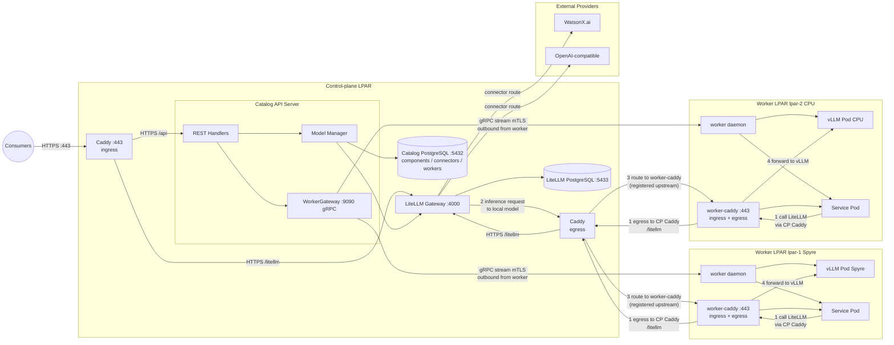
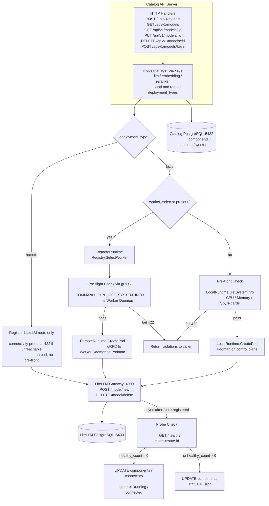
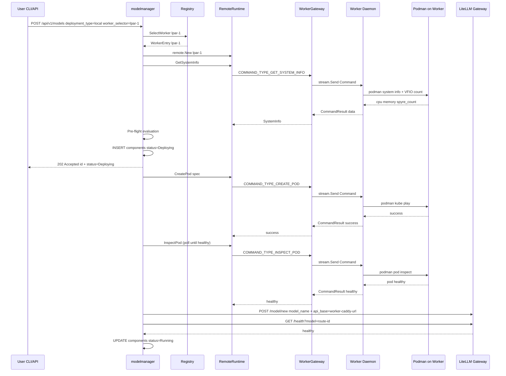

# Model Management — High-Level Architecture and Design

**Version:** 3.0
**Date:** October 2026
**Supersedes:** `docs/proposals/catalog/model-management-proposal.md` (v1.0), `model-management-architecture.md` (v2.0)
**See also:** [`model-management-LLD.md`](model-management-LLD.md) — Low-Level Design (DB schema, full API spec, deployment flows, CLI)

> **What changed from v2.0:** API surface aligned to the polymorphic `/api/v1/models` endpoint (LLD v1.1). Deploy flow updated to reflect `deployment_type` field, remote connector path, and LiteLLM one-time setup. Remote Worker sequence diagram updated with `InspectPod` poll step. UX designs updated for `deployment_type` toggle, extended provider list (`watsonx`, `hosted_vllm`, `openai`), and remote connector status values.

---

## Table of Contents

1. [System Topology](#system-topology)
2. [Deploy / Lifecycle Request Flow](#deploy--lifecycle-request-flow)
3. [Remote Worker — Model Deployment Sequence](#remote-worker--model-deployment-sequence)
4. [UX Designs — UI Requirements](#ux-designs--ui-requirements)
   - [4.1 Approach A — Flat Row Per Instance](#41-approach-a--flat-row-per-instance)
   - [4.2 Approach B — Grouped by Model Name](#42-approach-b--grouped-by-model-name)
   - [4.2.1 Generate Public Key](#421-generate-public-key)
   - [4.3 Deploy Model — Deployment Type and Backend Selection](#43-deploy-model--deployment-type-and-backend-selection)
   - [4.4 Resource Check Before Deploy](#44-resource-check-before-deploy)
   - [4.5 Application Deploy — Model, Profile and Instance Selection](#45-application-deploy--model-profile-and-instance-selection)

---

## System Topology



### How it works

**Control plane**
- LiteLLM Gateway and the Catalog API Server run on the control-plane LPAR.
- A single Caddy instance on the control plane handles both **ingress** (external consumers → API / LiteLLM) and **egress** (outbound to worker Caddys).

**Inference request path (numbered in diagram)**
1. A consumer or Service Pod sends an inference request to the control-plane Caddy.
2. LiteLLM receives the request and resolves the target worker's `api_base` URL.
3. The request leaves the control plane via the egress Caddy, which has the worker registered as an upstream, over **mTLS**.
4. The worker's Caddy (ingress) receives the request and forwards it to the local vLLM Pod.

**Service Pod call-home path**
- A Service Pod authenticates to LiteLLM with an **internal** virtual key that was generated at application create and delivered to the pod through a Podman Secret. The key is not stored in the Catalog DB, so the pod makes no call to the Catalog API to obtain it.
- The Service Pod calls LiteLLM directly: worker Caddy (egress) → control-plane egress Caddy → LiteLLM, over mTLS.

**External callers (developers, CI)**
- A user generates a **public** key for a model and chosen deployment(s) — each a specific worker and profile — with `POST /api/v1/models/keys`. Generating a new one for the same model revokes the previous one, and the key is shown once and never stored. See [`model-management-LLD.md`](model-management-LLD.md#virtual-key-provisioning).

**Worker management plane**
- Each worker daemon establishes a persistent **outbound** gRPC stream (mTLS) to the WorkerGateway on the control plane. Model Manager sends deployment commands down this stream — no inbound firewall holes are needed on the worker LPAR.

---

## Deploy / Lifecycle Request Flow



---

## Remote Worker — Model Deployment Sequence



---

## UX Designs — UI Requirements

### 4.1 Approach A — Flat Row Per Instance

Display all deployed models (both `local` and `remote` deployment types) in a flat table. Each row is one deployment instance — the same `model_name` can appear on multiple rows if it has been deployed to more than one worker or at more than one profile. Each row gives the operator an at-a-glance status of every deployment in the system.

```
┌───────────────────────────────────────────────────────────────────────────────────────────────────────────────────────────────────────────────────────────┐
│  Models                                                                                                     [ Generate Public Key ]   [ + Deploy Model ]  │
├───────────────────┬───────────┬──────────────────────────────────────────┬─────────────┬─────────────────┬────────┬────────────┬─────────────┬────────────┤
│ Name              │ Type      │ Model Name                               │ Backend     │ Deployment Type │ Worker │ Profile    │ Status      │ Actions    │
├───────────────────┼───────────┼──────────────────────────────────────────┼─────────────┼─────────────────┼────────┼────────────┼─────────────┼────────────┤
│ granite-3.3-8b    │ llm       │ ibm-granite/granite-3.3-8b-instruct      │ vllm-spyre  │ local           │ lpar-1 │ compact-4k │ ● Running   │ [ Delete ] │
│ granite-3.3-8b    │ llm       │ ibm-granite/granite-3.3-8b-instruct      │ vllm-spyre  │ local           │ lpar-2 │ standard   │ ● Running   │ [ Delete ] │
│ granite-embedding │ embedding │ ibm-granite/granite-embedding-278m-multi │ vllm-cpu    │ local           │ lpar-1 │ standard   │ ● Running   │ [ Delete ] │
│ prod-watsonx      │ llm       │ ibm/granite-4-h-small                    │ watsonx     │ remote          │ —      │ —          │ ● Connected │ [ Delete ] │
│ openai-embed      │ embedding │ text-embedding-3-small                   │ openai      │ remote          │ —      │ —          │ ● Connected │ [ Delete ] │
│ ext-vllm          │ llm       │ ibm-granite/granite-3.3-8b-instruct      │ hosted_vllm │ remote          │ —      │ —          │ ✕ Offline   │ [ Delete ] │
│ reranker-v1       │ reranker  │ ibm-granite/granite-reranking-278m-multi │ vllm-cpu    │ local           │ lpar-1 │ standard   │ ✕ Error     │ [ Delete ] │
└───────────────────┴───────────┴──────────────────────────────────────────┴─────────────┴─────────────────┴────────┴────────────┴─────────────┴────────────┘

Status legend (local):   ● Running   ⟳ Downloading   ⟳ Deploying   ✕ Error
Status legend (remote):  ● Connected   ✕ Offline
```

Note: `granite-3.3-8b` appears twice — once on `lpar-1` at `compact-4k` and once on `lpar-2` at `standard`. Each is an independent deployment instance with its own LiteLLM route. The **Profile** column shows the hardware profile the model was deployed with (`components.metadata.profile`, see `model-profiles.md`); it is `—` for remote connectors, which have no profile. A public key is tied to specific instances (worker and profile) chosen in the **[ Generate Public Key ]** dialog below.

**API backing this view:** `GET /api/v1/models` — returns a unified list from both `components` (local) and `connectors` (remote) tables. `worker` and `metadata.profile` in each item feed the **Worker** and **Profile** columns. Supports `?type=`, `?deployment_type=`, `?provider_id=`, `?model_name=`, `?profile=` and `?status=` query filters (all combined with AND).

**Open questions and trade-offs for this approach:**

- **Public key is per model, not per row** — a public key is scoped to a model and the deployments (worker + profile) the user picks, and is generated from the page-level **[ Generate Public Key ]** button, not from a row. Because generating a new key for a model revokes that model's previous one, the UI must confirm before proceeding and show the key once with a copy button.
- **`Name` vs `Model Name`** — during deployment the user supplies `model_name` (the HuggingFace ID) and a human-readable `name` (e.g. `granite-3.3-8b`). If the user only ever cares about `model_name`, the `Name` column adds noise for local models where it often duplicates the model ID. Consider whether `Name` should be optional or dropped from the list in favour of `Model Name` alone.

**Pros of this flat-row-per-instance approach:**
- Every deployment instance is directly visible and actionable (delete) without drilling into a separate detail page.
- Filtering by `model_name` instantly shows all workers and profiles running the same model.
- Status is per-instance — `lpar-1` can be `Running` while `lpar-2` is still `Deploying` for the same model.
- Worker and profile are visible on every row, so it is clear which instance a public key reaches when it is tied to a deployment.

**Cons of this flat-row-per-instance approach:**
- The same `model_name` appearing on multiple rows can look like duplicate data to operators unfamiliar with the multi-worker concept.
- `Name` column becomes redundant when it matches `model_name`; adds width and cognitive load for no extra information.
- A public key spans several rows of the same model (it is tied to the instances ticked in the dialog), so the link between a row and the key that reaches it is not visible in the table.
- Table can grow long quickly when many instances of the same model are deployed across workers.

---

### 4.2 Approach B — Grouped by Model Name

Two-level hierarchy:
1. **Top level** — one row per unique `model_name` + `deployment_type` + `backend` combination, showing the aggregate worker count and overall status.
2. **Second level** (expand a top-level row) — lists every instance of that combination, with the worker it runs on, its **profile**, status and actions.

**Level 1 — collapsed (default):**

```
┌────────────────────────────────────────────────────────────────────────────────────────────────────────────────────────────┐
│  Models                                                            [ Generate Public Key ]   [ + Deploy Model ]            │
├────────────────────────────────────────────────────────┬────────────┬──────────────────┬──────────────┬───────────┬────────────────┤
│  Model Name                                            │  Type      │  Deployment Type │  Backend     │  Workers  │  Overall Status│
├────────────────────────────────────────────────────────┼────────────┼──────────────────┼──────────────┼───────────┼────────────────┤
│▶ ibm-granite/granite-3.3-8b-instruct                   │  llm       │  local           │  vllm-spyre  │  2        │  ● 2           │
│▶ ibm-granite/granite-3.3-8b-instruct                   │  llm       │  local           │  vllm-cpu    │  1        │  ● 1           │
│▶ ibm-granite/granite-3.3-8b-instruct                   │  llm       │  remote          │  hosted_vllm │  1        │  ✕ 1           │
│▶ ibm-granite/granite-embedding-278m-multilingual       │  embedding │  local           │  vllm-cpu    │  1        │  ● 1           │
│▶ ibm/granite-4-h-small                                 │  llm       │  remote          │  watsonx     │  1        │  ● 1           │
│▶ text-embedding-3-small                                │  embedding │  remote          │  openai      │  1        │  ● 1           │
│▶ ibm-granite/granite-reranking-278m-multilingual       │  reranker  │  local           │  vllm-cpu    │  1        │  ✕ 1           │
└────────────────────────────────────────────────────────┴────────────┴──────────────────┴──────────────┴───────────┴────────────────┘

Overall Status legend:  ● = Running / Connected count   ⟳ = Downloading / Deploying count   ✕ = Error / Offline count
```

**Level 2 — `ibm-granite/granite-3.3-8b-instruct / local / vllm-spyre` expanded (one row per instance):**

```
├────────────────────────────────────────────────────────┼────────────┼──────────────────┼──────────────┼───────────┼────────────────┤
│▼ ibm-granite/granite-3.3-8b-instruct                   │  llm       │  local           │  vllm-spyre  │  2        │  ● 2           │
├──────────────────────────────┬────────────┬────────────┴─┬──────────┴───┬──────────────┴──────────────┴───────────┴────────────────┤
│  Instance Name               │  Worker    │  Profile     │  Status      │  Actions                                                 │
├──────────────────────────────┼────────────┼──────────────┼──────────────┼──────────────────────────────────────────────────────────┤
│  granite-3.3-8b--a1b2c3d4    │  lpar-1    │  compact-4k  │  ● Running   │  [ Delete ]                                              │
│  granite-3.3-8b--e5f6a7b8    │  lpar-3    │  standard    │  ● Running   │  [ Delete ]                                              │
├──────────────────────────────┴────────────┴────────────┬─┴──────────┬───┴──────────────┬──────────────┬───────────┬────────────────┤
│▶ ibm-granite/granite-3.3-8b-instruct                   │  llm       │  local           │  vllm-cpu    │  1        │  ● 1           │
│▶ ibm-granite/granite-3.3-8b-instruct                   │  llm       │  remote          │  hosted_vllm │  1        │  ✕ 1           │
│  ...                                                   │            │                  │              │           │                │
└────────────────────────────────────────────────────────┴────────────┴──────────────────┴──────────────┴───────────┴────────────────┘
```

**Profile** is shown per instance at Level 2, not at Level 1, because one backend group can mix profiles (here `lpar-1` runs `compact-4k` and `lpar-3` runs `standard`). It is read from `components.metadata.profile` (see `model-profiles.md`) and is `—` for remote connectors. Because profile is not part of the grouping key, two instances that differ only in profile stay in the same top-level row.

**[ Generate Public Key ]** is the same page-level action as in Approach A (`POST /api/v1/models/keys`). There is no per-instance key action. Its Deployments list shows each instance as worker, provider and profile, so the same information is available here.

**API backing this view:** Same `GET /api/v1/models` endpoint — all grouping is UI-side aggregation on `model_name`, `deployment_type`, and `backend`. `worker` and `metadata.profile` of each item feed the Level 2 **Worker** and **Profile** columns. No new backend endpoint needed.

**Pros of this grouped approach:**
- `model_name` is the primary identity — makes it easy to see all the ways a model is deployed at a glance.
- Each top-level row has a single unambiguous `Deployment Type` and `Backend` value — no comma-separated lists.
- `Workers` count immediately shows how widely a specific backend is deployed without expanding.
- Worker and profile are visible for every instance one click away, so a mixed-profile group is easy to read.
- Overall status per row surfaces any degraded instance without expanding.
- Only two levels of nesting — one click to see all workers for a given backend.

**Cons of this grouped approach:**
- A popular model like `granite-3.3-8b-instruct` with multiple backends still produces multiple top-level rows, so the table is not as compact as a pure model-name grouping.
- Grouping by `model_name` only works cleanly when the same model ID is reused; two remote connectors for the same model with different user-supplied `name`s would create separate top-level rows.
- Implementing UI-side aggregation adds more frontend complexity than the flat list.
- Profile is hidden until a row is expanded, so a group's mix of profiles is not visible at Level 1.

---

### 4.2.1 Generate Public Key

Available from the **[ Generate Public Key ]** button in the header of the Models page (both approaches). It calls `POST /api/v1/models/keys` with a `model_name` and a list of `deployment_ids`. A deployment is one row of the Models table, so choosing deployments is how the user ties the key to a worker and a profile.

```
┌──────────────────────────────────────────────────────────────┐
│  Generate Public Key                                    [ × ] │
├──────────────────────────────────────────────────────────────┤
│  Model        [ ibm-granite/granite-3.3-8b-instruct   ▾ ]    │
│                                                              │
│  Deployments  [✓] lpar-1   vllm-spyre  compact-4k            │
│               [ ] lpar-2   vllm-spyre  standard              │
│               [✓] Local    vllm-cpu    standard              │
│                                                              │
│  This creates a key for calling LiteLLM from outside the     │
│  platform. Only one public key exists per model: generating  │
│  a new one immediately revokes the current one.              │
│                                                              │
│                              [ Cancel ]  [ Generate ]        │
└──────────────────────────────────────────────────────────────┘

                          after Generate

┌──────────────────────────────────────────────────────────────┐
│  Public Key                                             [ × ] │
├──────────────────────────────────────────────────────────────┤
│  sk-WJIFUdKHNK8Jv9Iqa8Bn9w                       [ Copy ]    │
│                                                              │
│  Model: ibm-granite/granite-3.3-8b-instruct                  │
│  Deployments: lpar-1 / vllm-spyre / compact-4k               │
│               Local  / vllm-cpu   / standard                 │
│                                                              │
│  ⚠ Copy this key now. It will not be shown again.            │
│                                                              │
│                                          [ Done ]            │
└──────────────────────────────────────────────────────────────┘
```

The **Model** dropdown lists the distinct `model_name` values from `GET /api/v1/models`. The **Deployments** checkboxes list only the `Running` instances of the selected model, each shown as worker, provider and profile (the profile comes from `components.metadata.profile`; `Local` is the control-plane worker). At least one is required. Each ticked row's ID is sent in `deployment_ids`. The key is held in memory only while the dialog is open and is cleared when it closes. The Catalog stores nothing, so a lost key cannot be recovered; the user generates a new one.

---

### 4.3 Deploy Model — Deployment Type and Backend Selection

A modal / side panel opened by the **[ + Deploy Model ]** button. The user picks the model type, deployment type, and the target worker or remote provider. The form adapts based on deployment type (`local` vs `remote`).

```
┌──────────────────────────────────────────────────────────────┐
│  Deploy a Model                                         [ × ] │
├──────────────────────────────────────────────────────────────┤
│                                                              │
│  Model Name        [ granite-3.3-8b-instruct             ]  │
│                                                              │
│  Type              ( ● ) llm   ( ) embedding   ( ) reranker  │
│                                                              │
│  Deployment Type   ( ● ) Local Pod   ( ) Remote Connector    │
│                                                              │
│  ── Local Pod options ─────────────────────────────────      │
│                                                              │
│  Inference Backend  [ vllm-spyre             ▾ ]            │
│                       vllm-spyre                             │
│                       vllm-cpu                               │
│                                                              │
│  Target Worker      [ lpar-1  (Spyre, Ready)  ▾ ]           │
│                       lpar-1  Spyre   ● Ready                │
│                       lpar-2  CPU     ● Ready                │
│                       lpar-3  CPU     ○ Disconnected         │
│                                                              │
│  HuggingFace Model  [ ibm-granite/granite-3.3-8b-instruct ]  │
│                                                              │
│  Profile            [ compact-4k             ▾ ]  (enabled   │
│                       standard                   once a      │
│                       balanced                   model is    │
│                       compact-4k                 selected)   │
│                       compact-8k                             │
│                                                              │
│  ── Remote Connector options (hidden when local) ──────      │
│                                                              │
│  Provider           [ watsonx                ▾ ]            │
│                       watsonx                                │
│                       hosted_vllm                            │
│                       openai                                 │
│  Endpoint URL       [ https://...                        ]   │
│  API Key            [ ••••••••••••••••••                 ]   │
│                                                              │
│  [ Check Resources ]                  [ Cancel ] [ Deploy ]  │
└──────────────────────────────────────────────────────────────┘
```

**Notes:**
- **Inference Backend** dropdown is populated from available `metadata.yaml` assets on the server (`GET /api/v1/architectures/:id/deploy-options`).
- **Target Worker** dropdown lists all workers with `status = ready` from `GET /api/v1/workers`. Shows runtime type (Spyre / CPU) and live status alongside each entry. Disconnected workers are shown but disabled.
- **Profile** dropdown is disabled until a model is selected. Once the user picks a model, it is populated with only the profiles that model supports (from the model's `x-profiles` list in the provider's `values.schema.json`, see `model-profiles.md`), with the model's default profile pre-selected. Changing the model reloads the list, and changing the profile updates the resource numbers shown by **[ Check Resources ]**. The chosen value is sent as `params.profile`. Not shown for Remote Connectors.
- **[ Check Resources ]** triggers the resource check panel (see §4.4) before the user commits to deploy. Only shown for `deployment_type=local`.
- Remote Connector fields (Provider, Endpoint URL, API Key) are shown/hidden based on the **Deployment Type** toggle. Provider dropdown is populated from `GET /api/v1/connectors?type=<selected-type>`.

---

### 4.4 Resource Check Before Deploy

Triggered by **[ Check Resources ]** in the deploy form. Calls the pre-flight API for the selected worker and backend, then displays a per-resource breakdown before the user confirms deployment.

```
┌──────────────────────────────────────────────────────────────┐
│  Resource Check — lpar-1  (vllm-spyre)             [ × ]    │
├──────────────────────────────────────────────────────────────┤
│  Model:   ibm-granite/granite-3.3-8b-instruct                │
│  Profile: compact-4k                                         │
│  Worker:  lpar-1  (Spyre, Ready)                             │
├──────────────┬────────────┬────────────┬─────────────────────┤
│  Resource    │  Required  │  Available │  Status             │
├──────────────┼────────────┼────────────┼─────────────────────┤
│  CPU         │  8 cores   │  24 cores  │  ✓ Sufficient       │
│  Memory      │  32 GiB    │  64 GiB    │  ✓ Sufficient       │
│  Storage     │  50 GiB    │  120 GiB   │  ✓ Sufficient       │
│  Spyre Cards │  1         │  2         │  ✓ Sufficient       │
├──────────────┴────────────┴────────────┴─────────────────────┤
│  ✓ All resource constraints satisfied.                       │
│                                                              │
│                             [ Back ]  [ Confirm Deploy ]     │
└──────────────────────────────────────────────────────────────┘
```

**Failure state** (insufficient resources):

```
┌──────────────────────────────────────────────────────────────┐
│  Resource Check — lpar-2  (vllm-spyre)             [ × ]    │
├──────────────┬────────────┬────────────┬─────────────────────┤
│  Resource    │  Required  │  Available │  Status             │
├──────────────┼────────────┼────────────┼─────────────────────┤
│  CPU         │  8 cores   │  24 cores  │  ✓ Sufficient       │
│  Memory      │  32 GiB    │  18 GiB    │  ✕ Insufficient     │
│  Storage     │  50 GiB    │  120 GiB   │  ✓ Sufficient       │
│  Spyre Cards │  1         │  0         │  ✕ Insufficient     │
├──────────────┴────────────┴────────────┴─────────────────────┤
│  ✕ 2 constraint(s) not satisfied. Choose a different worker. │
│                                                              │
│                                        [ Back ]              │
└──────────────────────────────────────────────────────────────┘
```

**API backing this view:** Pre-flight is triggered automatically by `POST /api/v1/models` for `deployment_type=local`. The UI surfaces violations from the `422` response body's `violations` array — all constraint results (satisfied and unsatisfied) are returned together, never just the first failure.

---

### 4.5 Application Deploy — Model, Profile and Instance Selection

When a user deploys an application, each model the application needs (`llm`, `embedding`, `reranker`) is chosen in three dependent steps. Each step is enabled only after the previous one is set.

1. **Model** — the user picks the model.
2. **Profile** — the dropdown then lists only the profiles that model supports (from its `x-profiles` list, see `model-profiles.md`), with the model's default pre-selected.
3. **Instance** — the dropdown then lists the existing `Running` instances of that model at that profile (name and worker). The selected instance's `components.id` is what the UI sends as `instance_id`.

No new endpoint is needed for any of the three steps (see **How the UI populates each step** below).

```
┌──────────────────────────────────────────────────────────────────┐
│  Deploy Application — summarize                            [ × ] │
├──────────────────────────────────────────────────────────────────┤
│  LLM                                                             │
│                                                                  │
│  1. Model      [ ibm-granite/granite-3.3-8b-instruct  ▾ ]        │
│                                                                  │
│  2. Profile    [ compact-4k                           ▾ ]        │
│                  standard                                        │
│                  balanced                                        │
│                  compact-4k                                      │
│                  compact-8k                                      │
│                (only profiles supported by the model)            │
│                                                                  │
│  3. Instance   [ granite-llm-small  (lpar-1, Running) ▾ ]        │
│                  granite-llm-small  lpar-1   ● Running           │
│                  granite-llm-b      lpar-3   ● Running           │
│                (only instances of this model at this profile)    │
│                                                                  │
│                                    [ Cancel ]  [ Deploy ]        │
└──────────────────────────────────────────────────────────────────┘
```

**Notes:**
- The selected instance is **reused**: no new pod is started, and the application gets an `internal` key tied to that instance, so it always reaches that worker and profile.
- A model that is not deployed yet is deployed first from the Models page (§4.3), then picked here.
- Changing the model resets Profile and Instance; changing the profile resets Instance.
- Remote model connectors skip this flow: they have no profile and are picked directly by connector.

**Request payload:** the UI keeps the existing component entry and adds `instance_id`. Only `component_type` and `instance_id` are sent; `provider_id`, `version` and `params` are read from the selected instance.

```json
{
  "name": "My App",
  "catalog_id": "rag-pattern",
  "version": "1.0.0",
  "worker_name": "lpar-1",
  "services": [
    {
      "catalog_id": "summarize",
      "version": "2.0.0",
      "components": [
        { "component_type": "llm", "instance_id": "7f3a1c2d-8e4b-4f5a-9d6e-1a2b3c4d5e6f" }
      ]
    },
    {
      "catalog_id": "digitize",
      "version": "1.2.0",
      "components": [
        { "component_type": "embedding", "instance_id": "a91b44e0-3c2d-4e7f-8a10-5b6c7d8e9f01" }
      ],
      "connectors": [
        { "type": "llm", "id": "c1d2e3f4-a5b6-7890-cdef-123456789abc" }
      ]
    }
  ]
}
```

`worker_name` does not move the models. An `instance_id` already fixes the worker its model runs on, so `worker_name` only decides where the application's own service pods go. They can differ: services on `lpar-1` can use a model instance running on `lpar-3`.

**How the UI populates each step:**

| Step | Call | What it returns |
|---|---|---|
| 1. Model | `GET /api/v1/components/:component_type/providers/:provider_id/params` | The provider's `values.schema.json`; the `model` `oneOf` is the model list |
| 2. Profile | Same response | The selected model's `x-profiles` entries, with the default pre-selected |
| 3. Instance | `GET /api/v1/models?deployment_type=local&type=<type>&provider_id=<provider>&model_name=<model>&profile=<profile>&status=Running` | Matching instances; each item's `name` and `worker` form the option, its `id` is the value |

Example for step 3:

```
GET /api/v1/models?deployment_type=local&type=llm&provider_id=vllm-spyre
                  &model_name=ibm-granite/granite-3.3-8b-instruct&profile=compact-4k&status=Running
```

```json
{
  "data": [
    {
      "id": "7f3a1c2d-8e4b-4f5a-9d6e-1a2b3c4d5e6f",
      "deployment_type": "local",
      "name": "granite-llm-small",
      "type": "llm",
      "provider": { "id": "vllm-spyre", "name": "vLLM (Spyre)" },
      "worker": { "id": "lpar-1", "runtime_type": "spyre", "status": "ready" },
      "metadata": { "model": "ibm-granite/granite-3.3-8b-instruct", "profile": "compact-4k" },
      "status": "Running"
    }
  ]
}
```

An empty `data` array means no instance exists at that profile yet; the form asks the user to deploy one from the Models page first. The selection is submitted on `POST /api/v1/applications` as `instance_id` on the component entry. An `instance_id` that is unknown, not `Running`, or of a different type than `component_type` is rejected with `400`.
