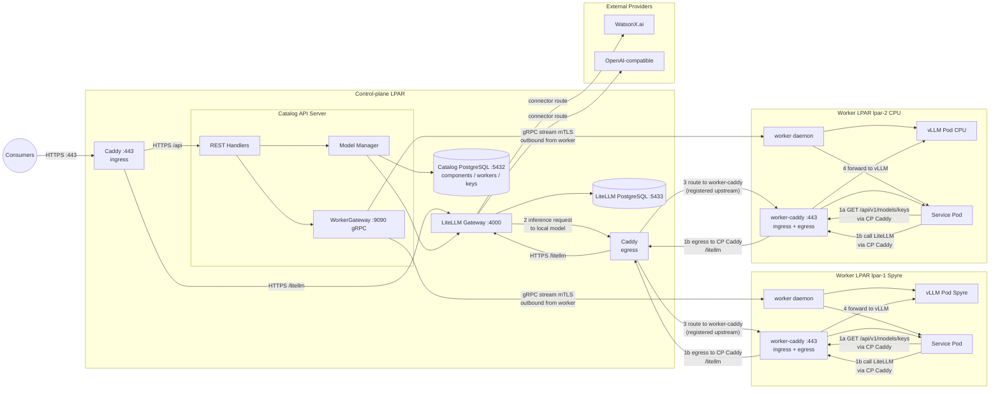
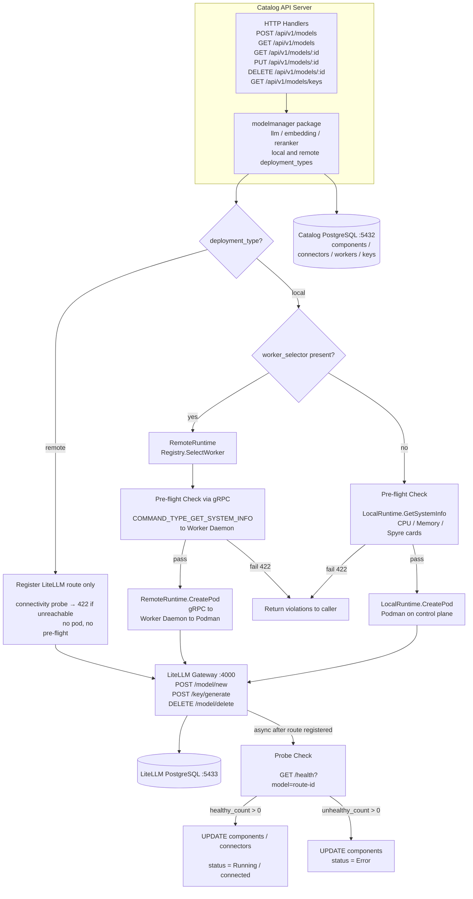
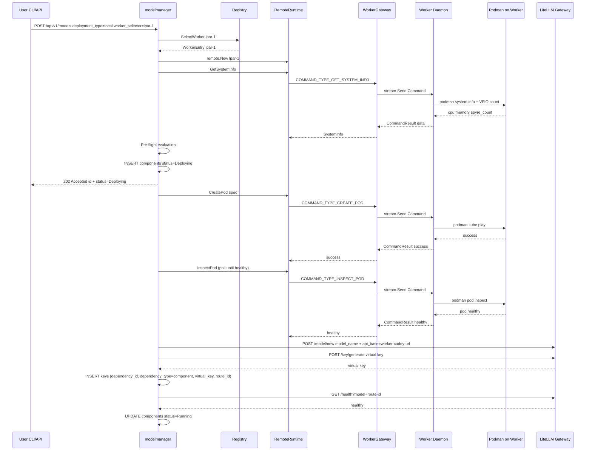

# Model Management — High-Level Architecture and Design

**Version:** 3.0
**Date:** October 2026
**Supersedes:** `docs/proposals/catalog/model-management-proposal.md` (v1.0), `model-management-architecture.md` (v2.0)
**See also:** [`model-management-LLD.md`](model-management-LLD.md) — Low-Level Design (DB schema, full API spec, deployment flows, CLI)

> **What changed from v2.0:** API surface aligned to the polymorphic `/api/v1/models` endpoint (LLD v1.1). Deploy flow updated to reflect `deployment_type` field, remote connector path, and LiteLLM one-time setup. Remote Worker sequence diagram updated with `InspectPod` poll step. UX designs updated for `deployment_type` toggle, extended provider list (`watsonx`, `hosted_vllm`, `openai`), and remote connector status values.

---

## Table of Contents

1. [System Topology](#system-topology)
2. [Deploy / Lifecycle Request Flow](#deploy--lifecycle-request-flow)
3. [Remote Worker — Model Deployment Sequence](#remote-worker--model-deployment-sequence)
4. [UX Designs — UI Requirements](#ux-designs--ui-requirements)
   - [4.1 Approach A — Flat Row Per Instance](#41-approach-a--flat-row-per-instance)
   - [4.2 Approach B — Grouped by Model Name](#42-approach-b--grouped-by-model-name)
   - [4.3 Deploy Model — Deployment Type and Backend Selection](#43-deploy-model--deployment-type-and-backend-selection)
   - [4.4 Resource Check Before Deploy](#44-resource-check-before-deploy)

---

## System Topology



### How it works

**Control plane**
- LiteLLM Gateway and the Catalog API Server run on the control-plane LPAR.
- A single Caddy instance on the control plane handles both **ingress** (external consumers → API / LiteLLM) and **egress** (outbound to worker Caddys).

**Inference request path (numbered in diagram)**
1. A consumer or Service Pod sends an inference request to the control-plane Caddy.
2. LiteLLM receives the request and resolves the target worker's `api_base` URL.
3. The request leaves the control plane via the egress Caddy, which has the worker registered as an upstream, over **mTLS**.
4. The worker's Caddy (ingress) receives the request and forwards it to the local vLLM Pod.

**Service Pod call-home path**
- Before making an inference call, the Service Pod first fetches its LiteLLM virtual key from the Catalog API (`GET /api/v1/models/keys?instance_id=<component_id>`) via its worker Caddy → control-plane Caddy → Catalog API. The virtual key is stored in the Catalog PostgreSQL `keys` table and was generated by Model Manager at deploy time via `POST /key/generate` on LiteLLM.
- With the key in hand, the Service Pod calls LiteLLM directly: worker Caddy (egress) → control-plane egress Caddy → LiteLLM. The same mTLS tunnel is reused for both legs.

**Worker management plane**
- Each worker daemon establishes a persistent **outbound** gRPC stream (mTLS) to the WorkerGateway on the control plane. Model Manager sends deployment commands down this stream — no inbound firewall holes are needed on the worker LPAR.

---

## Deploy / Lifecycle Request Flow



---

## Remote Worker — Model Deployment Sequence



---

## UX Designs — UI Requirements

### 4.1 Approach A — Flat Row Per Instance

Display all deployed models (both `local` and `remote` deployment types) in a flat table. Each row is one deployment instance — the same `model_name` can appear on multiple rows if it has been deployed to more than one worker. Each row gives the operator an at-a-glance status of every deployment in the system.

```
┌──────────────────────────────────────────────────────────────────────────────────────────────────────────────────────────────────┐
│  Models                                                                                           [ + Deploy Model ]              │
├──────────────────────┬────────────┬──────────────────────────────────────────────┬──────────┬──────────────────┬───────────┬─────────────┬────────────┤
│  Name                │  Type      │  Model Name                                  │  Backend │  Deployment Type │  Worker   │  Status     │  Actions   │
├──────────────────────┼────────────┼──────────────────────────────────────────────┼──────────┼──────────────────┼───────────┼─────────────┼────────────┤
│  granite-3.3-8b      │  llm       │  ibm-granite/granite-3.3-8b-instruct         │  vllm    │  local           │  lpar-1   │  ● Running  │  [ Delete ]│
│  granite-3.3-8b      │  llm       │  ibm-granite/granite-3.3-8b-instruct         │  vllm    │  local           │  lpar-2   │  ● Running  │  [ Delete ]│
│  granite-embedding   │  embedding │  ibm-granite/granite-embedding-278m-multi    │  vllm    │  local           │  lpar-1   │  ● Running  │  [ Delete ]│
│  prod-watsonx        │  llm       │  ibm/granite-4-h-small                       │  watsonx │  remote          │  —        │  ● Connected│  [ Delete ]│
│  openai-embed        │  embedding │  text-embedding-3-small                      │  openai  │  remote          │  —        │  ● Connected│  [ Delete ]│
│  ext-vllm            │  llm       │  ibm-granite/granite-3.3-8b-instruct         │  hosted_vllm│ remote        │  —        │  ✕ Offline  │  [ Delete ]│
│  reranker-v1         │  reranker  │  ibm-granite/granite-reranking-278m-multi    │  vllm    │  local           │  lpar-1   │  ✕ Error    │  [ Delete ]│
└──────────────────────┴────────────┴──────────────────────────────────────────────┴──────────┴──────────────────┴───────────┴─────────────┴────────────┘

Status legend (local):   ● Running   ⟳ Downloading   ⟳ Deploying   ✕ Error
Status legend (remote):  ● Connected   ✕ Offline
```

Note: `granite-3.3-8b` appears twice — once on `lpar-1` and once on `lpar-2`. Each is an independent deployment instance with its own virtual key.

**API backing this view:** `GET /api/v1/models` — returns a unified list from both `components` (local) and `connectors` (remote) tables. Supports `?type=`, `?deployment_type=` and `?model_name=` query filters.

**Open questions and trade-offs for this approach:**

- **Virtual key per row** — each deployment instance (row) gets its own virtual key scoped to its LiteLLM route. Should the same `model_name` deployed on two different workers share one key, or remain separate? Separate keys give per-worker revocation control but require consumer services to know which worker they are targeting. Worth deciding before implementation.
- **`Name` vs `Model Name`** — during deployment the user supplies `model_name` (the HuggingFace ID) and a human-readable `name` (e.g. `granite-3.3-8b`). If the user only ever cares about `model_name`, the `Name` column adds noise for local models where it often duplicates the model ID. Consider whether `Name` should be optional or dropped from the list in favour of `Model Name` alone.

**Pros of this flat-row-per-instance approach:**
- Every deployment instance is directly visible and actionable (delete, reveal key) without drilling into a separate detail page.
- Filtering by `model_name` instantly shows all workers running the same model.
- Status is per-instance — `lpar-1` can be `Running` while `lpar-2` is still `Deploying` for the same model.
- Row expand gives the virtual key in context without leaving the list view.

**Cons of this flat-row-per-instance approach:**
- The same `model_name` appearing on multiple rows can look like duplicate data to operators unfamiliar with the multi-worker concept.
- `Name` column becomes redundant when it matches `model_name`; adds width and cognitive load for no extra information.
- One virtual key per instance means consumer services that want to reach "any available worker running granite-3.3-8b" must manage key selection themselves — there is no single key that routes across workers.
- Table can grow long quickly when many instances of the same model are deployed across workers.

---

### 4.2 Approach B — Grouped by Model Name

Two-level hierarchy:
1. **Top level** — one row per unique `model_name` + `deployment_type` + `backend` combination, showing the aggregate worker count and overall status.
2. **Second level** (expand a top-level row) — lists every worker that combination is deployed on, with per-worker status and actions.

**Level 1 — collapsed (default):**

```
┌────────────────────────────────────────────────────────────────────────────────────────────────────────────────────────────┐
│  Models                                                                                       [ + Deploy Model ]            │
├────────────────────────────────────────────────────────┬────────────┬──────────────────┬──────────────┬───────────┬────────────────┤
│  Model Name                                            │  Type      │  Deployment Type │  Backend     │  Workers  │  Overall Status│
├────────────────────────────────────────────────────────┼────────────┼──────────────────┼──────────────┼───────────┼────────────────┤
│▶ ibm-granite/granite-3.3-8b-instruct                   │  llm       │  local           │  vllm-spyre  │  2        │  ● 2           │
│▶ ibm-granite/granite-3.3-8b-instruct                   │  llm       │  local           │  vllm-cpu    │  1        │  ● 1           │
│▶ ibm-granite/granite-3.3-8b-instruct                   │  llm       │  remote          │  hosted_vllm │  1        │  ✕ 1           │
│▶ ibm-granite/granite-embedding-278m-multilingual       │  embedding │  local           │  vllm-cpu    │  1        │  ● 1           │
│▶ ibm/granite-4-h-small                                 │  llm       │  remote          │  watsonx     │  1        │  ● 1           │
│▶ text-embedding-3-small                                │  embedding │  remote          │  openai      │  1        │  ● 1           │
│▶ ibm-granite/granite-reranking-278m-multilingual       │  reranker  │  local           │  vllm-cpu    │  1        │  ✕ 1           │
└────────────────────────────────────────────────────────┴────────────┴──────────────────┴──────────────┴───────────┴────────────────┘

Overall Status legend:  ● = Running / Connected count   ⟳ = Downloading / Deploying count   ✕ = Error / Offline count
```

**Level 2 — `ibm-granite/granite-3.3-8b-instruct / local / vllm-spyre` expanded (one row per worker):**

```
├────────────────────────────────────────────────────────┬────────────┬──────────────────┬──────────────┬───────────┬────────────────┤
│▼ ibm-granite/granite-3.3-8b-instruct                   │  llm       │  local           │  vllm-spyre  │  2        │  ● 2           │
├──────────────────────────────┬─────────────┬─────────────┬──────────────────────────────────────────────────────────┤
│  Instance Name               │  Worker     │  Status     │  Actions                                                 │
├──────────────────────────────┼─────────────┼─────────────┼──────────────────────────────────────────────────────────┤
│  granite-3.3-8b--a1b2c3d4    │  lpar-1     │  ● Running  │  [ Key ]  [ Delete ]                                     │
│  granite-3.3-8b--e5f6a7b8    │  lpar-3     │  ● Running  │  [ Key ]  [ Delete ]                                     │
├────────────────────────────────────────────────────────┼────────────┼──────────────────┼──────────────┼───────────┼────────────────┤
│▶ ibm-granite/granite-3.3-8b-instruct                   │  llm       │  local           │  vllm-cpu    │  1        │  ● 1           │
│▶ ibm-granite/granite-3.3-8b-instruct                   │  llm       │  remote          │  hosted_vllm │  1        │  ✕ 1           │
│  ...                                                   │            │                  │              │           │                │
└────────────────────────────────────────────────────────┴────────────┴──────────────────┴──────────────┴───────────┴────────────────┘
```

**[ Key ]** opens the virtual key panel for that specific worker instance (same `GET /api/v1/models/keys?instance_id=<id>` call as Approach A).

**API backing this view:** Same `GET /api/v1/models` endpoint — all grouping is UI-side aggregation on `model_name`, `deployment_type`, and `backend`. No new backend endpoint needed.

**Pros of this grouped approach:**
- `model_name` is the primary identity — makes it easy to see all the ways a model is deployed at a glance.
- Each top-level row has a single unambiguous `Deployment Type` and `Backend` value — no comma-separated lists.
- `Workers` count immediately shows how widely a specific backend is deployed without expanding.
- Overall status per row surfaces any degraded instance without expanding.
- Only two levels of nesting — one click to see all workers for a given backend.

**Cons of this grouped approach:**
- A popular model like `granite-3.3-8b-instruct` with multiple backends still produces multiple top-level rows, so the table is not as compact as a pure model-name grouping.
- Virtual key is one level deeper — a row must be expanded before the key can be copied.
- Grouping by `model_name` only works cleanly when the same model ID is reused; two remote connectors for the same model with different user-supplied `name`s would create separate top-level rows.
- Implementing UI-side aggregation adds more frontend complexity than the flat list.

---

### 4.3 Deploy Model — Deployment Type and Backend Selection

A modal / side panel opened by the **[ + Deploy Model ]** button. The user picks the model type, deployment type, and the target worker or remote provider. The form adapts based on deployment type (`local` vs `remote`).

```
┌──────────────────────────────────────────────────────────────┐
│  Deploy a Model                                         [ × ] │
├──────────────────────────────────────────────────────────────┤
│                                                              │
│  Model Name        [ granite-3.3-8b-instruct             ]  │
│                                                              │
│  Type              ( ● ) llm   ( ) embedding   ( ) reranker  │
│                                                              │
│  Deployment Type   ( ● ) Local Pod   ( ) Remote Connector    │
│                                                              │
│  ── Local Pod options ─────────────────────────────────      │
│                                                              │
│  Inference Backend  [ vllm-spyre             ▾ ]            │
│                       vllm-spyre                             │
│                       vllm-cpu                               │
│                                                              │
│  Target Worker      [ lpar-1  (Spyre, Ready)  ▾ ]           │
│                       lpar-1  Spyre   ● Ready                │
│                       lpar-2  CPU     ● Ready                │
│                       lpar-3  CPU     ○ Disconnected         │
│                                                              │
│  HuggingFace Model  [ ibm-granite/granite-3.3-8b-instruct ]  │
│                                                              │
│  ── Remote Connector options (hidden when local) ──────      │
│                                                              │
│  Provider           [ watsonx                ▾ ]            │
│                       watsonx                                │
│                       hosted_vllm                            │
│                       openai                                 │
│  Endpoint URL       [ https://...                        ]   │
│  API Key            [ ••••••••••••••••••                 ]   │
│                                                              │
│  [ Check Resources ]                  [ Cancel ] [ Deploy ]  │
└──────────────────────────────────────────────────────────────┘
```

**Notes:**
- **Inference Backend** dropdown is populated from available `metadata.yaml` assets on the server (`GET /api/v1/architectures/:id/deploy-options`).
- **Target Worker** dropdown lists all workers with `status = ready` from `GET /api/v1/workers`. Shows runtime type (Spyre / CPU) and live status alongside each entry. Disconnected workers are shown but disabled.
- **[ Check Resources ]** triggers the resource check panel (see §4.4) before the user commits to deploy. Only shown for `deployment_type=local`.
- Remote Connector fields (Provider, Endpoint URL, API Key) are shown/hidden based on the **Deployment Type** toggle. Provider dropdown is populated from `GET /api/v1/connectors?type=<selected-type>`.

---

### 4.4 Resource Check Before Deploy

Triggered by **[ Check Resources ]** in the deploy form. Calls the pre-flight API for the selected worker and backend, then displays a per-resource breakdown before the user confirms deployment.

```
┌──────────────────────────────────────────────────────────────┐
│  Resource Check — lpar-1  (vllm-spyre)             [ × ]    │
├──────────────────────────────────────────────────────────────┤
│  Model:   ibm-granite/granite-3.3-8b-instruct                │
│  Worker:  lpar-1  (Spyre, Ready)                             │
├──────────────┬────────────┬────────────┬─────────────────────┤
│  Resource    │  Required  │  Available │  Status             │
├──────────────┼────────────┼────────────┼─────────────────────┤
│  CPU         │  8 cores   │  24 cores  │  ✓ Sufficient       │
│  Memory      │  32 GiB    │  64 GiB    │  ✓ Sufficient       │
│  Storage     │  50 GiB    │  120 GiB   │  ✓ Sufficient       │
│  Spyre Cards │  1         │  2         │  ✓ Sufficient       │
├──────────────┴────────────┴────────────┴─────────────────────┤
│  ✓ All resource constraints satisfied.                       │
│                                                              │
│                             [ Back ]  [ Confirm Deploy ]     │
└──────────────────────────────────────────────────────────────┘
```

**Failure state** (insufficient resources):

```
┌──────────────────────────────────────────────────────────────┐
│  Resource Check — lpar-2  (vllm-spyre)             [ × ]    │
├──────────────┬────────────┬────────────┬─────────────────────┤
│  Resource    │  Required  │  Available │  Status             │
├──────────────┼────────────┼────────────┼─────────────────────┤
│  CPU         │  8 cores   │  24 cores  │  ✓ Sufficient       │
│  Memory      │  32 GiB    │  18 GiB    │  ✕ Insufficient     │
│  Storage     │  50 GiB    │  120 GiB   │  ✓ Sufficient       │
│  Spyre Cards │  1         │  0         │  ✕ Insufficient     │
├──────────────┴────────────┴────────────┴─────────────────────┤
│  ✕ 2 constraint(s) not satisfied. Choose a different worker. │
│                                                              │
│                                        [ Back ]              │
└──────────────────────────────────────────────────────────────┘
```

**API backing this view:** Pre-flight is triggered automatically by `POST /api/v1/models` for `deployment_type=local`. The UI surfaces violations from the `422` response body's `violations` array — all constraint results (satisfied and unsatisfied) are returned together, never just the first failure.

---

## Open Questions

- Should worker selection be automatic instead of the user picking a target worker?
- Should users be able to configure deployment profiles (e.g. number of Spyre cards to allocate, `max-model-len` etc and make the params flexible)?
