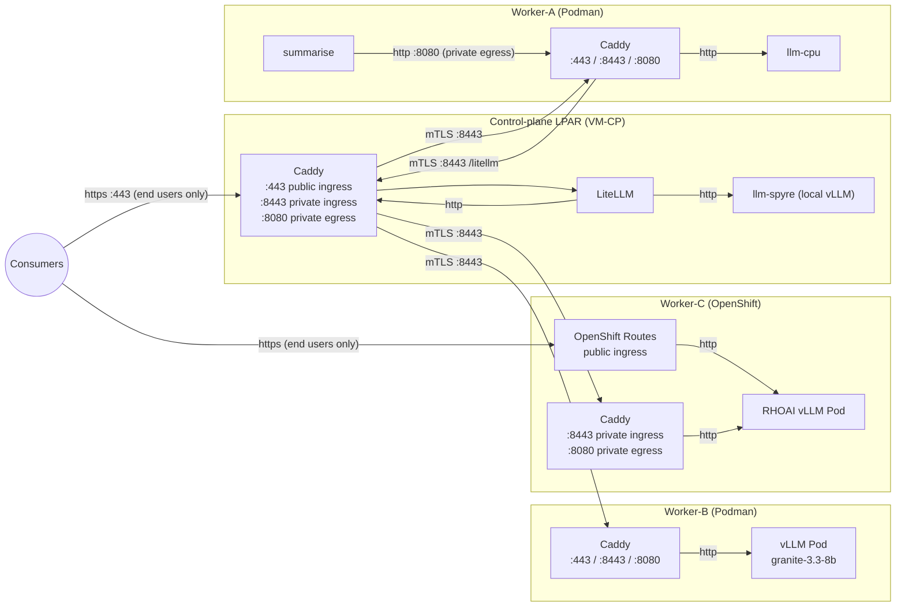

# Model Management — Network Connectivity

**Status:** Proposal
**See also:** [`model-management-architecture.md`](model-management-architecture.md) · [`model-management-LLD.md`](model-management-LLD.md) · [`network_connectivity.png`](network_connectivity.png)

---

## 1. Purpose

This document explains, in one place, how traffic moves between the control plane, the workers, and the models. It covers only networking: who talks to whom, on which port, and which certificate protects the connection.

**Guiding rules:**
1. Whenever a vLLM pod is deployed, it is registered with LiteLLM. After that, every consumer reaches the model through LiteLLM and never talks to the pod directly.
2. **Port `443` is for end users only.** Services inside the AI-Services platform never use it. They communicate through the **private ingress and private egress** (`:8443` / `:8080`).
3. A vLLM pod that runs on the **control-plane node** (the local worker) is reached by LiteLLM directly. It is **not** exposed through any ingress.
4. **Public ingress blocks internal utility paths:** Endpoints such as `/tokenize/*` registered in LiteLLM for internal service token-budget calculations are strictly internal. Caddy's public ingress (`:443`) explicitly blocks `/tokenize/*`.

---

## 2. The Big Picture



Every node runs a **Caddy reverse proxy** for platform-internal traffic. Podman nodes (control plane and Podman workers) also use Caddy for public ingress on `:443`. On OpenShift, public ingress is provided by **OpenShift Routes**, so Caddy there handles only private ingress and egress. Models and services never open a connection to another host themselves. They talk plain HTTP to the Caddy on their own node, and Caddy handles the secure hop across the network.

---

## 3. Ports and Roles

Caddy on Podman nodes exposes three roles. On OpenShift, public ingress is served by Routes instead, and Caddy provides only the two private roles.

| Role | Port | Who connects | Security |
|---|---|---|---|
| **Public ingress** | `:443` (Caddy on Podman nodes; **OpenShift Routes** on OpenShift, no Caddy) | **End users only** (UI, CLI, external consumers) | TLS, public-facing certificate |
| **Private ingress** | `:8443` | Other platform nodes only (**service-to-service**) | **mTLS**, internal CA |
| **Private egress** | `:8080` | Pods on the same node that need to call another node (**service-to-service**) | Plain HTTP, local only; Caddy then forwards over mTLS |

The pod behind Caddy (vLLM, summarise, and so on) listens on its own container port over plain HTTP. That port is never exposed outside the node.

**Simple mental model:** `443` is the front door for people, `8443` is the staff entrance for platform nodes, and `8080` is the internal phone a pod picks up to call out.

**Rule:** a service inside the platform must never call another service or node through `:443`. Doing so would bypass mTLS and the internal CA. All platform-internal traffic goes through private egress (`:8080`) on the caller's node and private ingress (`:8443`) on the target node.

**Security filtering on `:443`:** Caddy on public ingress (`:443`) explicitly blocks all requests matching `/tokenize` and `/tokenize/*` (returning `403 Forbidden`). LiteLLM configures `/tokenize/{UUID}` passthrough endpoints with `auth: false` for internal platform services, so blocking this prefix at the public ingress prevents unauthorized external access to tokenizer endpoints.

---

## 4. Certificates

| Scope | Used on | Issued by |
|---|---|---|
| **Public** (`:443`, end users) | Public ingress | Self-signed, signed by the Caddy CA, **or** customer-provided certificates |
| **Private** (`:8443`, services) | Private ingress and egress between nodes | Platform certificates signed by the **internal CA** |

Private connections are **mutual** TLS. Both ends present a certificate signed by the internal CA, so a node that is not part of the platform cannot connect to `:8443`, even if it can reach the port.

---

## 5. Traffic Flows with Examples

### 5.1 An end user calls a model

An end user (for example through the UI or CLI) sends a request to the control plane's public ingress. This is the only flow that uses `:443`. LiteLLM forwards the request to whichever model backs the route.

```
Consumer (End user) ──https :443──▶ CP Caddy ──▶ LiteLLM ──▶ model
```

**Example:** a UI request for `ibm-granite/granite-3.3-8b-instruct` arrives at `https://<cp-host>/litellm/...`. LiteLLM looks up the route and forwards the call to the model.

### 5.2 LiteLLM reaches a model on the control-plane node (local worker)

When a vLLM pod runs on the control-plane node, LiteLLM talks to it **directly**. The pod does **not** need to be exposed through ingress, and no Caddy route is created for it.

```
LiteLLM ──http──▶ llm-spyre
```

**Example:** `llm-spyre` is registered with `api_base = http://<pod-name>:8000/v1`. LiteLLM and the pod share the same Podman network, so plain HTTP is enough. Nothing outside the node can reach `llm-spyre`, because it has no ingress route. The only way in is through LiteLLM.

### 5.3 LiteLLM reaches a model on a worker (Worker-B)

```
LiteLLM ──http──▶ CP Caddy :8080 (egress)
        ──mTLS──▶ Worker-B Caddy :8443 (private ingress)
        ──http──▶ vLLM Pod (granite-3.3-8b)
```

**Example:** the route for `granite-3.3-8b` on Worker-B is registered in LiteLLM as:

```
api_base = http://ai-services--caddy:8080/worker/lpar-b/models/granite-3.3-8b--a1b2c3d4
```

LiteLLM makes a plain HTTP call to its own Caddy. Caddy matches the path `/worker/lpar-b/...`, opens an mTLS connection to Worker-B on `:8443`, and Worker-B's Caddy hands the request to the vLLM pod.

### 5.4 A service on a worker calls LiteLLM (Worker-A)

A service pod such as `summarise` needs an LLM. It always goes through LiteLLM, never to a model directly. As a platform-internal service, it uses **private egress and private ingress**, not `:443`.

```
summarise ──http :8080──▶ Worker-A Caddy (private egress)
          ──mTLS :8443──▶ CP Caddy  (path /litellm)
          ──http────────▶ LiteLLM ──▶ model (local, or on any worker)
```

**Example:** `summarise` on Worker-A needs `granite-3.3-8b`, which runs on Worker-B. It sends one HTTP call to its local Caddy. LiteLLM selects the route, and the control plane forwards the request over mTLS to Worker-B. `summarise` needs no knowledge of Worker-B's address.

The service authenticates to LiteLLM with its `internal` virtual key. That key is issued at application create and delivered to the pod through a Podman Secret, so the service makes no extra network call to obtain it.

### 5.5 OpenShift worker (Worker-C)

Worker-C differs from the Podman workers in one way: **it has no Caddy on `:443`**.

- **Public ingress** (end users) is exposed through **OpenShift Routes**, not Caddy.
- **Private ingress (`:8443`) and private egress (`:8080`)** are the only places Caddy is used. Service-to-service traffic follows the same path as on the Podman workers: mTLS from the control-plane Caddy to Worker-C's Caddy on `:8443`, then plain HTTP to the RHOAI vLLM pod.

### 5.6 Remote providers (WatsonX, OpenAI-compatible)

No pod or worker is involved. LiteLLM calls the provider over the public internet.

```
End user ──https :443──▶ CP Caddy ──▶ LiteLLM ──https──▶ WatsonX / OpenAI-compatible endpoint
Service  ──private egress/ingress──▶ CP Caddy ──▶ LiteLLM ──https──▶ WatsonX / OpenAI-compatible endpoint
```

The provider credentials are held by LiteLLM only. The catalog database stores no secrets.

### 5.7 Control plane manages workers (deploy commands)

Workers dial in to the control plane, not the other way round.

```
Worker daemon ──outbound gRPC stream, mTLS──▶ WorkerGateway (control plane)
```

Deploy, inspect, and system-info commands travel back down this already-open stream. **Benefit:** no inbound firewall rules are needed on worker LPARs for management.

### 5.8 Internal service tokenization (`/tokenize/*`) and public ingress blocking

Platform services (e.g. `chatbot`, `summarise`, `digitize`) call LiteLLM's `/tokenize/{UUID}` passthrough endpoint to count tokens against a specific model's tokenizer for context-budget calculations.

- **Internal services:** Call `https://<litellm-internal-host>/tokenize/{UUID}` directly or through private egress (`:8080`) / private ingress (`:8443`).
- **Public ingress (`:443`):** Caddy explicitly blocks any request matching `/tokenize/*` with `403 Forbidden`, ensuring unauthenticated passthrough endpoints are never accessible to external users.

---

## 6. How a Model Becomes Reachable

The wiring depends on where the vLLM pod runs.

**On a remote worker (Worker-A, B, C):** the platform wires up the network automatically.

| Step | Action |
|---|---|
| 1 | The vLLM pod starts on the worker and listens on its container port over HTTP |
| 2 | An **ingress route** is added on the worker Caddy (`:8443`) pointing to the pod |
| 3 | An **egress route** is added on the control-plane Caddy (`:8080`) pointing to the worker's `:8443` over mTLS |
| 4 | The model is registered in LiteLLM with `api_base` set to the control-plane egress URL |
| 5 | A health probe confirms the full path works, and the model status becomes `Running` |

**On the control-plane node (local worker):** steps 2 and 3 are skipped. LiteLLM reaches the pod directly over the local Podman network, so only registration with LiteLLM (step 4) and the health probe (step 5) apply. No ingress or egress route is created.

Deleting the model removes the routes (if any) and the LiteLLM entry.

The route ID format is `<modelName>--<componentID[:8]>`. It keeps routes unique when the same model is deployed more than once on a worker.

---

## 7. Summary Table

| From | To | Protocol | Port | Certificate |
|---|---|---|---|---|
| End user | CP Caddy (public ingress) | HTTPS | 443 | Caddy CA or customer cert |
| LiteLLM | Local model (CP), direct, no ingress | HTTP | pod port | none (same Podman network) |
| LiteLLM | CP Caddy (egress) | HTTP | 8080 | none (local) |
| CP Caddy | Worker Caddy | mTLS | 8443 | Internal CA |
| Worker pod | Worker Caddy (egress) | HTTP | 8080 | none (local) |
| Worker Caddy | CP Caddy (`/litellm`) | mTLS | 8443 | Internal CA |
| Worker Caddy | vLLM pod | HTTP | pod port | none (local) |
| Worker daemon | WorkerGateway | gRPC over mTLS (outbound) | 9090 | Internal CA |
| LiteLLM | WatsonX / OpenAI | HTTPS | 443 | Provider's public cert |

---

## 8. Design Principles

- **Plain HTTP stays on the node.** Encryption is applied only when traffic crosses a host boundary, and Caddy handles it.
- **Two trust zones.** End-user traffic (`:443`) uses public or customer certificates. Platform-internal service traffic (private ingress/egress, `:8443`/`:8080`) uses mTLS from the internal CA.
- **Public ingress blocks internal utility paths.** Sensitive or unauthenticated endpoints configured in LiteLLM for internal platform operations (such as `/tokenize/*` passthroughs) are explicitly blocked on Caddy `:443` with `403 Forbidden`.
- **No ingress for local models.** A vLLM pod on the control-plane node is reached directly by LiteLLM and is never exposed through ingress.
- **Uniform private networking.** Every node uses Caddy for private ingress and egress, so Podman and OpenShift workers are handled identically for service-to-service traffic. Only public ingress differs: Caddy `:443` on Podman nodes, OpenShift Routes on OpenShift.
- **LiteLLM is the single entry point to models.** Consumers and services learn one address and one key, not the topology.
- **Workers initiate management connections.** No inbound holes are needed on worker LPARs.
